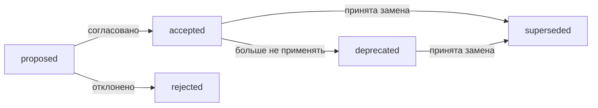
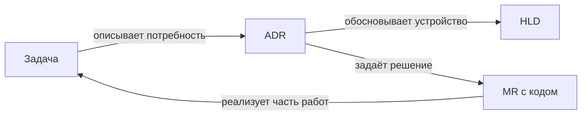

# 1. Основные понятия

## 1.1. Назначение ADR

**ADR — Architecture Decision Record, запись архитектурного решения:** короткий документ, сохраняющий выбор команды, обстоятельства его принятия и последствия.

Код показывает, **как система работает сейчас**, но часто не объясняет причину. Например, отправка уведомлений через очередь может выглядеть избыточной, пока неизвестно, что внешний провайдер периодически недоступен и не должен задерживать оформление заказа.

Полезная запись связывает несколько вещей:

| Часть | Пример |
|---|---|
| Контекст | Отправка письма иногда занимает десятки секунд |
| Решение | Отправлять подтверждение заказа асинхронно |
| Альтернатива | Ждать отправки внутри HTTP-запроса |
| Причина | Создание заказа не должно зависеть от доступности почты |
| Последствия | Нужны надёжная постановка задания, повторы и наблюдение |

**ADR объясняет выбор в конкретных условиях**, а не доказывает превосходство подхода вообще. Именно сохранение мотивов позволяет будущему разработчику осмысленно принять или пересмотреть решение. [Исходное описание Michael Nygard](https://cognitect.com/blog/2011/11/15/documenting-architecture-decisions)

Одна запись обычно посвящена одному значимому решению. Документ «Вся архитектура магазина» быстро становится сложным для обсуждения и сопровождения.

## 1.2. Архитектурное решение и деталь реализации

**Архитектурно значимое решение влияет на структуру системы, её гарантии, зависимости, интерфейсы или способы разработки.**

| Скорее требует ADR | Обычно достаточно кода или описания изменения |
|---|---|
| Отдельная БД для платёжного сервиса | Название локальной переменной |
| Асинхронное подтверждение заказа | Выделение небольшого приватного метода |
| Гарантия идемпотентности оплаты | Текст сообщения об успешном сохранении |
| Стандарт авторизации между сервисами | Перестановка условий без изменения поведения |
| Выбор основной БД | Добавление обычного поля по действующим правилам |

**Значимость зависит от контекста, а не от размера изменения.** Одна настройка срока хранения может определить возможность восстановления истории. Большой рефакторинг, сохраняющий архитектурные границы, может не требовать нового ADR.

Практические признаки значимости: решение затрагивает несколько компонентов, ограничивает будущие изменения, влияет на эксплуатацию или дорого отменяется.

Но сложность отмены — не обязательное условие. Обратимый выбор тоже стоит записать, если без контекста его легко ошибочно пересмотреть. Такие области решений перечислены в [рекомендациях AWS](https://docs.aws.amazon.com/prescriptive-guidance/latest/architectural-decision-records/adr-process.html).

ADR не нужен для каждого коммита: избыточные записи затрудняют поиск действительно важных договорённостей.

## 1.3. Неизменяемость после принятия

**Принятый ADR сохраняют как историческую запись того, что команда решила в определённый момент.** Если выбор изменился, создают новый ADR и связывают его с предыдущим.

Например:

```text
ADR-0004: Отправлять письма синхронно
Статус: Superseded by ADR-0012

ADR-0012: Отправлять письма через очередь
Статус: Accepted
Заменяет: ADR-0004
```

**Superseded означает «заменён новым решением».** Старый документ остаётся доступным: он объясняет прежний код, миграцию и причины перехода. Такой жизненный цикл описан в [процессе ADR AWS](https://docs.aws.amazon.com/prescriptive-guidance/latest/architectural-decision-records/adr-process.html).

Неизменяемость относится прежде всего к смыслу решения и его обоснованию. Обновление статуса, ссылки на замену или исправление опечатки допустимы по соглашению команды. **Нельзя незаметно переписать прошлое так, будто новое решение действовало всегда.**

Черновик до принятия можно обсуждать и менять. При пересмотре полезно указать, что изменилось: нагрузка, требования, стоимость или знания команды.

Принятый ADR также не доказывает, что реализация уже завершена. План внедрения и фактическое состояние нужно различать.

## 1.4. Журнал решений проекта

**Decision log — журнал решений — упорядоченная коллекция ADR с их статусами и связями.** Он позволяет восстановить развитие архитектуры, не перечитывая историю всех обсуждений.

Пример организации:

```text
docs/adr/
  README.md
  0001-use-postgresql.md
  0002-separate-payment-data.md
  0003-publish-events-through-outbox.md
```

В индексе удобно показывать номер, название, дату, статус и заменяющую запись. Идентификаторы сохраняют стабильными, чтобы ссылки из кода, задач и других ADR продолжали работать.

**Журнал содержит историю, поэтому не каждый его документ описывает действующее правило.** Перед применением решения проверяют статус и связанные изменения.

Набор ADR помогает новым участникам понять ограничения проекта. Но он не заменяет актуальную схему компонентов, API-документацию или инструкцию восстановления: у этих документов другие задачи.

**Запомнить:** ADR сохраняет значимый выбор и его причины; новые обстоятельства порождают новую запись, а журнал связывает решения в понятную историю архитектуры.

# 2. Шаблоны

## 2.1. Шаблон Майкла Найгарда

**Шаблон Michael Nygard — компактная структура ADR, сосредоточенная на обстоятельствах, выборе и его последствиях.** Помимо названия, он включает четыре основные части:

| Часть | Что записывать |
|---|---|
| **Context — контекст** | Проблему, ограничения и противоречащие требования |
| **Decision — решение** | Что именно команда выбирает |
| **Status — статус** | Предложено, принято, заменено другим решением |
| **Consequences — последствия** | Выигрыши, ограничения и новые обязанности |

Контекст описывают нейтрально. Вместо «синхронная отправка писем ужасна» — «недоступность почтового провайдера задерживает ответ оформления заказа».

Решение формулируют прямо: «Отправляем подтверждение заказа асинхронно через очередь». В последствиях указывают не только быстрый ответ, но и необходимость повторов, мониторинга и защиты от дублей.

**В исходном шаблоне нет отдельного обязательного раздела альтернатив.** Чтобы сохранить отвергнутые варианты, их можно описать в контексте или добавить небольшой раздел по соглашению команды. [Исходное описание Найгарда](https://cognitect.com/blog/2011/11/15/documenting-architecture-decisions)

Шаблон удобен для решений с понятным контекстом. При сложном сравнении вариантов краткость может скрыть важную аргументацию.

## 2.2. MADR: варианты и критерии

**MADR — Markdown Architectural Decision Records — более структурированный формат**, явно выделяющий основания выбора и рассмотренные варианты. [Проект MADR](https://adr.github.io/madr/)

В полном шаблоне есть:

- **Context and Problem Statement:** контекст и проблема;
- **Decision Drivers:** требования и ограничения, определяющие выбор;
- **Considered Options:** рассмотренные варианты;
- **Decision Outcome:** выбранный вариант и обоснование;
- последствия;
- плюсы и минусы вариантов;
- **Confirmation:** как проверить соответствие реализации решению.

Confirmation — не голосование за ADR, а способ подтвердить выполнение решения: проверкой кода, тестом или измерением. Часть разделов можно опускать; проект предоставляет и сокращённые шаблоны. [Структура MADR](https://adr.github.io/madr/decisions/adr-template.html)

Например, сравним отправку уведомлений:

| Вариант | Плюс | Минус |
|---|---|---|
| В исходном HTTP-запросе | Простая последовательность | Ответ зависит от почтового провайдера |
| Фоновая задача с надёжным хранением | Отдельные повторы и темп обработки | Нужно сопровождать обработку заданий |
| Внешняя платформа уведомлений | Часть эксплуатации делегирована | Стоимость и зависимость от поставщика |

**Аргументы оценивают относительно одинаковых критериев:** задержки оформления, допустимости потери, стоимости и возможностей команды. Количество плюсов не определяет победителя: одно обязательное требование может исключить вариант.

Типичная ошибка — заполнить все заголовки общими словами. Формальная полнота не заменяет свидетельства: измерения, ограничения и ссылки на проверенные предположения.

## 2.3. Y-statement: краткое обоснование

**Y-statement — короткая формула, связывающая контекст, проблему, выбор, альтернативы, выгоду и принятую цену.** Она помогает уместить суть решения в одно связное высказывание.

Структура в переводе:

> В контексте …, столкнувшись с …, мы выбираем … вместо …, чтобы получить …, принимая … .

Пример:

> В процессе оформления заказа, учитывая нестабильную задержку почтового провайдера, выбираем надёжную фоновую отправку вместо отправки внутри HTTP-запроса, чтобы не задерживать покупателя, принимая необходимость повторов, мониторинга и возможную задержку письма.

**Сильная сторона формулы — обязательное указание компромисса.** Она заставляет объяснить не только желаемый эффект, но и расходы выбранного подхода. Именно такой баланс описывает автор Y-statements Olaf Zimmermann. [Описание Y-statement](https://medium.com/olzzio/y-statements-10eb07b5a177)

Формат полезен для небольшого решения, вступления к полному ADR или его краткого представления на обсуждении.

**Одна фраза не заменяет все метаданные ADR.** Номер, статус, дата и ссылки могут храниться рядом. Если предложение становится нечитаемым, его разбивают на несколько предложений или используют более подробный шаблон.

## 2.4. Выбор шаблона для команды

**Выбирать стоит минимальный шаблон, который сохраняет необходимое обоснование и действительно используется.**

| Шаблон | Когда удобен | Основной риск |
|---|---|---|
| Найгарда | Нужна короткая запись решения | Альтернативы могут остаться неявными |
| MADR | Важно сравнить несколько вариантов | Избыточное заполнение разделов |
| Y-statement | Нужно быстро выразить суть | Недостаточно подробностей для сложного выбора |

Для команды магазина выберем **сокращённый MADR**: статус и дата, контекст, критерии, варианты, решение с причиной и последствия. Допущение: команда регулярно выбирает способы интеграции, хранения и обеспечения надёжности, где сравнение альтернатив важно.

Причина выбора — явные критерии и отвергнутые варианты при умеренном объёме документа. Для значимых рисков добавляем способ проверки, для простых решений сокращаем описание.

**Это адаптация MADR, а не требование заполнять полный шаблон каждый раз.** Y-statement можно использовать как первое предложение решения, не заводя отдельный процесс документации.

Шаблон и обязательный минимум фиксируют в репозитории. После нескольких реальных ADR проверяют, какие поля помогают обсуждению, а какие заполняются механически. Определяющий критерий — сможет ли будущий участник восстановить логику выбора.

**Запомнить:** Найгард даёт компактную основу, MADR делает сравнение явным, Y-statement сжимает обоснование; шаблон должен сохранять причины и компромиссы без лишней бюрократии.

# 3. Содержание ADR

## 3.1. Контекст: проблема, ограничения и влияющие силы

**Контекст объясняет, почему решение требуется именно сейчас и в каких условиях его принимают.** Читатель должен понять проблему, даже если не участвовал в обсуждении.

Полезно различать:

| Элемент | Пример |
|---|---|
| Проблема | Оформление заказа задерживается из-за отправки письма |
| Требование | Недоступность почты не должна мешать созданию заказа |
| Ограничение | У команды нет ресурсов на сопровождение нового брокера |
| Предположение | Допустима задержка письма до двух минут |
| Свидетельство | Замеры показали: отправка письма занимает большую часть времени ответа |

**Forces — влияющие силы — требования и обстоятельства, которые тянут решение в разные стороны.** Например, нужен быстрый ответ, но письмо нельзя терять; требуется надёжная очередь, но желательно сократить эксплуатационные расходы.

Контекст описывают нейтрально: «провайдер отвечает нестабильно», а не «текущая архитектура плохая». Такой подход соответствует исходному описанию ADR. [Michael Nygard](https://cognitect.com/blog/2011/11/15/documenting-architecture-decisions)

**Отделяйте факты от допущений.** Если задержка письма согласована только внутри команды, нельзя выдавать её за утверждённое бизнес-требование.

Также обозначают границу решения: меняем отправку подтверждений заказа, а не всю систему уведомлений. Иначе обсуждение легко расширяется до несвязанного перепроектирования.

## 3.2. Варианты, включая «ничего не менять»

**Рассмотренные варианты — реальные способы решить проблему или принять её последствия.** Их описывают достаточно конкретно, чтобы сравнить одинаковую область ответственности.

Для отправки писем:

| Вариант | Содержание |
|---|---|
| Ничего не менять | Продолжать отправку внутри запроса оформления |
| Ограничить ожидание | Сохранить синхронную отправку с конечным тайм-аутом |
| Надёжная фоновая обработка | Сохранять задание и отправлять письмо отдельно |
| Внешняя платформа | Передать обработку специализированному поставщику |

**«Ничего не менять» — базовая линия сравнения.** У неё нет стоимости миграции, но остаются текущие задержки и отказы. Это полноценный вариант, а не обязательный проигравший.

Варианты должны быть сопоставимы по гарантиям. Запустить поток в памяти и использовать надёжную очередь — разные решения: первое может потерять работу при перезапуске.

Не нужно включать заведомо неподходящие технологии ради количества. Если вариант исключён обязательным ограничением, достаточно записать причину.

**Для отвергнутого варианта сохраняют основание отказа.** Формулировка «сложно» слабее, чем «потребует нового кластера и дежурства, которых сейчас нет».

## 3.3. Сравнение по явным критериям

**Критерии связывают выбор с требованиями, а не с предпочтениями участников.** В MADR такие основания выделяются как Decision Drivers. [Шаблон MADR](https://adr.github.io/madr/decisions/adr-template.html)

Сначала определяют обязательные условия, затем сравнивают компромиссы:

| Критерий | Ничего не менять | Ограничить ожидание | Надёжный фон |
|---|---|---|---|
| Заказ не зависит от почты | Не выполняется | Выполняется при корректной обработке ошибки | Выполняется после сохранения задания |
| Восстановление отправки после сбоя | Нет отдельного механизма | Нет отдельного механизма | Предусмотрено |
| Изменения приложения | Минимальные | Небольшие | Обработчик, статусы, повторы |
| Эксплуатационная стоимость | Текущая | Почти текущая | Зависит от доступной инфраструктуры |

Таблица условная: конкретные гарантии подтверждают проектированием и испытаниями.

**Обязательное условие нельзя компенсировать суммой второстепенных плюсов.** Если потеря задания недопустима, удобство реализации не делает ненадёжный вариант подходящим.

Неизвестное помечают явно: «требуется прототип» или «стоимость не рассчитана». Числовые оценки сопровождают условиями измерения; баллы без объяснений создают ложную точность.

После сравнения записывают сам вывод: «Выбираем надёжную фоновую обработку, потому что она выполняет требования независимости оформления и восстановления отправки». Одна таблица не должна заставлять читателя угадывать решение.

## 3.4. Последствия и новые риски

**Последствия описывают, как изменится система после принятия решения:** что улучшится, что усложнится и какие обязательства появятся.

Для фоновой отправки:

| Категория | Последствие |
|---|---|
| Положительное | Задержка почтового провайдера не удерживает запрос оформления |
| Отрицательное | Письмо приходит позже, а результат отправки отслеживается отдельно |
| Новая обязанность | Поддерживать повторы, очередь ошибок и наблюдение |
| Новый риск | Накопление заданий может превысить допустимый срок доставки |
| Ограничение риска | Контроль возраста заданий, ограничение нагрузки и порядок восстановления |

**Последствие и риск различаются.** Дополнительный обработчик — неизбежная часть выбранной структуры. Его отказ и незаметное накопление заданий — возможный неблагоприятный сценарий.

Для существенного риска полезно указать владельца, способ обнаружения и реакцию. Но ADR не должен превращаться в подробную эксплуатационную инструкцию: достаточно ссылки на неё.

Не ограничивайтесь достоинствами и не обещайте абсолютов вроде «теперь письма никогда не теряются». Укажите границы гарантий и оставшиеся неопределённости.

**Последствия одного решения становятся контекстом следующего.** Рост очереди, новые требования к срокам или стоимость сопровождения могут дать основание пересмотреть выбор.

**Запомнить:** хороший ADR связывает проверяемую проблему, реальные альтернативы, явные критерии и честные последствия — так причина выбора остаётся понятной без автора.

# 4. Жизненный цикл

## 4.1. Статусы ADR

**Статус показывает, какое место решение занимает в договорённостях команды.** Перечень и точные значения статусов закрепляют в проекте: единого обязательного жизненного цикла для всех ADR нет.

Практичное соглашение:

| Статус | Значение |
|---|---|
| **proposed — предложено** | Решение обсуждается и может изменяться |
| **accepted — принято** | Уполномоченные участники согласовали решение |
| **rejected — отклонено** | Предложение рассмотрено, но не принято; причина сохранена |
| **deprecated — выведено из рекомендаций** | Прежде принятое решение больше не следует применять для новых случаев |
| **superseded — заменено** | Принято новое решение, заменяющее прежнее |

**Deprecated и superseded полезно различать:** первое сообщает о прекращении применения, второе указывает конкретную замену. Например, интеграция с закрываемым поставщиком может стать deprecated ещё до выбора нового.



Это пример жизненного цикла, а не обязательная последовательность.

**Accepted означает принятие решения, а не завершение реализации.** Прогресс внедрения отслеживают отдельно — например, задачами и ссылкой на план миграции. Исходное описание ADR также предусматривает статусы предложения, принятия и замены. [Michael Nygard](https://cognitect.com/blog/2011/11/15/documenting-architecture-decisions)

## 4.2. Замена новым ADR

**Пересмотр принятого решения оформляют новой записью, сохраняя прежнее обоснование.** Это позволяет понять, какие обстоятельства изменились.

Например:

```text
ADR-0007: Отправлять письма внутри запроса
Статус: superseded
Заменён: ADR-0021

ADR-0021: Отправлять письма через надёжную очередь
Статус: accepted
Заменяет: ADR-0007
Причина: задержки провайдера нарушают бюджет оформления заказа
```

В новом ADR описывают новый контекст, варианты и последствия. В прежнем обновляют статус и ссылку, но не переписывают старые аргументы под нынешние знания. Такой подход сохраняет историю решений. [Жизненный цикл ADR в AWS](https://docs.aws.amazon.com/prescriptive-guidance/latest/architectural-decision-records/adr-process.html)

**Пока замена только proposed, прежнее решение обычно остаётся действующим.** Если его нужно прекратить немедленно, это оформляют явно.

При частичной замене указывают область: например, новый подход касается подтверждений заказа, а восстановление пароля пока работает по прежнему решению.

Опечатки, неработающие ссылки и служебные метаданные можно исправлять по правилам команды. Изменение смысла или обязательств требует нового ADR либо явно согласованного процесса дополнения.

## 4.3. Нумерация и заголовки

**Стабильный номер позволяет ссылаться на решение независимо от его статуса.** Для небольшого проекта подходит последовательная нумерация:

```text
docs/adr/
  0001-use-postgresql-for-orders.md
  0002-isolate-payment-data.md
  0003-publish-order-events-through-outbox.md
```

Номера не переиспользуют после отклонения или замены. Пропуск в последовательности обычно менее опасен, чем изменение существующих ссылок. Последовательные номера предложены и в исходном подходе Найгарда.

**Заголовок должен объяснять предмет выбора.** «Использовать outbox для событий заказов» полезнее, чем «Интеграция» или «Улучшение надёжности».

При этом номер не обозначает приоритет, версию приложения или обязательный порядок реализации. Для замены создают новый номер, а не файл `0003-v2`.

Если два автора параллельно выбрали один номер, конфликт разрешают до принятия и обновляют ссылки. В больших организациях возможны отдельные последовательности по проектам, но область идентификатора должна быть понятной.

## 4.4. Дата, авторы и участники

**Метаданные объясняют, когда и кем решение предложено, обсуждено и принято.** Автор текста не обязательно является единственным принимающим решение.

Пример:

```text
Статус: accepted
Создан: 2026-11-05
Принят: 2026-11-05
Автор: разработчик команды заказов
Участники: команды заказов, платформы и поддержки
Приняли решение: ответственные представители заказов и платформы
Обсуждение: ссылка на PR
```

Даты создания и принятия различают, если обсуждение длительное. Используют однозначный формат `YYYY-MM-DD`.

**Участие в обсуждении не означает согласие или право утверждения.** Полезно разделять автора, консультировавших участников, принимающих решение и тех, кого нужно уведомить. Подобное разделение ролей поддерживает [MADR](https://adr.github.io/madr/).

Существенное возражение и способ его разрешения кратко сохраняют в ADR. Необязательно копировать всю переписку: документ должен быть понятен самостоятельно, а ссылка на обсуждение предоставляет подробности.

**Запомнить:** статус отражает судьбу решения, новый ADR сохраняет историю пересмотра, стабильные номера обеспечивают ссылки, а метаданные делают ответственность явной.

# 5. Процесс принятия

## 5.1. Кто предлагает, обсуждает и утверждает

**Процесс принятия ADR определяет ответственность: кто готовит предложение, чьё мнение необходимо и кто принимает окончательное решение.** Эти роли могут совмещаться, но должны быть понятны заранее.

| Роль | Ответственность |
|---|---|
| **Автор / владелец ADR** | Описывает проблему, собирает доказательства, обновляет предложение |
| **Участники обсуждения** | Проверяют предположения, варианты и последствия |
| **Принимающие решение** | Утверждают или отклоняют выбор в пределах своих полномочий |
| **Уведомляемые участники** | Узнают о решении и учитывают его в работе |

Например, разработчик предлагает outbox для событий заказов. Команда заказов проверяет бизнес-сценарий, платформа — эксплуатационные последствия, а представители этих команд принимают решение.

**Автор документа не получает автоматически полномочия единолично утвердить его.** При этом привлекать архитектурный комитет к каждому локальному решению обычно избыточно.

Состав участников зависит от влияния: изменение платёжного контракта требует владельца оплаты, а решение о персональных данных — соответствующих специалистов. Назначение владельца ADR и явное обсуждение входят в [рекомендации AWS](https://docs.aws.amazon.com/prescriptive-guidance/latest/architectural-decision-records/adr-process.html).

## 5.2. Ревью через merge request

**Merge request, MR — предложение включить изменения в основную ветку репозитория.** Он предоставляет место для просмотра различий, комментариев и согласования. В GitLab возможность утверждения зависит от настроек проекта. [Документация merge requests](https://docs.gitlab.com/user/project/merge_requests/)

Практический порядок:

1. Создать ADR со статусом `proposed`.
2. Открыть MR, указать проблему, участников и срок обсуждения.
3. Проверить контекст, альтернативы, критерии и риски.
4. Обновить текст по результатам обсуждения.
5. Явно зафиксировать итог: `accepted`, `rejected` либо необходимость доработки.
6. Сохранить запись и обновить журнал решений.

**Комментарии не должны быть единственным местом хранения обоснования.** Существенные выводы переносят в ADR, иначе будущему читателю придётся восстанавливать решение по переписке.

Слияние файла само по себе не означает принятия решения. Команда может хранить `proposed` в основной ветке; тогда утверждение оформляют отдельным изменением статуса. Отклонённый ADR также полезно сохранить вместе с причиной.

Для важного выбора MR лучше открыть до дорогой реализации. Прототип допустим как исследование, но уже написанный код не должен превращать обсуждение в формальность.

## 5.3. Срок обсуждения и несогласие

**Timebox — заранее ограниченное время обсуждения.** Он помогает получить решение, а не бесконечно уточнять документ.

Например, команда может выделить три рабочих дня на комментарии и отдельную встречу для оставшихся вопросов. Это локальное соглашение, а не универсальный срок.

**Истечение срока не означает автоматического согласия.** Если обязательный участник не ответил или ключевая гипотеза не проверена, владелец организует эскалацию, исследование либо явно переносит дату.

Возражения полезно формулировать проверяемо:

```text
Возражение: восстановление из резервной копии не проверено.
Риск: выбранная конфигурация может не уложиться в RTO.
Следующий шаг: провести восстановление на тестовой площадке.
```

Важно различать:

| Вид замечания | Реакция |
|---|---|
| Нарушено обязательное требование | Исправить предложение или пересмотреть требование |
| Не хватает доказательств | Провести проверку |
| Есть другой допустимый компромисс | Сравнить по критериям и принять решение |

**Принятие не обязательно требует единогласия**, если полномочия и обязательные согласования определены. Сохраняют существенное несогласие, ответ на него и принятый остаточный риск.

Если решение условное, условия формулируют явно: например, «допускается только пилот до подтверждения восстановления». Нельзя скрывать это за безусловным `accepted`.

## 5.4. Связь с задачей, HLD и кодом

**ADR объясняет причину выбора, задача организует работу, а HLD — High-Level Design — описывает устройство решения на верхнем уровне.** Изменения кода реализуют выбранный подход.



HLD может включать границы компонентов, потоки данных и взаимодействия. ADR связывают с соответствующим разделом, не копируя всю схему в каждую запись.

В ADR полезны ссылки на исходную задачу, результаты прототипа, HLD и план внедрения. В MR реализации — ссылка на применяемое решение и объяснение существенных отклонений.

**Accepted не означает implemented — «реализовано».** Решение может внедряться несколькими задачами. Их завершение проверяют отдельно, включая эксплуатационные требования и миграцию.

Если реализация требует другого архитектурного компромисса, решение пересматривают явно. Обычные локальные детали достаточно объяснить в коде или MR.

**Запомнить:** назначь ответственных, обсуди ADR в ограниченный срок, сохрани аргументы и несогласие; принятие решения и его реализация должны быть связаны, но отслеживаться отдельно.

# 6. Хранение и инструменты

## 6.1. Markdown в репозитории

**Docs as code — подход, при котором документацию хранят и изменяют по тем же правилам, что и код:** в Git, с историей изменений и ревью.

Для ADR подходит отдельный каталог:

```text
README.md
docs/
  adr/
    README.md
    template.md
    0001-use-postgresql.md
    0002-publish-order-events-through-outbox.md
```

Корневой README содержит ссылку на журнал, `template.md` — принятый шаблон, а остальные файлы — решения.

**Хранение рядом с кодом помогает согласовывать изменения реализации и архитектурных договорённостей.** Но оно не обновляет документы автоматически: ответственность остаётся у команды.

Для решения одного сервиса естественен его репозиторий. Общие решения нескольких сервисов можно хранить в отдельном архитектурном репозитории, добавляя ссылки из затронутых проектов.

Нужно выбрать **единственный авторитетный экземпляр ADR**. Если документ одновременно редактируется в wiki и Git, копии быстро расходятся. Опубликованный сайт удобнее считать представлением исходных Markdown-файлов.

Ограничение подхода — доступность для участников, редко работающих с Git. Им может понадобиться удобный просмотр через внутренний сайт документации.

## 6.2. `adr-tools` и `log4brains`

**Инструменты ADR автоматизируют создание и навигацию, но не принимают архитектурные решения.**

| Инструмент | Основное назначение |
|---|---|
| **adr-tools** | Работа с Markdown-записями через командную строку |
| **log4brains** | Создание ADR и публикация просматриваемой базы решений с поиском |

В `adr-tools` каталог по умолчанию — `doc/adr`, но его можно задать при инициализации. После установки доступны команды:

```sh
adr init docs/adr
adr new Use outbox for order events
adr new -s 2 Replace the previous integration approach
```

Последняя команда создаёт решение, заменяющее ADR № 2, и обновляет связь в прежней записи. Номер приведён условно. [Документация adr-tools](https://github.com/npryce/adr-tools)

**log4brains** поддерживает локальный предпросмотр, создание записей и сборку статического сайта. Документация описывает поиск и навигацию по времени:

```sh
log4brains init
log4brains adr new
log4brains preview
log4brains build
```

Команды предполагают установленный инструмент. Его можно использовать и для Rails-проекта: Node.js нужен для работы самого инструмента, а не приложения. [Документация log4brains](https://github.com/thomvaill/log4brains)

**Инструменты используют разные соглашения.** `adr-tools` создаёт нумерованные файлы, а log4brains не требует обязательной последовательной нумерации. Перед внедрением проверяют совместимость с существующим шаблоном и способом хранения.

Для небольшого журнала достаточно редактора и Git. Дополнительный генератор сайта оправдан, если улучшает поиск и доступ, компенсируя сопровождение зависимостей и публикации.

## 6.3. Индекс ADR со статусами

**Индекс — точка входа в журнал решений, позволяющая быстро найти нужный ADR и определить его актуальность.**

Пример содержимого `docs/adr/README.md`:

| ID | Решение | Статус | Связь |
|---|---|---|---|
| 0001 | Использовать PostgreSQL для заказов | accepted | — |
| 0002 | Публиковать события прямым вызовом | superseded | Заменён ADR-0005 |
| 0005 | Публиковать события через outbox | accepted | Заменяет ADR-0002 |
| 0006 | Выделить отдельный поисковый кластер | proposed | — |

В рабочем индексе названия и связи делают ссылками на файлы. Для большого проекта можно добавить область: платежи, хранение, интеграции.

**Источником статуса желательно считать сам ADR**, а индекс обновлять вместе с ним или генерировать. Две независимо редактируемые версии статуса создают противоречия.

В CI полезно проверять существование файлов, уникальность идентификаторов, допустимые статусы и корректность ссылок на замену.

Индекс не должен показывать только действующие решения: отклонённые и заменённые записи объясняют историю. При этом визуально их нужно отличать от принятых.

## 6.4. Поиск и доступ для новых участников

**Доступность ADR означает, что человек может найти решение по своей проблеме, не зная заранее его номера.**

Для этого нужны:

- ссылка из README проекта и материалов onboarding — введения в работу;
- понятные заголовки с предметом решения;
- единая терминология и пояснение сокращений;
- поиск по полному тексту;
- ссылки из HLD, задач и связанных ADR.

Например, запись «Использовать outbox для публикации событий заказов» найдётся по словам «outbox», «публикация» и «заказы». Заголовок «Новая интеграция» почти не помогает.

**Публикация должна сохранять права доступа исходной документации.** Внутренний репозиторий не означает, что сгенерированный сайт автоматически закрыт для посторонних.

Новому участнику полезно предложить несколько действующих решений для начала и объяснить статусы. Чтение журнала подряд не всегда эффективно: сначала нужна карта системы, затем причины интересующих ограничений.

**Запомнить:** Markdown и Git сохраняют историю, инструменты упрощают работу, индекс показывает актуальность, а понятные названия и доступный поиск превращают журнал в используемую документацию.

# 7. Типичные ошибки

## 7.1. Решение без контекста и альтернатив

**Решение без обоснования сохраняет результат выбора, но теряет знания, необходимые для его оценки.**

Например:

> Используем очередь для отправки писем.

Через полгода непонятно: очередь понадобилась из-за нагрузки, задержек провайдера, требований восстановления или принятого стандарта?

Более полезная запись:

> Отправка писем задерживает оформление заказа при медленном ответе провайдера. Выносим её в надёжную фоновую обработку. Синхронный вызов с тайм-аутом рассмотрен, но сам по себе не обеспечивает последующую отправку. Принимаем задержку письма и необходимость сопровождения повторов.

**Контекст должен объяснять необходимость решения, а альтернативы — причину конкретного выбора.** Необязательно перечислять все существующие технологии. Достаточно реальных вариантов, включая сохранение текущего подхода.

Проверка качества проста: сможет ли новый участник понять, при каком изменении условий решение стоит пересмотреть? Если нет, вероятно, потеряны ограничения или критерии.

В исходном описании ADR именно сохранение мотивов защищает от слепого принятия и необоснованной отмены решений. [Michael Nygard](https://cognitect.com/blog/2011/11/15/documenting-architecture-decisions)

## 7.2. Подгонка обоснования под выбранный вариант

**Подгонка — описание вариантов и критериев так, чтобы заранее предпочитаемое решение неизбежно победило.**

Характерные признаки:

| Признак | Проблема |
|---|---|
| Выбранный вариант описан подробно, остальные — одним словом | Сравниваются разные уровни проработки |
| Для альтернатив указаны только недостатки | Скрывается реальный компромисс |
| Критерии появились после выбора технологии | Они могут отражать особенности фаворита вместо требований |
| Предположения записаны как факты | Вывод выглядит доказанным без проверки |
| Единственный довод — «уже реализовано» | Потраченные усилия подменяют пригодность решения |

Например, фраза «выбираем брокер X, потому что он современный» не объясняет выполнение требований магазина. Нужны конкретные основания: гарантии доставки, доступная поддержка, стоимость и результаты проверки.

**Документировать решение после реализации допустимо**, если честно обозначить ретроспективный характер записи. Нельзя изображать обсуждение и измерения, которых не было.

Полезная защита — заранее согласовать обязательные требования, сравнивать варианты одинаково и отдельно отмечать неизвестное. При этом не требуется проводить дорогое исследование, если ограничение действительно однозначно исключает альтернативу.

Цель ADR — объяснить выбор и его пределы, а не доказать, что автор никогда не ошибается.

## 7.3. Слишком общие и непроверяемые ADR

**Непроверяемый ADR не позволяет определить, соответствует ли реализация принятому решению.**

Например:

> Используем масштабируемую архитектуру и обеспечиваем надёжную доставку.

Это пожелание. Оно не определяет границу, механизм или необходимые гарантии.

Более конкретный вариант:

> Для событий подтверждённых заказов сохраняем outbox-запись вместе с заказом в одной транзакции. Публикуем её с подтверждением брокера. Потребитель обрабатывает повтор одного `event_id` без повторного бизнес-эффекта.

Теперь можно проверить:

- атомарно ли сохраняются заказ и событие;
- восстанавливается ли публикация после перезапуска;
- что происходит при повторной доставке;
- обнаруживается ли длительное ожидание отправки.

**Проверяемость не требует перечислить каждый класс и метод.** ADR фиксирует архитектурные обязательства, а подробности оставляет коду, HLD и эксплуатационным инструкциям.

Для значимого решения полезно добавить способ подтверждения: ревью границ, тест отказа или нагрузочное измерение. В MADR для этого предусмотрен раздел **Confirmation**. [Шаблон MADR](https://adr.github.io/madr/decisions/adr-template.html)

Избегайте абсолютов вроде «система всегда доступна». Указывайте условия, допустимые отказы и измеримые цели там, где они действительно нужны.

## 7.4. ADR на каждую мелочь

**Избыточная детализация журнала снижает его полезность:** важные ограничения теряются среди локальных изменений.

| Изменение | Обычно подходящее место |
|---|---|
| Выбор основной БД | ADR |
| Правила совместимости событий между командами | ADR |
| Переименование приватного метода | Код и MR |
| Исправление опечатки в сообщении | MR |
| Добавление обычного поля по действующим правилам | Миграция и задача |

**Значимость определяется последствиями, а не количеством строк.** Одно изменение срока хранения может лишить систему возможности восстановления и заслуживать ADR.

Перед созданием записи полезно спросить:

- Ограничивает ли решение дальнейшее устройство системы?
- Затрагивает ли оно несколько компонентов или команд?
- Будет ли причина выбора непонятна из кода?
- Есть ли существенный компромисс, который важно сохранить?

Не требуется положительный ответ на все вопросы.

Обратная ошибка — не фиксировать значимый выбор, потому что его реализовали небольшой настройкой. Несколько тесно связанных деталей можно объединить вокруг одного решения, но документ «Все решения по инфраструктуре» снова станет непрозрачным.

**Запомнить:** ADR должен объяснять честный, значимый и проверяемый выбор; отсутствие контекста, искусственное обоснование, общие лозунги и мелкие записи превращают журнал в формальность.

