# 1. Назначение диаграмм

## 1.1. Вопрос и аудитория

**Архитектурная диаграмма — визуальное представление выбранного аспекта системы.** Она помогает ответить на конкретный вопрос: какие части существуют, как взаимодействуют, где выполняются или от чего зависят.

Перед построением сформулируй:

- **Вопрос:** что читатель должен понять?
- **Аудиторию:** кто читает и какие знания у него уже есть?
- **Границы:** какую систему, сценарий или окружение показываем?

Например, один интернет-магазин можно представить по-разному:

| Аудитория | Вопрос | Что показать |
|---|---|---|
| Владелец продукта | Какие участники обеспечивают оформление заказа? | Покупатель, магазин, платёжная система, доставка |
| Разработчик | Кто инициирует оплату и обрабатывает отказ? | Взаимодействие компонентов в выбранном сценарии |
| Инженер эксплуатации | Что перестанет работать при отказе узла? | Размещение экземпляров приложения и зависимостей |

Название «Архитектура магазина» слишком широкое. Название «Внешние интеграции магазина при оформлении заказа» задаёт понятные ожидания.

**Диаграмма должна читаться без устного объяснения:** нужны заголовок, понятные названия элементов, подписи связей и при необходимости легенда. Также полезно указать, изображено текущее или планируемое состояние.

Типичная ошибка — начинать с рисования всех известных компонентов, не определив вопрос.

## 1.2. View и viewpoint

В ISO/IEC/IEEE 42010 различаются **view — представление архитектуры** и **viewpoint — правила построения и интерпретации такого представления**. Представление раскрывает определённые вопросы заинтересованных сторон; viewpoint задаёт, какие вопросы рассматриваются и какими средствами их описывать. [ISO/IEC/IEEE 42010:2022, определения 3.7–3.8](https://cdn.standards.iteh.ai/samples/74393/fc7b7f103d8446a4b87a3261e31370d3/ISO-IEC-IEEE-42010-2022.pdf)

Пример для эксплуатации магазина:

| Понятие | Пример |
|---|---|
| **Viewpoint** | Показываем размещение приложения по узлам и зонам, число экземпляров и сетевые соединения |
| **View** | Конкретное представление production: два экземпляра приложения, рабочие процессы фоновых задач, БД и брокер с их размещением |

Проще: **viewpoint задаёт способ смотреть, view показывает конкретную систему этим способом**.

View не обязательно равен одной диаграмме: представление может объединять несколько диаграмм, таблицы и пояснения. И наоборот, выбор `flowchart` или `sequenceDiagram` сам по себе ещё не определяет viewpoint: это лишь способ графической записи.

Типичная ошибка — использовать одинаковые прямоугольники, но не объяснять, обозначают они модули кода, запущенные процессы или серверы.

## 1.3. Модель представлений 4+1

**4+1 — модель описания архитектуры через четыре взаимосвязанных представления и ключевые сценарии.** Филипп Крухтен предложил её, чтобы рассматривать разные архитектурные вопросы отдельно. [Исходная работа Крухтена](https://arxiv.org/abs/2006.04975)

| Представление | На какой вопрос отвечает | Пример для магазина |
|---|---|---|
| **Логическое — logical** | Какие основные абстракции и связи обеспечивают функциональность? | Заказ, платёж, резерв товара и отношения между ними |
| **Процессное — process** | Как устроены выполнение, параллелизм и синхронизация? | Веб-процессы принимают запросы, фоновые процессы обрабатывают задания |
| **Разработки — development** | Как организован исходный код и его зависимости? | Модули заказов, платежей и доставки |
| **Физическое — physical** | На каких вычислительных узлах выполняется ПО? | Размещение процессов приложения, БД и брокера |
| **Сценарии — +1** | Как элементы представлений совместно выполняют важный сценарий? | Оформление заказа, отказ оплаты, повтор обработки |

**«+1» связывает и проверяет остальные представления:** выбранный сценарий помогает обнаружить недостающие взаимодействия или противоречия.

Процессное представление здесь касается выполнения ПО, а не только последовательности бизнес-шагов. Представление разработки описывает организацию кода, а не этапы работы команды.

4+1 не требует рисовать ровно пять диаграмм. Выбирай представления, которые помогают решить задачу; одному представлению иногда нужны несколько схем.

## 1.4. Один уровень абстракции

**Уровень абстракции — степень детализации описания.** На обзорной диаграмме магазин может быть одним элементом, на подробной — набором компонентов.

Для вопроса «Какие внешние системы вызывает магазин?» достаточно такого представления:

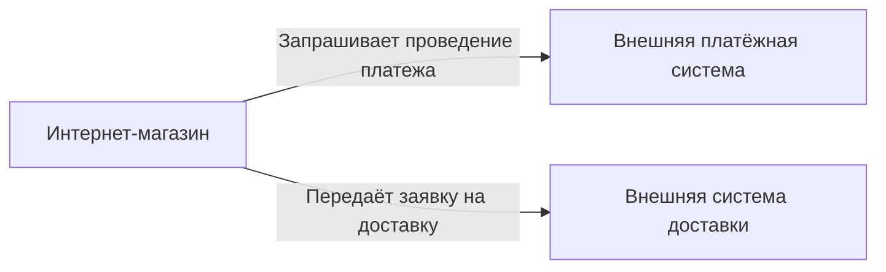

Границы примера: показаны внешние интеграции магазина. Стрелки обозначают направление вызовов, а не последовательность действий.

Добавление сюда `OrdersController`, метода `capture_payment` и отдельной таблицы смешает разные степени детализации. Детали оплаты лучше вынести в отдельную диаграмму и связать её с обзорной.

**Это практическое правило, а не абсолютный запрет:** вложенные элементы допустимы, если детализация необходима для вопроса, а границы явно обозначены. Главное — чтобы читатель понимал, что представляет каждый элемент и как соотносятся части.

**Запомнить:** сначала выбери вопрос и аудиторию, затем представление и детализацию; одна диаграмма должна раскрывать понятный аспект системы.

# 2. Структурные диаграммы

## 2.1. Компоненты и контекст системы

**Структурная диаграмма показывает состав системы и связи между её частями.** Она помогает понять границы ответственности и зависимости, но сама по себе не задаёт последовательность выполнения.

**Диаграмма контекста** показывает систему целиком, её пользователей и внешние системы. Внутреннее устройство здесь скрыто. [System context diagram](https://c4model.com/diagrams/system-context)

Например, контекст интернет-магазина:

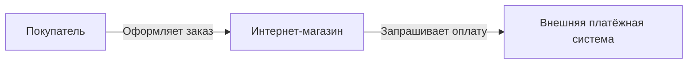

**Диаграмма компонентов** раскрывает внутренние части выбранного приложения, их обязанности и зависимости. Компонент может объединять несколько классов и не обязан быть отдельным сервисом. В C4 такая диаграмма рассматривает компоненты внутри одного приложения или другого контейнера C4. [Component diagram](https://c4model.com/diagrams/component)

Пример внутренней структуры Rails-приложения:

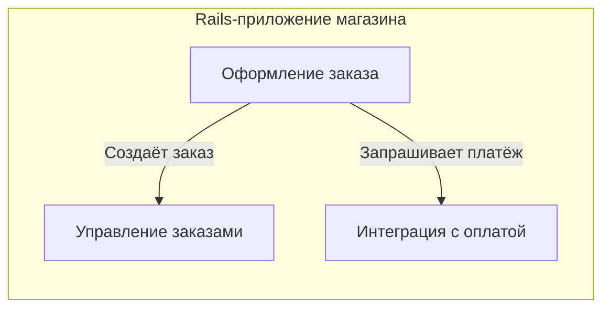

Здесь стрелки обозначают использование возможностей компонента. Они не означают, что вызовы происходят именно в показанном порядке.

**Ошибка — смешивать контекст и внутреннее устройство:** покупатель, внешний банк и отдельный Ruby-класс обычно требуют разной детализации. Для понимания порядка вызовов нужна отдельная диаграмма взаимодействия.

## 2.2. Диаграммы классов UML

**Диаграмма классов UML — представление типов объектов, их свойств, операций и отношений.** UML — Unified Modeling Language, унифицированный язык моделирования.

Для предметной области диаграмма помогает обсуждать понятия и правила: из чего состоит заказ, кому принадлежит позиция, какие действия доступны. Она может описывать концептуальную модель, ещё не привязанную к Ruby-классам или таблицам.

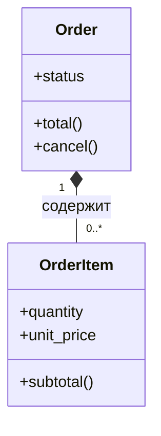

В примере допускается заказ-черновик без позиций:

- `1` возле `Order` — каждая позиция принадлежит ровно одному заказу.
- `0..*` возле `OrderItem` — у заказа может быть любое число позиций, включая ноль.
- Закрашенный ромб возле `Order` обозначает **композицию**: позиция рассматривается как принадлежащая заказу часть.
- `+` обозначает публичный член класса. [Обозначения в Mermaid](https://mermaid.js.org/syntax/classDiagram.html)

Кратность задавай по правилам предметной области. Например, требование «оформленный заказ содержит хотя бы одну позицию» зависит от состояния заказа и нуждается в дополнительном ограничении.

**Диаграмма классов не обязана повторять структуру БД.** А композиция на рисунке сама по себе не настраивает каскадное удаление записей.

## 2.3. ER-диаграммы

**ER-диаграмма — Entity–Relationship diagram, диаграмма сущностей и связей данных.** Она показывает, какие данные существуют и сколько экземпляров одной сущности может быть связано с другой.

На концептуальном уровне достаточно сущностей и отношений. Для модели реляционной БД добавляют таблицы, столбцы и ключи.

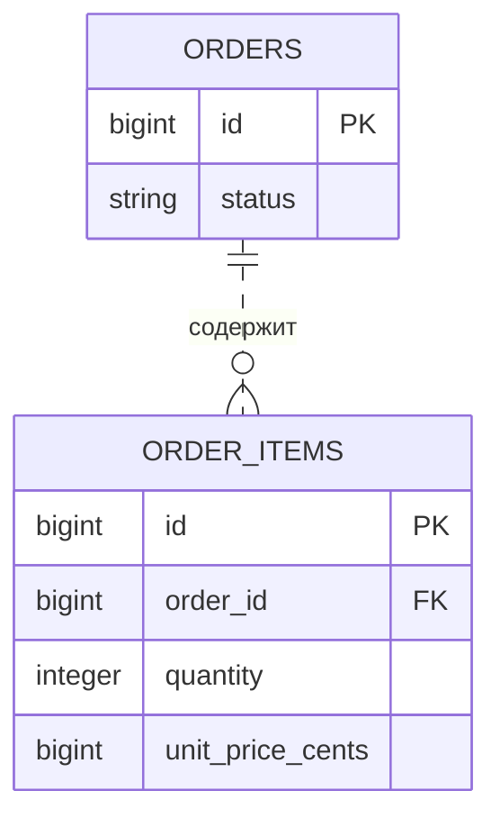

Здесь `PK` — **primary key**, первичный ключ записи; `FK` — **foreign key**, внешний ключ. `||` означает «ровно один», `o{` — «ноль или больше». Пунктир обозначает неидентифицирующую связь: у позиции есть собственный первичный ключ, не включающий ключ заказа. [Синтаксис ER-диаграмм Mermaid](https://mermaid.js.org/syntax/entityRelationshipDiagram.html)

Пример предполагает обязательный `order_id`; цена хранится в минимальных денежных единицах, валюта опущена.

**Нарисованная связь не обеспечивает целостность данных.** Обязательность ссылки, существование заказа и положительное количество нужно закрепить ограничениями БД или соответствующими проверками.

Для связи многие-ко-многим в реляционной модели обычно добавляют промежуточную таблицу.

## 2.4. Логическая структура и физическое размещение

**Логическая структура показывает обязанности и зависимости частей. Физическое размещение — где работают конкретные экземпляры ПО.** Диаграмму размещения, или deployment diagram, строят для определённого окружения: production, staging и других. [Deployment diagram](https://c4model.com/diagrams/deployment)

| Логическая структура | Физическое размещение |
|---|---|
| Компонент оформления использует компонент оплаты | Rails-приложение запущено в трёх экземплярах |
| Фоновый обработчик читает задания | Рабочие процессы размещены на отдельных узлах |
| Приложение сохраняет заказы в БД | Основной экземпляр БД и реплика находятся в разных зонах |

**Связь между ними не обязательно один-к-одному:** несколько компонентов могут выполняться в одном процессе, а один компонент — работать во многих экземплярах.

Не путай физическую модель данных с размещением: таблицы, индексы и типы столбцов описывают устройство хранения, а серверы, зоны и экземпляры БД — инфраструктуру.

**Запомнить:** контекст показывает окружение системы, компоненты — её части, UML-классы — модель объектов, ER — модель данных, а deployment — размещение работающих экземпляров.

# 3. Поведенческие диаграммы

## 3.1. Sequence-диаграммы: взаимодействия во времени

**Sequence diagram — диаграмма последовательности сообщений между участниками конкретного сценария.** Она отвечает на вопрос: кто, кому и в каком порядке передаёт управление или данные.

Участниками могут быть сервисы, компоненты или объекты. Выбирай одинаковую степень детализации: для интеграции магазина с платёжной системой обычно достаточно приложений, без внутренних методов.

Время читается сверху вниз. Вертикальная линия участника называется **lifeline — линия жизни**. Она показывает его участие в сценарии, а не срок существования сервиса.

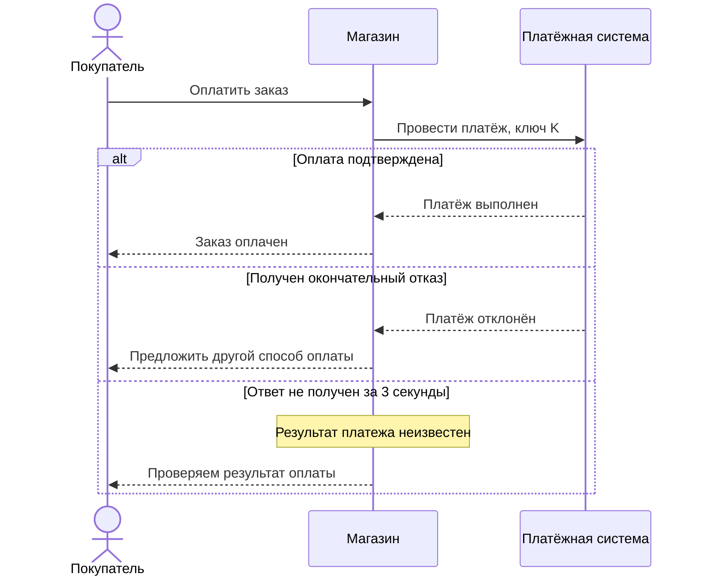

Здесь сплошные стрелки обозначают запросы, пунктирные — ответы. Три секунды — условный таймаут примера.

В Mermaid `alt` обозначает альтернативные ветви, `opt` — необязательные действия, `loop` — повтор, `par` — параллельные взаимодействия. [Синтаксис sequence-диаграмм](https://mermaid.js.org/syntax/sequenceDiagram.html)

**Вертикальное расстояние не показывает точную длительность.** Таймауты и существенные задержки нужно подписывать явно. Диаграмма описывает выбранный сценарий, а не все возможные выполнения системы.

## 3.2. Диаграммы состояний: жизненный цикл сущности

**State machine diagram — диаграмма допустимых состояний и переходов между ними.** Она отвечает на вопрос: в каком состоянии находится сущность и что позволяет его изменить.

Состояние описывает устойчивое положение: `Processing`, `Succeeded`. Действие описывает работу: «проверить результат платежа».

Пример жизненного цикла одной попытки оплаты:

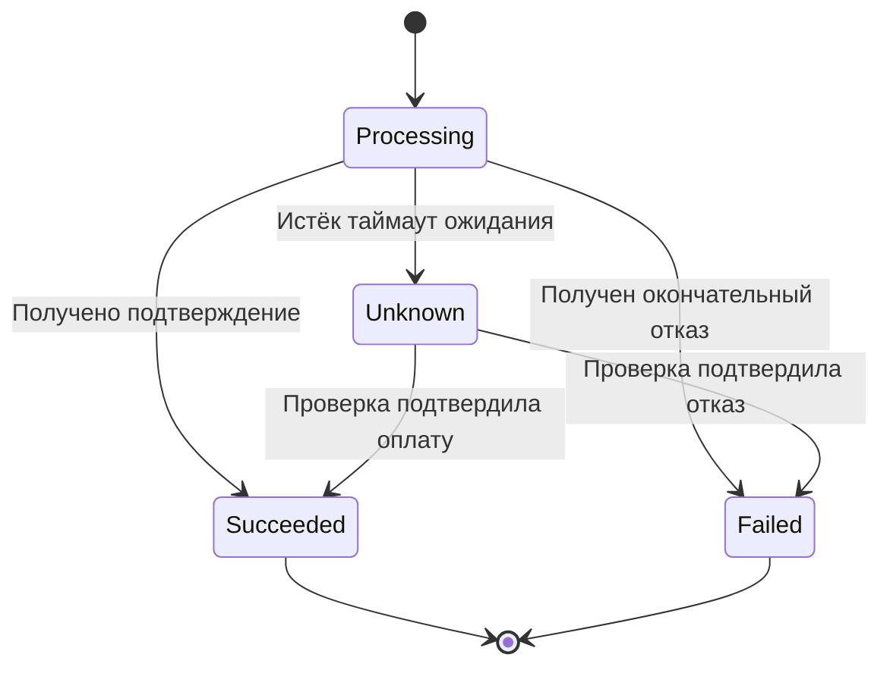

`Unknown` здесь означает неопределённость результата для магазина, а не отдельный статус у платёжного провайдера. Пока результат не установлен, попытка остаётся в этом состоянии.

Подпись перехода при необходимости включает **событие, guard и действие**: `событие [условие] / действие`. Guard — условие, при котором переход разрешён. Начало и завершение в Mermaid обозначаются `[*]`. [Диаграммы состояний Mermaid](https://mermaid.js.org/syntax/stateDiagram.html)

**Диаграмма должна описывать одну выбранную сущность.** Не смешивай статусы заказа, оплаты и доставки. В примере повторная оплата после окончательного отказа создаёт новую попытку; возврат денег находится за границами модели.

## 3.3. Диаграммы активностей и BPMN: ход процесса

**Activity diagram — диаграмма активностей UML, показывающая действия, условия, потоки управления и данных.** Она полезна для алгоритмов и рабочих процессов.

Важно различать:

- **Decision / merge** — выбор альтернативной ветви и объединение альтернатив.
- **Fork / join** — разделение параллельных потоков и их синхронизация.

Merge не ожидает завершения всех параллельных действий; для такой синхронизации используют join. [Управляющие узлы UML](https://www.ibm.com/docs/en/dma?topic=diagrams-control-nodes)

**BPMN — Business Process Model and Notation, стандарт моделирования бизнес-процессов.** Он особенно полезен, когда участвуют разные организации, люди и системы, есть сообщения, ожидания и исключения.

| Элемент BPMN | Назначение |
|---|---|
| Task | Работа: «Зарезервировать товар» |
| Event | Событие: получение сообщения, наступление срока |
| Gateway | Выбор ветви или управление параллельными потоками |
| Pool / lane | Участник процесса / распределение ответственности внутри него |

**Sequence flow** задаёт ход процесса внутри пула; **message flow** показывает обмен сообщениями между участниками в разных пулах. Эти связи нельзя подменять друг другом. [Справочник BPMN](https://camunda.com/bpmn/reference/)

Например: магазин резервирует товар, ожидает оплату и передаёт заказ складу. BPMN позволяет явно показать ответственного за каждый шаг и ожидание платежа с таймером.

Простой внутренний алгоритм часто достаточно описать activity-диаграммой. Обычная блок-схема Mermaid может передать его идею, но сама по себе не становится корректной BPMN-моделью.

## 3.4. Ошибки, повторы и таймауты

**Альтернативный путь должен показывать дальнейшее поведение системы**, включая состояние данных и результат для пользователя.

| Ситуация | Что отразить на диаграмме |
|---|---|
| Окончательный отказ оплаты | Сохранение результата, предложение другого способа |
| Таймаут | Неизвестный результат, последующую проверку |
| Временный сбой | Условие повтора, задержку и предел попыток |
| Попытки исчерпаны | Отложенную сверку или передачу ответственному |
| Следующий шаг не выполнен | Компенсацию, например возврат подтверждённой оплаты |

**Таймаут не доказывает, что операция не выполнена:** платёж мог пройти, а ответ — потеряться. В приведённом сценарии магазин сначала выясняет результат. Если контракт разрешает повтор запроса, используется тот же ключ идемпотентности, защищающий от повторного списания.

Показывай, кто выполняет повтор и при каком условии останавливается. Бесконечная стрелка «повторить» скрывает важное проектное решение.

В BPMN таймаут можно представить граничным событием таймера. Однако прерывание локального ожидания **не гарантирует отмену операции во внешней системе**. [Timer events](https://docs.camunda.io/docs/components/modeler/bpmn/timer-events/)

**Запомнить:** sequence показывает обмен сообщениями, state machine — допустимые состояния, activity и BPMN — ход процесса; ошибки и неопределённые результаты должны быть частью модели.

# 4. Инфраструктурные диаграммы

## 4.1. Deployment: где выполняется система

**Deployment diagram — диаграмма размещения экземпляров ПО на инфраструктуре.** Она показывает, где работают приложения и хранилища, какие ресурсы они используют и какие границы отказа существуют. Узлы могут представлять серверы, виртуальные машины или среды выполнения и вкладываться друг в друга. [Deployment diagram](https://c4model.com/diagrams/deployment)

Перед построением укажи:

- **Окружение:** production, staging или development.
- **Узлы:** физические серверы, виртуальные машины, вычислительные узлы кластера.
- **Размещение ПО:** процессы, Docker-контейнеры, экземпляры БД.
- **Границы:** регион, площадка, зона доступности.

**Зона доступности — отдельная область размещения, предназначенная для изоляции части инфраструктурных отказов.** Её границы и гарантии зависят от платформы.

Пример размещения магазина:

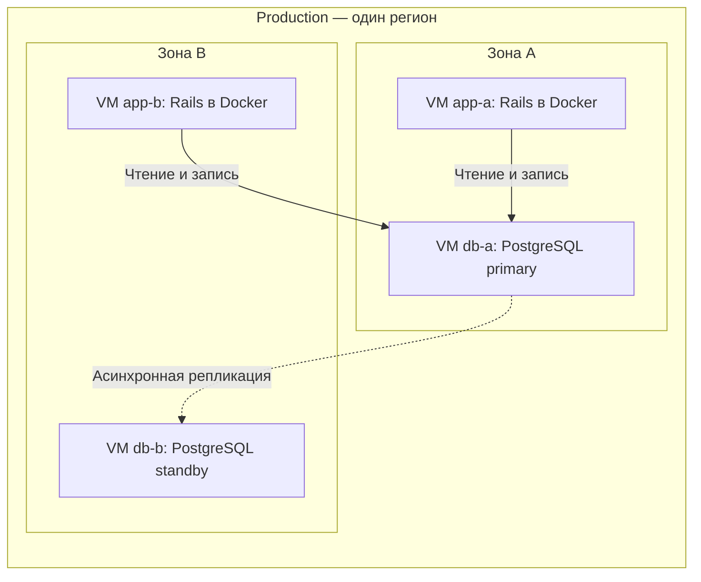

Границы примера: показаны приложение и БД; входной трафик и механизм переключения БД опущены. Пунктир означает репликацию, сплошные стрелки — обращения приложения.

**Docker-контейнер и контейнер C4 — разные понятия:** первый является технологией выполнения, второй — архитектурной единицей, например приложением или хранилищем.

Два экземпляра приложения на одном сервере не защищают от отказа этого сервера. Поэтому важно показывать фактическое размещение, а не только количество копий.

## 4.2. Сетевая диаграмма: кто может соединяться с кем

**Сетевая диаграмма показывает сегменты сети, маршруты взаимодействия и ограничения доступа.** Она помогает проверить достижимость зависимостей и границы доверия.

На ней полезно обозначать:

- подсети и публичные либо приватные сегменты;
- балансировщики и точки входа;
- **firewall — межсетевой экран**, разрешающий или запрещающий трафик по правилам;
- направление установления соединения, протокол и порт назначения;
- место завершения **TLS — шифрованного транспортного соединения**.

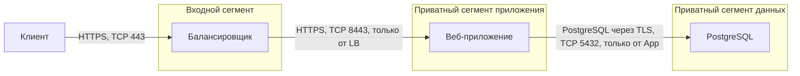

В примере порты приняты как часть конфигурации; TLS завершается на балансировщике и устанавливается заново до приложения. Подписи «только от…» описывают требуемые правила firewall, а не отдельные физические устройства. Стрелки показывают инициатора соединения, обратный трафик опущен.

**Приватная подсеть сама по себе не доказывает изоляцию:** важны маршруты и действующие правила доступа. Иконка замка также не заменяет указание, какой участок соединения зашифрован.

## 4.3. Отказоустойчивость: что произойдёт при сбое

**Отказоустойчивость — способность продолжать работу при определённых отказах.** Диаграмма должна показывать не только резервные экземпляры, но и механизм их использования.

| Элемент | Что нужно пояснить |
|---|---|
| Реплики приложения | Как распределяется трафик и исключается нездоровый экземпляр |
| Реплика БД | Как передаются изменения и кто назначает новый primary |
| VIP | Кто обслуживает адрес и как трафик переключается |
| Резервная площадка | Что там подготовлено и как запускается обслуживание |

**VIP — Virtual IP, виртуальный IP-адрес**, позволяющий отделить точку подключения от конкретного сервера. Перенос адреса или изменение маршрутизации требуют поддержки сети и механизма переключения. VIP сам по себе не обеспечивает доступность.

Для БД показывай синхронность репликации. При асинхронной передаче часть подтверждённых изменений может ещё отсутствовать на резервном узле. [Репликация PostgreSQL](https://www.postgresql.org/docs/current/warm-standby.html)

Подпиши **failover — переключение на резерв**: автоматическое оно или ручное, кто его выполняет и как исключается одновременная запись в два primary. Наличие standby не означает готового автоматического переключения. [Failover PostgreSQL](https://www.postgresql.org/docs/current/warm-standby-failover.html)

Для резервной площадки укажи **RTO — целевое время восстановления** и **RPO — допустимую потерю данных по времени**. Репликация не заменяет резервные копии: ошибочное удаление тоже может реплицироваться.

## 4.4. Иконки облаков и платформ

**Официальные иконки помогают узнавать конкретные продукты**, когда выбор технологии важен для читателя. Наборы доступны у [AWS](https://aws.amazon.com/architecture/icons/), [Azure](https://learn.microsoft.com/en-us/azure/architecture/icons/) и [Google Cloud](https://cloud.google.com/icons).

Используй их вместе с названием ресурса и его ролью: «PostgreSQL — основная БД заказов» информативнее одиночного значка.

Проверяй актуальность набора и правила использования. Например, Azure рекомендует подписывать продукт рядом с иконкой и запрещает искажать её форму.

**Иконка обозначает продукт, а не его конфигурацию:** она не сообщает число реплик, доступность из интернета или наличие резервирования. Эти свойства нужно показывать отдельно.

Для обсуждения архитектуры без привязки к поставщику обычные подписанные прямоугольники часто понятнее. Значение цвета, рамок и линий объясняй легендой.

**Запомнить:** инфраструктурная диаграмма должна объяснять размещение, сетевой доступ и поведение при отказе; количество значков само по себе ничего не гарантирует.

# 5. Диаграммы потоков данных

## 5.1. DFD: откуда приходят и куда уходят данные

**DFD — Data Flow Diagram, диаграмма потоков данных.** Она показывает, кто передаёт данные, какие процессы их обрабатывают и где они сохраняются.

Основные элементы:

| Элемент | Назначение | Пример |
|---|---|---|
| Внешняя сущность | Источник или получатель вне рассматриваемой системы | Покупатель, служба доставки |
| Процесс | Принимает, преобразует или передаёт данные | Оформление заказа |
| Хранилище | Сохраняет данные для последующего использования | БД заказов, файл, очередь |
| Поток | Показывает перемещение определённых данных | Адрес доставки из заказа |

**Источник и потребитель — роли в конкретном потоке:** один участник может выполнять обе роли. Процесс в DFD обозначает обработку данных, а не обязательно процесс операционной системы. [Элементы DFD](https://learn.microsoft.com/en-us/training/modules/tm-create-a-threat-model-using-foundational-data-flow-diagram-elements/)

Пример выбранных потоков оформления и передачи заказа в доставку:

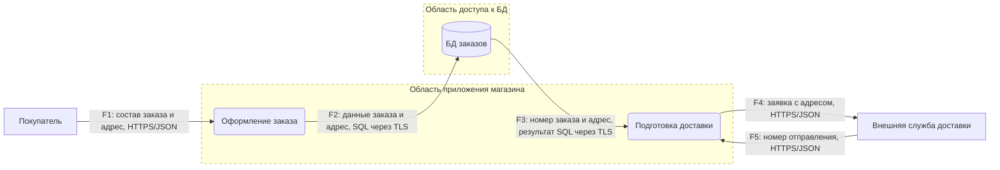

Легенда: прямоугольники — внешние сущности, скруглённые элементы — процессы, цилиндр — хранилище. Пунктирные рамки обозначают области с разными условиями доверия и доступа. `F1–F5` — идентификаторы потоков для ссылок в описании.

Границы примера: показаны основные передаваемые данные; запрос чтения к БД и ответ покупателю опущены.

**DFD не задаёт порядок шагов или условия ветвления.** Для этого используют sequence-диаграммы, activity или BPMN. При детализации процесса сохраняй соответствие его внешних входов и выходов обзорной диаграмме.

## 5.2. Границы доверия и чувствительные данные

**Trust boundary — граница доверия, на которой меняются предположения о достоверности данных, полномочиях или контроле над компонентом.** Она может проходить между браузером и приложением, приложением и БД, магазином и внешним поставщиком. Граница доверия не обязательно совпадает с подсетью. [Microsoft SDL](https://www.microsoft.com/en-us/securityengineering/sdl/practices/secure-by-design)

Для каждого пересечения выясняй:

- Кто отправитель и как подтверждается его личность?
- Какие действия ему разрешены?
- Какие данные нужно проверять?
- Какие сведения допустимо передавать получателю?

В примере адрес — персональные данные. Нужно обозначить, что он поступает в оформление заказа, сохраняется в БД и передаётся доставке. Для полного анализа учитывают также журналы, резервные копии и аналитические выгрузки, куда адрес может попасть.

**Отмечай места чтения, изменения и копирования чувствительных данных**, а не только основное хранилище. Можно использовать метки «персональные данные», «секрет» или отдельную таблицу полей.

Данные внутри инфраструктуры тоже требуют проверки прав. Корректный формат `order_id` не доказывает, что пользователь вправе читать соответствующий заказ. TLS защищает передачу, но не определяет полномочия получателя.

## 5.3. DFD как основа STRIDE

**Моделирование угроз — поиск способов нарушить безопасность системы и выбор мер защиты.** DFD помогает привязать угрозу к конкретному процессу, хранилищу или потоку.

**STRIDE — шесть категорий вопросов об угрозах:**

| Категория | Что может произойти | Пример меры защиты |
|---|---|---|
| **Spoofing — подмена личности** | Злоумышленник действует от имени покупателя | Проверка сессии |
| **Tampering — изменение данных** | В запрос подставлена заниженная цена | Расчёт стоимости на сервере |
| **Repudiation — отрицание действий** | Нельзя установить, кто изменил адрес | Защищённый аудит действий |
| **Information Disclosure — раскрытие информации** | Адреса покупателей доступны постороннему | Проверка доступа, ограничение выдаваемых полей |
| **Denial of Service — отказ в обслуживании** | Массовые запросы исчерпывают ресурсы | Ограничение частоты и объёма запросов |
| **Elevation of Privilege — повышение привилегий** | Покупатель получает возможности администратора | Серверная проверка полномочий |

Категории помогают задавать вопросы, но не гарантируют обнаружения всех угроз. [Модель STRIDE Microsoft](https://learn.microsoft.com/en-us/azure/security/develop/threat-modeling-tool-threats)

Результат анализа записывай конкретно: **угроза → элемент DFD → последствия → защита → способ проверки**. Например: «Утечка адреса через F4 → передавать только необходимые поля → проверить состав исходящей заявки».

Назначай ответственного и приоритет. По мере изменения потоков обновляй модель угроз. [OWASP Threat Modeling](https://cheatsheetseries.owasp.org/cheatsheets/Threat_Modeling_Cheat_Sheet.html)

## 5.4. Направление и способ передачи

**Стрелка DFD обозначает направление движения данных.** Оно может отличаться от направления запроса: приложение запрашивает заказ у БД, а результат движется из БД в приложение — как поток F3.

Подписывай стрелку содержимым: «адрес и номер заказа», а не только действием «вызвать доставку». Для технической диаграммы добавляй способ передачи: HTTPS/JSON, SQL через TLS, сообщение брокера или пакетный файл.

Рядом с диаграммой при необходимости фиксируй:

- синхронная передача или асинхронная;
- способ аутентификации отправителя;
- защиту соединения;
- контракт или схему данных.

Запрос и ответ лучше показывать отдельными потоками, если они содержат разные данные. Для очереди учитывай и хранение сообщения: шифрование соединения не описывает защиту сохранённой копии.

**Запомнить:** DFD показывает движение и обработку данных; границы доверия и STRIDE помогают понять, где эти данные могут подменить, раскрыть или использовать без полномочий.

# 6. Нотации и правила оформления

## 6.1. UML, C4, ArchiMate и BPMN

**Нотация — набор графических обозначений и правил их чтения.** Значение имеют не только фигуры, но и допустимые связи между ними.

UML, ArchiMate и BPMN — языки моделирования. **C4 — модель описания архитектуры ПО, которая не требует определённой графической нотации.** Например, представления C4 можно строить с использованием элементов UML. [Нотация C4](https://c4model.com/diagrams/notation)

| Подход | Основная область применения | Пример для магазина | Ограничение |
|---|---|---|---|
| **UML — Unified Modeling Language** | Структура и поведение ПО: классы, компоненты, состояния, взаимодействия | Модель заказа и последовательность оплаты | Полный язык обширен, обычно достаточно выбранных типов диаграмм |
| **C4** | Объяснение устройства ПО с разной детализацией | Окружение магазина и состав его приложений | Сам по себе не задаёт подробную семантику бизнес-процесса |
| **ArchiMate** | Архитектура предприятия: связи бизнеса, приложений и технологий | Как процесс продаж поддерживается магазином, складской системой и инфраструктурой | Для обсуждения одного метода или простого вызова обычно избыточен |
| **BPMN — Business Process Model and Notation** | Бизнес-процессы, участники, сообщения, ожидания и исключения | Оформление заказа с оплатой, сборкой и доставкой | Не заменяет модель классов или сетевого размещения |

Официальные описания: [UML](https://www.omg.org/gettingstarted/what_is_uml.htm), [C4](https://c4model.com/introduction), [ArchiMate](https://help.opengroup.org/hc/en-us/articles/32115987894930-How-the-ArchiMate-Language-and-the-TOGAF-Standard-Complement-Each-Other), [BPMN](https://www.omg.org/bpmn/).

**Выбирай подход под вопрос и аудиторию.** Для одного проекта могут одновременно понадобиться обзор C4, sequence-диаграмма UML и процесс BPMN.

Не смешивай стандартные символы произвольно: ромб композиции UML и шлюз BPMN имеют разные значения. Если используешь свободную схему, явно объясни её условные обозначения.

## 6.2. Заголовок, легенда, дата и область

**Область диаграммы — scope: какая часть системы и какие аспекты рассматриваются.** Она помогает понять, какие выводы можно сделать по рисунку.

Минимальный набор пояснений:

| Поле | Пример |
|---|---|
| Заголовок | «Интеграции магазина при оплате заказа» |
| Область | Приложение магазина и внешняя платёжная система |
| Состояние | Планируемое решение для production |
| Дата проверки | 2026-11-07 |
| Легенда | Прямоугольник — приложение, стрелка — направление запроса |

Дата должна иметь понятный смысл: создание, изменение или последняя проверка соответствия системе. **Недавняя дата экспорта картинки не доказывает актуальность архитектуры.**

Легенда объясняет формы, линии, цвета и сокращения, которые нужны для чтения. Храни её рядом с рисунком, чтобы при копировании диаграмма сохраняла смысл. Эти сведения относятся к общим рекомендациям по архитектурным диаграммам. [Microsoft: оформление диаграмм](https://learn.microsoft.com/en-us/azure/well-architected/architect-role/design-diagrams)

Типичная ошибка — заголовок «Архитектура» без указания системы, окружения и текущего либо будущего состояния.

## 6.3. Назначение и протокол связи

**Подпись связи должна объяснять, что означает стрелка.** «Использует» или «HTTP» по отдельности дают мало информации: первая подпись скрывает действие, вторая — назначение взаимодействия.

Для технической интеграции полезен формат:

**действие или данные + протокол**, при необходимости — формат сообщения.

Учебный пример: внешние взаимодействия приложения магазина.

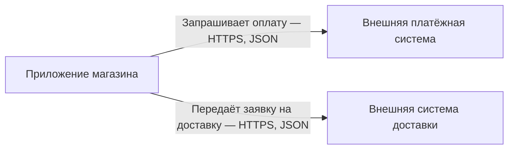

Легенда: прямоугольники — приложения и системы, стрелки — направление запросов. Ответы опущены; порядок вызовов не задаётся.

**Назначение связи должно соответствовать её направлению.** Для потока данных стрелка показывает движение данных, для зависимости — кто от кого зависит. Эти смыслы нужно различать. Указывать протокол особенно полезно для взаимодействий между приложениями. [Рекомендации C4 по связям](https://c4model.com/diagrams/notation)

На обзорной диаграмме для бизнеса протоколы могут быть лишними. Для вызова внутри Ruby-процесса подпись HTTP будет ошибкой: достаточно «Вызывает метод резервирования».

## 6.4. Последовательное использование цвета и формы

**Визуальное обозначение должно сохранять значение внутри диаграммы и между связанными диаграммами.**

Например, команда может договориться:

- внешние системы отмечать серым и подписью «Внешняя система»;
- хранилища показывать цилиндром и указывать их тип;
- планируемые элементы выделять пунктирной рамкой и меткой «Планируется».

Это локальные соглашения, которые нужно включить в легенду. В стандартных нотациях сохраняй установленный смысл символов.

**Цвет и форма должны дополнять текст.** Если резервный узел отличается только зелёной заливкой или необычной рамкой, смысл легко потерять. Подпись «Резервный экземпляр» остаётся понятной независимо от оформления. Принцип не передавать информацию одним цветом закреплён и в рекомендациях W3C. [Use of Color](https://www.w3.org/WAI/WCAG22/Understanding/use-of-color.html)

Проверяй читаемость в уменьшенном размере и чёрно-белом виде. Для сложной диаграммы добавляй краткое текстовое описание основных элементов и связей.

**Запомнить:** выбирай язык под задачу, обозначай границы и актуальность, объясняй стрелки и дублируй визуальные различия понятными подписями.

# 7. Инструменты

## 7.1. Диаграммы как код

**Diagrams as code — подход, при котором диаграмму описывают текстом, а изображение строит инструмент.** Исходник можно хранить в Git, обсуждать в merge request и проверять автоматически.

| Инструмент | Для чего подходит | Существенное ограничение |
|---|---|---|
| **[PlantUML](https://plantuml.com/)** | UML: последовательности, классы, состояния, компоненты и другие диаграммы | Нужно освоить синтаксис; окружение генерации зависит от используемых возможностей |
| **[Mermaid](https://mermaid.js.org/intro/)** | Компактные диаграммы в Markdown: потоки, последовательности, состояния, ER | Поддержка синтаксиса зависит от версии Mermaid в системе просмотра |
| **[Structurizr](https://docs.structurizr.com/dsl)** | Согласованные представления C4 на основе общей модели архитектуры | Требует описания модели, поэтому для одиночного эскиза может быть избыточен |
| **[D2](https://d2lang.com/tour/intro/)** | Декларативное описание структурных схем с автоматической раскладкой | Свободная схема сама по себе не обеспечивает соблюдение UML или другой нотации |

**DSL — Domain-Specific Language, язык для конкретной предметной задачи.** В Structurizr DSL описывают элементы архитектуры и отношения, затем выбирают, какие из них показать в разных представлениях. Это помогает избежать независимых копий одного компонента на нескольких рисунках.

Простой исходник Mermaid:

```text
flowchart LR
    Shop["Магазин"] -->|"Публикует OrderPlaced"| Broker["Брокер"]
    Broker -->|"Доставляет OrderPlaced"| Notifications["Уведомления"]
```

**Диаграмма как код не означает автоматическое извлечение архитектуры из приложения.** Если изменился способ доставки события, исходник обычно тоже нужно обновить вручную.

Текст удобен для ревью связей, но изменение одной строки может перестроить всю раскладку. Поэтому проверяй и исходник, и результат генерации.

## 7.2. Визуальные редакторы

**Визуальный редактор позволяет размещать элементы и соединять их непосредственно на холсте.** Он полезен при обсуждении архитектуры и работе с аудиторией, которой неудобно редактировать текстовый DSL.

| Инструмент | Когда полезен | Что сохранять |
|---|---|---|
| **draw.io / diagrams.net** | Аккуратные схемы с ручной компоновкой, инфраструктурные и процессные диаграммы | Редактируемый файл `.drawio` |
| **Excalidraw** | Быстрые эскизы, обсуждение альтернатив, совместное рисование | Редактируемый файл `.excalidraw` |

draw.io рекомендует формат `.drawio`; он также поддерживает сохранение данных диаграммы внутри PNG и SVG. **Обычный экспорт изображения не следует автоматически считать редактируемым исходником.** [Форматы draw.io](https://www.drawio.com/docs/manual/editor/save-file-formats/)

Excalidraw сохраняет рисунки в открытом формате JSON с расширением `.excalidraw` и поддерживает экспорт PNG/SVG. [Возможности Excalidraw](https://github.com/excalidraw/excalidraw)

Файлы визуальных редакторов можно версионировать, но их текстовые различия часто неудобны для содержательного ревью. Добавляй предпросмотр.

**Редактор не определяет качество модели:** свободный холст позволяет нарисовать как понятную архитектуру, так и неоднозначную смесь обозначений.

## 7.3. Исходники рядом с документацией

**Исходник диаграммы — редактируемый источник истины; изображение — результат для просмотра.** Связь между ними должна быть явной.

Пример структуры репозитория:

```text
docs/
  architecture/
    README.md
    diagrams/
      checkout.mmd
      deployment.drawio
      alternatives.excalidraw
```

В README опиши назначение файлов, используемые инструменты и способ получения изображений. Шаблоны, стили и подключаемые файлы тоже должны быть доступны сборке.

Практические договорённости:

- менять диаграмму вместе с изменением архитектуры;
- назначить владельца документации;
- использовать стабильные имена файлов и ссылки;
- определить, хранятся ли изображения в Git или публикуются сборкой.

Оба варианта хранения изображений допустимы. При хранении в Git проверяй соответствие исходнику; при генерации в CI обеспечь доступный предпросмотр и стабильные ссылки.

**Не поддерживай вручную две независимые версии одной диаграммы.** Правки экспортированного SVG могут потеряться при следующей генерации.

## 7.4. Генерация и проверки в CI

**CI — Continuous Integration, автоматические проверки изменений в репозитории.** Для диаграмм CI должен обнаруживать ошибки исходников и создавать результат, который можно просмотреть.

Например, Mermaid CLI преобразует `.mmd` в SVG, PNG или PDF. [Документация Mermaid CLI](https://github.com/mermaid-js/mermaid-cli)

```sh
mmdc -i docs/architecture/diagrams/checkout.mmd \
     -o build/diagrams/checkout.svg
```

Допущения: `mmdc` установлен, среда запуска браузера подготовлена, выходная директория существует. Это команда генерации одной диаграммы, а не полная конфигурация CI.

Обычно сборка выполняет следующие шаги:

1. Устанавливает зафиксированные версии инструментов и зависимостей.
2. Проверяет исходники и генерирует изображения.
3. Завершает проверку ошибкой при неуспешном разборе или генерации.
4. Сохраняет изображения как артефакты — результаты сборки — либо включает их в документацию.

Фиксируй также значимые настройки раскладки и шрифты: они влияют на результат. Проверяй совместимость с версией движка, которая отображает диаграммы в целевой документации.

**Успешная генерация подтверждает техническую корректность, но не правильность архитектуры.** Пересечения линий, нечитаемые подписи, пропущенные зависимости и устаревшие сведения требуют визуального и содержательного ревью.

**Запомнить:** выбирай инструмент под способ работы команды, храни редактируемый исходник и автоматически проверяй сборку, сохраняя ревью смысла и читаемости.

# 8. Поддержка и ревью

## 8.1. Владелец и события обновления

**Владелец диаграммы — человек или команда, отвечающие за её актуальность и понятность.** Он не обязан лично вносить все изменения, но должен обеспечивать их проверку.

Вместе с владельцем зафиксируй **события обновления**: изменения системы, после которых диаграмму нужно пересмотреть.

| Диаграмма | Возможный владелец | Событие обновления |
|---|---|---|
| Контекст магазина | Команда архитектуры или владелец системы | Добавлена внешняя интеграция |
| Последовательность оплаты | Команда платежей | Изменены вызовы, таймауты или повторы |
| Размещение приложения | Команда эксплуатации | Изменены узлы, зоны или резервирование |
| Потоки персональных данных | Команда соответствующего сервиса | Добавлен получатель, поле или место хранения |

**Обновляй диаграмму вместе с изменением, которое делает её неверной.** В merge request можно включить короткий пункт: «Какая документация затронута?» Если обновление откладывается, нужна отдельная задача с ответственным.

Периодический пересмотр полезен как дополнительная проверка. Однако календарное напоминание раз в квартал не заменяет обновление после изменения архитектуры.

Типичная ошибка — назначить владельцем «всех разработчиков»: без конкретной ответственности исправления легко откладываются.

## 8.2. Ревью: что можно понять неверно

**Ревью диаграммы — проверка её смысла, соответствия системе и читаемости.** Главный вопрос: **«Какой неверный вывод может сделать читатель?»**

Проверяй диаграмму глазами человека, который не участвовал в её создании:

- Понятны ли вопрос, границы и уровень детализации?
- Ясно ли, что обозначают элементы и стрелки?
- Можно ли отличить текущее состояние от планируемого?
- Не создаёт ли упрощение ложного впечатления о безопасности или надёжности?
- Видны ли существенные ошибки и ограничения выбранного сценария?

Например, стрелку `Магазин → Платежи` с подписью «Оплата» можно прочитать как синхронный HTTP-вызов, публикацию команды или передачу уже совершившегося факта.

Более точная подпись: **«Запрашивает списание — HTTPS/JSON»**. Если важны ожидание ответа и таймаут, их стоит раскрыть на sequence-диаграмме.

Полезный приём — попросить коллегу пересказать рисунок. Несовпадение его объяснения с замыслом автора показывает неоднозначность.

**Не исправляй неоднозначность добавлением всех деталей сразу.** Иногда достаточно подписи или легенды; иногда нужен отдельный рисунок. Также различай замечания к диаграмме и замечания к самой архитектуре: точное изображение может выявить реальную проблему системы.

## 8.3. Связь с HLD и ADR

**HLD — High-Level Design, описание устройства решения на верхнем уровне. ADR — Architecture Decision Record, запись архитектурного решения и его обоснования.** Точный состав HLD определяется договорённостями команды.

Эти документы дополняют диаграммы:

| Артефакт | Основной вопрос |
|---|---|
| Диаграмма | Как устроена выбранная часть системы? |
| HLD | Как части решения работают вместе и удовлетворяют требованиям? |
| ADR | Почему выбран этот подход и какие последствия приняты? |

Например, для оформления заказа:

- HLD описывает приём заказа, оплату и передачу в доставку.
- Диаграмма показывает приложение, БД, outbox и брокер.
- ADR объясняет выбор outbox, рассмотренные альтернативы и стоимость решения.

Делай ссылки двусторонними, когда это помогает навигации: из HLD — на нужное представление, из пояснения к диаграмме — на ADR, объясняющий значимое решение.

**Принятый ADR не доказывает, что решение уже реализовано.** Пока идёт переход, явно помечай диаграмму как целевую или текущую. Не заменяй ссылками необходимые подписи: базовый смысл рисунка должен оставаться понятным самостоятельно.

## 8.4. Удаление устаревших диаграмм

**Устаревшая диаграмма — представление, которое больше не соответствует заявленному состоянию системы или не отвечает на актуальный вопрос.**

При изменении системы выбери действие:

| Ситуация | Действие |
|---|---|
| Изменилась часть актуальной схемы | Обновить исходник и изображение |
| Появилось новое представление взамен старого | Заменить ссылки и удалить прежнее из актуальной документации |
| Историческое состояние нужно для миграции или расследования | Перенести в явно обозначенный архив с датой и назначением |
| Диаграмма больше не нужна | Удалить |

В репозитории история Git обычно позволяет восстановить прежний вариант без хранения файлов «актуальная», «новая» и «финальная-2» рядом.

При удалении проверь ссылки в HLD, README и другой документации. При необходимости укажи замену.

**Не смешивай удаление устаревшей схемы с переписыванием истории решений.** Старый ADR сохраняет обоснование своего времени; его статус и ссылка на заменяющее решение показывают, что произошло дальше.

**Запомнить:** у диаграммы должны быть владелец, повод для обновления и понятное место в документации; неоднозначные схемы уточняй, устаревшие — обновляй или убирай из актуального набора.