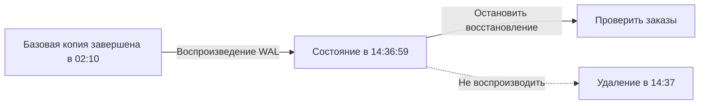

# 1. Цели восстановления

## 1.1. RPO: сколько последних изменений допустимо потерять

**RPO (Recovery Point Objective)** — максимально допустимый промежуток времени, за который могут быть потеряны последние изменения данных при аварии.

Например, **RPO = 5 минут** означает: если авария произошла в 12:00, должна быть возможность восстановить данные как минимум до 11:55. Потеря более свежих изменений допускается, более старых — уже нарушает требование.

Для интернет-магазина это могут быть созданные заказы, изменения остатков и статусы платежей. Значение RPO определяют через последствия потери этих данных для бизнеса.

**RPO — требование, а не периодичность запуска копирования.** Копирование каждые пять минут ещё не гарантирует RPO в пять минут: операция занимает время, может завершиться ошибкой, а готовая копия — остаться на потерянном сервере.

У `pg_dump` содержимое соответствует согласованному снимку на момент начала работы, а не её завершения. Поэтому при оценке возможной потери нужно учитывать возраст снимка последней доступной и пригодной копии. [Документация PostgreSQL: SQL Dump](https://www.postgresql.org/docs/current/backup-dump.html)

Важное ограничение: восстановление БД не отменяет внешние действия. Если платёж прошёл у провайдера, а запись о нём потерялась, потребуется сверка. Повторно списывать деньги только потому, что в восстановленной базе нет платежа, нельзя.

## 1.2. RTO: за какое время сервис должен восстановиться

**RTO (Recovery Time Objective)** — максимально допустимое время от нарушения работы сервиса до восстановления согласованного уровня обслуживания.

Для нашей цели сервис считается восстановленным, когда приложение снова может **корректно читать и записывать данные**, а обязательные проверки пройдены. Сам по себе запуск PostgreSQL ещё не означает выполнение RTO.

В бюджет времени входят:

- обнаружение аварии и принятие решения;
- подготовка чистого экземпляра;
- получение копии и восстановление данных;
- проверка целостности и работоспособности;
- подключение приложения и возобновление обслуживания.

Например, при **RTO = 60 минут** можно предварительно выделить 10 минут на обнаружение и подготовку, 35 — на восстановление, 10 — на проверки и подключение, 5 — в резерв. Это гипотеза, которую нужно проверить тренировкой.

| Показатель | На какой вопрос отвечает |
|---|---|
| RPO | Насколько далеко назад по данным допустимо откатиться? |
| RTO | Как долго сервис может оставаться недоступным? |

Типичная ошибка — измерять только время команды восстановления. **Полное время восстановления сервиса обычно больше.** В учебном эксперименте полезно записывать обе величины отдельно.

## 1.3. Выбор способа копии по RPO и RTO

**Стратегия резервного копирования** — сочетание способа создания копий, расписания, хранения, контроля и процедуры восстановления.

Сначала задают допустимую потерю данных и длительность простоя, затем выбирают подход и проверяют его измерениями.

| Требования | Что рассмотреть | Главное ограничение |
|---|---|---|
| Допустима потеря нескольких часов, база небольшая | Периодический логический дамп | Время загрузки данных и создания индексов может превысить RTO |
| Допустима потеря лишь нескольких минут | Физическая базовая копия и непрерывное архивирование WAL | Нужны сохранная цепочка WAL и контроль задержки архивации |
| Допустимый простой очень короткий | Дополнительно подготовленный резервный сервер и переключение | Переключение не решает все сценарии потери или повреждения данных |

**Логическая копия** хранит описание объектов и их данные для последующего воссоздания. **Физическая копия** сохраняет файлы экземпляра PostgreSQL.

**WAL (Write-Ahead Log)** — журнал изменений. Физическая базовая копия вместе с необходимой непрерывной последовательностью WAL позволяет выполнить **PITR (Point-in-Time Recovery)** — восстановление на выбранный момент времени. Логический дамп `pg_dump` нельзя использовать как основу для такого воспроизведения WAL. [Документация PostgreSQL: Continuous Archiving и PITR](https://www.postgresql.org/docs/current/continuous-archiving.html)

Эта таблица — ориентир, а не гарантия. Даже подходящая технология не обеспечивает RPO и RTO без исправного хранения и проверенного восстановления.

**Репликация не заменяет резервные копии:** ошибочное удаление данных может попасть и на резервный сервер. Кроме того, быстрое переключение на него и восстановление на чистом экземпляре — разные сценарии, их следует проверять отдельно.

## 1.4. Объём базы и допустимое окно нагрузки

**Окно резервного копирования** — период, в который дополнительная нагрузка от создания копии допустима. Восстановление также требует ресурсов, но авария может произойти в любое время: ждать ночного окна получится только в пределах RTO.

На длительность операций влияют:

- объём данных и индексов, скорость роста базы;
- скорость дисков и сети до хранилища;
- доступные процессор и память;
- объём WAL, который потребуется воспроизвести;
- конкурирующая нагрузка и объём проверок.

Например, передача **500 ГБ при устойчивых 100 МБ/с занимает около 83 минут** даже без распаковки и обработки данных. Если копию сначала нужно целиком скачать, RTO в 30 минут уже недостижим при таких условиях.

Не следует считать время копирования равным времени восстановления. Для логического дампа восстановление включает создание индексов; при восстановлении физической копии с WAL требуется воспроизведение журнала. Более свежая базовая копия может сократить этот этап.

**Проверять нужно на реалистичном объёме и сопоставимом оборудовании.** Успешное восстановление маленькой тестовой базы не подтверждает RTO для рабочей. В результаты тренировки включают время всех этапов, достигнутую точку восстановления, проверки связей между данными и пробные чтение и запись через приложение.

**Запомнить:** RPO ограничивает потерю данных, RTO — простой сервиса; подходящую стратегию подтверждает восстановление на практике, а не успешное создание файла копии.

# 2. Логическая копия

## 2.1. Согласованный дамп и восстановление через pg_restore

**Логическая копия** — описание объектов базы и их данных, из которого PostgreSQL может заново создать таблицы, индексы, ограничения и другие объекты.

`pg_dump` создаёт **согласованный снимок**: данные соответствуют одному состоянию базы, а не разным моментам чтения отдельных таблиц. Обычные чтение и запись могут продолжаться, но изменения структуры, например `ALTER TABLE`, могут конфликтовать с блокировками дампа. [Документация: SQL Dump](https://www.postgresql.org/docs/current/backup-dump.html)

**Custom format (`-Fc`)** — специальный архивный формат PostgreSQL, иногда называемый пользовательским. Он сжат по умолчанию и восстанавливается через `pg_restore`, а не через `psql`.

```bash
# Снять копию рабочей базы
pg_dump -h source-db -U backup_user -d shop -Fc -f shop.dump

# Посмотреть оглавление архива
pg_restore --list shop.dump

# На отдельном экземпляре создать пустую базу
createdb -h restore-db -U restore_admin -T template0 shop_restore

# Восстановить копию
pg_restore -h restore-db -U restore_admin \
  -d shop_restore --exit-on-error shop.dump
```

Здесь имена серверов условные; доступ уже настроен, у пользователей достаточно прав. До восстановления подготовлены необходимые роли и расширения. Каждую следующую команду выполняют только после успешного завершения предыдущей.

`--exit-on-error` прекращает восстановление при первой SQL-ошибке. **Уже выполненные изменения автоматически не откатываются**: после сбоя база может остаться частично восстановленной. Для повторной проверки лучше снова подготовить пустую базу. Чтение оглавления проверяет структуру архива, но не заменяет полноценное восстановление. [Документация: pg_restore](https://www.postgresql.org/docs/current/app-pgrestore.html)

## 2.2. Переносимость между версиями и отсутствие PITR

**Переносимость логической копии** означает, что объекты воссоздаются командами PostgreSQL, без прямого переноса внутреннего формата файлов старого сервера. Это полезно при обновлении **мажорной версии**, например с PostgreSQL 17 на 18.

Однако переносимость имеет направление и ограничения:

| Ситуация | Что учитывать |
|---|---|
| Восстановление на более новой версии | Обычно поддерживается, но требует проверки совместимости |
| Восстановление на более старой версии | Не гарантируется |
| Старый `pg_dump` подключается к более новому серверу | Дамп не выполняется |
| База использует расширения | На целевом сервере нужны совместимые расширения |

Для обновления обычно используют `pg_dump` целевой версии, если он поддерживает исходный сервер, и `pg_restore` из того же комплекта утилит. Архив не содержит устанавливаемые библиотеки расширений. [Документация: pg_dump](https://www.postgresql.org/docs/current/app-pgdump.html)

**PITR (Point-in-Time Recovery)** — восстановление на выбранный момент времени. Логический дамп его не обеспечивает: он сохраняет снимок, а не историю последующих изменений.

Например, дамп со снимком на 02:00 позволяет вернуть это состояние, но не состояние на 14:37 перед ошибочным удалением заказов. Для PITR нужна физическая базовая копия и непрерывная цепочка **WAL (Write-Ahead Log)** — журнала изменений. «Доиграть WAL поверх `pg_dump`» нельзя. [Документация: Continuous Archiving](https://www.postgresql.org/docs/current/continuous-archiving.html)

## 2.3. Роли, владельцы и права доступа

**Роль (role)** — объект PostgreSQL, которому назначаются права; она может представлять пользователя или группу. Роли общие для всего экземпляра, поэтому **дамп одной базы не содержит их определения**.

При этом сведения о владельцах объектов и **ACL (Access Control List)** — правах доступа к ним — обычно присутствуют в дампе. Восстановление этих сведений требует, чтобы соответствующие роли уже существовали.

```bash
# Сохранить определения ролей отдельно
pg_dumpall -h source-db -U backup_admin \
  --roles-only -f roles.sql

# Выполнить до восстановления базы
psql -X -h restore-db -U restore_admin -d postgres \
  -v ON_ERROR_STOP=1 -f roles.sql
```

Перед выполнением проверяют конфликты с уже существующими ролями, включая администратора нового экземпляра. Файл может содержать хеши паролей, поэтому доступ к нему ограничивают. Если нужны также определения табличных пространств — мест хранения файлов базы, — рассматривают `--globals-only` вместо `--roles-only`. [Документация: pg_dumpall](https://www.postgresql.org/docs/current/app-pg-dumpall.html)

**`--no-owner` и `--no-acl` меняют результат восстановления:** первый отключает восстановление исходных владельцев, второй — прав доступа. Они полезны для некоторых тестовых переносов, но не подтверждают восстановление исходной модели доступа.

В приведённом выше примере база создана вручную: её владельца и права нужно проверить отдельно. Восстановление через `pg_restore --create` переносит также права самой базы, но создаёт её под именем из архива. [Документация: pg_restore](https://www.postgresql.org/docs/current/app-pgrestore.html)

Проверяй доступ под ролью Rails-приложения: администратор может успешно читать таблицы, которые приложению недоступны.

## 2.4. Время дампа и восстановления на рабочем объёме

**Контрольное восстановление** — практическая проверка копии на отдельном экземпляре с измерением времени и проверкой результата.

Используй объём и структуру, близкие к рабочим: важны не только гигабайты, но и размеры таблиц заказов, число индексов, ограничения и оборудование.

Записывай отдельно:

- время дампа, размер архива и влияние на рабочую нагрузку;
- время передачи архива и подготовки экземпляра;
- время восстановления, проверки данных и готовности приложения.

Custom-архив поддерживает параллельное восстановление через `pg_restore --jobs=4`. Но **параллельное создание дампа доступно только для directory format (`-Fd`)**, а не `-Fc`. Число работников подбирают измерениями: дополнительные процессы могут упереться в диски или память. [Документация: pg_dump](https://www.postgresql.org/docs/current/app-pgdump.html)

После восстановления проверь связи заказов и платежей, контрольные суммы денежных показателей и пробное создание заказа. Ожидаемые значения должны соответствовать снимку: сравнение с продолжающей меняться рабочей базой может показать нормальные расхождения.

**Запомнить:** логический дамп — переносимый снимок одной базы; его пригодность подтверждают восстановление, проверка ролей и данных и измеренное время готовности приложения.

# 3. Физическая копия и восстановление на момент времени

## 3.1. Базовая физическая копия кластера

**Физическая копия** сохраняет файлы PostgreSQL, включая данные и индексы. **Кластер PostgreSQL** здесь — все базы, которыми управляет один экземпляр сервера, а не группа серверов.

**Базовая копия (base backup)** — исходная физическая копия, от которой начинается восстановление. `pg_basebackup` умеет снимать её с работающего сервера:

```bash
pg_basebackup -h source-db -U backup_user \
  -D /backup/shop-base -Fp -X stream -P
```

- `-D` — каталог назначения, пустой или ещё не существующий.
- `-Fp` — сохранение в виде обычных файлов.
- `-X stream` — параллельное получение WAL, необходимого для восстановления самой копии.
- `-P` — отображение прогресса.

В примере предполагаются настроенный доступ для репликации, роль с правом `REPLICATION`, достаточное число `max_wal_senders` и отсутствие дополнительных табличных пространств. Последние требуют учёта отдельных путей хранения. Обычные запросы продолжают работать, но копирование создаёт нагрузку на диски и сеть. [Документация: pg_basebackup](https://www.postgresql.org/docs/current/app-pgbasebackup.html)

**`-X stream` не организует постоянный архив WAL:** получение журнала заканчивается вместе с копированием. Для восстановления на более позднее время журнал нужно сохранять дальше.

Если в инфраструктуре принят другой инструмент физического копирования, используют его процедуры создания, хранения и восстановления копий. Простое копирование каталога работающего PostgreSQL без согласованной процедуры не заменяет base backup.

## 3.2. Архивирование WAL между базовыми копиями

**WAL (Write-Ahead Log)** — журнал изменений файлов данных. **Архивирование WAL** сохраняет завершённые сегменты журнала в отдельное долговременное хранилище.

Базовые настройки на исходном сервере:

```conf
wal_level = replica
archive_mode = on
```

Дополнительно нужен работающий `archive_command` или `archive_library`, который действительно сохраняет сегменты. Эти две строки сами по себе архив не создают; изменение указанных параметров требует перезапуска PostgreSQL. [Документация: настройки WAL](https://www.postgresql.org/docs/current/runtime-config-wal.html)

Архивирование настраивают и проверяют **до базовой копии**. Для дальнейшего восстановления необходима непрерывная цепочка нужных WAL: пропущенный сегмент нельзя компенсировать более поздними. Хранить копию и архив следует вне общего с рабочим сервером места отказа. [Документация: Continuous Archiving](https://www.postgresql.org/docs/current/continuous-archiving.html)

Например, ночная базовая копия вместе с последующим WAL позволяет восстановить дневные заказы без нового полного копирования базы.

**Наличие архива не означает нулевую потерю данных.** При небольшой активности сегмент может долго оставаться незавершённым. `archive_timeout` ограничивает ожидание переключения сегмента, но не устраняет задержки передачи и ошибки хранилища. Поэтому контролируют фактическую задержку архивации. [Документация: архивирование WAL](https://www.postgresql.org/docs/current/runtime-config-wal.html#RUNTIME-CONFIG-WAL-ARCHIVING)

## 3.3. PITR: базовая копия плюс журнал до выбранной точки

**PITR (Point-in-Time Recovery)** — восстановление согласованного состояния на выбранный момент посредством последовательного воспроизведения WAL.

Предположим, базовая копия завершена в 02:10, а ошибочное удаление заказов зафиксировано в 14:37. Требуется вернуть состояние перед этой операцией.



На отдельном остановленном экземпляре размещают файлы копии, настраивают получение WAL и целевую точку, создают `recovery.signal` в каталоге данных, затем запускают сервер.

Пример части конфигурации для PostgreSQL 12+:

```conf
restore_command = 'cp /mnt/wal-archive/%f "%p"'
recovery_target_time = '2026-11-16 14:36:59+03:00'
recovery_target_action = 'pause'
```

Здесь архив доступен как каталог с несжатыми файлами: `%f` — запрошенное имя, `%p` — путь назначения. При включённом `hot_standby` пауза позволяет проверить данные чтением перед завершением recovery; запись пока недоступна. [Документация: настройки восстановления](https://www.postgresql.org/docs/current/runtime-config-wal.html#RUNTIME-CONFIG-WAL-RECOVERY-TARGET)

Важные ограничения:

- Цель должна быть **после завершения выбранной базовой копии**. Для более раннего момента нужна предыдущая копия.
- Восстанавливается вся история до цели: пропустить только ошибочный `DELETE`, сохранив последующие операции, таким способом нельзя.
- После предыдущих восстановлений учитывают **timeline** — ветку истории изменений; сохраняют также файлы её истории. [Документация: процедура PITR](https://www.postgresql.org/docs/current/continuous-archiving.html)

Время 14:36:59 условное: точку выбирают по фактическому времени фиксации ошибочной транзакции, с явным часовым поясом. После проверки завершают recovery и только затем возвращают приложение к работе.

## 3.4. Привязка к версии и восстановление всего кластера

**Физическая совместимость** означает, что сервер способен прочитать сохранённый внутренний формат данных. Физическую копию восстанавливают на той же мажорной версии: копию PostgreSQL 17 нельзя просто запустить PostgreSQL 18. Нужны также совместимые платформа и установленные расширения. Для переноса между мажорными версиями применяют отдельную процедуру обновления или логический экспорт. [Документация: различия способов копирования](https://www.postgresql.org/docs/current/backup-dump.html)

| Свойство | Логическая копия | Физическая копия |
|---|---|---|
| Единица восстановления | База или выбранные объекты | Весь кластер |
| Индексы | Создаются заново | Сохраняются физически |
| Роли | Копируются отдельно | Входят в кластер |
| PITR через WAL | Не поддерживается | Поддерживается при наличии журнала |

`pg_basebackup` не позволяет выбрать одну базу или таблицу. Для извлечения только потерянных заказов можно восстановить **весь кластер отдельно**, затем логически выгрузить нужные данные и согласовать их перенос. [Документация: pg_basebackup](https://www.postgresql.org/docs/current/app-pgbasebackup.html)

«Весь кластер» не означает весь сервер: внешние конфигурационные файлы, библиотеки расширений и файлы приложения требуют отдельного учёта.

**Запомнить:** PITR требует базовой физической копии и непрерывного WAL до цели; восстановление возвращает весь кластер на совместимой версии PostgreSQL.

# 4. Хранение копий

## 4.1. Отдельное хранилище и независимость от аварии

**Независимое хранение** означает, что авария рабочего сервера не уничтожает одновременно данные и резервную копию.

Файл `/backup/shop.dump` на том же диске, что и PostgreSQL, удобен для промежуточного сохранения, но не защищает от поломки диска. Второй диск на том же сервере помогает при отказе первого, однако остаются общие риски: потеря сервера, ошибочное удаление, компрометация административного доступа.

| Размещение | От каких событий помогает защититься |
|---|---|
| Другой каталог на том же диске | Ошибка в данных, если копия сохранилась |
| Другой диск того же сервера | Дополнительно — отказ исходного диска |
| Отдельный сервер или объектное хранилище | Дополнительно — потеря сервера БД |
| Отдельная площадка и независимый доступ | Дополнительно — авария площадки и часть сценариев компрометации |

**Объектное хранилище (object storage)** хранит файлы как отдельные объекты, доступные через API. Конкретная степень защиты зависит от его размещения, настроек и учётных записей.

Например, дамп магазина можно создавать локально, затем передавать в отдельное хранилище. Этап считается завершённым только после проверки сохранённого там объекта.

Обратная сторона удалённого хранения — время получения копии. Его включают в **RTO**, допустимое время восстановления сервиса: надёжно сохранённый архив бесполезен для короткого RTO, если скачивается несколько часов.

## 4.2. Срок хранения и глубина восстановления

**Retention policy — политика хранения**: какие копии сохраняются, как долго и при каких условиях удаляются.

Нужно различать два требования:

- **RPO** ограничивает допустимую потерю последних изменений. На него влияют частота копирования и задержка сохранения WAL.
- **Глубина восстановления** определяет, насколько далеко в прошлое можно вернуться. Она зависит от срока хранения пригодных копий и журнала.

Например, RPO в пять минут не означает, что копии достаточно хранить пять минут. Ошибку расчёта скидок могут обнаружить спустя две недели — тогда понадобится более старое состояние.

Условная политика магазина: возможность восстановиться на любой момент последних 14 дней и отдельные месячные снимки для разбора старых заказов. **Месячный снимок сохраняет одну точку, а не все состояния месяца.**

Для **PITR — восстановления на момент времени** — хранят подходящую базовую копию и непрерывную цепочку **WAL — журнала изменений**. Чтобы покрыть начало 14-дневного окна, может потребоваться базовая копия старше 14 дней и WAL от её начала. Удалять файлы только по возрасту опасно: можно разрушить цепочку восстановления. [Документация PostgreSQL: Continuous Archiving](https://www.postgresql.org/docs/current/continuous-archiving.html)

Срок выбирают с учётом времени обнаружения ошибок, потребности в исторических данных, стоимости хранения и установленных правил обращения с данными. Автоматическое удаление должно учитывать зависимости между копиями.

## 4.3. Проверка завершения и пригодности копии

**Проверка копии** — подтверждение того, что операция завершилась, результат сохранился и его можно использовать для восстановления.

Минимальная автоматическая проверка включает:

- успешное завершение команды копирования и передачи;
- наличие ожидаемого файла или набора файлов;
- ненулевой размер и отсутствие необъяснимого резкого уменьшения;
- допустимый возраст последней успешной копии.

Простейшая проверка файла на Ruby:

```ruby
path = "/backup/shop.dump"

raise "Копия отсутствует или пуста" unless File.file?(path) && File.size?(path)
```

Этот код проверяет только локальный файл. Он **не подтверждает завершение `pg_dump`**, целостность архива или наличие удалённой копии. Незавершённый файл тоже может занимать гигабайты.

Полезно сохранять результат под временным именем и отмечать его как готовый лишь после успешного завершения всех этапов. **Контрольная сумма (checksum)** позволяет обнаружить изменение содержимого при передаче или хранении, но не доказывает правильность исходных данных.

Для физической копии с `backup_manifest` — описанием ожидаемых файлов и их контрольных сумм — доступна проверка:

```bash
pg_verifybackup /backup/shop-base
```

Пример предполагает копию в обычном файловом формате и совместимую версию утилиты. Проверка обнаруживает многие повреждения, но не заменяет пробное восстановление. Она также не подтверждает сохранность всей последующей цепочки WAL до произвольной точки PITR. [Документация: pg_verifybackup](https://www.postgresql.org/docs/current/app-pgverifybackup.html)

**Отсутствие сообщения об ошибке ещё не означает успех:** задание могло вообще не запуститься. Поэтому контролируют свежесть последней готовой копии.

## 4.4. Доступ к копиям и защита содержимого

**Резервная копия содержит те же чувствительные данные, что и база:** адреса покупателей, заказы, контактные данные и другие сохранённые поля. Человек, получивший полный дамп, может восстановить его на своём сервере; ограничения доступа исходного PostgreSQL этому не помешают.

Практически полезны следующие меры:

- выдавать доступ только сотрудникам и процессам, которым он нужен;
- по возможности разделять права создания, чтения и удаления копий;
- шифровать передачу и хранение;
- хранить ключи так, чтобы они пережили потерю сервера, и проверять доступ к ним при тренировке восстановления;
- учитывать обращения к копиям и их удаление.

**Сжатие не является шифрованием.** Custom-архив `pg_dump` сжимается по умолчанию, но сам формат не скрывает содержимое от получившего файл. [Документация: pg_dump](https://www.postgresql.org/docs/current/app-pgdump.html)

Если существенен риск удаления копий злоумышленником, полезно хранилище с запретом изменения и удаления на заданный срок. Его ограничения согласуют с политикой хранения. Тестовые восстановленные базы защищают не слабее архивов: после восстановления данные остаются чувствительными.

**Запомнить:** хорошая копия переживает аварию сервера, хранится вместе со всеми зависимостями, регулярно проверяется и защищается так же строго, как исходные данные.

# 5. Восстановление

## 5.1. Чистый экземпляр вместо рабочей базы

**Чистый экземпляр** — отдельная среда восстановления, в которой нет рабочих данных, требующих сохранения. Она позволяет проверить копию, не повредив действующую базу и не смешав старое состояние с новым.

Подготовка зависит от вида копии:

| Вид копии | Что подготовить |
|---|---|
| Логический дамп | Работающий PostgreSQL, необходимые роли и расширения, пустую целевую базу |
| Физическая копия | Остановленный экземпляр совместимой версии и пустые целевые каталоги для размещения файлов |

При логическом восстановлении `pg_restore` подключается к уже работающему серверу. При физическом файлы копии сначала размещают на диске, затем запускают PostgreSQL. **Нельзя накладывать физическую копию на файлы другого кластера.** [Документация: pg_restore](https://www.postgresql.org/docs/current/app-pgrestore.html), [физическое восстановление](https://www.postgresql.org/docs/current/continuous-archiving.html#BACKUP-PITR-RECOVERY)

Например, копию магазина восстанавливают на `restore-db`, а Rails-приложение продолжает использовать `production-db`. Для проверки запускают отдельный экземпляр приложения, отключив реальные платежи, рассылки и отправку заказов в доставку.

Типичная ошибка — указать правильное имя базы, но подключиться к рабочему серверу. Перед началом явно проверяют **сервер, порт, базу и каталог данных**. Имя `shop_restore` само по себе не гарантирует изоляцию.

## 5.2. Последовательность действий и проверка готовности

**Runbook — инструкция восстановления** — воспроизводимая последовательность действий с условиями успеха каждого шага. Она должна содержать конкретные пути, адреса, выбранную копию и ожидаемую точку восстановления.

Для физической копии порядок следующий:

1. **Подготовить среду:** проверить версию, свободное место, целевые каталоги, владельца файлов и остановку целевого сервера.
2. **Загрузить копию:** получить её из хранилища, проверить и разместить файлы, включая данные дополнительных табличных пространств.
3. **Настроить recovery:** указать получение WAL — журнала изменений — и, если нужен PITR, целевую точку восстановления; создать `recovery.signal`.
4. **Запустить PostgreSQL:** сервер начнёт воспроизводить необходимый WAL.
5. **Дождаться нужного состояния:** подтвердить достижение цели и завершить recovery по выбранной процедуре.
6. **Проверить подключения, данные и операции приложения.**

**Применение WAL происходит после запуска процесса PostgreSQL, в режиме восстановления.** Это не отдельная команда, которую выполняют перед запуском сервера. [Документация: процедура восстановления](https://www.postgresql.org/docs/current/continuous-archiving.html#BACKUP-PITR-RECOVERY)

Для логического дампа путь другой: запуск нового кластера → подготовка ролей и пустой базы → `pg_restore` → проверки. Отдельного воспроизведения архивного WAL здесь нет.

Первичная проверка доступности:

```bash
pg_isready -h restore-db -p 5432
```

Код завершения `0` означает, что сервер принимает соединения. **Он не подтверждает правильность пароля приложения, наличие нужных таблиц или возможность записи.** [Документация: pg_isready](https://www.postgresql.org/docs/current/app-pg-isready.html)

После настоящего подключения полезно проверить:

```sql
SELECT pg_is_in_recovery();
SHOW transaction_read_only;
```

`pg_is_in_recovery()` показывает, продолжается ли восстановление. Для самостоятельного экземпляра, предназначенного для чтения и записи, ожидается `false`. [Документация: функции управления восстановлением](https://www.postgresql.org/docs/current/functions-admin.html#FUNCTIONS-RECOVERY-INFO-TABLE)

Затем под ролью приложения проверяют чтение заказов и контролируемую запись. Даже завершённое recovery не доказывает наличие всех необходимых прав.

## 5.3. Остановка при обнаружении чужих данных

**Защитная проверка перед восстановлением** запрещает продолжение, если назначение каталога неоднозначно или в нём уже есть данные.

Нельзя автоматически очищать непустой каталог, чтобы «подготовить место». Сначала выясняют, какому экземпляру он принадлежит и используется ли сейчас.

Минимальная проверка на Ruby:

```ruby
target = "/srv/postgresql/shop-restore"

raise "Целевой путь — символическая ссылка" if File.symlink?(target)

if File.exist?(target)
  raise "Ожидался каталог" unless File.directory?(target)
  raise "Каталог не пуст: восстановление остановлено" unless Dir.empty?(target)
end
```

Пример только проверяет путь, ничего не удаляя. Он не проверяет символические ссылки в родительских каталогах, точки монтирования или параллельное изменение содержимого. В рабочей инструкции дополнительно проверяют фактическое расположение данных и исключают одновременное использование каталога.

Наличие `PG_VERSION`, `base` или `global` указывает на возможный каталог PostgreSQL, но **отсутствие этих признаков не делает удаление остальных файлов допустимым**. Аналогичные проверки нужны для отдельных каталогов табличных пространств.

## 5.4. Измерение времени каждого этапа

**Поэтапный замер** показывает, какая операция определяет длительность восстановления и где есть возможность ускорения.

Пример журнала учебного восстановления:

| Этап | Длительность |
|---|---:|
| Подготовка среды | 8 минут |
| Получение и размещение копии | 22 минуты |
| Запуск и воспроизведение WAL | 17 минут |
| Проверка данных, подключений и записи | 9 минут |
| **Всего** | **56 минут** |

Для каждого этапа фиксируют начало, окончание, результат и ошибки. Дополнительно записывают размер копии, объём WAL, характеристики оборудования и выбранную точку восстановления — иначе сравнение тренировок будет неточным.

Для измерения длительности в скриптах используют **монотонные часы**: их отсчёт не меняется при корректировке системного времени. Календарные отметки сохраняют отдельно для сопоставления с журналами.

Если операции идут параллельно, сумма их длительностей может превышать общее время. А **RTO — допустимое время восстановления сервиса — включает также обнаружение аварии, принятие решения и возвращение приложения к работе**. Эти затраты нельзя скрывать за быстрым завершением команды восстановления.

**Запомнить:** восстанавливай в проверенную отдельную среду, останавливайся при чужих данных и измеряй весь путь до подтверждённого чтения и записи приложения.

# 6. Проверка целостности

## 6.1. Число строк и контрольные суммы

**Проверка целостности** подтверждает, что восстановлены ожидаемые данные и структура, а приложение может ими пользоваться. Успешное завершение восстановления — необходимое, но недостаточное условие.

**Эталон** — заранее сохранённые результаты проверок исходной базы для того состояния, которое восстанавливается. Сравнивать копию с текущей рабочей базой некорректно: после копирования могли появиться новые заказы.

Для логического дампа можно согласовать проверки и `pg_dump` через общий экспортированный снимок и параметр `--snapshot`. Просто запустить подсчёт рядом по времени недостаточно. [Документация: pg_dump](https://www.postgresql.org/docs/current/app-pgdump.html)

Для физической копии с PITR эталон должен соответствовать **выбранной точке восстановления**, а не началу копирования файлов. В учебной проверке проще временно остановить изменения, сохранить показатели и выбрать точку в этом стабильном интервале.

**Число строк обнаруживает пропуски, но не замену содержимого.** Поэтому для важных таблиц сравнивают также контрольную сумму — вычисленный отпечаток выбранных данных.

Пример для небольшой таблицы заказов:

```sql
SELECT
  count(*) AS row_count,
  md5(COALESCE(
    jsonb_agg(
      jsonb_build_array(id, status, total_cents)
      ORDER BY id
    )::text,
    '[]'
  )) AS fingerprint
FROM orders;
```

Здесь `id` — уникальный числовой ключ, `total_cents` — целое число копеек. JSON сохраняет границы значений и `NULL`, а явный порядок делает результат воспроизводимым. [Документация: агрегатные функции](https://www.postgresql.org/docs/current/functions-aggregate.html), [JSON-функции](https://www.postgresql.org/docs/current/functions-json.html)

Ограничения: проверяются только перечисленные поля; MD5 здесь служит для обнаружения случайных различий, а не защиты от подделки. Большие таблицы проверяют частями, например диапазонами `id`, чтобы не собирать всю таблицу в один JSON. Для дат, чисел и текста заранее согласуют формат представления.

## 6.2. Ограничения, индексы и последовательности

**Структурная целостность** означает, что вместе со строками восстановлены правила хранения данных и необходимые объекты базы.

| Объект | Что проверять |
|---|---|
| Ограничения — constraints | Первичные и внешние ключи, уникальность, `CHECK`, `NOT NULL`, определения и состояние проверки |
| Индексы — indexes | Состав столбцов, уникальность, условия частичных индексов и пригодность к использованию |
| Последовательности — sequences | Наличие, связь со столбцом, параметры и безопасное продолжение выдачи значений |

Проверка состояния индексов таблицы:

```sql
SELECT indexrelid::regclass AS index_name,
       indisvalid, indisready
FROM pg_index
WHERE indrelid = 'public.orders'::regclass;
```

`indisvalid` показывает пригодность индекса для запросов, `indisready` — готовность обслуживать изменения таблицы. Однако запрос **не обнаружит отсутствующий индекс**: результат нужно сравнить с ожидаемым списком и определениями. [Документация: pg_index](https://www.postgresql.org/docs/current/catalog-pg-index.html)

Для ограничений проверяют не только имена, но и определения, а также `convalidated` — подтверждена ли проверка существующих данных. Состояние сравнивают с источником: ограничение могло быть намеренно создано без полной проверки ещё до копирования. [Документация: pg_constraint](https://www.postgresql.org/docs/current/catalog-pg-constraint.html)

**Последовательность — генератор значений**, обычно для идентификаторов. Для обычного возрастающего `id` важно, чтобы новые значения не конфликтовали с уже восстановленными строками. Равенство её состояния `MAX(id)` не обязательно: пропуски нормальны из-за откатов и резервирования значений.

Не исправляй последовательности автоматически через `setval`, не разобрав причину расхождения. Вызов `nextval` изменяет состояние даже при последующем откате транзакции. [Документация: функции последовательностей](https://www.postgresql.org/docs/current/functions-sequence.html)

## 6.3. Короткий прикладной сценарий

**Smoke test — короткая проверка основных операций** — показывает, что восстановленной базой действительно может пользоваться приложение.

Заранее выбирают контрольный заказ, который точно существовал в целевом состоянии, и сохраняют его ожидаемые поля. На изолированном экземпляре приложения выполняют:

1. Чтение заказа и сравнение номера, суммы, статуса и позиций.
2. Изменение безопасного поля, например внутреннего комментария.
3. Сохранение с фиксацией транзакции.
4. Повторное чтение через новое подключение и проверку изменения.

Проверку выполняют **под ролью приложения**, поскольку административные права могут скрыть проблемы доступа.

Используй специально подготовленную запись, отключив внешние платежи, уведомления и доставку. После сценария восстанови исходное значение либо заново подготовь тестовую базу.

Проверка с `ROLLBACK` полезна как предварительная, но **не подтверждает успешную фиксацию записи**. Кроме того, откат транзакции не отменяет внешние действия. SQL-проверка напрямую также не заменяет сценарий через приложение: она обходит его правила и обработчики.

## 6.4. Завершение recovery и возможность записи

**Recovery — режим восстановления**, в котором PostgreSQL воспроизводит журнал изменений. Приём соединений и доступность чтения ещё не означают готовность к записи.

Проверки в подключении приложения:

```sql
SELECT pg_is_in_recovery();
SHOW transaction_read_only;
```

Для самостоятельного экземпляра, который должен обслуживать чтение и запись, ожидаются:

- `pg_is_in_recovery() = false`;
- `transaction_read_only = off`;
- успешная фиксация прикладного изменения.

Первая проверка показывает состояние сервера, вторая — режим текущей транзакции. Ни одна отдельно не подтверждает права на нужную таблицу. [Документация: состояние recovery](https://www.postgresql.org/docs/current/functions-admin.html#FUNCTIONS-RECOVERY-INFO-TABLE), [режим транзакции](https://www.postgresql.org/docs/current/runtime-config-client.html)

Для резервного сервера или проверки PITR на паузе продолжающееся recovery может быть ожидаемым. **Критерий успеха определяется назначением экземпляра:** не нужно завершать восстановление только ради значения `false`.

**Запомнить:** сравнивай с правильной точкой во времени, проверяй данные и структуру, а готовность к работе подтверждай реальным чтением и зафиксированной записью через приложение.

# 7. Время восстановления

## 7.1. От начала восстановления до прикладной проверки

**Время восстановления** — фактически измеренный интервал от начала процедуры до подтверждения, что приложение снова выполняет необходимые операции.

Заранее определяют границы измерения:

- **Старт:** начало выполнения инструкции восстановления, включая подготовку среды и получение копии.
- **Финиш:** успешное завершение прикладной проверки — чтение ожидаемого заказа, фиксация тестового изменения и его повторное чтение.

Если сервер или файлы подготовлены заранее, это отмечают в результатах. Такая тренировка измеряет восстановление **при готовой инфраструктуре**, а не весь путь с нуля.

**Завершение команды восстановления не равно готовности сервиса.** После неё могут потребоваться проверка данных, настройка доступа, подключение приложения и прогрев до приемлемой скорости работы.

Пример журнала:

| Событие | Время |
|---|---|
| Начало процедуры | 10:00 |
| Среда подготовлена | 10:08 |
| Копия получена | 10:20 |
| Данные восстановлены, запись разрешена | 10:47 |
| Прикладная проверка пройдена | 10:55 |

Результат — **55 минут**, а не 27 минут обработки данных.

Фиксируют календарные отметки для сопоставления с журналами и длительности этапов. При автоматическом измерении длительностей полезны **монотонные часы** — отсчёт, который не изменяется из-за корректировки системного времени.

## 7.2. Сравнение с целевым RTO

**RTO (Recovery Time Objective)** — максимально допустимое время нарушения работы сервиса до восстановления согласованного уровня обслуживания.

Измеренное время процедуры — только часть этого бюджета:

```text
Полное время восстановления сервиса =
  обнаружение аварии и принятие решения
  + выполнение процедуры восстановления
  + оставшиеся действия по возврату сервиса
```

Этапы учитывают без повторного сложения: если переключение приложения уже вошло в процедуру, второй раз его не добавляют.

Например:

| Составляющая | Длительность |
|---|---:|
| Обнаружение аварии и решение | 12 минут |
| Восстановление до прикладной проверки | 55 минут |
| Возврат пользовательского трафика | 5 минут |
| **Итого** | **72 минуты** |

При **RTO = 60 минут** требование не выполнено, хотя сама процедура заняла меньше часа.

Если время обнаружения и переключения не измерялось, вывод формулируют точно: «Процедура заняла 55 минут; соблюдение полного RTO пока не подтверждено».

**Один успешный замер не гарантирует соблюдение RTO при любой аварии.** Нужны повторяемый результат и запас на колебания скорости сети, нагрузку и действия оператора. Размер запаса выбирают по наблюдаемому разбросу и последствиям задержки.

## 7.3. Время получения копии из хранилища

**Время передачи** — период получения необходимых файлов из хранилища на целевой сервер. Оно входит в восстановление, если файлы заранее там отсутствуют.

Отдельно отмечают:

- ожидание доступности копии, например её извлечения из архивного хранилища;
- передачу базовой копии или дампа;
- получение WAL — журнала изменений, если он необходим;
- проверку полученных файлов и распаковку.

Приближённая оценка:

```text
Время передачи ≈ размер передаваемых данных / фактическая скорость
```

Например, **300 ГБ при устойчивых 100 МБ/с — около 50 минут** только на передачу. Используются десятичные единицы; ожидание, проверка и распаковка не включены.

Ориентируйся на фактическую скорость всего пути, а не только на заявленную пропускную способность сети. Ограничением могут стать чтение хранилища, запись диска или обработка сжатых данных.

Если получение файлов и восстановление идут одновременно, их длительности нельзя просто сложить. **Общий результат измеряют по времени от старта до финиша**, а отдельные интервалы используют для поиска задержек.

## 7.4. Повторные замеры при росте базы

**Масштабирование времени восстановления** — изменение длительности процедуры при увеличении объёма данных и работы, необходимой для восстановления.

Условные результаты тренировок:

| Размер базы | Передача | Восстановление данных | Остальные этапы | Всего |
|---|---:|---:|---:|---:|
| 100 ГБ | 8 мин | 15 мин | 12 мин | 35 мин |
| 200 ГБ | 16 мин | 34 мин | 13 мин | 63 мин |
| 400 ГБ | 32 мин | 82 мин | 15 мин | 129 мин |

Рост может быть **нелинейным**: увеличение базы вдвое не обязательно увеличивает время ровно вдвое. Влияют индексы, доступная память, скорость дисков и объём воспроизводимого WAL.

Для сопоставимости записывают размер базы и архива, оборудование, способ восстановления, параметры параллелизма, возраст базовой копии и конкурирующую нагрузку. Размер базы сам по себе не объясняет результат.

Повторяют тренировку после существенного роста данных или изменений инфраструктуры. Цель — заметить приближение к пределу RTO заранее. Прогноз по прошлым замерам помогает планированию, но не заменяет новую проверку.

**Запомнить:** измеряй путь до успешной прикладной проверки, учитывай передачу и полный бюджет RTO, а рост времени подтверждай повторными тренировками.

# 8. Регулярная проверка

## 8.1. Восстановление как подтверждение пригодности

**Пригодная резервная копия** — копия, из которой удалось восстановить ожидаемые данные и пройти необходимые проверки. Наличие файла и успешный статус задания подтверждают создание копии, но не возможность вернуть сервис к работе.

Полезно различать три состояния:

| Состояние | Что подтверждено |
|---|---|
| Создана | Задание завершилось, результат сохранён |
| Проверена технически | Файлы доступны, выполнены предусмотренные проверки целостности |
| Проверена восстановлением | Данные восстановлены, сверка и прикладной сценарий успешны |

**Статус «проверена восстановлением» относится к конкретной копии и проверенному сценарию.** Успешная тренировка на прошлой неделе не доказывает пригодность сегодняшнего архива.

Для PITR — восстановления на момент времени — проверяется комплект: базовая копия, необходимая цепочка WAL — журнала изменений — и достижение выбранной точки. Восстановление одной базовой копии не подтверждает возможность вернуть состояние на любой последующий момент.

Если каждый архив восстанавливать слишком дорого, проверяют выбранные копии по расписанию, а остальные контролируют технически. Это разумный компромисс, но в отчётах различают **проверенные и ещё не проверенные восстановлением копии**.

Типичная ошибка — считать пригодность доказанной после запуска PostgreSQL. Завершённая проверка включает сверку данных и работу приложения.

## 8.2. Плановые проверочные восстановления

**Проверочное восстановление (restore drill)** — запланированное выполнение процедуры на изолированном стенде с измерением времени и проверкой результата.

У проверки должны быть:

- расписание и ответственный;
- правило выбора копии и целевой точки;
- подготовленный сценарий сверки;
- критерии успеха;
- порядок действий при сбое.

Например, магазин может еженедельно восстанавливать свежую копию, а ежемесячно — дополнительно проверять старую копию у границы срока хранения. Это пример расписания, а не универсальная норма: частоту выбирают по последствиям потери данных, скорости изменений и стоимости тренировки.

**Проверять нужно весь путь от хранилища до приложения.** Если всегда использовать заранее скачанный архив, останутся непроверенными доступ к хранилищу, получение ключей расшифрования и время передачи.

Внеплановая тренировка полезна после смены способа копирования, версии PostgreSQL, хранилища, ключей доступа или существенного изменения схемы и объёма базы.

Успешный статус задания копирования и успешное восстановление — отдельные результаты. Пропущенная тренировка или неудачная сверка должны быть заметны ответственному, даже если создание копий продолжает работать.

## 8.3. Отчёт и сравнение с RPO и RTO

**Отчёт о восстановлении** — запись, позволяющая понять, что проверяли, какие результаты получили и какие требования выполнены.

Компактный пример:

| Поле | Пример |
|---|---|
| Дата проверки | 16 ноября 2026 года |
| Копия и тип | `shop-base-2026-11-15`, физическая копия + WAL |
| Целевая точка | 16 ноября, 10:00, UTC+03:00 |
| Объём | Базовая копия 180 ГБ, необходимый WAL 12 ГБ |
| Время процедуры | 48 минут, включая передачу 14 минут |
| Сверка | Контрольные таблицы совпали, прикладная запись успешна |
| RPO | Цель 5 минут, фактический разрыв 2 минуты — выполнено |
| RTO | Цель 60 минут, полный сценарий 66 минут — превышение на 6 минут |
| Действие | Сократить подготовку среды, повторить замер |

**RPO (Recovery Point Objective)** ограничивает допустимую потерю последних изменений. Чтобы оценить его, задают момент условной аварии и определяют последнюю достижимую точку по копиям и журналу, доступным к этому моменту.

Например, авария условно произошла в 10:02, а данные доступны до 10:00: разрыв составляет две минуты. Намеренный выбор старой точки PITR сам по себе не означает нарушение RPO.

**RTO (Recovery Time Objective)** ограничивает время восстановления сервиса. В примере процедура заняла 48 минут, но обнаружение, решение и возврат трафика добавили ещё 18 минут. Поэтому полный результат — 66 минут.

Если эти дополнительные этапы не измерялись, пишут: **«Полный RTO не проверен»**. Аналогично, без подтверждённой достижимой точки нельзя объявлять выполнение RPO.

К отчёту прикладывают идентификатор копии, версию инструкции, журналы и результаты сверки. Чувствительные данные из таблиц без необходимости не включают.

## 8.4. Обновление процедуры по результатам стенда

**Актуальная инструкция восстановления** — последовательность действий, которая соответствует реальной среде и была проверена выполнением.

Если на стенде потребовался незаписанный шаг, фиксируют его сразу: что произошло, почему инструкция не сработала и какое действие помогло. Например, восстановление заказов завершилось, но Rails-приложение не смогло подключиться из-за отсутствующего доступа.

После тренировки:

1. Определяют, где ошибка: в инструкции, подготовке среды или самом процессе.
2. Исправляют соответствующую часть.
3. Добавляют условия успеха и остановки.
4. Повторно проверяют изменённые шаги; при существенном изменении — весь сценарий.

**Не каждый ручной обход следует превращать в постоянную инструкцию.** Отключение проверки или выдача административных прав могли временно скрыть проблему, а не решить её.

Хранят версию процедуры и связывают её с отчётом. Полезная проверка качества — сможет ли другой сотрудник выполнить восстановление без устных пояснений автора.

**Запомнить:** доверие к копиям строится на повторяемом восстановлении, отчётах с измерениями и инструкции, исправленной по результатам практики.
