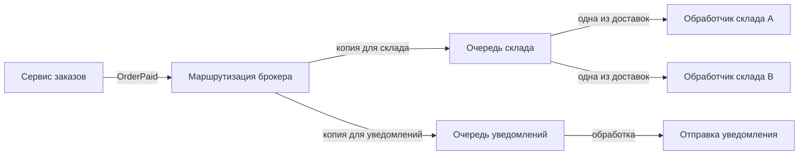
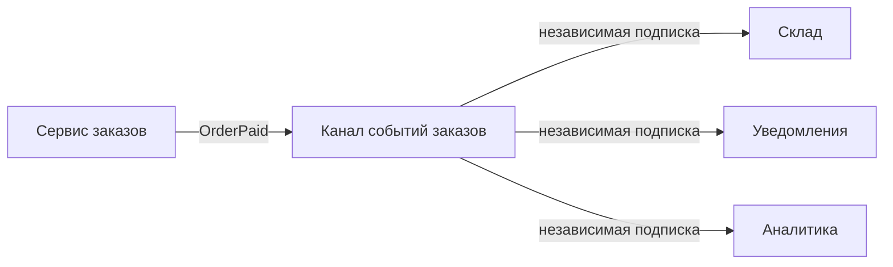
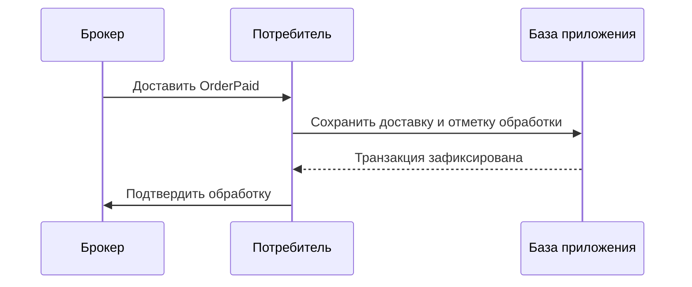
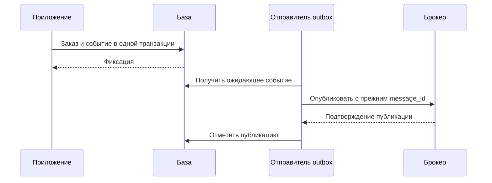

# 1. Основные понятия

## 1.1. Производитель, брокер и потребитель

**Брокер сообщений — посредник, который принимает сообщения от приложений и предоставляет их получателям.** В зависимости от продукта и настроек он маршрутизирует, хранит и повторно доставляет сообщения.

В обмене участвуют три роли:

| Роль | Ответственность | Пример |
|---|---|---|
| **Producer / publisher — производитель / издатель** | Формирует и публикует сообщение | Сервис заказов сообщает об оплате |
| **Broker — брокер** | Принимает сообщение и обеспечивает его передачу по настроенным правилам | Направляет событие подписчикам |
| **Consumer — потребитель** | Получает сообщение и выполняет обработку | Сервис доставки создаёт отправление |

Это роли, а не обязательно отдельные приложения. Сервис доставки может потреблять `OrderPaid`, а затем публиковать `ShipmentCreated`.

**Успешная публикация не означает успешную обработку.** Подтверждение брокера говорит о приёме сообщения в рамках его гарантий, а не о создании доставки.

Брокер также не превращает изменения базы и публикацию в одну транзакцию автоматически. Если заказ сохранён, а сообщение не отправлено, приложению нужен механизм восстановления этого разрыва.

## 1.2. Очередь, топик и модели потребления

**Очередь (queue)** обычно используется для распределения работы: каждое сообщение обрабатывает один из **конкурирующих потребителей (competing consumers)**. Например, несколько экземпляров сервиса делят задания на создание накладных. При сбоях возможна повторная доставка, поэтому «один потребитель» не означает «ровно одна попытка».

**Топик (topic)** — именованный канал или поток сообщений. Его точная семантика зависит от брокера. Он часто используется для **publish/subscribe — публикации и подписки**, когда несколько независимых подписчиков получают одни и те же события.

| Модель | Кто обрабатывает сообщение | Применение |
|---|---|---|
| Конкурирующие потребители | Один из обработчиков одной группы | Распределение заданий |
| Publish/subscribe | Каждый независимый подписчик | Реакция разных систем на событие |

Эти модели можно сочетать: склад и уведомления получают событие независимо, а внутри каждого сервиса работу делят несколько экземпляров.



Диаграмма показывает логическую модель с отдельными очередями подписчиков.

**Названия сущностей нельзя переносить между продуктами буквально.** В RabbitMQ AMQP 0-9-1 сообщения публикуются в **exchange — обменник**, который маршрутизирует их в очереди. `topic exchange` — разновидность маршрутизации, а не журнал сообщений Kafka. [Модель RabbitMQ](https://www.rabbitmq.com/tutorials/amqp-concepts)

В Kafka топики хранят записи независимо от факта их чтения; срок хранения определяется политикой. Это позволяет повторно читать сохранённые события. [Введение в Kafka](https://kafka.apache.org/intro/)

## 1.3. Сообщение, ключ, заголовки, тело и подтверждение

**Сообщение — единица передачи данных через брокер.** Оно может содержать команду «создать отправление» или событие «заказ оплачен».

Условное представление сообщения:

```json
{
  "message_id": "msg-815",
  "key": "order-42",
  "headers": {
    "event_type": "OrderPaid",
    "schema_version": "1.0.0",
    "correlation_id": "checkout-42"
  },
  "body": {
    "order_id": 42,
    "amount_cents": 150000,
    "currency": "RUB"
  }
}
```

Это иллюстрация: клиент брокера может передавать ключ и заголовки отдельными параметрами, а не внутри JSON.

- **Ключ** используется для маршрутизации или распределения сообщений. Он не обязательно уникален.
- **Заголовки (headers)** содержат метаданные: тип, версию, контекст трассировки.
- **Тело (body / payload)** содержит данные команды или события.
- **`message_id`** идентифицирует сообщение и может участвовать в дедупликации.

Например, в Kafka запись имеет ключ, значение, временную отметку и необязательные заголовки. [Структура записи Kafka](https://kafka.apache.org/intro/)

**Acknowledgement, ack — подтверждение обработки** сообщает брокеру, что доставка обработана согласно выбранной политике. Его отправляют после надёжной фиксации требуемого результата.

Если подтвердить слишком рано, сбой может привести к пропуску работы. Если обработать сообщение, но не успеть подтвердить, возможен повтор. Поэтому обработчик должен учитывать дубли. Конкретный механизм подтверждения зависит от брокера.

## 1.4. Зачем нужен брокер

**Брокер отделяет момент появления работы от момента её выполнения.** Это полезно в трёх основных случаях.

**Буфер нагрузки.** Во время распродажи заказы поступают быстрее, чем создаются накладные. Очередь временно накапливает задания. Но она не увеличивает производительность: длительное превышение входного потока приводит к росту задержки.

**Слабая связность.** Производителю не требуется знать адрес каждого потребителя. При этом зависимость от схемы и смысла сообщения сохраняется: переименование поля всё ещё может сломать интеграцию.

**Независимый темп систем.** Обработчик уведомлений может временно остановиться и продолжить работу после восстановления, если сообщения надёжно сохранены и не истёк срок их хранения.

За эти возможности приходится платить эксплуатационной сложностью: наблюдением за очередями, повторами, порядком, совместимостью и восстановлением. Для простого действия с немедленным результатом прямой вызов может быть удобнее.

**Запомнить:** брокер разделяет публикацию и обработку; очередь распределяет работу, подписки обеспечивают независимые реакции, а надёжность зависит от настроек и поведения всех участников.

# 2. Выбор модели доставки

## 2.1. Очередь команд: один исполнитель задачи

**Команда — сообщение с намерением выполнить действие**, например `CreateShipment` — «создать отправление». У неё должен быть понятный ответственный сервис.

Для распределения работы используют очередь с **конкурирующими потребителями — competing consumers**. Несколько экземпляров сервиса получают задания, но конкретную доставку обрабатывает один из них.

```text
Очередь CreateShipment
  ├── обработчик A ← заказ 42
  └── обработчик B ← заказ 57
```

Это позволяет увеличивать производительность числом обработчиков без изменения производителя.

**«Один исполнитель» не означает «ровно одна попытка».** Обработчик мог создать отправление и завершиться до подтверждения. Тогда сообщение поступит повторно, возможно другому экземпляру. Нужна идемпотентность: одна логическая команда не должна создавать несколько отправлений.

В контракте команды полезно определить:

- идентификатор команды и ключ идемпотентности;
- параметры действия;
- срок актуальности;
- способ узнать результат, если он нужен инициатору.

Не стоит направлять команду нескольким независимым сервисам в надежде, что кто-нибудь её выполнит. Ответственность за действие должна оставаться определённой.

## 2.2. Топик событий: независимые подписчики

**Событие — сообщение о произошедшем факте**, например `OrderPaid` — «заказ оплачен». Издатель сообщает факт, а подписчики самостоятельно определяют реакцию.



Склад начинает комплектацию, уведомления отправляют письмо, аналитика обновляет отчёт. У каждого подписчика свои повторы, прогресс и обработка ошибок.

**Независимая подписка отличается от нескольких экземпляров одного подписчика.** Если склад и уведомления конкурируют за одну очередь, событие может получить только один из них.

Реализация зависит от брокера:

- в RabbitMQ для независимых подписчиков обычно создают отдельные очереди;
- в Kafka независимым приложениям назначают разные **consumer groups — группы потребителей**, а экземпляры одной группы делят работу.

**Топик не гарантирует получение всей истории любым новым подписчиком.** Это зависит от хранения сообщений, момента создания подписки и начальной позиции чтения. В Kafka события сохраняются согласно политике хранения и могут читаться повторно. [Введение в Kafka](https://kafka.apache.org/intro/)

Событие следует публиковать после надёжной фиксации соответствующего факта. Название `OrderPaid` не должно означать лишь «отправили запрос на оплату».

## 2.3. Ключ сообщения и порядок внутри сущности

**Ключ сообщения помогает направлять связанные сообщения в одну область упорядочивания.** Например, для событий заказа естественным ключом будет `order_id`:

```json
{
  "key": "order-42",
  "body": {
    "event_id": "evt-815",
    "type": "OrderPaid",
    "order_id": 42,
    "order_version": 3
  }
}
```

Здесь ключ — идентификатор заказа, а `event_id` — идентификатор конкретного события. Они решают разные задачи.

В Kafka топик разделён на **partitions — разделы**. При согласованном выборе раздела события с одним ключом направляются в один раздел, где сохраняется порядок записей. Это не глобальный порядок всех заказов. [Ключи и разделы Kafka](https://kafka.apache.org/intro/)

**Порядок хранения не равен порядку завершения обработки.** Если обработчик запускает сообщения одного заказа параллельно или откладывает неудачное сообщение, следующее может завершиться раньше.

Для строгой последовательности нужны:

- согласованная маршрутизация;
- последовательная обработка внутри нужной области;
- политика повторов, не нарушающая порядок;
- при необходимости версия сущности для обнаружения пропусков и устаревших событий.

В RabbitMQ обычный routing key сам по себе не закрепляет заказ за последовательным обработчиком. Конкурирующие потребители и повторные доставки влияют на наблюдаемый порядок. [Порядок сообщений RabbitMQ](https://www.rabbitmq.com/docs/queues#message-ordering)

Нужно также оценивать **горячий ключ**: одна очень активная сущность может ограничивать производительность, если её сообщения обязаны обрабатываться последовательно.

## 2.4. Что лучше не передавать через брокер

**Большой файл обычно лучше хранить отдельно, передавая через брокер ссылку и необходимые метаданные.** Такой подход называется **Claim Check**.

Например, вместо PDF-каталога на десятки мегабайт:

```json
{
  "type": "ImportCatalog",
  "file_id": "catalogs/import-815.csv",
  "checksum": "sha256:...",
  "schema_version": "1.0.0"
}
```

Файл сначала надёжно сохраняют, затем публикуют сообщение. Получателю нужны права доступа, а срок хранения файла должен покрывать ожидание, повторы и возможную повторную обработку. Идентификатор желательно связывать с неизменяемой версией содержимого.

Большие сообщения увеличивают расходы на передачу, хранение и повторы; допустимый размер зависит от продукта и настроек. Claim Check переносит эти расходы в подходящее хранилище, но добавляет зависимость от него. [Паттерн Claim Check](https://learn.microsoft.com/en-us/azure/architecture/patterns/claim-check)

**Вызов с немедленным обязательным результатом обычно проще выполнить напрямую.** Request–reply через брокер возможен, но требует корреляции ответа, обратного канала, дедлайна и обработки поздних ответов.

Ожидание без ограничения времени не становится безопасным благодаря брокеру. Если работа длительная, лучше явно принять её в обработку и предоставить статус; если результат нужен сейчас — установить конечный бюджет ожидания и сценарий отказа.

**Запомнить:** команды распределяют между исполнителями, события доставляют независимым подписчикам, порядок обеспечивают в выбранной области, а большие данные и ожидание результата требуют отдельного решения.

# 3. Контракт сообщения

## 3.1. Конверт и полезная нагрузка

**Контракт сообщения — соглашение о его структуре, смысле полей и правилах обработки.** **Конверт (envelope)** содержит общие метаданные, а **полезная нагрузка (payload)** — данные конкретной команды или события.

Пример собственного конверта события:

```json
{
  "message_id": "msg-815",
  "type": "OrderPaid",
  "occurred_at": "2026-10-30T10:15:00Z",
  "schema_version": "1.0.0",
  "correlation_id": "checkout-42",
  "data": {
    "order_id": 42,
    "payment_id": "pay-730",
    "amount_cents": 150000,
    "currency": "RUB"
  }
}
```

| Поле | Что нужно зафиксировать |
|---|---|
| `message_id` | Область уникальности и сохранение при повторной доставке |
| `type` | Смысл сообщения: команда или произошедший факт |
| `occurred_at` | Время возникновения факта, формат и часовой пояс |
| `schema_version` | Версия прикладного контракта |
| `correlation_id` | Идентификатор общего бизнес-сценария |
| `data` | Структура и смысл полезной нагрузки |

Для команды вместо времени возникновения события можно определить `created_at`. Если есть срок актуальности, его задают отдельно: время создания не заменяет дедлайн.

**Версия схемы, время события и единицы измерения должны иметь однозначный смысл.** Например, `amount_cents` — целое число минимальных денежных единиц, а не сумма в рублях.

Названия выше — соглашение приложения. Вместо собственного конверта можно использовать **CloudEvents — стандарт описания событий**. У него есть атрибуты `id`, `source`, `type`, `time`, `dataschema`; `specversion` обозначает версию CloudEvents, а не схему бизнес-данных. [Спецификация CloudEvents](https://github.com/cloudevents/spec/blob/v1.0.2/cloudevents/spec.md)

## 3.2. Бизнес-сущность и ключ идемпотентности

**Связь с бизнес-сущностью показывает, к чему относится сообщение; ключ идемпотентности определяет, какой эффект нельзя выполнить повторно.** Это разные назначения.

| Идентификатор | Пример | Назначение |
|---|---|---|
| Бизнес-сущность | `order_id: 42` | Найти заказ |
| Сообщение | `message_id: "msg-815"` | Распознать повтор того же сообщения |
| Корреляция | `correlation_id: "checkout-42"` | Связать этапы оформления |
| Идемпотентность | `shipment-for-payment:pay-730` | Не создать вторую доставку для одной оплаты |

**Один заказ может породить много самостоятельных операций**, поэтому `order_id` обычно недостаточен для дедупликации. Несколько частичных оплат или отправлений не должны ошибочно считаться дублями.

При повторной доставке сохраняют идентификатор исходного сообщения. Но одна бизнес-операция иногда порождает разные сообщения, например после ошибочной повторной публикации. Тогда для защиты эффекта полезнее устойчивый идентификатор операции, такой как `payment_id`.

Ключ идемпотентности необязательно передавать отдельным полем: потребитель может вычислить его по согласованным данным. Важно документировать правило.

**Наличие ключа не обеспечивает идемпотентность автоматически.** Получатель должен атомарно связать регистрацию ключа с бизнес-изменением либо использовать соответствующую гарантию внешней системы. Также определяют область ключа, срок хранения и реакцию на повтор с другими параметрами.

## 3.3. Совместимые изменения схемы

**Совместимость означает, что поддерживаемые отправители и получатели продолжают правильно взаимодействовать после изменения контракта.** Проверять нужно оба направления: старые сообщения с новым потребителем и новые сообщения со старым.

| Изменение | Условие или риск |
|---|---|
| Добавить необязательное поле | Старый потребитель должен допускать и игнорировать его |
| Добавить обязательное поле | Старые сообщения могут перестать проходить проверку |
| Удалить поле | Старый код может продолжать использовать его |
| Изменить тип | Потребители могут ожидать прежнее представление |
| Расширить `enum` | Старый код может не понимать новое значение |
| Изменить единицы измерения | Структура сохранится, но смысл обработки нарушится |

В JSON Schema дополнительные поля разрешены по умолчанию, но `additionalProperties: false` делает добавление нового поля потенциально несовместимым со старой схемой. [Дополнительные свойства](https://json-schema.org/understanding-json-schema/reference/object#additionalproperties)

**Структурная совместимость не гарантирует смысловую.** Замена значения суммы с копеек на рубли при прежнем типе `integer` может пройти валидацию и привести к неверному списанию.

Полезно письменно зафиксировать разрешённые изменения и проверять их в CI на примерах поддерживаемых версий. Несовместимое изменение выпускают как новый контракт с планом миграции. Старые сообщения могут оставаться в очередях и архиве после обновления издателя.

## 3.4. Хранение и идентификация схем

**Источник истины для схем — место, где хранится утверждённый контракт конкретной версии.** Для небольшой интеграции достаточно Git-репозитория; при большом числе участников может быть полезен **schema registry — реестр схем и их версий**.

Пример структуры:

```text
contracts/
  order-paid/
    1.0.0/
      schema.json
      valid-example.json
      invalid-example.json
    README.md
```

Рядом описывают назначение события, владельца, канал публикации, ключ, гарантии порядка и правила повторов. Эти сведения не выражаются одной схемой JSON.

В JSON Schema `$schema` задаёт диалект, а `$id` идентифицирует схему и задаёт базу для ссылок. **URL в `$id` не означает, что валидатор обязательно скачает документ:** способ разрешения схем определяется интеграцией. [Идентификация схем](https://json-schema.org/understanding-json-schema/structuring#id)

Опубликованную версию желательно сохранять неизменной вместе с её зависимостями. Потребитель должен однозначно выбирать схему по типу и версии либо согласованному идентификатору реестра.

Реестр не отменяет проверки на границе. Для неизвестной версии нужна явная реакция: отказ от обработки, карантин и диагностика, а не молчаливый выбор `latest`.

**Запомнить:** контракт фиксирует структуру и смысл сообщения; идентификатор сущности, корреляция и идемпотентность решают разные задачи, а каждая опубликованная схема должна оставаться однозначно доступной по версии.

# 4. Гарантии доставки

## 4.1. At-most-once, at-least-once и effectively-once

**Гарантия доставки определяет, какие потери и повторы допустимы в заданных условиях отказа.** Её нужно описывать для конкретного участка: производитель → брокер, брокер → потребитель или весь путь до бизнес-результата.

| Гарантия | Что означает | Основной риск |
|---|---|---|
| **At-most-once** | Сообщение доставляется не более одного раза | Работа может быть потеряна |
| **At-least-once** | Неподтверждённая доставка повторяется | Работа может выполниться несколько раз |
| **Effectively-once** | Повторы не создают дополнительного наблюдаемого бизнес-эффекта | Требуется защита приложения |

At-least-once действует в пределах оговорённых условий: надёжности хранения, доступности системы, срока хранения и политики повторов. Это не обещание бесконечного восстановления при любых сбоях.

**Effectively-once обычно строят поверх at-least-once и идемпотентной обработки.** Например, повтор события `OrderPaid` не должен создавать вторую доставку.

Для этого нужны стабильный идентификатор операции, атомарная защита от конкурентных дублей и сохранение результата. Если изменения локальные, запись об обработке и бизнес-эффект можно зафиксировать одной транзакцией. Внешний вызов требует собственной защиты, например ключа идемпотентности у платёжного сервиса.

**Exactly-once всегда требует уточнения границ.** Транзакционные гарантии Kafka для обработки между топиками не распространяются автоматически на произвольную внешнюю базу или HTTP API. [Гарантии обработки Kafka](https://kafka.apache.org/41/design/design/)

## 4.2. Подтверждение после успешной обработки

**Acknowledgement, ack — подтверждение, позволяющее брокеру считать доставку обработанной.** Его отправляют после надёжной фиксации результата, за который отвечает потребитель.



Если подтвердить сообщение **до** фиксации результата, последующий сбой может привести к пропуску работы. Если зафиксировать результат, но не успеть подтвердить, брокер может доставить сообщение повторно.

**Publisher confirm и consumer ack подтверждают разные этапы.** Первый относится к публикации в брокер, второй — к обработке получателем. Подтверждение публикации не доказывает, что заказ обработан. [Подтверждения RabbitMQ](https://www.rabbitmq.com/docs/confirms)

В Kafka вместо удаления отдельного сообщения потребитель фиксирует **offset — позицию чтения группы в партиции**. Для восстановления он должен продвигать позицию только за уже обработанные записи. При параллельной обработке нельзя перескочить через незавершённую запись: после перезапуска она может быть пропущена. [Управление позицией потребителя](https://kafka.apache.org/41/design/design/)

«Успешная обработка» может означать надёжную передачу следующему этапу, например запись задания в outbox. Она не обязательно означает завершение всего бизнес-процесса.

## 4.3. Повторная доставка как штатный случай

**Повторная доставка — нормальное следствие неопределённости между выполнением работы и получением подтверждения.** Она возможна даже при исправной бизнес-логике.

Например:

1. Обработчик создал отправление.
2. Соединение с брокером оборвалось до подтверждения.
3. Сообщение получил другой экземпляр обработчика.

Защита должна работать между экземплярами и переживать перезапуск. Обычного множества идентификаторов в памяти недостаточно.

Условный Rails-пример:

```ruby
ApplicationRecord.transaction do
  ProcessedMessage.create!(
    consumer: "shipping",
    message_id: message.fetch("message_id")
  )

  Shipment.create!(
    order_id: message.fetch("data").fetch("order_id")
  )
end

# Подтверждение брокеру — после завершения транзакции
```

Пример предполагает одну базу и уникальное ограничение на `(consumer, message_id)`. Конфликт именно этого ограничения обрабатывают отдельно: уже завершённую обработку можно подтвердить без повторного создания доставки. Нельзя считать любое исключение уникальности признаком дубля.

**Область дедупликации важна:** склад и уведомления должны независимо обработать одно событие. Кроме того, разные сообщения могут описывать одну бизнес-операцию — тогда нужна дополнительная уникальность по её идентификатору.

Срок хранения отметок должен покрывать допустимые повторы и повторное чтение истории. После удаления отметки прежняя защита может перестать действовать.

## 4.4. Порядок внутри ключа или партиции

**Порядок нужно обещать только в определённой области**, например для событий одного заказа, а не для всех сообщений системы.

В Kafka порядок записей определён внутри партиции. Ключ `order_id` помогает направлять связанные события в одну партицию при согласованной стратегии распределения. Изменение числа партиций или алгоритма маршрутизации требует отдельного анализа: ключ может начать попадать в другое место. [Модель Kafka](https://kafka.apache.org/41/design/design/)

**Порядок записи не гарантирует порядок завершения обработки.** Событие № 12 может завершиться раньше № 11 из-за параллелизма или повторов.

Для последовательного процесса определяют:

- область упорядочивания и ключ;
- порядок публикации у источника;
- последовательность обработки связанных сообщений;
- поведение при ошибке: остановить продвижение или допустить пропуск с восстановлением.

Версия сущности, например `order_version`, помогает обнаружить устаревшие события и разрывы последовательности, но сама их не исправляет.

В RabbitMQ конкурирующие потребители, приоритеты и повторная постановка также влияют на наблюдаемый порядок. **Наличие FIFO-очереди не означает глобального порядка бизнес-эффектов.** [Порядок сообщений RabbitMQ](https://www.rabbitmq.com/docs/queues#message-ordering)

**Запомнить:** подтверждай после надёжной обработки, считай дубли штатными и обеспечивай один бизнес-эффект в приложении; порядок гарантируй только в явно указанной области.

# 5. Публикация

## 5.1. Публикация после сохранения состояния и outbox

**Сообщение о факте нужно публиковать после фиксации соответствующего состояния.** Иначе потребитель может получить `OrderPaid`, хотя транзакция заказа затем откатится.

Но последовательность «сохранить, затем отправить» оставляет другую проблему: приложение может завершиться между этими действиями.

**Transactional Outbox — сохранение бизнес-изменения и записи о будущем сообщении в одной локальной транзакции.** Отдельный отправитель затем читает записи и публикует их в брокер.

```ruby
Order.transaction do
  order.update!(status: "paid")

  OutboxEvent.create!(
    message_id: SecureRandom.uuid,
    event_type: "OrderPaid",
    partition_key: order.id.to_s,
    payload: { order_id: order.id }
  )
end
```

Предполагается, что модели используют одну базу и транзакцию, а допустимость перехода в `paid` уже проверена. Конверт сокращён ради примера.

**Атомарно сохраняются состояние и намерение отправить сообщение**, а не состояние и фактическая доставка потребителю. Если транзакция откатится, запись outbox тоже исчезнет. [Паттерн Transactional Outbox](https://docs.aws.amazon.com/prescriptive-guidance/latest/cloud-design-patterns/transactional-outbox.html)

Прямая публикация после сохранения может быть достаточна для некритичного уведомления, потерю которого допускают, либо при наличии отдельной надёжной сверки. Outbox полезен, когда событие необходимо для продолжения процесса.

## 5.2. Закрытие разрыва между базой и брокером

**Dual write — запись в две независимые системы без общей атомарности.** Обычная транзакция базы не делает отправку в брокер своей частью.

| Момент сбоя | Что происходит |
|---|---|
| До фиксации бизнес-транзакции | Изменение и запись outbox откатываются |
| После фиксации, до публикации | Запись остаётся для последующей отправки |
| Брокер принял сообщение, но подтверждение потерялось | Отправитель может опубликовать его повторно |
| Подтверждение получено, но отметка в outbox не сохранена | Также возможна повторная публикация |

Следовательно, **outbox закрывает разрыв за счёт восстанавливаемых попыток, но не исключает дубли**. При повторе сохраняют прежний `message_id`; потребитель должен поддерживать идемпотентность. [Ограничения outbox](https://docs.aws.amazon.com/prescriptive-guidance/latest/cloud-design-patterns/transactional-outbox.html)



Отметку об отправке сохраняют после требуемого подтверждения брокера, а не после помещения сообщения в локальный буфер клиента. **Подтверждение публикации не означает завершение обработки потребителем.** В RabbitMQ publisher confirms и consumer acknowledgements независимы. [Подтверждения RabbitMQ](https://www.rabbitmq.com/docs/confirms)

У отправителя также нужны координация нескольких экземпляров, восстановление зависших записей и политика повторов. Одна таблица outbox без работающего механизма отправки гарантии не даёт.

## 5.3. Ключ партиции и порядок публикации

**Ключ партиции определяет область, в которой связанные сообщения должны попадать в один раздел потока.** Его выбирают по сущности, чья последовательность изменений важна:

| Требуемая последовательность | Возможный ключ |
|---|---|
| События одного заказа | `order_id` |
| Изменения одной доставки | `shipment_id` |
| Операции одного складского остатка | Сочетание `warehouse_id` и `product_id` |

В Kafka топик разбит на **partitions — партиции**, внутри которых записи упорядочены. При согласованной стратегии распределения одинаковый ключ направляет события в одну партицию. [Ключи и партиции Kafka](https://kafka.apache.org/intro/)

**Ключ не исправляет неправильный порядок у отправителя.** Если два экземпляра outbox одновременно отправят версии заказа 12 и 11, брокер может сохранить именно такую последовательность.

Поэтому порядок обеспечивают на всём пути: согласованное изменение сущности, фиксация версии, последовательная публикация её событий и соответствующая обработка потребителем. Сортировки только по времени создания недостаточно при конкуренции.

Идентификатор сообщения не стоит использовать как случайный ключ, если нужен порядок по заказу: связанные события могут разойтись по разным партициям. Обратная крайность — постоянный ключ для всех событий: он концентрирует нагрузку.

Изменение числа партиций или алгоритма распределения требует отдельного анализа сохранения порядка.

## 5.4. Тайм-аут публикации и неотправленные сообщения

**Тайм-аут публикации ограничивает ожидание результата одной попытки.** Нужно уточнить, какие этапы он покрывает: ожидание места в клиентском буфере, соединение, внутренние повторы и подтверждение брокера.

**Тайм-аут означает неопределённый результат, а не доказанный отказ брокера.** Сообщение оставляют в состоянии, допускающем восстановление, и повторяют с тем же идентификатором.

Временные ошибки повторяют с ограниченными паузами. Постоянные ошибки — например, недопустимый размер или неверную конфигурацию — выделяют для диагностики, а не крутят в бесконечном быстром цикле.

Основные показатели:

| Метрика | Что обнаруживает |
|---|---|
| Число записей без подтверждённой публикации | Накопление работы |
| Возраст самой старой такой записи | Длительную задержку |
| Время от фиксации до подтверждения | Реальную задержку публикации |
| Ошибки и тайм-ауты по причинам | Сбой брокера, сети или конфигурации |
| Записи, требующие вмешательства | Окончательно остановленную отправку |

В общем числе учитывают и записи, ожидающие повтора, и зависшие «в работе»: смена внутреннего статуса не должна скрывать проблему.

**Сигнал полезнее привязывать к допустимой задержке процесса**, например «события оплаченных заказов не публикуются дольше минуты», а не к каждому отдельному неудачному вызову.

**Запомнить:** сохраняй событие вместе с состоянием, публикуй с подтверждением и готовностью к дублям; порядок начинается у источника, а задержку публикации нужно измерять до её фактического подтверждения.

# 6. Потребление

## 6.1. Идемпотентная обработка и дедупликация

**Идемпотентный обработчик при повторном получении одной операции не создаёт дополнительного бизнес-эффекта.** **Дедупликация** помогает этого добиться: приложение распознаёт уже обработанное сообщение по устойчивому идентификатору.

Например, повтор `OrderPaid` не должен создавать вторую доставку.

```ruby
ApplicationRecord.transaction do
  ProcessedMessage.create!(
    consumer: "shipping",
    message_id: message.fetch("message_id")
  )

  Shipment.create!(
    order_id: message.fetch("data").fetch("order_id")
  )
end
```

Пример предполагает одну базу и уникальное ограничение на `(consumer, message_id)`. После успешной транзакции сообщение подтверждают брокеру.

**Регистрация сообщения и бизнес-изменение должны фиксироваться атомарно.** Если сначала отдельно сохранить отметку, а затем создать доставку, сбой между действиями приведёт к пропуску работы.

Конфликт именно ограничения дедупликации означает, что обработка уже зафиксирована: повтор можно подтвердить без нового эффекта. Другие ошибки нельзя автоматически считать дублями.

Вызов внешнего перевозчика локальная транзакция не охватывает. Для него нужен собственный ключ идемпотентности или восстановление результата по идентификатору операции.

Отметки хранят достаточно долго для допустимых повторов и повторного чтения истории. Если разные сообщения обозначают одну бизнес-операцию, дополнительно нужна защита по её идентификатору.

## 6.2. Параллелизм и backpressure

**Ограничение параллелизма задаёт число одновременно выполняемых обработок.** Оно защищает память, соединения с базой и внешние зависимости.

Например, восемь обработчиков доставки могут работать параллельно, но только четыре одновременно обращаться к API перевозчика. Лимиты выбирают по измерениям и возможностям зависимостей, учитывая все экземпляры приложения.

**Backpressure — обратное давление:** потребитель уменьшает приём новой работы, когда не успевает обрабатывать текущую. Оно должно доходить до механизма получения сообщений, а не заканчиваться бесконечной очередью внутри процесса.

В RabbitMQ **prefetch** ограничивает число доставленных, но ещё не подтверждённых сообщений. Это не число рабочих потоков: параллелизм исполнения настраивается отдельно. При ручных подтверждениях слишком большой prefetch позволяет потребителю набрать много работы заранее. [Consumer Prefetch](https://www.rabbitmq.com/docs/consumer-prefetch)

| Ограничение | Что контролирует |
|---|---|
| Число обработчиков | Активную работу |
| Prefetch или размер получаемого пакета | Объём заранее принятой работы |
| Размер локального буфера | Накопление в памяти |
| Лимит вызовов зависимости | Нагрузку на внешний сервис |

**Больше параллелизма не всегда означает больше производительности.** Можно перегрузить базу, увеличить ошибки и вызвать лавину повторов. Если важен порядок по заказу, сообщения одного заказа также нельзя безусловно выполнять параллельно.

## 6.3. Повторы с задержкой и пределом попыток

**Повтор нужен для временной ошибки, которую новая попытка способна устранить.** Политика должна различать технический сбой, неверное сообщение и бизнес-отказ.

| Причина | Возможная реакция |
|---|---|
| Временная недоступность перевозчика | Повтор с задержкой |
| Неверный формат сообщения | Сразу изолировать для разбора |
| Неизвестная версия контракта | Карантин до появления поддержки |
| Заказ уже отменён | Завершить по бизнес-правилу без бесполезных повторов |

Задают максимальное число попыток, общий срок обработки и интервалы. Например: **пять попыток всего**, паузы с увеличением и случайным разбросом. Это условная политика, а не универсальное значение.

**Backoff** увеличивает задержки, **jitter** распределяет попытки во времени. Ожидание желательно организовывать без удержания рабочего потока.

Не стоит немедленно возвращать неудачное сообщение в ту же очередь без ограничения: возникает *requeue loop* — цикл повторных доставок, расходующий ресурсы. RabbitMQ отдельно предупреждает о таком поведении. [Подтверждения и повторная доставка](https://www.rabbitmq.com/docs/confirms)

Счётчик попыток должен переживать перезапуск. При переносе в очередь повторов нужно обеспечить надёжное сохранение перед подтверждением исходной доставки.

**Отложенный повтор может нарушить порядок:** следующее событие заказа обгонит неудачное. Для последовательного процесса заранее выбирают политику: приостановить связанные сообщения либо поддержать обработку версий и восстановление пропуска.

## 6.4. Очередь ошибок и ответственность за разбор

**Dead Letter Queue, DLQ — очередь сообщений, выведенных из обычной обработки.** Она сохраняет проблемную работу для диагностики и восстановления, но сама ошибку не исправляет.

Условия помещения определяют явно:

- исчерпан предел попыток или срок обработки;
- сообщение нарушает контракт;
- обнаружена ошибка, требующая исправления кода или данных.

В RabbitMQ сообщения могут маршрутизироваться через **Dead Letter Exchange, DLX** после отказа без возврата в исходную очередь, истечения TTL и других настроенных условий. **DLX — обменник, DLQ — очередь назначения; их нужно настроить.** [Dead Letter Exchanges](https://www.rabbitmq.com/docs/dlx)

Вместе с сообщением сохраняют причину, исходный канал, время первой ошибки, число попыток и идентификаторы корреляции. Секреты и персональные данные требуют соответствующего режима доступа.

Для очереди назначают владельца — обычно команду потребителя. Описывают срок реакции и порядок действий: установить причину, исправить обработчик или данные, проверить актуальность операции, выполнить контролируемый повтор.

**Повтор из DLQ тоже должен быть идемпотентным.** Простое массовое возвращение сообщений может повторить бизнес-эффекты и снова перегрузить систему. Нужны метрики количества и возраста сообщений, а также сигнал о незавершённых пользовательских операциях.

**Запомнить:** потребитель должен безопасно переживать дубли, принимать работу по своим возможностям, ограничивать повторы и передавать окончательные ошибки в управляемый процесс разбора.

# 7. Эксплуатация

## 7.1. Имена каналов, владелец и срок хранения

**Эксплуатационный контракт описывает, кто отвечает за канал, как долго доступны данные и что делать при сбое.** Эти сведения нужны вместе со схемой сообщения.

Имена должны отражать назначение и следовать единому соглашению:

```text
orders.events
shipping.commands
shipping.commands.retry
shipping.commands.dlq
```

Это условная схема именования. Окружения можно разделять именами, пространствами имён или отдельными кластерами. Версию в имя добавляют, если нужен отдельный канал миграции, а не при каждом изменении поля.

Для каждого канала фиксируют:

- владельца контракта и ответственного за эксплуатацию;
- производителей и потребителей;
- права публикации и чтения;
- срок хранения, ограничения объёма и порядок восстановления;
- владельца очереди ошибок.

**Retention — политика хранения сообщений; она отличается от срока бизнес-актуальности.** Событие оплаты может оставаться полезным для повторного построения отчёта, а команда резервирования — стать неактуальной через несколько минут.

В Kafka удаление зависит от политики топика, включая ограничения времени и размера. **Compaction — уплотнение** сохраняет актуальные значения по ключам и не заменяет полную историю событий. [Настройки хранения Kafka](https://kafka.apache.org/41/configuration/topic-configs/)

В RabbitMQ различают TTL сообщения и TTL самой очереди. Истечение сообщения может приводить к удалению или маршрутизации в очередь ошибок при соответствующей настройке. [TTL RabbitMQ](https://www.rabbitmq.com/docs/ttl)

**Хранение должно покрывать ожидаемый простой и время восстановления с запасом.** Иначе потребитель после восстановления обнаружит, что необходимые данные уже недоступны.

## 7.2. Партиции, группы потребителей и допустимый лаг

**Партиция — раздел топика с собственной последовательностью записей.** Она служит единицей распределения работы в обычной модели Kafka consumer groups.

**Consumer group — группа потребителей**, совместно обрабатывающих топик. Для независимой реакции склад и аналитика используют разные группы; экземпляры одного сервиса обычно входят в одну.

В обычной группе Kafka одна партиция назначается одному потребителю в момент времени. Поэтому при шести партициях восемь потребителей не получат восемь независимых назначений для этого топика. Это не ограничивает число внутренних задач обработчика, но их параллелизм требует аккуратного управления порядком и позициями. [Модель потребления Kafka](https://kafka.apache.org/intro/)

Число партиций оценивают по нагрузочным измерениям:

| Фактор | Что учитывать |
|---|---|
| Пиковое поступление | Сообщения и байты в секунду |
| Производительность обработки | Скорость с реальными базой и зависимостями |
| Распределение ключей | Горячие ключи могут перегружать отдельный раздел |
| Восстановление после простоя | Нужна мощность сверх текущего входного потока |
| Цена разделения | Ресурсы брокеров и сложность эксплуатации |

**Больше партиций не исправляет перегруженный ключ**, если его сообщения должны оставаться последовательными. Изменение числа партиций также требует анализа маршрутизации и порядка.

**Лаг — отставание потребителя от доступных данных.** Допустимую величину лучше выражать через бизнес-срок: например, «доставка должна создаваться в течение двух минут после оплаты». Количество записей само по себе не говорит, насколько серьёзно отставание.

## 7.3. Наблюдение за лагом, ошибками и очередью ошибок

**Мониторинг должен показывать, продвигается ли обработка и успевает ли она в согласованный срок.**

| Показатель | Что помогает обнаружить |
|---|---|
| Лаг по группе и партиции | Отставание и неравномерную нагрузку |
| Возраст необработанных операций | Нарушение срока получения результата |
| Скорость поступления и завершения | Рост накопленной работы |
| Ошибки и повторы по причинам | Сбой зависимости или дефект сообщения |
| Размер и возраст DLQ | Неустранённые окончательные ошибки |
| Перезапуски и переназначения | Нестабильность обработчиков |

В Kafka доступны метрики отставания, скорости чтения и другие показатели клиента. Важно уточнять семантику конкретной метрики: отставание позиции чтения и отставание зафиксированной позиции могут различаться. [Мониторинг Kafka](https://kafka.apache.org/41/operations/monitoring/)

**Нулевой лаг не доказывает бизнес-успех:** потребитель мог преждевременно зафиксировать позицию или передать работу во внутреннюю очередь. Поэтому дополнительно измеряют время до конечного результата.

Для RabbitMQ аналогичную картину строят по ожидающим и неподтверждённым сообщениям, возрасту операций и темпу обработки.

Сигнал стоит привязывать к последствиям: «оплаченные заказы не передаются в доставку вовремя». Кратковременный рост очереди после пика может быть штатным, если она быстро сокращается.

Для DLQ нужны владелец и порядок разбора. Простое уменьшение её размера не является успехом: сообщения могли удалить без восстановления пользовательских операций.

## 7.4. Совместимость при выкладке

**Во время постепенной выкладки одновременно работают разные версии приложения.** Кроме того, новый потребитель встречает старые сообщения из очереди или архива.

Минимальная матрица:

| Сообщение | Потребитель | Что проверяем |
|---|---|---|
| Новое | Старый | Сохранена работа ещё не обновлённых экземпляров |
| Старое | Новый | Сохранены обработка накопленных данных и повторное чтение |
| Новое | Новый | Работает целевой контракт |

Проверяют не только JSON Schema, но и смысл обработки: единицы суммы, новые статусы, значения по умолчанию, порядок и идемпотентность.

**Безопасный порядок часто начинается с расширения возможностей получателя:** сначала он учится принимать оба формата, затем издатель начинает отправлять новый. Удалять поддержку старого можно после завершения миграции и оценки оставшихся сообщений.

Нужно учитывать откат релиза: после запуска нового издателя в брокере уже могут находиться сообщения, которые прежний потребитель не понимает. При несовместимом изменении потребуется отдельный канал, преобразователь или иной явный план миграции.

**Запомнить:** каналу нужны владелец и политика хранения, мощности — запас для восстановления, мониторингу — связь с результатом, а выкладке — проверка обеих сторон совместимости.

# 8. Безопасность и отказ брокера

## 8.1. Аутентификация, доступ и шифрование

**Аутентификация определяет, кто подключается; авторизация — какие действия ему разрешены; шифрование защищает передаваемые данные.** Эти механизмы дополняют друг друга.

| Механизм | Что зафиксировать |
|---|---|
| Аутентификация | Учётную запись сервиса, способ подключения и обновления credentials |
| Авторизация | Разрешённые каналы и действия: публикация, чтение, управление |
| TLS | Шифрование соединения и проверку сертификата брокера |
| Ротация | Порядок замены паролей, токенов и сертификатов без длительного простоя |

**Credentials — данные для подтверждения личности:** пароль, токен или сертификат с соответствующим закрытым ключом.

Каждому сервису желательно выдавать собственную учётную запись с минимальными правами. Например, сервис заказов публикует события заказов, но не читает очередь платёжных команд и не удаляет каналы.

В RabbitMQ доступ ограничивается на уровне **virtual host — виртуального пространства ресурсов**, а внутри него — разрешениями на операции с ресурсами. [Контроль доступа RabbitMQ](https://www.rabbitmq.com/docs/access-control)

**TLS должен включать проверку подлинности сервера**, а не только шифрование трафика. При необходимости используют **mTLS — взаимную проверку сертификатов клиента и сервера**. Конкретное сопоставление сертификата с учётной записью настраивают отдельно. [TLS в RabbitMQ](https://www.rabbitmq.com/docs/ssl)

Защита клиентского соединения не означает автоматического шифрования дисков брокера, резервных копий или межузлового трафика. Эти участки рассматривают отдельно.

## 8.2. Минимизация персональных данных и секретов

**Минимизация данных — передача только того, что нужно конкретному получателю для обработки.** Каждое поле сообщения может оказаться в очереди ошибок, архиве, диагностике или у нескольких подписчиков.

Для события оплаты обычно достаточно:

```json
{
  "type": "OrderPaid",
  "data": {
    "order_id": 42,
    "payment_id": "pay-730",
    "amount_cents": 150000,
    "currency": "RUB"
  }
}
```

Полный профиль покупателя, платёжные реквизиты и токен провайдера здесь не нужны.

**Заголовки не являются безопасным местом для секретов.** Их тоже могут сохранять брокер, инструменты наблюдения и административный интерфейс. В `correlation_id`, ключах и именах каналов также не стоит кодировать email или телефон.

| Данные | Предпочтительное решение |
|---|---|
| Пароль или API-токен | Хранилище секретов и доступ сервиса по собственной учётной записи |
| Большой документ | Защищённое хранилище и ссылка либо идентификатор |
| Контакт для доставки | Передавать только необходимому обработчику |
| Техническая диагностика | Код ошибки и идентификаторы вместо полного тела |

Передача идентификатора вместо персональных данных уменьшает распространение копий, но добавляет зависимость от сервиса данных. Поэтому решение зависит от требований доступности и автономности потребителя.

Если чувствительные данные необходимы, определяют получателей, сроки хранения, доступ к DLQ и правила журналирования. **Шифрование соединения не ограничивает использование данных после получения.**

## 8.3. Изоляция окружений

**Изоляция окружений предотвращает попадание тестовых сообщений в production и ограничивает влияние ошибок разработки.**

| Вариант | Что обеспечивает | Ограничение |
|---|---|---|
| Отдельный кластер | Более сильное разделение ресурсов и отказов | Дополнительная стоимость и сопровождение |
| Отдельный vhost или аналог | Логическое разделение ресурсов и доступа | Общие вычислительные ресурсы и инфраструктура |
| Префиксы `prod.*`, `test.*` | Различимые имена каналов | Без разрешений не обеспечивают защиту |

**Префикс — соглашение об именовании, а не граница безопасности.** Его нужно подкреплять отдельными credentials и правилами доступа. Тестовый сервис не должен иметь права публиковать в `prod.orders.events`.

В RabbitMQ vhosts разделяют пространства ресурсов, но не предоставляют физической изоляции: перегрузка общего кластера может затронуть несколько окружений. [Виртуальные хосты RabbitMQ](https://www.rabbitmq.com/docs/vhosts)

В конфигурации приложения явно фиксируют адрес брокера, окружение, пространство имён и учётную запись. Полезно проверять их согласованность при запуске. Production и тесты должны различаться также потребителями, очередями ошибок и хранилищами, на которые ссылаются сообщения.

## 8.4. Поведение при недоступности брокера

**Отказ брокера должен менять поведение приложения по заранее выбранной политике**, а не приводить к бесконечному ожиданию или незаметной потере работы.

| Условие | Поведение |
|---|---|
| Команда надёжно сохраняется вместе с outbox | Можно принять её, показав незавершённый статус |
| Надёжного буфера нет | Не подтверждать успешный приём работы |
| Брокер принял сообщение, но ответ потерялся | Считать результат неопределённым, повторять с прежним ID |
| Буфер приближается к пределу | Ограничивать приём новой работы |

**Outbox позволяет пережить простой брокера, пока доступны база и достаточный объём хранения.** Он не даёт бесконечного запаса. Для длительного сбоя задают предел накопления и допустимое время ожидания.

Публикация должна иметь тайм-аут. Переподключения и повторы выполняют с задержкой и случайным разбросом, чтобы восстановившийся брокер не получил одновременный шквал запросов. Восстановление соединения само по себе не доказывает доставку всех сообщений: неподтверждённые публикации требуют отдельного учёта. [Надёжность RabbitMQ](https://www.rabbitmq.com/docs/reliability)

Дежурному сигнализируют о последствиях: растёт возраст неопубликованных событий, команды не завершаются в срок, заканчивается место. Единичный разрыв соединения без влияния на результат может оставаться диагностическим событием.

В инструкции восстановления фиксируют: кто отвечает за брокер и приложение, как проверить накопление, возобновить отправку с ограниченным темпом и сверить незавершённые операции. **После восстановления возможны дубли и всплеск нагрузки**, поэтому идемпотентность и backpressure остаются обязательной частью выбранной модели.

**Запомнить:** права, шифрование и изоляция решают разные задачи; при отказе брокера подтверждай только надёжно сохранённую работу, ограничивай накопление и сигнализируй о нарушении пользовательских сроков.


