# C4 Model

> Иллюстрированный конспект. Диаграммы приведены в Mermaid: их можно отображать в совместимом Markdown-редакторе. Архитектурные примеры используют интернет-магазин; схемы приближения и процессов отмечены отдельно.

# 1. Основные понятия C4 Model

## 1.1. Назначение и четыре уровня

**C4 Model — способ описывать архитектуру через последовательное приближение:** от системы в её окружении до деталей кода.

| Уровень | Главный вопрос | Что показываем |
|---|---|---|
| **Context** | Кто использует систему и с чем она взаимодействует? | Систему целиком, пользователей и внешние системы |
| **Container** | Из каких приложений и хранилищ состоит система? | Веб-приложение, API, фоновые обработчики, БД и связи |
| **Component** | Как устроено конкретное приложение внутри? | Основные компоненты, их ответственность и зависимости |
| **Code** | Как реализован конкретный компонент? | Классы, интерфейсы, функции и их связи |

Пример приближения:

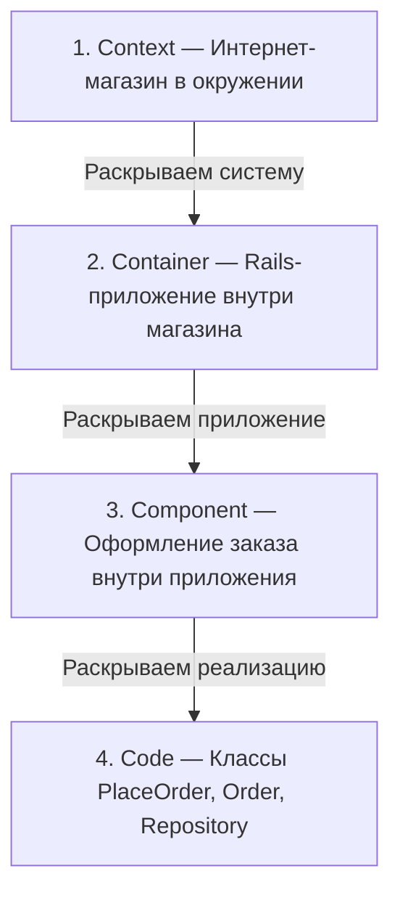

**Как читать:** это схема приближения, а не взаимодействия во время работы. Каждый следующий уровень раскрывает выбранный элемент предыдущего.

**Не обязательно рисовать все четыре уровня.** Для многих команд достаточно Context и Container; детализацию добавляют, если она помогает понять архитектуру. [Описание уровней C4](https://c4model.com/diagrams).

## 1.2. Аудитория каждого уровня

**Context** — для бизнеса, пользователей, разработчиков и других участников. Показывает назначение системы и её окружение без подробностей реализации.

**Container** — прежде всего для технической аудитории: разработчиков, архитекторов и специалистов эксплуатации. Помогает понять основные технологии, ответственность приложений и взаимодействие между ними.

**Component** — для разработчиков и архитекторов, которым нужно разобраться внутри конкретного контейнера. [Описание Component](https://c4model.com/diagrams/component).

**Code** — для людей, работающих с реализацией конкретного компонента. Такой уровень полезен для сложных участков; его часто удобнее получать автоматически из инструментов разработки. [Описание Code](https://c4model.com/diagrams/code).

**Главное:** выбирай детализацию под вопрос аудитории. Бизнесу обычно не нужны классы, а разработчику для изменения компонента недостаточно общей картины.

## 1.3. Базовые элементы

| Элемент | Значение | Пример |
|---|---|---|
| **Person** | Человек или роль, взаимодействующая с системой | Покупатель, оператор |
| **Software System** | Система, предоставляющая возможности пользователям | Интернет-магазин |
| **Container** | Приложение или хранилище данных внутри системы | Rails-приложение, PostgreSQL |
| **Component** | Группа связанной функциональности за определённым интерфейсом внутри контейнера | Компонент оформления заказов |

Иерархия:

```text
Software System
└── Container
    └── Component
        └── Элементы кода
```

Компонент обычно не развёртывается отдельно: он является частью контейнера. [Абстракции C4](https://c4model.com/abstractions).

**Container в C4 не равен Docker-контейнеру.** Это архитектурная граница приложения или хранения данных. Например, Rails-приложение и его БД — два C4-контейнера независимо от способа запуска. Серверы, экземпляры и их размещение описывают отдельно на диаграмме развёртывания. [Определение Container](https://c4model.com/abstractions/container).

Связи между элементами подписывают по смыслу: «оформляет заказ», «проводит оплату», «читает и записывает данные». На технических уровнях добавляют протокол или технологию.

## 1.4. C4 и UML

**C4 задаёт уровни рассмотрения архитектуры и основные абстракции. UML предоставляет набор типов диаграмм и правил изображения структуры и поведения.**

| Задача | Подход |
|---|---|
| Показать систему, пользователей и интеграции | C4 Context |
| Показать приложения и хранилища | C4 Container |
| Разобрать классы и интерфейсы | UML class diagram |
| Показать порядок вызовов при оплате | UML sequence diagram |
| Показать допустимые состояния заказа | UML state machine diagram |

Их можно сочетать: сначала показать место компонента на C4-диаграмме, затем раскрыть его классы или поведение через UML. Уровень Code прямо допускает использование UML-диаграмм классов. [Описание уровня Code](https://c4model.com/diagrams/code).

**Запомнить:** Context — окружение системы, Container — приложения и хранилища, Component — внутренние части приложения, Code — реализация этих частей.

# 2. Нотация и правила

## 2.1. Подписи элементов

**Каждый элемент должен объяснять, что это и за что он отвечает.**

| Поле | Пример |
|---|---|
| **Название** | Приложение заказов |
| **Тип** | Container |
| **Технология** | Ruby on Rails |
| **Ответственность** | Оформляет заказы и управляет их состоянием |

Пример блока:

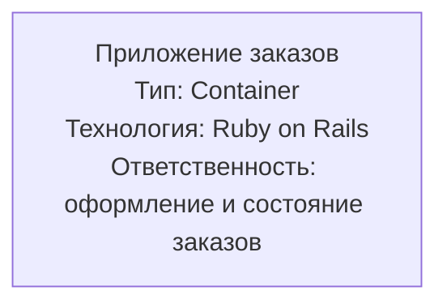

**Пример подписи элемента.** Блок содержит название, тип, технологию и ответственность.

**Технологию указывают для контейнеров и компонентов.** Для человека она не нужна, а на уровне Context обычно достаточно назначения системы без технических деталей.

Ответственность описывают конкретно: «Хранит заказы и их позиции» понятнее, чем «Работает с данными». [Правила элементов C4](https://c4model.com/diagrams/notation).

## 2.2. Подписи связей

**Каждая стрелка должна показывать понятное однонаправленное отношение.** Подпись объясняет, зачем элементы взаимодействуют.

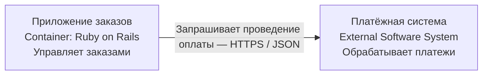

**Пример связи.** Стрелка обозначает вызов от приложения к внешней системе; подпись объясняет цель и способ взаимодействия.

Между контейнерами указывают протокол или технологию взаимодействия. На уровне Context обычно достаточно бизнес-смысла: «Проводит оплату».

Избегай общих подписей вроде «Использует» или «Взаимодействует». Лучше: «Получает остатки», «Публикует событие создания заказа», «Читает и записывает заказы».

**Направление зависит от смысла связи:**

- «Вызывает API» — стрелка от вызывающего к получателю.
- «Передаёт событие» — стрелка по направлению передачи.

Ответ на HTTP-запрос не требует второй стрелки, если первая показывает вызов API. Если есть отдельный callback или публикация события, это самостоятельная связь. [Правила связей C4](https://c4model.com/diagrams/notation).

## 2.3. Заголовок, легенда и scope

**Диаграмма должна быть понятна без устного объяснения автора.**

Добавляют:

- **Заголовок:** тип диаграммы и название рассматриваемого объекта.
- **Scope — область рассмотрения:** какую систему, контейнер или компонент раскрываем.
- **Легенду:** значения цветов, форм, границ и типов линий.

Пример:

```text
Заголовок: Container diagram — Интернет-магазин
Scope: приложения и хранилища интернет-магазина

Легенда:
Синий блок — внутренний контейнер
Серый блок — внешняя система
Рамка — граница интернет-магазина
```

Scope — это **фокус диаграммы**, а не список всех её элементов: внешние зависимости тоже можно показывать для понимания взаимодействия.

C4 не требует конкретных цветов или фигур. Важно использовать их последовательно и объяснять значения. [Нотация C4](https://c4model.com/diagrams/notation).

## 2.4. Однозначность стрелок и терминов

Типичные источники путаницы:

| Проблема | Как исправить |
|---|---|
| Двунаправленная стрелка без объяснения | Разделить на конкретные однонаправленные отношения |
| Стрелка подписана «Данные» | Указать действие и какие данные передаются |
| Цвета и пунктир имеют неизвестный смысл | Добавить объяснение в легенду |
| Сокращение непонятно аудитории | Расшифровать при первом использовании или в легенде |
| На Context показаны отдельные классы | Перенести детали на подходящий уровень |
| Много пересечений линий | Переставить элементы или разделить диаграмму |

Не смешивай без пояснения **зависимость**, **поток данных** и **порядок выполнения**. Структурная C4-диаграмма показывает связи, но сама по себе не описывает последовательность шагов сценария.

Перед публикацией проверь: понятно ли, что делает каждый элемент, куда направлена каждая связь и зачем она нужна? [Чек-лист C4](https://c4model.com/diagrams/checklist).

**Запомнить:** элемент отвечает на вопросы «что это и что делает», связь — «кто, с кем и зачем взаимодействует», заголовок и легенда задают контекст чтения.

# 3. Диаграмма Context (уровень 1)

## 3.1. Система как единый блок

**Context показывает систему целиком и её место в окружении.** Внутреннее устройство — приложения, БД, компоненты — здесь не раскрывают.

В блоке указывают:

- название;
- тип `Software System`;
- краткое назначение.

Пример:

```text
Интернет-магазин
[Software System]

Позволяет выбирать товары, оформлять
и отслеживать заказы
```

**Сначала определи границу:** что входит в рассматриваемую систему, а что является её окружением. Внешняя система может принадлежать той же компании — «внешняя» означает находящаяся за выбранной границей.

## 3.2. Пользователи и роли

**Person обозначает роль человека, взаимодействующего с системой**, а не обязательно конкретного сотрудника.

Пример:

| Роль | Для чего использует систему |
|---|---|
| **Покупатель** | Выбирает товары, оформляет и отслеживает заказы |
| **Оператор** | Обрабатывает заказы и помогает покупателям |
| **Администратор каталога** | Управляет ассортиментом и описаниями товаров |

Роли разделяют, если у них существенно разные цели или способы взаимодействия. Если различие не помогает понять систему, отдельный элемент не нужен.

Подписывай связи действиями: **«Оформляет заказы»**, а не просто «Использует».

Автоматизированный участник, например платёжный провайдер, отображается как система, а не как Person.

## 3.3. Внешние системы и интеграции

Показывают внешние системы, которые **непосредственно взаимодействуют** с рассматриваемой системой.

Для интернет-магазина:

- **Платёжная система:** проведение оплаты и возвратов.
- **Система доставки:** создание отправлений и получение их статусов.
- **Сервис уведомлений:** отправка сообщений покупателям.

Упрощённый пример Context:

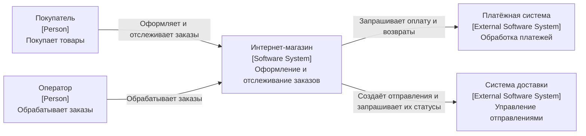

**Заголовок:** Context diagram — Интернет-магазин.  
**Scope:** интернет-магазин и его непосредственное окружение.  
**Легенда:** Person — роль человека; Software System — рассматриваемая система; External Software System — система за её границей. Стрелки показывают, кто инициирует подписанное взаимодействие.

На этом уровне важен **смысл интеграции**, поэтому протоколы, форматы сообщений и адреса API обычно не нужны. [Описание System Context в C4](https://c4model.com/diagrams/system-context).

## 3.4. Понятность для нетехнической аудитории

Проверь, может ли человек без знания реализации ответить:

- Для чего существует система?
- Кто ею пользуется и зачем?
- С какими внешними системами она связана?
- Что входит в её границу?
- Что означает каждая стрелка?

Используй бизнес-термины, расшифровывай сокращения и убирай детали, которые не помогают ответить на эти вопросы.

Например, **«Передаёт запрос на оплату»** понятнее для бизнеса, чем **«POST /payments через HTTPS»**.

Полезная проверка — попросить представителя бизнеса объяснить диаграмму своими словами. Если приходится постоянно дополнять её устно, уточни подписи и границы.

**Запомнить:** Context — это карта системы в её окружении: один блок системы, роли людей, внешние системы и понятные связи между ними.

# 4. Диаграмма Container (уровень 2)

## 4.1. Приложения и хранилища

**Container раскрывает внутреннее устройство одной системы:** какие приложения и хранилища выполняют её функции и как они взаимодействуют.

Типичные контейнеры:

| Контейнер | Ответственность |
|---|---|
| **Веб-приложение** | Обслуживает пользовательский интерфейс |
| **API-приложение** | Принимает запросы и выполняет операции |
| **База данных** | Хранит данные |
| **Брокер сообщений** | Доставляет сообщения для обработки |
| **Кэш** | Хранит временные данные для быстрого доступа |
| **Фоновый обработчик** | Выполняет задачи вне пользовательского запроса |

**Контейнер C4 — приложение или хранилище, а не обязательно Docker-контейнер.** Это логическое представление архитектуры, без детализации серверов и количества экземпляров.

Пример для Rails:

- Rails с серверным HTML — один контейнер; контроллеры, модели и шаблоны находятся внутри.
- Отдельное SPA и Rails API — два контейнера.
- Фоновый обработчик, запускаемый отдельно, — отдельный контейнер, даже если использует тот же репозиторий кода.

Не каждую таблицу, библиотеку или внутренний модуль нужно превращать в контейнер. [Определение Container в C4](https://c4model.com/abstractions/container).

## 4.2. Технологии контейнеров

Для каждого контейнера указывают **название, тип, технологию и ответственность**.

```text
Приложение заказов
[Container: Ruby on Rails]

Принимает запросы покупателей
и управляет заказами
```

Пример набора:

| Название | Технология | Ответственность |
|---|---|---|
| Веб-приложение | Ruby on Rails | Каталог и оформление заказов |
| База заказов | PostgreSQL | Хранение заказов и их позиций |
| Брокер сообщений | RabbitMQ | Передача фоновых задач |
| Обработчик уведомлений | Ruby | Обработка задач отправки писем |
| Кэш каталога | Redis | Ускорение получения данных каталога |

Технологию описывают достаточно конкретно для понимания архитектуры. Версии добавляют, если они существенны для обсуждаемого решения.

## 4.3. Протоколы взаимодействия

**Связь показывает назначение взаимодействия и используемый механизм.**

| Пример подписи | Что означает |
|---|---|
| «Оформляет заказы [HTTPS]» | Пользователь обращается к веб-приложению |
| «Получает данные [gRPC]» | Одно приложение вызывает другое |
| «Публикует задачи [AMQP]» | Приложение отправляет сообщения в брокер |
| «Читает и записывает заказы [SQL, PostgreSQL protocol]» | Приложение обращается к БД |
| «Получает кэшированные данные [RESP]» | Приложение взаимодействует с Redis |

**SQL — язык запросов, а не сетевой протокол.** Подпись `SQL` привычна и полезна, но при необходимости точности указывают также протокол БД.

Различай назначение, протокол и формат: например, **«Запрашивает оплату [HTTPS, JSON]»**.

Направление стрелки должно соответствовать подписи. «Публикует сообщение» направлено к брокеру, «Доставляет сообщение» — от брокера к обработчику. Не смешивай поток данных и направление вызова без пояснения.

## 4.4. Граница системы и внешние связи

**Контейнеры рассматриваемой системы помещают внутрь общей границы.** Пользователей и внешние системы показывают снаружи.

Упрощённый пример:

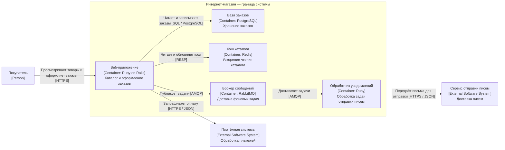

**Заголовок:** Container diagram — Интернет-магазин.  
**Scope:** приложения и хранилища интернет-магазина.  
**Легенда:** рамка — граница системы; внутренние блоки — контейнеры; внешние блоки — пользователь и внешние системы. Стрелки обозначают подписанные вызовы или передачу сообщений. AMQP — протокол обмена сообщениями; RESP — протокол Redis.

Внешние системы остаются цельными блоками: их внутреннее устройство здесь не раскрывают. Размещение на серверах, резервирование и число экземпляров выносят на диаграмму развёртывания.

**Запомнить:** Container показывает, из чего система работает: приложения, хранилища, технологии и взаимодействие между ними.

# 5. Диаграммы Component и Code

## 5.1. Декомпозиция контейнера на компоненты

**Component раскрывает внутреннее устройство одного контейнера:** основные части, их ответственность и зависимости.

Компонент — связная функциональность за определённым интерфейсом. Он может состоять из нескольких классов и обычно не развёртывается отдельно.

Пример для Rails-приложения:

| Компонент | Ответственность |
|---|---|
| **Контроллер заказов** | Принимает HTTP-запросы и формирует ответы |
| **Оформление заказа** | Координирует создание и сохранение заказа |
| **Доменная модель заказа** | Проверяет бизнес-правила |
| **Хранилище заказов** | Загружает и сохраняет заказы |
| **Адаптер платежей** | Переводит внутренние операции в вызовы платёжного API |

Не нужно автоматически рисовать каждый класс или папку как компонент. Выбирай части, которые помогают объяснить устройство приложения.

**Граница диаграммы — один контейнер.** Внешние зависимости показывают рядом, но не раскрывают их внутренности.

## 5.2. Когда нужен уровень Code

**Code раскрывает реализацию одного компонента:** классы, интерфейсы, функции и их связи.

Например, компонент доменной модели заказа:

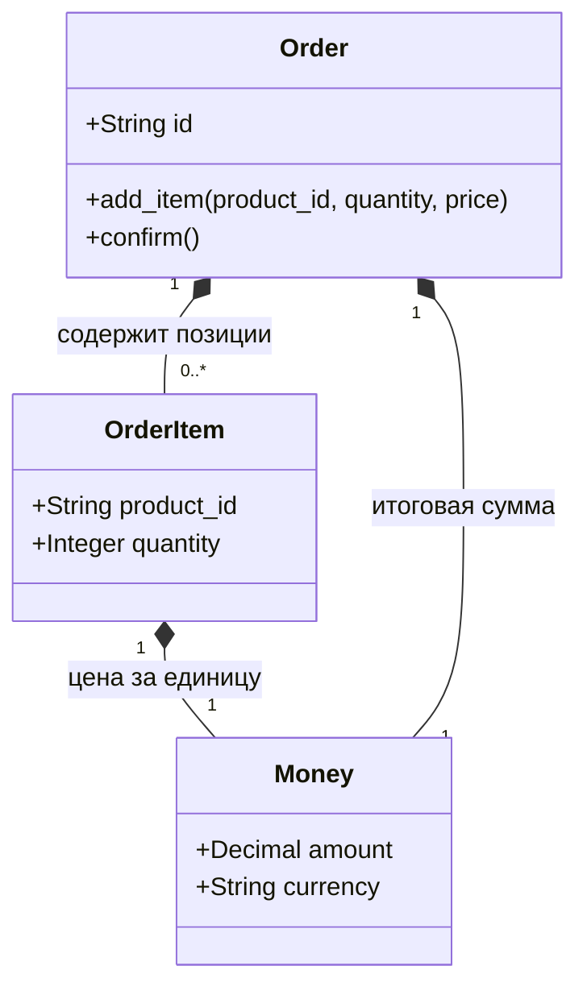

**Code diagram — доменная модель заказа.** Scope: компонент модели заказа, Ruby. Легенда: прямоугольники — классы; ромб — композиция; числа — количество связанных объектов. Это учебная структура, а не автоматическое отражение конкретного кода.

Этот уровень полезен, если нужно объяснить сложную структуру, важный интерфейс или нетривиальные зависимости.

Его можно не создавать, когда:

- код достаточно понятен сам по себе;
- Component уже отвечает на нужные вопросы;
- подробная схема быстро устаревает;
- структуру проще посмотреть в IDE.

**Code-диаграммы часто лучше генерировать из кода по необходимости.** Но результат стоит фильтровать: сотни классов и методов редко помогают понять решение. Можно использовать UML-диаграмму классов.

## 5.3. Пример Component для Rails-приложения

Раскроем контейнер **«Веб-приложение интернет-магазина»** и покажем оформление заказа.

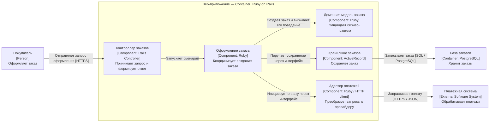

**Заголовок:** Component diagram — Веб-приложение интернет-магазина.  
**Scope:** компоненты оформления заказа внутри Rails-приложения.  
**Легенда:** рамка — раскрываемый контейнер; внутренние блоки — компоненты; снаружи — пользователь, БД и внешняя система. Стрелки показывают вызовы и обращения; внутренние вызовы выполняются в процессе приложения.

Это **структурная диаграмма**, а не последовательность действий. Она не задаёт порядок сохранения и оплаты, границы транзакций или обработку ошибок — для этого нужен отдельный разбор сценария.

При инверсии зависимостей сценарий знает интерфейсы хранения и оплаты. Стрелки выше показывают вызовы во время работы; зависимости кода от интерфейсов можно подробнее раскрыть на уровне Code.

## 5.4. Какие уровни поддерживать

| Уровень | Когда обновлять |
|---|---|
| **Context** | Меняются пользователи, назначение, границы системы или внешние интеграции |
| **Container** | Добавляются приложения и хранилища, меняются технологии или межконтейнерные связи |
| **Component** | Меняются значимые внутренние части выбранного контейнера и их зависимости |
| **Code** | Обычно генерировать по необходимости; вручную поддерживать только полезные ключевые схемы |

**Практический минимум — Context и Container.** Component поддерживают для тех контейнеров, где он помогает разработке и обсуждению архитектуры.

Для каждой поддерживаемой диаграммы полезно определить владельца и обновлять её вместе с соответствующим изменением системы.

**Запомнить:** Component объясняет части одного приложения, Code — их реализацию. Поддерживай ту детализацию, которая помогает принимать решения и остаётся достоверной.

# 6. Дополнительные диаграммы

## 6.1. System Landscape — набор систем

**System Landscape показывает общую картину систем в выбранной области:** организации, подразделении или продуктовой экосистеме.

В отличие от Context, здесь нет обязательного фокуса на одной системе.

Пример:

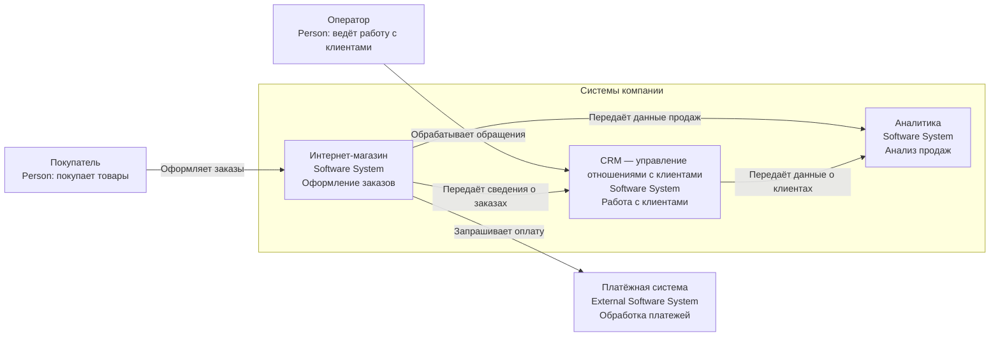

**System Landscape — продажи компании.** Scope: выбранная часть экосистемы. Легенда: рамка объединяет системы компании; снаружи — роли и внешний провайдер; стрелки обозначают подписанные взаимодействия. Здесь несколько систем, а не внутренности одной.

Показывают:

- людей и роли;
- программные системы;
- связи между ними;
- при необходимости — границы организаций или подразделений.

**Внутреннее устройство систем не раскрывают.** Цель — понять, какие системы существуют, кто ими пользуется и как они связаны.

Не обязательно изображать всю организацию: область диаграммы должна быть явно указана.

## 6.2. Dynamic diagram — конкретный сценарий

**Dynamic diagram показывает, как элементы взаимодействуют при выполнении определённого сценария.** В отличие от структурных диаграмм, здесь важен порядок взаимодействий.

Пример: оформление заказа.

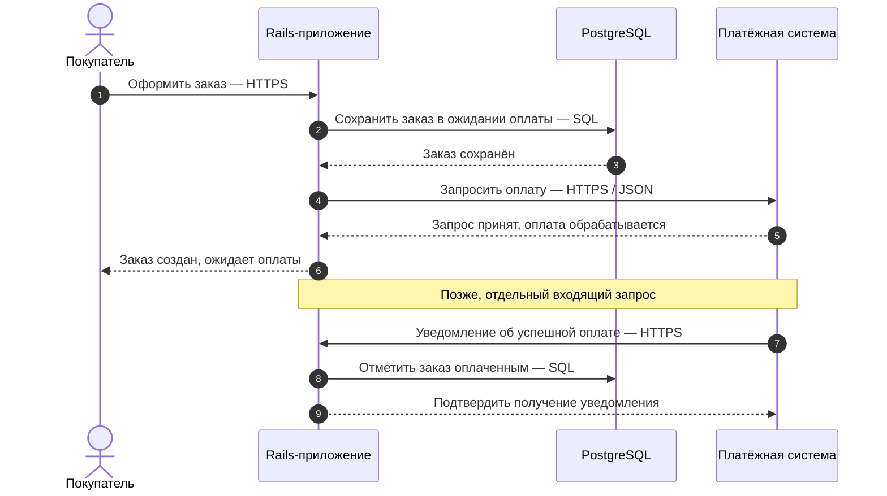

**Dynamic diagram — успешная оплата заказа.** Scope: один сценарий с асинхронным подтверждением платежа. Легенда: сплошные стрелки — запросы, пунктирные — ответы; сверху вниз — порядок взаимодействий. Это представление последовательности; номера включают и ответы. Ошибки и повторы здесь опущены.

Используют элементы из основной модели — системы, контейнеры или компоненты — и подписывают взаимодействия с номерами шагов. Также возможна форма, похожая на sequence diagram.

**Диаграмма описывает один сценарий, а не весь бизнес-процесс сразу.** Основной путь, отказ оплаты и повторную обработку часто удобнее показывать отдельно.

Нужно явно обозначать существенные особенности: асинхронные сообщения, параллельные действия и callback. Нумерация сама по себе их не объясняет.

## 6.3. Deployment diagram — размещение в инфраструктуре

**Deployment показывает, где запускаются экземпляры контейнеров и какая инфраструктура обеспечивает их работу.**

Основные понятия:

- **Deployment node:** среда размещения — устройство, сервер, виртуальная машина, среда исполнения.
- **Container instance:** конкретный экземпляр приложения или хранилища из Container diagram.
- **Infrastructure node:** вспомогательный элемент, например балансировщик.

Пример production-окружения:

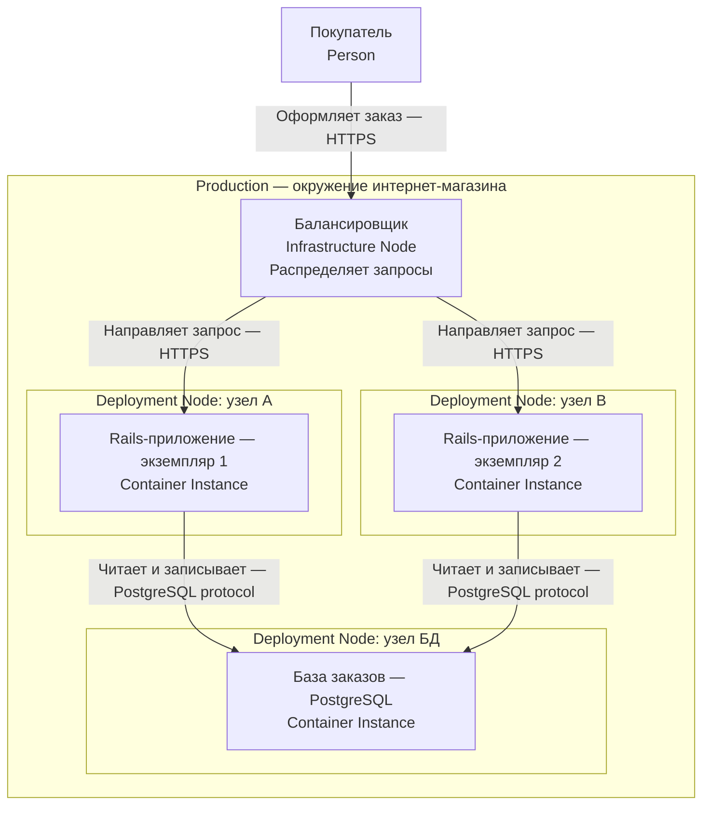

**Deployment diagram — веб-часть магазина в production.** Scope: входной трафик, экземпляры веб-приложения и БД; фоновые задачи и кэш не показаны. Легенда: вложенные рамки — узлы размещения; блоки внутри — экземпляры; отдельный блок балансировщика — инфраструктура. Два экземпляра соответствуют одному контейнеру Rails на уровне Container. БД здесь показана без резервирования.

Один контейнер на архитектурной диаграмме может иметь несколько экземпляров на Deployment diagram.

Здесь показывают значимые детали размещения: регионы, зоны доступности, сетевые границы, резервирование и соединения. Узлы могут быть вложенными: регион → виртуальная машина → среда исполнения.

**Окружение обязательно указывают:** development, staging или production. Их инфраструктура может существенно различаться.

## 6.4. Связь с основными уровнями

| Диаграмма | Как дополняет основную модель |
|---|---|
| **System Landscape** | Показывает окружение нескольких систем; из неё можно перейти к Context конкретной системы |
| **Dynamic** | Показывает взаимодействия элементов Context, Container или Component в одном сценарии |
| **Deployment** | Размещает экземпляры контейнеров на инфраструктурных узлах конкретного окружения |

Пример связанного набора:

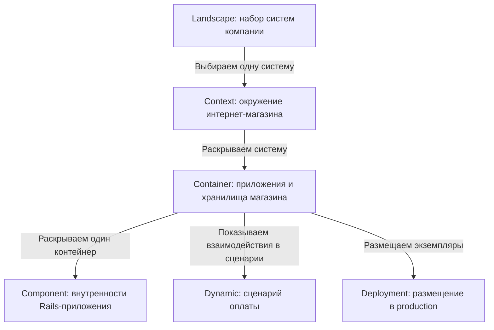

**Карта представлений.** Стрелки обозначают переходы между архитектурными описаниями, а не сетевые вызовы.

Используй согласованные названия и идентификаторы элементов. Если Rails-приложение присутствует на Container diagram, его экземпляры на Deployment должны однозначно ссылаться на него.

**Дополнительные диаграммы — не новые уровни приближения.** Они показывают другие стороны той же архитектуры: окружение, поведение и размещение.

**Запомнить:** Landscape — набор систем, Dynamic — сценарий взаимодействия, Deployment — инфраструктура и экземпляры.

# 7. Инструменты: диаграммы как код

## 7.1. Structurizr DSL

**Structurizr DSL позволяет описать единую архитектурную модель текстом, а затем построить разные представления этой модели.**

Разделяют:

- **Model:** элементы и связи между ними.
- **Views:** что показать на конкретной диаграмме.
- **Styles:** оформление элементов.

Пример Context:

```text
workspace {
    model {
        buyer = person "Покупатель" "Покупает товары"
        shop = softwareSystem "Интернет-магазин" "Оформляет заказы"

        buyer -> shop "Оформляет заказы"
    }

    views {
        systemContext shop "ShopContext" {
            include *
            autoLayout lr
        }
    }
}
```

**Преимущество:** одна система определяется один раз и используется на разных диаграммах. Это уменьшает расхождения в названиях и связях.

DSL — предметно-ориентированный язык описания. Его синтаксис и доступные виды диаграмм описаны в [документации Structurizr](https://docs.structurizr.com/dsl/language).

## 7.2. C4-PlantUML и Mermaid C4

| Инструмент | Особенность |
|---|---|
| **Structurizr DSL** | Сначала общая модель, затем представления |
| **C4-PlantUML** | Набор элементов и макросов C4 для текстовых диаграмм PlantUML |
| **Mermaid C4** | C4-синтаксис Mermaid; удобен там, где поддерживается Mermaid |

Пример C4-PlantUML:

```text
@startuml
!include <C4/C4_Context>

title Context — Интернет-магазин

Person(buyer, "Покупатель", "Покупает товары")
System(shop, "Интернет-магазин", "Оформляет заказы")

Rel(buyer, shop, "Оформляет заказы")

SHOW_LEGEND()
@enduml
```

Для других уровней подключают соответствующие определения, например `C4_Container` или `C4_Component`. [Документация C4-PlantUML](https://github.com/plantuml-stdlib/C4-PlantUML).

Аналогичный пример Mermaid:

```text
C4Context
    title Context — Интернет-магазин

    Person(buyer, "Покупатель", "Покупает товары")
    System(shop, "Интернет-магазин", "Оформляет заказы")

    Rel(buyer, shop, "Оформляет заказы")
```

**Mermaid C4 отмечен как экспериментальный.** Поддержка зависит от версии Mermaid в конкретном редакторе или сервисе. Обычный `flowchart` Mermaid тоже позволяет изобразить архитектуру, но C4-типы и оформление тогда задаются вручную. [Документация Mermaid C4](https://github.com/mermaid-js/mermaid/blob/develop/packages/mermaid/src/docs/syntax/c4.md).

## 7.3. Хранение в репозитории

**Текстовый исходник диаграммы — источник истины.** Изображение является результатом генерации.

Пример структуры:

```text
docs/
└── architecture/
    ├── workspace.dsl
    ├── diagrams/
    │   └── payment-flow.puml
    └── README.md
```

Практические правила:

- обновлять диаграммы в том же изменении, что и архитектуру;
- проверять их при code review;
- использовать согласованные названия элементов;
- фиксировать версии генератора и библиотек;
- документировать способ генерации.

Изображения можно хранить в репозитории или публиковать как результаты CI. Если хранят оба варианта, нужно предотвращать расхождения между исходником и изображением.

**Текстовые диаграммы не становятся актуальными автоматически:** их всё равно нужно обновлять при изменении системы.

## 7.4. Генерация и проверки в CI

Типичный процесс:

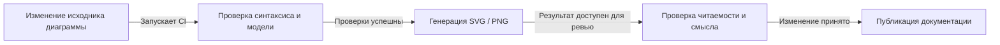

**Процесс поддержки диаграмм.** Это схема работы с документацией, а не C4-диаграмма приложения. CI — непрерывная интеграция.

CI должен завершаться ошибкой, если исходник не разбирается или генерация не удалась.

Для Structurizr есть команда **validate**, проверяющая DSL/JSON workspace. Экспорт в PlantUML или Mermaid создаёт текстовое описание диаграмм; для получения изображений затем нужен соответствующий рендерер. [Проверка Structurizr](https://docs.structurizr.com/validate), [экспорт](https://docs.structurizr.com/cli).

При проверке изменений важно смотреть и на результат:

- читаются ли подписи;
- не перекрываются ли элементы;
- понятны ли направления стрелок;
- присутствуют ли заголовок и легенда.

**Синтаксически правильная диаграмма может быть архитектурно неверной.** CI проверяет техническую корректность, а соответствие реальной системе — автор и ревьюер.

**Запомнить:** диаграммы как код дают историю изменений, совместное редактирование и автоматическую генерацию. Их польза зависит от актуальности модели и читаемости результата.


# Список литературы

https://habr.com/ru/articles/778726/ - С4 — примеры диаграмм и инструменты