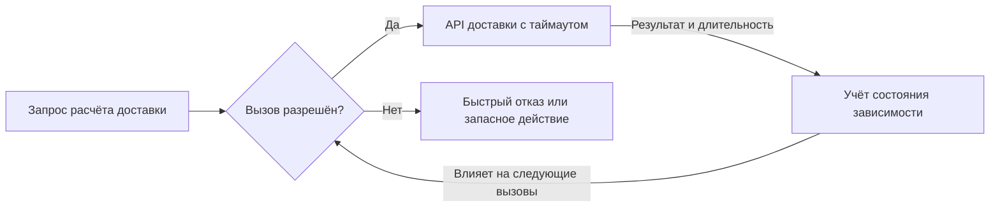

# 1. Зачем разрывать вызовы

## 1.1. Медленная зависимость занимает ресурсы вызывающего сервиса

**Circuit breaker — автоматический размыкатель вызовов** — механизм, который отслеживает результаты обращений к зависимости и при признаках устойчивого сбоя временно прекращает обычные вызовы к ней.

Он защищает не только зависимость, но и вызывающий сервис: тот перестаёт тратить ресурсы на запросы, которые с большой вероятностью завершатся ошибкой или слишком поздно.

Допустим, Rails-приложение обращается к API доставки при оформлении заказа. Обычно ответ приходит за 100 мс, но во время сбоя ожидание растёт до 10 секунд. Пока запрос выполняется, он может занимать:

- поток обработки запроса;
- соединение с внешним API;
- память и место в очереди;
- соединение с БД, если приложение удерживает его во время внешнего вызова.

При потоке **20 вызовов в секунду** и среднем ожидании **10 секунд** системе потребуется примерно **200 одновременно выполняющихся вызовов**, если она допускает такую параллельность. При ограниченном пуле часть запросов начнёт ждать освобождения ресурсов.

**Пул** — ограниченный набор повторно используемых ресурсов, например соединений или рабочих потоков.

Так возникает **каскадный отказ**: проблема доставки приводит к исчерпанию ресурсов приложения, после чего перестают работать даже страницы, которым доставка не нужна.

Асинхронный ввод-вывод может освободить поток на время ожидания, но незавершённый запрос всё равно занимает другие ресурсы. Circuit breaker сокращает число новых бесполезных обращений. Уже выполняющиеся вызовы он сам по себе обычно не отменяет.

## 1.2. Circuit breaker и повторные попытки

**Retry — повторная попытка** — повтор операции после ошибки. Он полезен при кратковременном сбое, когда следующий вызов имеет разумный шанс завершиться успешно.

**Circuit breaker решает другую задачу:** распознаёт повторяющиеся неудачи и прекращает обращения на некоторое время.

| Механизм | Поведение при ошибках | Влияние на число обращений |
|---|---|---|
| Retry | Пробует выполнить операцию ещё раз | Увеличивает |
| Circuit breaker | Временно отклоняет обычные вызовы без обращения к зависимости | Уменьшает |

Например, если каждый из 100 запросов получает две дополнительные попытки, зависимость может получить **300 обращений**. Когда причина сбоя — перегрузка, повторы способны её усилить.

Оба механизма можно использовать вместе, но нужны ограниченное число попыток, общий бюджет времени и паузы. Важно также определить, что считает breaker: каждую фактическую попытку или итог одной операции после всех повторов. От этого зависит скорость обнаружения сбоя.

**Отказ самого breaker не должен запускать немедленные повторы**, снова обходящие ту же защиту.

Для изменяющих операций отдельно нужна **идемпотентность** — защита от дополнительного бизнес-эффекта при повторе. Если API платежей списал деньги, но ответ потерялся, новый вызов без постоянного ключа операции может списать их повторно. Circuit breaker эту проблему не решает.

## 1.3. Circuit breaker и таймаут одного вызова

**Таймаут (timeout)** — ограничение времени ожидания конкретной операции. Например, приложение прекращает ждать расчёт доставки через две секунды.

Но следующий запрос без дополнительных механизмов снова обратится к тому же API и снова займёт ресурсы на две секунды.

**Circuit breaker использует историю вызовов:** после достижения заданного порога ошибок или медленных ответов он временно не отправляет новые обычные запросы.



**Разомкнутая цепь (open)** означает, что обычные обращения заблокированы. В **замкнутой цепи (closed)** вызовы проходят. После периода ожидания механизм обычно разрешает ограниченные пробные обращения, чтобы оценить восстановление зависимости; подробно это определяется правилами переходов состояний.

Таймаут и breaker дополняют друг друга:

- таймаут ограничивает ожидание уже начатого вызова;
- breaker ограничивает новые обращения при накопленных признаках сбоя.

Важно: прекращение ожидания клиентом не гарантирует отмену работы на удалённой стороне. Кроме того, breaker может не успеть предотвратить первый всплеск параллельных запросов — для этого отдельно ограничивают одновременные обращения и очереди.

## 1.4. Деградация при разомкнутой цепи

**Деградация (graceful degradation)** — сохранение полезной части сервиса при недоступности зависимости. **Fallback — запасное действие**, выполняемое вместо основного вызова.

Запасной путь выбирают по бизнес-смыслу:

| Недоступная зависимость | Возможное поведение |
|---|---|
| Рекомендации товаров | Показать страницу без рекомендаций |
| Расчёт доставки | Предложить уточнить стоимость позже, если правила магазина это допускают |
| Отправка уведомлений | Надёжно сохранить задание для последующей обработки |
| Платёжный API | Сообщить о временной недоступности оплаты или проверять неизвестный результат |

**Fallback не должен изображать успех, которого не было.** При недоступной оплате нельзя пометить заказ оплаченным. При использовании кешированной цены доставки нужно учитывать срок её актуальности и допустимость такого расчёта.

Запасное действие тоже расходует ресурсы. Например, переход всех запросов с кеша на БД способен перегрузить её. Поэтому оценивают нагрузку на запасной путь.

Разрыв ограничивают подходящей зависимостью или группой операций. Сбой рекомендаций не должен блокировать оформление заказа, если эти сценарии независимы.

Circuit breaker особенно полезен при повторяющихся сбоях удалённых сервисов. Для редкой операции с дешёвым и быстрым отказом может хватить таймаута и обработки ошибки: механизм добавляет состояние, настройки и необходимость наблюдения.

**Запомнить:** таймаут ограничивает одно ожидание, retry добавляет попытки, а circuit breaker временно убирает заведомо бесполезные вызовы и позволяет сервису перейти в честный ограниченный режим.

# 2. Состояния

## 2.1. Закрытое состояние: обычные вызовы и сбор результатов

**Closed — закрытое, или замкнутое, состояние** — режим, в котором circuit breaker пропускает обычные вызовы к зависимости. Название взято из электрической цепи: замкнутая цепь проводит ток, поэтому **closed означает «вызовы разрешены»**.

Для каждого завершённого обращения механизм учитывает результат. В зависимости от выбранной политики это могут быть:

- число последовательных ошибок;
- доля ошибок среди последних вызовов;
- доля слишком медленных ответов.

Например, магазин вызывает API доставки. Успешный расчёт считается успехом, ошибка соединения — сбоем зависимости. При достижении порога breaker размыкается.

**Не всякая неудачная бизнес-операция означает неисправность зависимости.** Ответ «доставка по этому адресу невозможна» может быть корректным результатом работающего API. Если считать его технической ошибкой, breaker начнёт блокировать исправный сервис.

Политику учёта определяют явно. Для счётчика последовательных ошибок успех обычно обнуляет серию. Для доли ошибок в окне один успех лишь добавляет новое наблюдение.

Пока цепь закрыта, breaker не заменяет таймауты и ограничения параллелизма. До накопления достаточных признаков сбоя несколько медленных вызовов могут уже выполняться одновременно.

## 2.2. Разомкнутое состояние: быстрый отказ без обращения

**Open — разомкнутое состояние** — режим, в котором breaker не отправляет обычные вызовы в зависимость. Вместо ожидания сетевого ответа вызывающий код сразу получает специальный отказ.

Приложение может преобразовать его в **fallback — запасное действие**:

```ruby
begin
  delivery_breaker.call { delivery_api.quote(order) }
rescue CircuitOpen
  DeliveryQuote.pending
end
```

Это условный интерфейс, а не код конкретной библиотеки. Предполагается, что `CircuitOpen` означает запрет вызова, а `pending` явно сообщает: стоимость доставки пока не рассчитана.

**Успешный fallback не является успехом зависимости.** Если приложение показало запасной результат, это не доказывает, что API доставки восстановился.

Отклонённые обращения полезно учитывать отдельно от реальных ошибок API. Иначе метрики смешают два события: «зависимость не ответила» и «мы намеренно к ней не обращались».

После открытия начинается период ожидания перед проверкой восстановления. Обычно новые отклонённые запросы не должны бесконечно отодвигать эту проверку. Такое поведение определяется политикой механизма.

Вызовы, начатые до размыкания, могут ещё завершаться. Их поздние результаты не должны случайно закрыть цепь в обход предусмотренной проверки.

## 2.3. Полуоткрытое состояние: ограниченные пробы

**Half-open — полуоткрытое состояние** — режим проверки зависимости после паузы. Breaker разрешает небольшое число **пробных вызовов**, а остальные обращения продолжает отклонять или обрабатывать запасным способом.

Например, после 30 секунд ожидания разрешается один расчёт доставки:

- проба успешна — можно рассмотреть возврат к обычной работе;
- проба завершилась учитываемой ошибкой — цепь снова размыкается.

**Проба — реальное обращение к зависимости.** Лучше проверять операцию, которая показывает её пригодность для нужного сценария: ответ простого служебного адреса ещё не подтверждает возможность рассчитать доставку.

Если пробой служит изменяющая операция, нужно учитывать её бизнес-эффект и безопасность повторов. Нельзя незаметно проводить тестовый платёж ради проверки доступности.

Ограничение проб должно работать при одновременных запросах. Если сто потоков одновременно увидели, что пауза закончилась, это не должно приводить к ста пробам вместо одной.

При нескольких экземплярах приложения важно также знать область действия breaker. Если состояние локально для каждого процесса, каждый может отправить собственную пробу. Одна проба на процесс не равна одной пробе на весь сервис.

Полуоткрытое состояние тоже требует таймаута: зависшая проба не должна оставлять проверку незавершённой навсегда.

## 2.4. Переходы и выбранная политика

**Переход состояния** — изменение правил допуска вызовов по результату наблюдения или истечению времени.


Для простой модели можно принять такие правила:

| Переход | Условие | Действие |
|---|---|---|
| Closed → Open | Пять последовательных учитываемых ошибок | Запретить новые вызовы, начать паузу |
| Open → Half-open | Прошло 30 секунд | Разрешить одну пробу |
| Half-open → Closed | Проба успешна | Разрешить обычные вызовы, сбросить счётчик ошибок |
| Half-open → Open | Ошибка или таймаут пробы | Начать новую паузу на 30 секунд |

Числа иллюстративные. Более осторожная политика может требовать нескольких успешных проб. Тогда заранее определяют их количество, допустимый параллелизм и обработку промежуточных результатов.

**Истечение таймера разрешает проверку, а не доказывает восстановление.** Нельзя сразу возвращать полный поток только потому, что прошло 30 секунд.

Переход по таймеру может быть реализован отдельным событием либо проверкой времени при следующем запросе. Во втором случае без входящих запросов проба не отправляется.

После закрытия поток обращений снова растёт. Если зависимость выдерживает одну пробу, но ещё не выдерживает рабочую нагрузку, breaker может повторно открыться. При необходимости его дополняют постепенным увеличением нагрузки и ограничением параллельных вызовов.

**Запомнить:** closed пропускает и наблюдает, open быстро отклоняет, half-open осторожно проверяет; вернуть обычный поток можно по результату проб, а не только по истечению паузы.

# 3. Пороги

## 3.1. Последовательные ошибки или доля в окне

**Порог размыкания** — условие, при котором circuit breaker прекращает обычные обращения к зависимости. Два распространённых подхода — считать ошибки подряд или их долю среди наблюдаемых вызовов.

| Подход | Пример условия | Особенность |
|---|---|---|
| Последовательные ошибки | Пять ошибок подряд | Успех прерывает серию |
| Доля ошибок в окне | Не менее 50% ошибок среди последних вызовов | Учитывает сбой, перемежающийся успехами |

**Окно наблюдения** — ограниченный набор результатов, используемый для расчёта. Оно может включать последние N вызовов либо вызовы за последние T секунд.

Например, API доставки отвечает так:

```text
ошибка → ошибка → успех → ошибка → ошибка → успех
```

Порог в пять ошибок подряд не сработает, хотя две трети обращений неуспешны. Порог по доле способен обнаружить такую частичную неисправность, когда накопится достаточное число наблюдений.

Счётчик подряд проще объяснить и использовать при полном отказе зависимости. Доля в окне полезна для нестабильных сбоев, но требует выбора размера окна и минимального числа вызовов.

**Нужно определить единицу учёта:** одна пользовательская операция или каждая фактическая попытка обращения. Если внутри операции выполняются три повтора, они могут дать три наблюдения либо один итоговый результат — в зависимости от расположения breaker относительно механизма повторов.

## 3.2. Размер окна и скорость реакции

**Размер окна** определяет баланс между устойчивостью к случайным ошибкам и скоростью обнаружения сбоя.

Маленькое окно быстрее реагирует, но сильнее зависит от отдельных результатов. Большое сглаживает случайные ошибки, однако может долго сохранять влияние старых успехов.

| Вид окна | При высокой нагрузке | При низкой нагрузке |
|---|---|---|
| Последние N вызовов | Быстро обновляется | Может содержать давно полученные результаты |
| Последние T секунд | Содержит много наблюдений | Может оказаться почти пустым |

Например, последние 100 вызовов при скорости 100 вызовов в секунду описывают примерно секунду работы. При одном вызове в минуту — примерно 100 минут. Одинаковое число наблюдений не означает одинаковую скорость реакции.

Для API доставки можно начать с гипотезы: окно 10 секунд, порог 50%, минимум 20 завершённых вызовов. Затем проверить её на рабочей нагрузке и искусственных сбоях. Эти числа не являются универсальной рекомендацией.

**Breaker видит многие ошибки только после завершения вызова или таймаута.** Если одновременно запущены 100 запросов с таймаутом 10 секунд, ресурсы могут закончиться раньше первого зарегистрированного таймаута.

Поэтому цель «разомкнуть до исчерпания потоков» достигается сочетанием:

- подходящих таймаутов;
- ограничения одновременно выполняющихся обращений;
- ограниченной очереди;
- порога, проверенного под ожидаемой нагрузкой.

Breaker не заменяет ограничение ресурсов. При необходимости отдельно учитывают медленные успешные ответы: они тоже способны удерживать соединения и потоки.

## 3.3. Какие результаты считать ошибками зависимости

**Учитываемая ошибка** — результат, который свидетельствует о проблеме зависимости и влияет на решение о размыкании.

| Результат | Обычно учитывать? | Что уточнить |
|---|---|---|
| Таймаут обращения | Да | Таймаут должен соответствовать допустимой длительности операции |
| Отказ соединения или разрыв сети | Да | Возможно, неисправен путь до зависимости |
| HTTP 5xx | Обычно да | Проверить смысл конкретных кодов и контракт API |
| Ожидаемый HTTP 4xx | Обычно нет | Например, некорректный адрес доставки |
| HTTP 429 | Отдельное правило | Это ограничение частоты, возможно только для конкретного клиента |
| Ошибка до отправки запроса | Обычно нет | Локальная ошибка не доказывает неисправность внешнего сервиса |

**Классификация определяется смыслом ответа, а не только первой цифрой HTTP-кода.** Например, `422` при недопустимом адресе подтверждает, что API обработал запрос. Размыкать цепь для всех покупателей из-за такого ответа неправильно.

Но массовые `401` или `403` могут означать неисправную настройку доступа. Их нельзя просто спрятать как обычные ошибки покупателя: нужны отдельное обнаружение и реакция.

Нужно различать **исключение из статистики** и **учёт как здорового ответа**. Ожидаемый отказ по бизнес-правилу можно считать признаком работоспособности API. Локальную отмену запроса часто разумнее вообще не включать в наблюдения. Выбор влияет на знаменатель доли ошибок.

Отказы самого breaker, пока цепь разомкнута, не являются новыми ошибками зависимости. Успешный запасной результат также не означает успешного обращения к ней.

## 3.4. Минимальное число вызовов

**Минимальный объём наблюдений (minimum call count)** — число учитываемых завершённых вызовов, которое должно накопиться в окне до проверки доли ошибок.

Без него одна ошибка из двух обращений даёт 50% и может разомкнуть цепь по слишком слабому основанию.

Условная проверка на Ruby:

```ruby
def should_open?(calls:, failures:, minimum: 20, threshold: 0.5)
  return false if calls < minimum

  failures.fdiv(calls) >= threshold
end
```

Предполагается, что `calls` положительно после проверки минимума, а `failures` входит в диапазон от нуля до `calls`. Код показывает только условие: хранение окна и безопасное обновление счётчиков при параллельных вызовах здесь не реализованы.

При таких настройках:

- 1 ошибка из 2 — наблюдений недостаточно;
- 9 ошибок из 20 — порог не достигнут;
- 10 ошибок из 20 — цепь размыкается.

**Слишком высокий минимум задерживает защиту.** Если за временное окно никогда не набирается 20 вызовов, правило доли вообще не сработает.

Для редких обращений можно выбрать другой минимум, окно по количеству вызовов или дополнительный порог последовательных ошибок. Если действуют несколько правил, явно записывают, достаточно ли выполнения любого из них.

**Запомнить:** порог — это сочетание способа подсчёта, окна, классификации результатов и минимального числа наблюдений; его проверяют вместе с таймаутами и пределами ресурсов.

# 4. Таймауты

## 4.1. Таймаут вызова и бюджет пользовательского запроса

**Таймаут вызова (call timeout)** — максимальное время, которое сервис готов потратить на одно обращение к зависимости. Его выбирают внутри общего бюджета пользовательского запроса, оставляя время для собственной обработки, запасного действия и отправки ответа.

Например, пользователь должен получить результат оформления заказа за три секунды. Возможный бюджет:

| Этап | Бюджет |
|---|---:|
| Проверка заказа и работа с БД | 500 мс |
| Обращение к API доставки | 1 200 мс |
| Запасное действие при ошибке | 300 мс |
| Остальная обработка и резерв | 1 000 мс |

**Таймаут зависимости не должен занимать всё допустимое ожидание пользователя.** Иначе после его истечения сервис уже не успеет корректно завершить запрос.

Учитывают и ресурсы вызывающего сервиса. Если доступно 40 потоков, длительное ожидание внешнего API может занять их все. Уменьшение таймаута сокращает удержание ресурсов, но само по себе не ограничивает число одновременных запросов.

При повторах считают суммарное время:

```text
Время попыток + паузы между ними + остальная обработка
≤ общий бюджет запроса
```

Полезно различать таймаут и **deadline — крайний срок завершения операции**. Таймаут ограничивает отдельную попытку, а deadline позволяет не начинать новую попытку, когда общий бюджет почти исчерпан.

Слишком короткий таймаут тоже опасен: нормальные, но медленные ответы будут превращаться в ошибки и преждевременно размыкать circuit breaker. Значение выбирают по допустимому ожиданию и измеренным задержкам, включая медленные ответы под нагрузкой.

**Прекращение ожидания не гарантирует отмену удалённой операции.** Платёж или создание отправления могли завершиться после того, как клиент получил таймаут.

## 4.2. Длительность разомкнутого состояния

**Open duration, или период охлаждения (cooldown)** — время, в течение которого разомкнутый circuit breaker не отправляет обычные вызовы в зависимость.

Это отдельная настройка:

| Параметр | Что ограничивает |
|---|---|
| Таймаут вызова | Ожидание конкретного обращения |
| Длительность open | Период отказа от обычных обращений после размыкания |

Например, вызов доставки ограничен одной секундой. После накопления ошибок breaker размыкается на 30 секунд. В течение этой паузы новые запросы сразу получают отказ или запасной результат, не ожидая по секунде каждый.

**Окончание паузы разрешает пробу, а не полный поток.** Breaker переходит в half-open — полуоткрытое состояние — и допускает ограниченное число проверочных обращений.

Время отсчитывают от открытия цепи. При неудачной пробе начинается новая пауза. Обычные отклонённые запросы, как правило, не должны продлевать её бесконечно.

Для измерения таких интервалов используют **монотонные часы**: их отсчёт не скачет при корректировке календарного времени.

Слишком короткая пауза создаёт частые обращения к неисправному сервису. Слишком длинная задерживает возврат к исправной зависимости. Поэтому cooldown проверяют вместе с частотой проб и требованиями к восстановлению обслуживания.

## 4.3. Связь паузы со временем восстановления зависимости

**Время восстановления зависимости** — период, необходимый ей для возвращения в работоспособное состояние: перезапуска, переключения, прогрева или освобождения ресурсов.

Если известно, что после обнаруженного сбоя зависимость заведомо не будет готова ещё 20 секунд, проба через две секунды обычно бесполезна. Период ожидания выбирают с учётом этого ограничения и возможного разброса.

Например, API доставки после перезапуска загружает справочники и начинает обслуживать запросы примерно через 40 секунд. Пауза в 45–60 секунд может быть разумной исходной гипотезой, которую затем проверяют измерениями.

**Важно, от какого события отсчитано время.** Если восстановление занимает 40 секунд от начала сбоя, а breaker открылся спустя 15 секунд, оставшееся ожидание отличается от полного времени восстановления.

Также различают гарантированный минимальный срок и обычную длительность. Если «40 секунд» — только среднее наблюдение, более ранняя ограниченная проба иногда оправданна. Но она не должна создавать заметную нагрузку.

При нескольких неудачных пробах можно увеличивать паузу до заданного предела. **Jitter — случайный разброс задержки** — помогает экземплярам приложения не отправлять пробы одновременно.

Не следует делать паузу короче известного обязательного ожидания. Однако circuit breaker не должен угадывать внутреннее состояние зависимости только по одному историческому числу: окончательное решение о возврате принимают по результатам проб.

## 4.4. Таймаут соединения и таймаут ответа

**Connect timeout — таймаут соединения** — ограничение времени установления подключения. **Response timeout — таймаут ответа** — ограничение ожидания ответа после отправки запроса.

На практике сетевой вызов состоит из нескольких этапов:

```text
Ожидание соединения из пула
→ разрешение DNS-имени
→ подключение
→ защищённое соединение TLS
→ отправка запроса
→ получение ответа
```

**Названия настроек разных клиентов не гарантируют одинаковый охват этапов.** DNS, TLS и ожидание свободного соединения могут иметь отдельные ограничения или входить в общий таймаут — это проверяют в документации выбранной библиотеки.

Например, для условного бюджета вызова в 1 200 мс можно ограничить установление соединения 200 мс. Но оставшиеся этапы всё равно должны укладываться в общий предел, а не получать каждый дополнительные 1 200 мс.

Отдельный нюанс — **read timeout**, таймаут чтения. В некоторых клиентах он ограничивает паузу между порциями данных, а не полное получение ответа. Медленно поступающий ответ тогда способен удерживать вызов значительно дольше ожидаемого.

Поэтому полезны раздельные ограничения этапов и общий deadline. В метриках сохраняют, где именно закончилось время: в пуле, при подключении или при чтении. Это помогает отличить перегрузку собственного сервиса от проблемы зависимости.

**Запомнить:** таймаут вызова ограничивает расход времени и ресурсов, cooldown даёт зависимости восстановиться, а раздельные сетевые таймауты должны укладываться в общий бюджет операции.

# 5. Пробные вызовы и восстановление

## 5.1. Ограниченный допуск в полуоткрытом состоянии

**Пробный вызов (probe)** — ограниченное обращение к зависимости, по которому circuit breaker оценивает возможность возобновить обычную работу.

В **half-open — полуоткрытом состоянии** нельзя сразу пропускать весь поток. Зависимость могла только запуститься и ещё не выдерживать прежнюю нагрузку.

Раздельно задают:

- **число одновременно выполняющихся проб** — например, одну;
- **число успешных проб для восстановления** — например, три.

Это разные ограничения: три успешные пробы можно выполнить последовательно, не создавая трёх параллельных обращений.

**Circuit breaker сам по себе не обязан накапливать очередь запросов.** Отклонённые обращения обычно сразу получают отказ или запасной результат. Если очередь существует отдельно, переход в half-open не должен автоматически выгружать её целиком.

Например, пока API доставки восстанавливается, один заказ получает разрешение на пробный расчёт. Другие запросы сразу видят «Расчёт доставки временно недоступен», а не занимают потоки в ожидании пробного слота.

Выдача разрешений должна быть безопасной при параллельной работе: два потока не должны одновременно занять единственный слот.

Если breaker хранится отдельно в каждом процессе приложения, лимит действует **на процесс**, а не на весь сервис. Двадцать экземпляров могут отправить двадцать проб одновременно. Это учитывают при выборе лимитов и разброса времени проверки.

## 5.2. Возврат после заданного числа успехов

**Критерий восстановления** — условие, после которого breaker закрывает цепь и снова разрешает обычные вызовы.

Пример простой политики:

```text
Одновременно разрешена одна проба.
Для закрытия нужны три последовательные успешные пробы.
Каждая проба ограничена таймаутом.
```

Один удачный ответ может быть случайностью: зависимость способна то отвечать, то падать. Несколько проб дают больше оснований считать её работоспособной.

**Успех пробы определяют по реальному результату зависимости.** Если API доставки не ответил, а приложение показало сохранённый ранее тариф, это успех запасного действия, но не самой пробы.

Желательно проверять операцию, близкую к рабочей. Ответ служебного адреса «процесс запущен» не доказывает, что сервис способен рассчитать доставку с обращением к своим зависимостям.

Слишком медленный ответ также может не удовлетворять критерию восстановления, даже если формально завершился успешно. Это правило задают заранее.

При небольшом трафике три пробы могут набираться долго. Можно ждать естественных запросов либо предусмотреть безопасные проверочные обращения. Для проб с изменением данных необходимо учитывать их бизнес-эффект.

**Закрытие цепи ещё не доказывает способность выдержать полную нагрузку.** Если после трёх успехов приходит большая очередь, возможен повторный отказ. При необходимости breaker дополняют ограничением параллелизма и постепенным увеличением нагрузки.

## 5.3. Повторное размыкание при неудачной пробе

**Правило неуспешной пробы** определяет, когда проверка восстановления считается проваленной.

Для простой модели удобно правило: **любая учитываемая ошибка пробы немедленно возвращает breaker в open — разомкнутое состояние**.

| Результат пробы | Действие |
|---|---|
| Успех, но нужное число ещё не набрано | Остаться в half-open |
| Последний необходимый успех | Перейти в closed |
| Учитываемая ошибка или таймаут | Перейти в open и начать новую паузу |
| Результат, исключённый из статистики | Освободить слот, действовать по отдельному правилу |

Например, последовательность «успех → успех → таймаут» не закрывает цепь. После новой паузы проверка начинается заново.

Более терпимая политика может допускать некоторую долю ошибок среди проб. Она полезна при ожидаемом уровне случайных сбоев, но сложнее: нужны размер проверочной серии, минимальное число результатов и точные условия решения.

Неудача должна классифицироваться так же осмысленно, как в закрытом состоянии. Корректный ответ «доставка по адресу невозможна» не обязательно означает неисправность API.

Если разрешено несколько параллельных проб, одна ошибка может разомкнуть цепь, пока другие ещё выполняются. **Поздний успех оставшейся пробы не должен отменить уже принятое решение.**

Начатые обращения не всегда возможно остановить, но после размыкания новые разрешения больше не выдаются.

## 5.4. Сброс счётчиков и отделение поколений вызовов

**Сброс состояния наблюдений** — очистка или замена статистики, используемой для принятия решений при переходе в новый режим.

Разные состояния должны иметь собственный смысл счётчиков:

| Переход | Что обновить |
|---|---|
| Closed → Open | Начать новую паузу, исключить прежнее окно из следующих решений |
| Open → Half-open | Обнулить успехи проб, подготовить лимит допуска |
| Half-open → Open | Сбросить результаты проб, начать новую паузу |
| Half-open → Closed | Начать чистое окно обычных вызовов |

Без сброса breaker может закрыться после успешных проб и сразу открыться снова из-за ошибок, накопленных до паузы.

Но **обнуления переменных недостаточно при незавершённых вызовах**. Старый запрос способен вернуть результат уже после перехода и попасть в новое окно.

Для этого используют **поколение (generation)** — идентификатор текущего периода наблюдения. Вызов запоминает поколение при допуске, а результат учитывается только там, где он ещё актуален.

Условная идея на Ruby:

```ruby
def record_result(call_generation, result)
  @mutex.synchronize do
    return unless call_generation == @generation

    apply_result(result)
  end
end
```

Это фрагмент, а не полная реализация. Предполагается, что переходы, изменение поколения и выдача разрешений согласованы тем же механизмом синхронизации. Освобождение ресурсов вызова выполняется независимо от того, учтён ли его результат.

**Сбрасывают управляющие счётчики, а не историю наблюдения.** Метрики общего числа ошибок и журнал переходов сохраняют: они нужны для диагностики повторных размыканий.

**Запомнить:** half-open допускает ограниченные пробы, закрытие требует заданных успехов, ошибка запускает новую паузу, а старые результаты не должны менять новое состояние.

# 6. Запасное действие и наблюдение

## 6.1. Ответ при разомкнутой цепи

**Fallback — запасное действие** — поведение приложения, когда основной вызов не выполняется или завершается предусмотренной ошибкой. При разомкнутой цепи оно позволяет быстро вернуть полезный результат либо понятный отказ.

Запасной ответ выбирают по смыслу операции:

| Вариант | Пример для магазина | Ограничение |
|---|---|---|
| Кэшированное значение | Показать ранее полученное описание товара | Проверить допустимый возраст данных |
| Значение по умолчанию | Вернуть пустой список рекомендаций | Пустой список должен быть корректным результатом |
| Явное ожидание | Сохранить заказ со статусом «Расчёт доставки ожидается» | Нужна надёжная последующая обработка |
| Понятная ошибка | Сообщить о временной недоступности оплаты | Не изображать успешный платёж |

**Запасной результат не обязан выглядеть как обычный успех.** Если стоимость доставки неизвестна, нельзя подставить ноль только ради продолжения оформления: клиент может воспринять его как бесплатную доставку.

Для кэша определяют допустимую давность и поведение при отсутствии записи. Для значения по умолчанию проверяют, не меняет ли оно бизнес-правила.

Условный пример на Ruby:

```ruby
def recommendations(product)
  breaker.call { recommendation_api.fetch(product.id) }
rescue CircuitOpen
  cached_recommendations(product.id) || []
end
```

Здесь `breaker` и `CircuitOpen` — условный интерфейс. Предполагается, что кэш читается независимо от API рекомендаций, а отсутствие рекомендаций допустимо.

Перехватывать все исключения подряд опасно: ошибка программирования может незаметно превратиться в «нормальный» запасной ответ. Обрабатывают конкретные ситуации, для которых такое поведение предусмотрено.

## 6.2. Независимость запасного пути

**Независимый fallback** выполняется без повторного обращения к зависимости, от которой circuit breaker защищает сервис.

Типичная ошибка — при открытой цепи читать кэш методом, который при промахе автоматически вызывает тот же API:

```ruby
# Условный пример опасного запасного пути
cache.fetch(key) { delivery_api.quote(order) }
```

Если записи нет, защита фактически обходится. Для fallback нужен режим чтения без автоматической загрузки либо другое явно предусмотренное действие.

Скрытые повторные обращения могут возникать через вспомогательный сервис, обработчик ошибки или повтор той же операции. Поэтому проверяют **весь путь исполнения**, а не только ближайший вызов.

**Запасной путь тоже имеет стоимость и зависимости.** Удалённый кэш может зависнуть, а массовое переключение чтения на БД — перегрузить её. Для него также нужны ограниченные ожидание и параллелизм.

Если fallback сохраняет задание для последующей обработки, само сохранение должно быть надёжным. Нельзя ответить «Отправим письмо позже», если задание осталось только в памяти процесса.

Проверка проста: при принудительно разомкнутой цепи выполнить запросы с заполненным и пустым кэшем. Число обращений к защищаемой зависимости должно остаться нулевым. Пробные вызовы допускаются только по правилам полуоткрытого состояния.

## 6.3. Журнал переходов и причины решений

**Журнал переходов** фиксирует изменение состояния breaker и основания принятого решения. Он помогает понять, почему вызовы прекратились и как зависимость возвращалась в работу.

Для каждого перехода сохраняют:

- имя зависимости и защищаемой операции;
- прежнее и новое состояние;
- момент перехода и экземпляр приложения;
- причину, порог и фактические значения;
- параметры окна или проверочной серии.

Пример структурированной записи:

```json
{
  "event": "circuit_transition",
  "dependency": "delivery_api",
  "operation": "quote",
  "instance": "web-2",
  "from": "closed",
  "to": "open",
  "reason": "failure_rate",
  "calls": 40,
  "failures": 24,
  "threshold": 0.5,
  "window_seconds": 10,
  "at": "2026-11-23T12:00:00Z"
}
```

По ней видно: из 40 вызовов ошибочными оказались 24, то есть 60%, при пороге 50%.

**Не каждый переход вызван порогом ошибок.** Для `open → half-open` причиной будет окончание паузы; для `half-open → closed` — достижение необходимого числа успешных проб. Это отражают отдельными причинами.

Переход обычно журналируют один раз, а не при каждом отклонённом запросе. Иначе массовые отказы заполнят журнал одинаковыми сообщениями. Количество таких запросов удобнее учитывать метрикой.

Не включают пароли, токены и полное содержимое заказов. Для анализа конкретной операции достаточно безопасного идентификатора связи с её журналом.

## 6.4. Метрики состояния и запасного поведения

**Метрика состояния** позволяет увидеть положение breaker на панели наблюдения без построчного чтения журнала.

Удобная модель — три показателя со значением `0` или `1`:

```text
circuit_state{dependency="delivery_api", state="closed"}    0
circuit_state{dependency="delivery_api", state="open"}      1
circuit_state{dependency="delivery_api", state="half_open"} 0
```

Это условные имена метрик, не настройка конкретного инструмента. Для одного breaker одновременно активным должен быть один показатель.

**Если состояние локально для процесса, метрика должна позволять различать экземпляры.** Один процесс может держать цепь открытой, пока другой ещё выполняет обычные вызовы. Среднее числовых кодов состояний даст бессмысленный результат; полезнее показывать число открытых breaker и длительность их открытия.

Одного состояния недостаточно. Дополнительно наблюдают:

| Метрика | Что помогает понять |
|---|---|
| Выполненные вызовы и их результаты | Работоспособность зависимости |
| Отклонённые вызовы | Сколько обращений остановил breaker |
| Пробы и их результаты | Почему восстановление удаётся или срывается |
| Запасные ответы и их ошибки | Работает ли ограниченный режим |
| Переходы состояний | Нет ли частого чередования открытия и закрытия |

**Успешный fallback не должен скрывать отказ зависимости.** Для клиента запрос мог завершиться приемлемо, но сервис уже работает в ограниченном режиме.

Оповещения связывают с длительностью открытия и влиянием на сценарий. Краткое размыкание рекомендаций и длительная невозможность оплаты требуют разной реакции. Идентификаторы заказов не используют как метки метрик: это создаёт слишком много отдельных рядов.

**Запомнить:** запасное действие должно быть честным и независимым, журнал — объяснять переходы, а метрики — показывать текущее состояние и реальную цену деградации.

# 7. Реализация или модель

## 7.1. Исполняемый автомат на Ruby

**Исполняемая модель** — программа, которая воспроизводит правила circuit breaker на искусственных входных данных. Она позволяет проверить переходы без подключения реального API.

Выберем простую политику:

| Параметр | Значение |
|---|---|
| Размыкание в closed | Три учитываемые ошибки подряд |
| Таймаут вызова | Одна секунда |
| Пауза в open | Пять секунд |
| Пробы в half-open | Последовательные |
| Возврат в closed | Две успешные пробы подряд |
| Ошибка пробы | Немедленное размыкание |

В модели `at` — момент начала вызова, `duration` — время до результата или срабатывания таймаута. Время задаётся числами, поэтому ждать реальные секунды не нужно.

```ruby
class Breaker
  attr_reader :state

  def initialize
    @state = :closed
    @failures = @successes = 0
    @retry_at = nil
  end

  def call(at:, result:, duration: 0)
    if @state == :open
      return :blocked if at < @retry_at
      transition(:half_open, at)
    end

    outcome = duration >= 1.0 ? :timeout : result
    finished_at = at + duration

    if outcome == :ok
      @failures = 0
      if @state == :half_open
        @successes += 1
        transition(:closed, finished_at) if @successes == 2
      end
    else
      @failures += 1
      if @state == :half_open || @failures == 3
        transition(:open, finished_at)
      end
    end

    outcome
  end

  private

  def transition(to, at)
    @state = to
    @failures = @successes = 0
    @retry_at = to == :open ? at + 5 : nil
  end
end
```

**Это последовательная модель, а не готовый сетевой клиент.** Допустимые результаты — `:ok` и `:error`; таймаут определяется отдельно. Входные вызовы не перекрываются, время не движется назад, длительность не превышает одну секунду.

Модель не запускает реальный таймер и не отменяет запрос: событие с `duration: 1` означает, что таймаут уже наступил. Для промышленного применения дополнительно нужны ограничения параллелизма, синхронизация состояния и обработка поздних результатов.

## 7.2. Сценарии, которые должна покрывать проверка

**Сценарий проверки** — последовательность событий с заранее указанным ожидаемым результатом.

Основной прогон должен показать:

- **Серию ошибок:** первые две не размыкают цепь, третья размыкает.
- **Таймаут:** учитывается как ошибка зависимости.
- **Открытую цепь:** обращения отклоняются до конца паузы.
- **Период без вызовов:** не создаёт искусственных успехов или ошибок.
- **Неуспешную пробу:** возвращает цепь в open.
- **Успешные пробы:** только второй успех закрывает цепь.
- **Сброс статистики:** после закрытия новая ошибка начинает новую серию.

В этой реализации переход `open → half-open` выполняется **при первом обращении после окончания паузы**. Если запросов нет, сохранённое состояние остаётся `open`, но проба уже разрешена.

Это допустимая модель без фонового таймера. Важно не путать её с автоматической отправкой проверочных запросов.

## 7.3. Прогон без живой зависимости

Следующий код добавляется после класса:

```ruby
breaker = Breaker.new

cases = [
  # start, result, duration, expected result, expected state
  [0,  :error, 0, :error,   :closed],
  [1,  :error, 0, :error,   :closed],
  [2,  :ok,    1, :timeout, :open],
  [7,  :ok,    0, :blocked, :open],
  [20, :ok,    0, :ok,      :half_open],
  [21, :error, 0, :error,   :open],
  [25, :ok,    0, :blocked, :open],
  [26, :ok,    0, :ok,      :half_open],
  [27, :ok,    0, :ok,      :closed],
  [28, :error, 0, :error,   :closed]
]

cases.each do |at, result, duration, expected, state|
  actual = breaker.call(at: at, result: result, duration: duration)
  raise "Mismatch at #{at}" unless [actual, breaker.state] == [expected, state]

  puts "#{at}: #{actual} / #{breaker.state}"
end
```

**`:blocked` означает, что обращение не допущено.** Переданные результат и длительность такого вызова не используются и не меняют счётчики.

Прогон не содержит сети, случайности или реального ожидания. Это делает результат воспроизводимым и позволяет быстро менять пороги.

Но модель подтверждает только собственную логику. Она не доказывает, что реальная библиотека корректно прерывает ожидание, освобождает соединение или предотвращает одновременный запуск нескольких проб.

## 7.4. Сверка переходов и временных границ

Модель выполнена: **все десять проверок прошли**.

| Время события | Фактическое поведение |
|---|---|
| Начало в 2, таймаут в 3 | Третья ошибка открывает цепь до момента 8 |
| 7 | Вызов отклонён, срок паузы не изменён |
| 20 | После периода без вызовов разрешена первая успешная проба |
| 21 | Ошибка второй пробы открывает цепь до момента 26 |
| 25 | Вызов отклонён |
| 26 | На границе окончания паузы разрешена проба |
| 27 | Второй успех закрывает цепь |
| 28 | Новая ошибка не открывает цепь немедленно |

**Паузу отсчитывают от момента обнаружения ошибки**, а не от начала вызова. Поэтому таймаут обращения, начатого в момент 2, открывает цепь в момент 3.

В модели граница задана явно: при `at == retry_at` проба разрешена, а длительность ровно одна секунда считается таймаутом. В реальной реализации конкуренция завершения запроса и таймера тоже требует определённого правила.

При изменении политики обновляют ожидаемые результаты независимо от реализации. Иначе тест, повторяющий вычисления самого автомата, может воспроизвести ту же ошибку вместо её обнаружения.

**Запомнить:** управляемые время и результаты делают пороги проверяемыми; корректная модель должна подтверждать не только открытие цепи, но и паузы, пробы, временные границы и очистку старой статистики.
