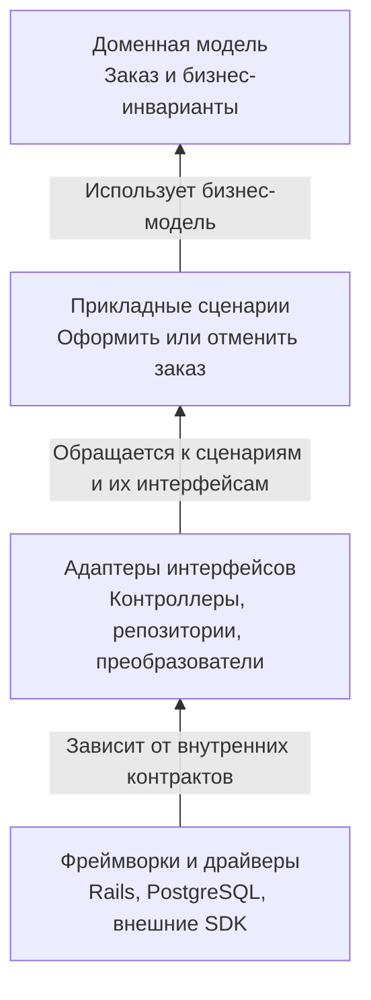

# 1. Основные понятия Clean Architecture

## 1.1. Цели архитектуры

**Clean Architecture — подход к организации кода, при котором бизнес-правила не зависят от технических деталей.** Фреймворки, БД и внешние интерфейсы подключаются вокруг них.

Основные цели:

| Цель | Что это даёт |
|---|---|
| **Снижение стоимости изменений** | Изменение одной части меньше затрагивает остальные |
| **Независимость от деталей** | Бизнес-правила не привязаны к конкретной БД, UI или SDK |
| **Тестируемость** | Основную логику можно проверять без сети и БД |
| **Понятная ответственность** | Видно, где правила, где координация, где техническая работа |

Например, правило «подтверждённый заказ нельзя редактировать» можно проверить без запуска Rails и PostgreSQL.

**Независимость не означает, что сменить БД будет бесплатно.** Придётся менять хранение, запросы и миграции. Архитектура помогает ограничить область этих изменений.

## 1.2. Политика и детали

**Политика — правила и сценарии, определяющие поведение приложения. Детали — технические способы их выполнения.**

| Политика | Деталь |
|---|---|
| Когда заказ разрешено отменить | HTTP-контроллер отмены |
| Как рассчитывается скидка | Способ загрузки данных из PostgreSQL |
| Какие шаги нужны для оформления | SDK платёжного провайдера |
| Какие ограничения должен соблюдать заказ | Формат JSON-ответа |

Различают два уровня правил:

- **Доменная логика:** инварианты и понятия бизнеса — например, допустимые состояния заказа.
- **Прикладная логика:** координация конкретного сценария — загрузить заказ, отменить, сохранить результат.

**Главное правило — Dependency Rule:** зависимости исходного кода направлены к внутренним слоям с более высокоуровневыми правилами.



**Как читать:** стрелки показывают зависимости кода, а не последовательность выполнения.

Сценарий может вызвать сохранение через интерфейс репозитория. Конкретный адаптер реализует этот интерфейс. Поэтому **вызов во время работы может идти наружу, а зависимость кода остаётся направленной внутрь**.

## 1.3. Clean, Hexagonal и Onion Architecture

Эти подходы близки по цели, но по-разному расставляют акценты.

| Подход | Основной акцент |
|---|---|
| **Clean Architecture** | Разделение доменных правил, прикладных сценариев, адаптеров и технических деталей |
| **Hexagonal Architecture — Ports and Adapters** | Приложение взаимодействует с внешним миром через порты и заменяемые адаптеры |
| **Onion Architecture** | Доменная модель находится в центре, зависимости направлены к внутренним слоям |

Для системы заказов:

- **Clean:** отделить `Order`, `PlaceOrder`, контроллер и реализацию хранения.
- **Hexagonal:** сценарий оформления вызывается через входной порт, а хранение доступно через выходной порт.
- **Onion:** инфраструктура зависит от внутренних моделей и контрактов, а не наоборот.

**Порт — контракт взаимодействия, адаптер — его конкретное подключение.** Например, контракт сохранения заказа и адаптер на ActiveRecord.

Это не обязательные альтернативы: одно приложение может соответствовать принципам всех трёх подходов.

Не нужно буквально воспроизводить число кругов или создавать класс для каждой стрелки. Важнее направление зависимостей и разделение ответственности.

## 1.4. Когда подход избыточен

**Для простого CRUD-приложения полное разделение на множество слоёв может стоить дороже, чем приносить пользы.**

Признаки:

- мало бизнес-правил;
- операции почти полностью повторяют создание, чтение, изменение и удаление записей;
- дополнительные классы только передают одинаковые данные;
- разработчику приходится проходить несколько слоёв ради простой правки.

Например, для небольшого справочника офисов может быть достаточно обычных Rails-моделей, контроллеров и тестов.

Но наличие CRUD-эндпоинтов ещё не означает простую предметную область: изменение статуса платежа может запускать сложный процесс с ограничениями и компенсациями.

**Принципы можно применять выборочно:** вынести сложный расчёт, обернуть внешний API адаптером, передать время явно. Не обязательно сразу создавать полную систему портов и репозиториев.

**Запомнить:** Clean Architecture защищает бизнес-правила от технических деталей. Полезность измеряется простотой изменений и проверок, а не количеством слоёв и классов.

# 2. Слои и правило зависимостей

## 2.1. Четыре слоя

**Слои разделяют бизнес-правила, прикладные сценарии и технические способы взаимодействия с системой.**

| Слой | Ответственность | Пример |
|---|---|---|
| **Entities — сущности** | Основные бизнес-понятия и правила | Заказ запрещает изменение своего состава после подтверждения |
| **Use Cases — сценарии использования** | Координация конкретной прикладной задачи | Загрузить заказ, подтвердить, сохранить |
| **Interface Adapters — адаптеры интерфейсов** | Преобразование данных и вызовов между внешними средствами и внутренними контрактами | Контроллер, презентер, адаптер репозитория |
| **Frameworks and Drivers — фреймворки и драйверы** | Техническая инфраструктура | Веб-фреймворк, БД, пользовательский интерфейс, библиотека внешнего API |

**Entity не равна записи в БД.** Это носитель бизнес-правил, которому необязательно знать о таблицах и сохранении.

Пример сценария на псевдокоде:

```text
ПодтвердитьЗаказ(идентификатор):
    заказ = репозиторий.найти(идентификатор)

    если заказ отсутствует:
        вернуть ошибку «Заказ не найден»

    заказ.подтвердить()
    репозиторий.сохранить(заказ)

    вернуть результат «Заказ подтверждён»
```

Сценарий организует действия, а заказ проверяет, допустимо ли подтверждение.

## 2.2. Правило зависимостей

**Зависимости исходного кода направлены внутрь — к более высокоуровневым правилам.** Внутренние слои не должны знать устройство внешних.


**Легенда:** стрелки обозначают зависимости кода, а не последовательность выполнения. Зависимость может пересекать несколько слоёв, если направлена внутрь.

Если сценарию нужно сохранить заказ, он обращается к контракту репозитория. Конкретный адаптер реализует этот контракт:

```text
Сценарий → Контракт репозитория ← Адаптер хранилища
```

Во время работы сценарий вызывает адаптер. Но в коде сценария отсутствует зависимость от конкретной БД или библиотеки хранения.

**Контракт описывает доступные операции, их входы, результаты и ошибки.** Способ его выражения зависит от языка: интерфейс, протокол или соглашение о поведении.

Размещение файлов в папках «Домен» и «Инфраструктура» само по себе не обеспечивает независимость. Важны реальные обращения и передаваемые объекты.

## 2.3. DTO вместо ORM-моделей на границе

**DTO — Data Transfer Object, структура для передачи данных.** Она содержит значения и не выполняет запросы к БД, сетевые вызовы или бизнес-процессы.

Пример входа сценария:

```text
Вход создания заказа:
    идентификатор покупателя
    идентификатор товара
    количество
```

Контроллер извлекает эти данные из запроса и контекста аутентификации, преобразует форматы и вызывает сценарий:

```text
вход = {
    покупатель: идентификатор текущего пользователя,
    товар: идентификатор из запроса,
    количество: преобразованное значение из запроса
}

результат = создатьЗаказ(вход)
```

Бизнес-проверки — например, допустимость заказа — остаются внутри приложения.

На выходе:

```text
Результат создания заказа:
    идентификатор заказа
    состояние заказа
```

Презентер или контроллер преобразует результат в формат внешнего интерфейса.

**ORM — механизм сопоставления объектов с данными хранилища.** Передавать его модели внутрь нежелательно, потому что они могут:

- выполнять скрытые запросы при чтении связанных данных;
- предоставлять операции сохранения и удаления;
- связывать бизнес-код с конкретной технологией;
- требовать БД даже для проверки простого правила.

Адаптер репозитория может преобразовывать ORM-модели в независимые доменные объекты.

**DTO переносит данные, Entity защищает правила.** Не нужно заменять всю доменную модель структурами без поведения.

Для простой операции достаточно отдельных аргументов или записи с полями. Отдельный класс DTO для каждого вызова необязателен.

## 2.4. Нарушения и способы их поиска

| Нарушение | Возможное исправление |
|---|---|
| Сущность сама выполняет запросы к БД | Перенести хранение в адаптер |
| Сценарий получает объект HTTP-запроса | Передать извлечённые значения или DTO |
| Домен напрямую вызывает библиотеку провайдера | Ввести внутренний контракт и внешний адаптер |
| Сценарий возвращает объект запроса ORM | Вернуть независимый результат |
| Сценарий сам создаёт конкретный адаптер БД | Подключить реализацию при сборке приложения |
| Бизнес-правила оперируют кодами внешнего API | Перевести их в собственные понятия на границе |

Нарушения помогают находить:

- просмотр импортов и ссылок на внешние типы;
- поиск обращений к БД, сети и фреймворку внутри бизнес-кода;
- проверка входных и выходных данных сценариев;
- автоматические архитектурные тесты запрещённых зависимостей;
- запуск доменных тестов без инфраструктуры.

**Отсутствие импорта не доказывает независимость.** Переданный объект может скрыто выполнять SQL или сетевой запрос. Нужно проверять не только названия типов, но и доступное поведение.

**Запомнить:** внутренние слои определяют бизнес-правила и необходимые контракты, внешние подключают технологии. Через границы передают данные, не протаскивая инфраструктуру внутрь.

# 3. Принципы проектирования компонентов

## 3.1. SOLID на уровне классов

**SOLID помогает распределять ответственность и управлять зависимостями.** Это ориентиры проектирования, а не требование создавать больше классов и интерфейсов.

| Принцип | Смысл | Пример |
|---|---|---|
| **SRP — Single Responsibility** | Объединять то, что меняется по одной причине, и разделять разные ответственности | Расчёт скидки не отвечает за отправку письма |
| **OCP — Open/Closed** | Предусматривать расширение поведения без постоянной переделки устойчивого кода | Подключить новую стратегию доставки |
| **LSP — Liskov Substitution** | Реализация подтипа сохраняет поведенческий контракт базового типа | Подмена хранилища не меняет ожидаемый смысл `save` |
| **ISP — Interface Segregation** | Не заставлять потребителя зависеть от ненужных ему операций | Отдельный контракт чтения вместо огромного универсального API |
| **DIP — Dependency Inversion** | Высокоуровневые правила и технические реализации зависят от абстракций | Сценарий использует контракт репозитория, а адаптер реализует его |

**SRP не означает «один метод на класс». OCP не означает «никогда не менять существующий код».** Абстракции особенно полезны вокруг реальных вариантов поведения и причин изменений.

## 3.2. Связность компонентов: REP, CCP, CRP

Здесь **компонент — модуль или пакет, объединяющий код**, часто имеющий собственную единицу выпуска. Это не обязательно микросервис или компонент на диаграмме C4.

Принципы связности отвечают на вопрос: **что размещать вместе?**

| Принцип | Смысл |
|---|---|
| **REP — Reuse/Release Equivalence Principle** | Единица повторного использования должна быть единицей управляемого выпуска |
| **CCP — Common Closure Principle** | Код, меняющийся по одним причинам и одновременно, следует объединять |
| **CRP — Common Reuse Principle** | Не стоит объединять то, что потребители не используют совместно |

**REP:** если команда использует библиотеку расчёта цен, ей нужна понятная версия и состав выпуска, а не случайный набор файлов.

**CCP:** связанные правила скидок удобно держать вместе, чтобы изменение политики не затрагивало множество пакетов.

**CRP:** библиотека расчёта цен не должна навязывать потребителю зависимости для генерации PDF, если экспорт ему не нужен.

Между принципами есть напряжение:

- CCP подталкивает объединять совместно изменяемый код;
- CRP — разделять независимо используемый;
- REP — делать результат удобным для выпуска и использования.

**Хорошая граница учитывает и авторов изменений, и потребителей компонента.**

## 3.3. Сочетаемость компонентов: ADP, SDP, SAP

Эти принципы отвечают на вопрос: **как компоненты должны зависеть друг от друга?**

| Принцип | Смысл |
|---|---|
| **ADP — Acyclic Dependencies Principle** | В графе зависимостей компонентов не должно быть циклов |
| **SDP — Stable Dependencies Principle** | Зависимости направляют к более стабильным компонентам |
| **SAP — Stable Abstractions Principle** | Стабильные компоненты должны иметь достаточно абстракций для расширения |

**ADP:** цикл затрудняет независимое изменение, тестирование и выпуск.

```text
Проблема:
Заказы → Платежи → Заказы

Возможное решение:
Заказы → Контракты платежей ← Адаптер платежей
```

Для устранения цикла можно выделить контракт, перенести ответственность или объединить части, которые фактически не самостоятельны.

**SDP:** компонент, от которого зависит много других, трудно менять. Нежелательно привязывать его к легко изменяемым деталям.

**SAP:** устойчивую основу лучше строить вокруг контрактов и расширяемых правил, а конкретные реализации оставлять заменяемыми.

**Стабильность здесь — сопротивление изменениям из-за зависимостей**, а не отсутствие ошибок и не возраст кода. Стабильный компонент всё ещё может содержать дефекты.

## 3.4. Метрики стабильности и абстрактности

### Неустойчивость — Instability

Используют входящие и исходящие зависимости:

- **Ca — afferent coupling:** сколько внешних элементов зависит от компонента;
- **Ce — efferent coupling:** от скольких внешних элементов зависит компонент.

```text
I = Ce / (Ca + Ce)
```

| Значение | Интерпретация |
|---|---|
| **I близко к 0** | Много входящих зависимостей относительно исходящих: компонент структурно стабилен |
| **I близко к 1** | Преобладают исходящие зависимости: компонент структурно неустойчив |

Пример: `Ca = 8`, `Ce = 2`, значит `I = 0,2`.

Если зависимостей нет, знаменатель равен нулю: способ обработки такого случая определяется инструментом.

### Абстрактность — Abstractness

В классическом классовом измерении:

```text
A = число абстрактных классов и интерфейсов /
    общее число классов и интерфейсов
```

- **A = 0:** только конкретные реализации.
- **A = 1:** только абстракции.

В Ruby интерфейсы часто выражаются duck typing, поэтому **эту метрику нельзя безоговорочно переносить из языков с явными интерфейсами**.

### Баланс абстрактности и неустойчивости

Ориентир — линия:

```text
A + I = 1
```

Удалённость от неё часто оценивают нормализованной метрикой:

```text
D = |A + I - 1|
```

Два подозрительных сочетания:

| Сочетание | Возможная проблема |
|---|---|
| **Низкие A и I** | Конкретный компонент с множеством потребителей трудно менять — «зона боли» |
| **Высокие A и I** | Много абстракций, но мало потребителей — возможная «зона бесполезности» |

Это **сигналы для анализа, а не доказательства плохого дизайна**. Например, устойчивые объекты-значения могут быть конкретными и при этом хорошо спроектированными.

При измерении заранее согласуют, что считают зависимостью: связи классов или компонентов, какие файлы и библиотеки учитывают.

**Запомнить:** SOLID помогает проектировать классы, REP/CCP/CRP — группировать код, ADP/SDP/SAP — направлять зависимости. Метрики помогают задавать вопросы, но не заменяют понимание ответственности и причин изменений.

## 3.4. Метрики стабильности и абстрактности

### Неустойчивость — Instability

**Метрика показывает соотношение исходящих и входящих зависимостей компонента.**

- **Ca — afferent coupling:** сколько внешних элементов зависит от компонента.
- **Ce — efferent coupling:** от скольких внешних элементов зависит компонент.

```text
I = Ce / (Ca + Ce)
```

| Значение | Интерпретация |
|---|---|
| **I близко к 0** | Компонент структурно стабилен: от него зависит много других относительно его собственных зависимостей |
| **I близко к 1** | Компонент структурно неустойчив: преобладают его зависимости от других |

Пример: `Ca = 8`, `Ce = 2`, поэтому `I = 0,2`.

**Стабильность здесь не означает надёжность.** Она характеризует сопротивление изменениям: изменение компонента с большим числом потребителей может затронуть многих.

Если зависимостей нет, знаменатель равен нулю. Обработку такого случая определяют отдельно.

### Абстрактность — Abstractness

**Абстрактность показывает долю абстрактных типов в компоненте.**

В классическом классовом измерении:

```text
A = число абстрактных классов и интерфейсов /
    общее число классов и интерфейсов
```

- **A = 0:** только конкретные реализации.
- **A = 1:** только абстракции.

Например, если из десяти типов четыре являются интерфейсами или абстрактными классами, `A = 0,4`.

Метрика зависит от возможностей языка и инструмента. **Контракты, выраженные неявно, трудно корректно учесть простым подсчётом типов.**

### Баланс абстрактности и неустойчивости

Ориентир — **главная последовательность**, линия:

```text
A + I = 1
```

Нормализованное отклонение от неё:

```text
D = |A + I - 1|
```

Чем ближе `D` к нулю, тем ближе компонент к этой линии.

| Сочетание | Возможная проблема |
|---|---|
| **Низкие A и I** | Конкретный компонент с большим числом потребителей трудно менять — «зона боли» |
| **Высокие A и I** | Много абстракций при малом числе потребителей — возможная «зона бесполезности» |

**Это диагностические сигналы, а не оценка качества.** Конкретный устойчивый объект-значение может быть удачным решением, а новый интерфейс — ещё не иметь потребителей.

Перед измерением согласуют единицу подсчёта: классы или компоненты, состав анализируемого кода и правила учёта зависимостей.

**Запомнить:** метрики помогают обнаружить подозрительные зависимости. Улучшать нужно реальные причины сложности, а не числа сами по себе.

# 4. Сущности и сценарии использования

## 4.1. Сущности — носители бизнес-правил

**Entity содержит бизнес-состояние и правила, которые должны соблюдаться независимо от способа запуска приложения.**

Например, нельзя подтвердить пустой заказ ни через пользовательский интерфейс, ни из фонового обработчика.

Псевдокод:

```text
Заказ.подтвердить():
    если состояние не «Черновик»:
        сообщить ошибку «Недопустимое состояние заказа»

    если позиции отсутствуют:
        сообщить ошибку «Пустой заказ»

    состояние = «Подтверждён»
```

Сущность не выбирает HTTP-код, не формирует экран и не выполняет запрос к БД.

**Не вся бизнес-логика обязана находиться в сущности.** Правила значений могут принадлежать Value Objects, а операции без естественного владельца — Domain Services.

## 4.2. Use Case — отдельный сценарий

**Use Case, или Interactor, координирует одну прикладную задачу.** Он получает входные данные, вызывает бизнес-поведение и выдаёт результат.

```text
Получить идентификатор заказа
              ↓
Загрузить заказ
              ↓
Подтвердить по бизнес-правилам
              ↓
Сохранить
              ↓
Сообщить результат
```

Пример входа:

```text
Вход подтверждения:
    идентификатор заказа
```

Пример результата:

```text
Успех:
    идентификатор заказа
    новое состояние

Отказ:
    причина
```

Сценарий не принимает объект HTTP-запроса и не возвращает ответ конкретного фреймворка. Поэтому его можно вызывать из разных интерфейсов.

**Use Case определяет последовательность действий, Entity — допустимость изменения.** Правило запрета подтверждения пустого заказа не нужно повторять в каждом сценарии.

## 4.3. Input Port и Output Port

**Порт — контракт взаимодействия на границе приложения.**

| Порт | Назначение |
|---|---|
| **Input Port** | Определяет, как вызвать сценарий и какие данные передать |
| **Output Port** | Определяет, как сценарий передаёт результат внешнему представлению |

Например:

```text
Input Port:
    выполнить(вход подтверждения)

Output Port:
    представить(результат подтверждения)
```

Interactor реализует входной порт и использует выходной. Presenter реализует выходной порт и преобразует результат в данные интерфейса.

```text
Вызовы во время работы:

Контроллер → Interactor → Presenter
```

```text
Зависимости кода:

Контроллер → Input Port ← Interactor
Interactor → Output Port ← Presenter
```

**Различай данные и контракт:**

- **Input/Output DTO** — что передаём.
- **Input/Output Port** — через какую операцию взаимодействуем.

Контракт репозитория тоже является выходным портом приложения в широком смысле, но выполняет другую задачу: доступ к хранению, а не представление результата.

Для простого сценария достаточно вернуть результат напрямую. Отдельный объект выходного порта представления нужен не всегда.

## 4.4. Ошибки без зависимости от фреймворка

**Внутренние ошибки описывают смысл проблемы, а внешние адаптеры выбирают форму ответа.**

| Ситуация | Представление внутри | Обработка снаружи |
|---|---|---|
| Заказ пустой | Доменная ошибка «Пустой заказ» | Сообщение пользователю |
| Недопустимый переход | Доменная ошибка состояния | Объяснение отказа |
| Заказ не найден | Прикладной результат «Не найден» | Соответствующий ответ интерфейса |
| Хранилище недоступно | Техническая ошибка, при необходимости переведённая в ошибку внутреннего порта | Диагностика и сообщение о недоступности |

Используют собственные исключения или явный результат:

```text
Результат = Успех(данные) ИЛИ Отказ(причина)
```

Пример обработки ожидаемого отказа:

```text
попытаться:
    заказ.подтвердить()

при ошибке «Пустой заказ»:
    вернуть Отказ(«Пустой заказ»)
```

**Не нужно превращать любую техническую ошибку в бизнес-отказ.** Сбой БД не означает, что заказ нарушает правила, а ошибка программирования не должна маскироваться сообщением «Операция запрещена».

HTTP-коды, элементы экрана и исключения фреймворка остаются за пределами бизнес-модели.

При конкурентных изменениях дополнительно нужны транзакции или контроль версии: разделение на слои само по себе не защищает от гонок.

**Запомнить:** Entity защищает правила, Interactor координирует сценарий, порты определяют взаимодействие, адаптеры преобразуют данные и ошибки во внешний формат.
