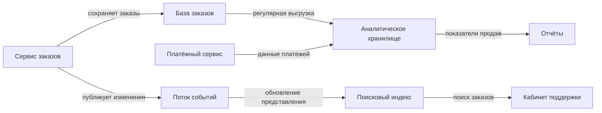
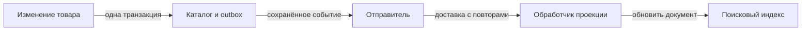
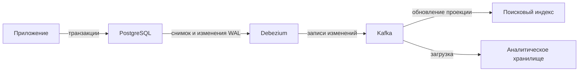
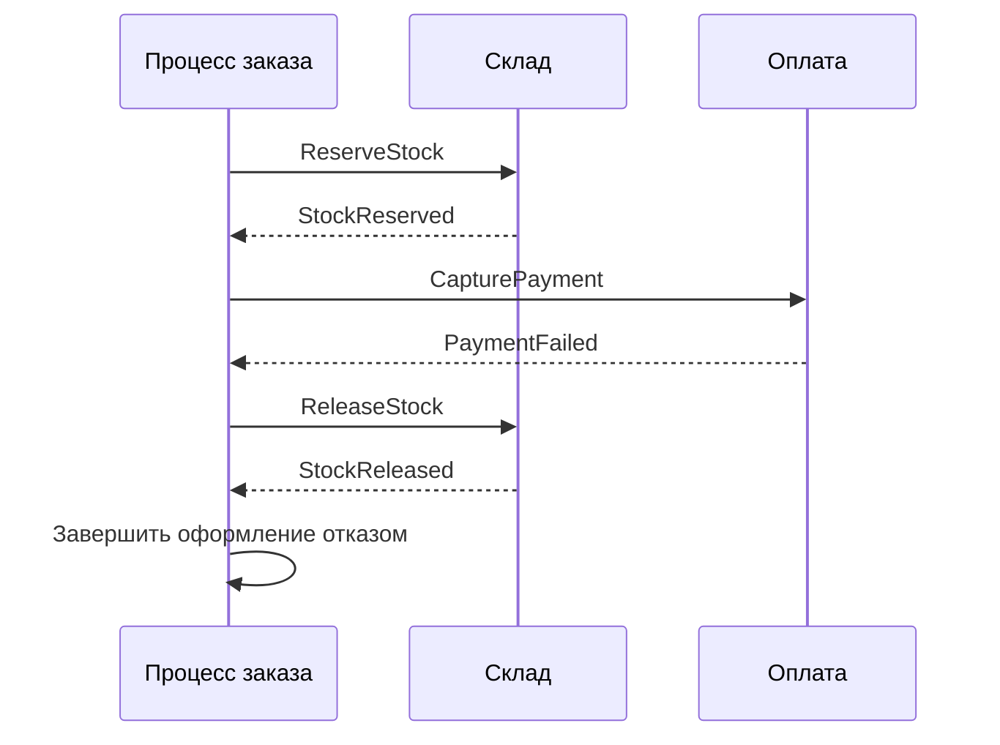
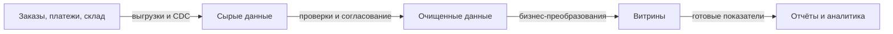
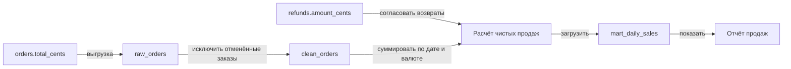

# 1. Ландшафт данных

## 1.1. Карта источников, хранилищ и потребителей

**Ландшафт данных — совокупность систем, наборов данных и потоков между ними.** Карта ландшафта показывает, где данные возникают, где сохраняются, как преобразуются и кто их использует.

Для интернет-магазина удобно начать с конкретного процесса — например, оформления заказа:



Это условная схема: платёжные данные могут поступать через отдельную базу, события или API.

**Источник, хранилище и потребитель — роли, а не обязательно разные приложения.** Сервис заказов создаёт данные, хранит их и одновременно потребляет сведения о платежах.

Для каждого потока фиксируют:

| Характеристика | Пример |
|---|---|
| Какие данные передаются | Заказы и позиции |
| Способ передачи | API, события, CDC или пакетная выгрузка |
| Частота и задержка | Непрерывно, допустимое отставание — минута |
| Преобразования | Исключение тестовых заказов |
| Ответственный | Команда аналитической платформы |
| Поведение при сбое | Повтор и сверка пропущенного диапазона |

**Карта должна отражать реальные потоки**, включая ручные CSV-выгрузки, таблицы сотрудников и прямые SQL-запросы. Иначе самые хрупкие зависимости останутся за пределами проекта.

Не обязательно сразу описывать каждый столбец. Начинают с систем и значимых наборов данных, затем детализируют рискованные участки.

## 1.2. Классификация данных

**Классификация помогает выбрать требования к хранению, свежести, изменению и восстановлению.**

| Категория | Назначение | Примеры | Важные свойства |
|---|---|---|---|
| **Операционные** | Выполнение текущих бизнес-операций | Заказы, платежи, резервы | Корректность изменений и защита от конкуренции |
| **Справочные** | Общие значения и классификация | Валюты, категории, способы доставки | Управляемые версии и согласованный смысл |
| **Аналитические** | Расчёты и исследование деятельности | Выручка по дням, показатели возвратов | Происхождение, полнота и воспроизводимость |
| **Журналы** | Фиксация событий и действий | Логи, аудит, история событий | Время, порядок, срок хранения и назначение |

Категории могут пересекаться. История платежей участвует в операциях и служит входом аналитики. Справочник валют может содержать стабильные коды, а курсы валют — отдельные изменяющиеся данные с датой действия.

**Не все журналы взаимозаменяемы.** Технический лог помогает диагностировать сбой, аудит фиксирует значимые действия, журнал Event Sourcing может быть источником состояния. Наличие строки в обычном логе не делает её надёжной бизнес-записью.

Классификация по назначению также не заменяет классификацию чувствительности: персональные данные и секреты могут встречаться в разных категориях.

## 1.3. System of record для сущностей и фактов

**System of record — авторитетная система учёта, чьи данные считаются исходными для определённой области.** Она определяет, где изменение принимается окончательно и кто отвечает за его корректность.

| Сведения | Возможный авторитетный источник |
|---|---|
| Состав и статус заказа | Система заказов |
| Результат платёжной операции | Платёжный контур с подтверждением провайдера |
| Доступный остаток и резервы | Складская система |
| Состояние отправления | Система доставки |
| Официальный показатель выручки | Утверждённый аналитический набор с определённой методикой |

**Для сущности не всегда существует один владелец всех сведений.** «Заказ» на экране объединяет состав покупки, оплату и доставку, но эти факты могут принадлежать разным системам.

Поэтому область авторитетности формулируют точно: не «CRM владеет клиентом», а, например, «CRM отвечает за контактные предпочтения, система идентификации — за учётную запись».

При расхождении заранее определяют, какой источник проверять и как восстанавливать копии. Самая свежая временная отметка не обязательно означает самое достоверное значение.

Аналитическое хранилище может быть авторитетным для рассчитанного показателя, но это не даёт ему права самостоятельно менять исходный статус платежа. Для каждого показателя нужны согласованные определения: например, включает ли выручка возвраты и к какому периоду они относятся.

## 1.4. Дублирование и неявные зависимости

**Дублирование — наличие нескольких представлений одних сведений.** Оно бывает полезным: поисковый индекс, кеш и аналитическая таблица специально содержат копии ради скорости или автономности.

Опасность возникает, когда непонятны источник, способ обновления и допустимое отставание.

| Ситуация | Оценка |
|---|---|
| Кеш цены с известным сроком актуальности | Управляемая копия |
| Имя покупателя на момент оформления | Исторический снимок |
| Две системы независимо редактируют один адрес без правил | Конфликтующее владение |
| Отчёт напрямую читает внутренние таблицы сервиса | Скрытая зависимость от структуры хранения |

**Одинаковые значения не всегда означают дублирование одного факта.** Текущий адрес клиента и адрес доставки оформленного заказа могут законно различаться.

Для каждой копии полезно задать четыре вопроса:

- Откуда она получена?
- Кто и как её обновляет?
- Насколько она может отставать?
- Можно ли её восстановить?

Неявные зависимости выявляют по выгрузкам, настройкам интеграций, заданиям по расписанию и доступам к базам. Дополнительно проверяют смысловые связи: общие идентификаторы, часовые пояса, единицы суммы и правила удаления.

**Карта происхождения данных — data lineage — показывает путь от источника через преобразования к результату.** Она помогает понять, какие отчёты сломаются при изменении поля и где искать причину неверного показателя.

**Запомнить:** для каждого набора данных должны быть понятны происхождение, назначение, авторитетный владелец и потребители; копии допустимы, если их обновление и границы достоверности явны.

# 2. Владение и границы

## 2.1. Принцип «база данных на сервис»

**Database per service — принцип, по которому сервис владеет своими данными, а другие сервисы обращаются к ним через опубликованные контракты.** Таблицы являются внутренней реализацией владельца.

Например, сервис заказов не должен напрямую уменьшать остаток в таблице склада. Он отправляет `ReserveStock`, а склад проверяет правила и выполняет изменение.

**Разделение не обязательно означает отдельный сервер базы для каждого сервиса.** Возможны приватные таблицы, отдельные схемы или отдельные экземпляры СУБД. Главное — исключить произвольный доступ к чужим данным и закрепить границы разрешениями. [Database per service](https://microservices.io/patterns/data/database-per-service.html)

| Вариант | Что разделено | Что остаётся общим |
|---|---|---|
| Приватные таблицы | Владение и права доступа | Сервер, ресурсы, часть сопровождения |
| Отдельные схемы | Пространства имён и доступ | Ресурсы экземпляра СУБД |
| Отдельные базы на отдельных экземплярах | Хранение и эксплуатация | Возможные общие инфраструктурные зависимости |

**Проблема общей БД — совместное владение и обход контрактов**, а не сам факт общего оборудования. Прямые межсервисные SQL-запросы связывают приложения со структурой чужих таблиц; совместная запись позволяет обходить бизнес-правила.

Цена разделения — более сложные объединённые запросы и операции между владельцами. Для них используют API, события и производные представления.

В модульном монолите общая база может быть разумным решением. Принцип применяют к выбранным границам, а не превращают каждую таблицу в отдельный сервис.

## 2.2. Владелец каждого набора данных

**Владелец набора данных — команда, ответственная за его смысл, качество, развитие и предоставление потребителям.** Это отличается от администратора, обслуживающего сервер хранения.

Для магазина ответственность можно распределить так:

| Набор | Владелец смысла и изменений |
|---|---|
| Заказы и позиции | Команда заказов |
| Платёжные операции | Команда оплаты |
| Остатки и резервы | Команда склада |
| Витрина продаж | Назначенная команда аналитического продукта |

Владелец определяет допустимые изменения, объясняет поля, согласует совместимость и организует исправление ошибок. Платформенная команда может обеспечивать хранение, резервное копирование и инструменты доставки.

**Для производных данных тоже нужен владелец.** Команда витрины продаж отвечает за расчёт показателя и работу конвейера, но не получает права самостоятельно переписывать исходные платежи.

Область ответственности формулируют точно. «Владелец клиента» слишком широко: учётная запись, адрес доставки и маркетинговые предпочтения могут принадлежать разным компонентам.

Для каждого набора полезно записать источник истины, контакт команды, потребителей и порядок эскалации. Название владельца без полномочий и времени на сопровождение проблему не решает.

## 2.3. Контракт данных

**Контракт данных — соглашение между поставщиком и потребителем о структуре, смысле и свойствах предоставления данных.** Он шире схемы типов.

Пример для набора `orders`:

| Часть | Что зафиксировать |
|---|---|
| Схема | Поля, типы, обязательность, ключи |
| Семантика | Что означает «оформлен», как учитываются отмены |
| Единицы и время | Суммы в копейках, время в UTC |
| Обновление | Изменения поступают непрерывно |
| Свежесть | Например, 99% изменений доступны за минуту |
| Качество | Уникальный `order_id`, отсутствие потерянных позиций |
| Эволюция | Версии и порядок прекращения поддержки |
| Восстановление | Повторы, сверка, повторная выгрузка |

**Частота обновления не равна гарантированной свежести.** Задание, запускающееся каждую минуту, может отставать на час из-за ошибок.

**SLI — измеряемый показатель качества**, например задержка доставки данных. **SLO — целевое значение**, а **SLA — соглашение об уровне обслуживания**, обычно включающее ответственность и последствия нарушения. Для внутреннего набора иногда достаточно согласованного SLO и порядка реакции.

Не стоит обещать «данные всегда актуальны» без способа измерения. Контракт должен учитывать остановку потока: отсутствие новых записей может означать и отсутствие заказов, и поломку доставки.

## 2.4. Data Mesh и централизованная платформа

**Data Mesh — подход к организации аналитических данных, распределяющий ответственность между доменными командами.** Его четыре принципа:

- доменное владение;
- **data as a product — данные как продукт** для потребителей;
- общая платформа самообслуживания;
- **федеративное управление** — совместно установленные правила с распределённой ответственностью и автоматизацией проверок.

Такое определение предложено автором подхода Zhamak Dehghani. [Принципы Data Mesh](https://martinfowler.com/articles/data-mesh-principles.html)

**Данные как продукт** означают наличие пользователей, владельца, документации, качества и поддержки, а не просто опубликованной таблицы.

| Организация | Преимущество | Риск |
|---|---|---|
| Централизованная команда данных | Общие компетенции и единые процессы | Очередь задач и удалённость от бизнес-смысла |
| Data Mesh | Ответственность ближе к предметной области | Нужны зрелые команды и общие стандарты |

**Data Mesh совместим с централизованной технической платформой.** Доменные команды могут владеть продуктами данных, используя общее хранилище, каталог и инструменты. Децентрализация ответственности не требует отдельного кластера каждому домену.

Для небольшой организации централизованная команда часто проще. При множестве самостоятельных доменов распределённое владение может уменьшить узкое место, если команды способны поддерживать свои продукты.

**Запомнить:** границы данных определяются ответственностью и контрактами; инфраструктуру можно объединять, сохраняя приватность сервисов, а Data Mesh распределяет владение, сохраняя общие правила и платформу.

# 3. Polyglot persistence

## 3.1. Несколько хранилищ под разные задачи

**Polyglot persistence — использование разных технологий хранения в одной системе в зависимости от характера данных и операций.** Выбор начинают с требований: что сохранять, как читать, какие гарантии нужны и какую нагрузку ожидают. [Описание подхода у Martin Fowler](https://martinfowler.com/bliki/PolyglotPersistence.html)

Для интернет-магазина возможна такая комбинация:

| Тип хранилища | Задача | Причина выбора |
|---|---|---|
| Реляционная БД | Заказы, платежи, резервы | Транзакции, ограничения целостности, связанные данные |
| Поисковый индекс | Поиск товаров | Полнотекстовый поиск, фильтры и ранжирование |
| Key-value — ключ–значение | Кеш карточек товаров | Быстрый доступ по известному ключу |
| Объектное хранилище | Изображения и документы | Хранение файлов отдельно от записей приложения |
| Аналитическое хранилище | Отчёты по продажам | Обработка больших выборок и агрегатов |

Это примеры распределения обязанностей, а не обязательный набор технологий.

**Несколько хранилищ могут содержать как разные данные, так и разные представления одних данных.** Файл изображения и заказ — самостоятельные данные. Карточка товара в поисковом индексе — производное представление каталога.

Не стоит добавлять документную или графовую БД только из-за формы отдельного объекта. Сначала проверяют, действительно ли существующая технология неудобна для нужных операций. Возможностей одной современной СУБД нередко достаточно.

## 3.2. Синхронизация без ненадёжной двойной записи

**Проблема двойной записи — необходимость согласованно изменить два независимых хранилища без общей транзакции.**

Например, последовательность опасна:

```ruby
product.update!(price_cents: 12_000)
search_index.update(product.id, price_cents: 12_000)
```

Код условный. Если второй вызов завершится ошибкой, цена в базе изменится, а в поиске останется прежней. Перестановка вызовов не устраняет проблему.

**Обычно выбирают авторитетную запись и надёжно передают её изменения производным хранилищам.**



**Transactional Outbox** сохраняет данные и намерение опубликовать изменение атомарно. Отдельный отправитель доставляет сообщение. Повторы возможны, поэтому обработчик должен быть идемпотентным. [Паттерн Outbox](https://docs.aws.amazon.com/prescriptive-guidance/latest/cloud-design-patterns/transactional-outbox.html)

Другой механизм — **CDC, Change Data Capture**, передача изменений из базы, часто через её журнал. CDC может читать как бизнес-таблицы, так и outbox: эти подходы можно сочетать.

«Без двойной записи» не означает, что физически записывается только одна копия. Оно означает отказ от двух несогласованных записей приложения как единственного механизма надёжности.

**Обновление кеша тоже требует политики:** инвалидировать значение, заменить его или дождаться истечения срока. Асинхронная синхронизация допускает задержку, поэтому окончательную цену покупки проверяют у владельца каталога или в установленном процессе оформления.

## 3.3. Стоимость дополнительного хранилища

**Каждая новая технология добавляет не только возможности, но и отдельный эксплуатационный контур.**

| Область | Дополнительная работа |
|---|---|
| Надёжность | Репликация, резервное копирование, проверка восстановления |
| Безопасность | Доступы, шифрование, обновления и ротация credentials |
| Производительность | Индексы, настройка, контроль ресурсов |
| Изменения | Миграции схем и совместимость клиентов |
| Синхронизация | Лаг, повторы, порядок, обработка удалений |
| Поддержка | Компетенции команды, диагностика и дежурства |

**Управляемый облачный сервис уменьшает часть работы, но не снимает ответственность за данные и интеграцию.** Остаются выбор конфигурации, стоимость, права доступа и поведение приложения при отказе.

Расходы оценивают по всему жизненному циклу. Поисковый индекс может ускорить чтение, но его перестроение потребует времени, вычислительных ресурсов и достаточного источника данных.

Полезно заранее ответить: что будет недоступно при отказе этого хранилища? Можно ли показать карточку без рекомендаций? Можно ли временно отключить поиск? Как ограничить нагрузку на основную БД при массовых промахах кеша?

**Добавление технологии оправдано измеримой пользой**, а не только потенциально лучшей производительностью.

## 3.4. Авторитетный источник при расхождении

**Приоритет задают для конкретных фактов, а не обязательно для всей системы.** Например, каталог владеет текущей ценой, заказ — согласованной ценой покупки, объектное хранилище — содержимым сохранённого документа.

| Данные | Источник истины | Производная копия |
|---|---|---|
| Текущие сведения о товаре | Каталог | Поисковый индекс |
| Карточка товара для быстрого чтения | Каталог | Кеш |
| Состав оформленного заказа | Система заказов | Аналитическая витрина |
| Сумма продаж за период | Утверждённые исходные факты и методика | Подготовленный отчёт |

**Более поздняя временная отметка не делает копию авторитетнее.** И наоборот, различие может быть законным: цена в старом заказе не обязана совпадать с текущей ценой каталога.

Для производных представлений фиксируют допустимое отставание, версии, способ сверки и восстановления. При расхождении копию исправляют из источника, учитывая новые изменения. Возможность перестроения — важное свойство материализованных представлений. [Materialized View](https://learn.microsoft.com/en-us/azure/architecture/patterns/materialized-view)

Если оба хранилища независимо принимают изменения одного факта, простой выбор «главной базы» недостаточен. Нужны явные правила конфликтов либо пересмотр владения.

**Запомнить:** выбирай хранилища под реальные операции, передавай изменения надёжно и для каждого факта определяй источник истины, стоимость копий и способ восстановления.

# 4. Интеграция и перемещение данных

## 4.1. Пакетная загрузка, ETL, ELT и потоки

**Пакетная обработка (batch processing) работает с ограниченным набором данных**, например заказами за сутки. **Потоковая обработка (stream processing) непрерывно обрабатывает поступающие изменения**, обычно с меньшей задержкой.

**ETL и ELT описывают порядок преобразования и загрузки:**

| Подход | Последовательность | Пример |
|---|---|---|
| **ETL — Extract, Transform, Load** | Извлечь → преобразовать → загрузить | Очистить выгрузку заказов перед записью в витрину |
| **ELT — Extract, Load, Transform** | Извлечь → загрузить → преобразовать | Сохранить исходные записи, затем построить отчёт SQL-запросами |

Разница — в месте преобразования, а не в частоте запуска. ETL и ELT могут использовать пакетные и потоковые механизмы. [Сравнение ETL и ELT](https://aws.amazon.com/compare/the-difference-between-etl-and-elt/)

Пакетная загрузка удобна для периодической отчётности и крупных пересчётов. Потоки полезны для быстрого обновления поиска, остатков и оперативных показателей. Возможен компромисс — **micro-batch**, обработка небольшими пакетами через короткие интервалы.

**Меньшая задержка не означает автоматически лучшую архитектуру.** Поток требует управления порядком, состоянием и запоздавшими данными. Если отчёт нужен раз в сутки, непрерывная обработка может быть избыточна.

Для аналитики различают время бизнес-факта и время его получения. Платёж за вчера, поступивший сегодня, может потребовать пересчёта вчерашнего итога.

## 4.2. CDC на примере Debezium

**CDC — Change Data Capture, захват изменений данных:** получение вставок, обновлений и удалений без регулярного полного перечитывания таблиц.

**Debezium — платформа CDC с коннекторами к базам данных.** Для PostgreSQL коннектор использует логическое декодирование **WAL — журнала предзаписи базы**. Типичный сценарий включает первоначальный снимок существующих данных, затем чтение изменений. Конкретное поведение зависит от выбранного режима снимка. [Коннектор PostgreSQL](https://debezium.io/documentation/reference/stable/connectors/postgresql.html)



Показан распространённый вариант развёртывания с Kafka; это не единственный способ использования Debezium. [Архитектура Debezium](https://debezium.io/documentation/reference/stable/architecture.html)

**Изменение строки не равно событию предметной области.** Обновление `orders.status` сообщает техническое изменение, но не обязательно объясняет причину отмены заказа.

Прямой CDC бизнес-таблиц связывает получателей со схемой хранения. Альтернатива — CDC outbox-таблицы, где приложение сохраняет явно сформированные события.

Нужно контролировать задержку и состояние коннектора. В PostgreSQL replication slot — позиция и состояние подписчика репликации — может удерживать WAL при отставании; требуется наблюдение за диском и политикой удержания. CDC не является механизмом, который можно настроить и больше не обслуживать.

## 4.3. Брокер как журнал изменений

**Сохраняемый журнал позволяет разным потребителям читать изменения независимо и возвращаться к доступной истории.**

В Kafka записи организованы в топики и **партиции — упорядоченные разделы**. Потребители отслеживают **offset — позицию записи в партиции**. Чтение одним потребителем не удаляет данные для остальных. [Модель Kafka](https://kafka.apache.org/intro/)

| Свойство журнала | Для чего нужно |
|---|---|
| Независимые позиции потребителей | Разный темп загрузки поиска и аналитики |
| Повторное чтение | Восстановление и пересчёт |
| Ключ сущности | Направление связанных изменений в одну партицию |
| Политика хранения | Определение доступной глубины истории |

**Не любой брокер или очередь является журналом истории.** Очередь, удаляющая подтверждённые сообщения, не обеспечивает произвольное повторное чтение.

Также фиксируют срок и объём хранения. Уплотнение по ключу может помочь восстановить актуальные значения, но не сохраняет обязательно все промежуточные изменения.

Порядок внутри партиции не означает общего порядка нескольких таблиц и потоков. Если приёмнику нужна согласованность всей исходной транзакции, её границы и обработку нужно проектировать отдельно.

Журнал доставки не становится источником истины автоматически: он может содержать лишь ограниченную копию изменений базы.

## 4.4. Идемпотентная загрузка и повторная обработка

**Идемпотентная загрузка даёт тот же результат при повторном применении одной порции данных.** Это необходимо после сбоев и при пересчётах.

Для текущего состояния часто используют **upsert — вставку либо обновление по устойчивому ключу**. Но одного ключа недостаточно: запоздавшая старая запись не должна затереть новую. Сравнение версии и обновление должны выполняться атомарно.

Для накопительных расчётов требуется дополнительная защита:

```text
Установить сумму заказа = 150000 → повтор не увеличивает её
Добавить 150000 к выручке        → повтор удваивает вклад
```

Вклад события можно хранить по его ID либо атомарно сохранять отметку обработки вместе с изменением итога.

**Checkpoint — сохранённую позицию обработки — нельзя продвигать раньше фиксации результата.** Сбой после записи, но до checkpoint приводит к повтору, который и должна выдерживать загрузка.

Для пакетов полезен **staging — промежуточный слой загрузки**: данные проверяют, затем публикуют согласованным переключением или слиянием. Нельзя оставлять половину пересчитанного отчёта видимой как окончательный результат.

Повторная обработка требует сохранённых входов, версий преобразований и обработки удалений. Её отделяют от внешних эффектов: пересчёт аналитики не должен повторно отправлять уведомления или выполнять платежи.

**Запомнить:** выбирай частоту и место преобразований по задаче; CDC и журнал обеспечивают поток изменений, а корректность загрузки требует версий, идемпотентности и безопасного восстановления позиции.

# 5. Согласованность в распределённой системе

## 5.1. Распределённые транзакции и ограничения 2PC

**Распределённая транзакция согласует фиксацию изменений нескольких независимых ресурсов.** Например, операция должна одновременно изменить данные заказа и склада в разных базах.

**2PC — Two-Phase Commit, двухфазная фиксация** — использует координатор:

1. **Prepare:** участники подготавливают изменения и подтверждают готовность.
2. **Commit или rollback:** координатор принимает общее решение о фиксации либо отмене.

**Атомарность не означает одновременную видимость изменений для всех читателей.** Она также не заменяет необходимые гарантии изоляции.

Основные причины отказаться от 2PC:

| Ограничение | Последствие |
|---|---|
| Нужна поддержка протокола всеми участниками | Произвольный HTTP API нельзя автоматически включить в транзакцию |
| Ожидание решения после подготовки | При сбоях участники могут оставаться заблокированными |
| Удержание ресурсов | Растут блокировки и влияние на другие операции |
| Дополнительная координация | Увеличиваются задержка и сложность восстановления |

Например, PostgreSQL предупреждает, что подготовленные транзакции продолжают удерживать блокировки и не должны оставаться в таком состоянии надолго. [Документация PostgreSQL](https://www.postgresql.org/docs/current/sql-prepare-transaction.html)

**2PC может быть оправдан для коротких операций в контролируемой инфраструктуре.** Для длительного оформления заказа с внешней оплатой обычно удобнее явно управлять промежуточными состояниями. Если инвариант вообще не допускает временного нарушения, полезно сначала пересмотреть границы данных.

## 5.2. Saga, Outbox и компенсации

**Saga — процесс из локальных транзакций, который доводит операцию до успеха либо предусмотренного результата восстановления.** Каждый участник фиксирует свои изменения отдельно.

**Outbox обеспечивает надёжную передачу изменения:** состояние и сообщение сохраняются в одной локальной транзакции, затем сообщение публикуется. Он не делает всю Saga атомарной и не исключает дубли. [Transactional Outbox](https://docs.aws.amazon.com/prescriptive-guidance/latest/cloud-design-patterns/transactional-outbox.html)

**Компенсация — новая бизнес-операция, уравновешивающая последствия выполненного шага.**



Сценарий предполагает окончательно установленный отказ оплаты. **Тайм-аут списания сначала требует выяснить результат**, иначе компенсация может начаться при уже успешной оплате.

| Механизм | Задача |
|---|---|
| Локальная транзакция | Атомарность изменений одного ресурса |
| Outbox | Восстанавливаемая публикация зафиксированного изменения |
| Saga | Управление последовательностью и промежуточными состояниями |
| Компенсация | Устранение нежелательных последствий |

Saga не предоставляет общей изоляции: другие операции могут видеть промежуточные результаты. Компенсации тоже требуют идемпотентности, повторов и наблюдения; некоторые действия необратимы. [Паттерн Saga](https://learn.microsoft.com/en-us/azure/architecture/patterns/saga)

## 5.3. Сверка данных между системами

**Reconciliation — сверка ожидаемых и фактических данных с последующим разбором расхождений.** Она дополняет обычную доставку и обнаруживает то, что не исправилось автоматически.

Например, платёжный провайдер подтвердил списание, но заказ остался в состоянии `payment_pending`.

Для сверки определяют:

- авторитетный источник каждого факта;
- ключ сопоставления, например `payment_id`;
- сравниваемые поля и правила эквивалентности;
- границу сравнения и допустимое отставание;
- безопасный способ исправления и владельца разбора.

**Нельзя безусловно сравнивать два меняющихся источника «прямо сейчас».** Используют согласованный снимок, версии или закрытый период с учётом поздних изменений. Иначе нормальный лаг будет выглядеть как ошибка.

| Расхождение | Возможное действие |
|---|---|
| Запись отсутствует в проекции | Повторно применить изменение или загрузить сущность |
| Сумма отличается | Проверить валюту, единицы, возвраты и версии |
| Результат внешней операции неизвестен | Запросить статус по идентификатору |
| Обнаружены дубли | Проверить бизнес-эффект и выполнить контролируемое исправление |

Количество записей и общие суммы полезны как быстрые проверки, но могут скрывать взаимно компенсирующие ошибки. Для значимых случаев нужна сверка по операциям.

**Исправление выполняют через владельца данных или механизм обновления проекции.** Произвольная запись в чужую базу может обойти правила и потерять конкурентные изменения. Действия сверки сохраняют в журнале для проверки результата.

## 5.4. Допустимая задержка каждого потока

**Допустимая задержка согласования — время, в течение которого расхождение приемлемо для конкретного сценария.** Единого значения для всей системы обычно нет.

| Поток | Пример требования |
|---|---|
| Резервирование остатка | Решение принимается атомарно у владельца до подтверждения резерва |
| Статус оплаты в интерфейсе | Обновление за несколько секунд |
| Поисковый индекс | Отставание до минуты |
| Дневная аналитика | Готовность к установленному времени следующего дня |

Значения условные: их согласуют с бизнесом и проверяют под нагрузкой.

Фиксируют начало и конец измерения. Например: от commit оплаты до видимости нового статуса через API, включая кеш. **Скорость чтения брокера не равна скорости получения результата клиентом.**

Наблюдают распределение задержки, долю нарушений срока и возраст старейшего незавершённого изменения. Для остановившегося потока нужны отдельные проверки: замеры только успешно завершённых операций скроют зависание.

При превышении срока заранее выбирают реакцию: показать «уточняем статус», прочитать авторитетный источник, запустить сверку или ограничить приём работы. Нельзя превращать просрочку ожидания в ложное подтверждение успеха или отказа.

**Запомнить:** локальная атомарность, доставка изменений и завершение процесса — разные гарантии; для каждого потока нужны допустимый лаг, механизм восстановления и сверка с авторитетными данными.

# 6. Аналитический контур

## 6.1. DWH, озеро данных и lakehouse

**Аналитический контур — системы хранения, подготовки и анализа данных, предназначенные для отчётов и исследования бизнеса.**

| Подход | Основная идея | Пример применения |
|---|---|---|
| **DWH — Data Warehouse, хранилище данных** | Интегрированные, подготовленные данные с согласованными определениями | Продажи, возвраты и прибыль по периодам |
| **Data lake — озеро данных** | Хранение разнообразных данных, часто близких к исходному виду | Выгрузки таблиц, события, документы |
| **Lakehouse** | Управление таблицами и аналитика поверх озера с механизмами надёжности | Общая основа для отчётности и обработки больших наборов |

**DWH — не просто копия операционной базы.** В нём согласуют идентификаторы, историю и смысл показателей из разных источников.

Озеро позволяет сохранить данные до определения всех будущих сценариев использования. Но без каталога, владельцев и качества оно превращается в трудноиспользуемое скопление файлов.

**Lakehouse сочетает файловую основу озера с управляемыми таблицами**, включая транзакционные механизмы, контроль схем и метаданные. Одного размещения CSV в объектном хранилище недостаточно. [Описание lakehouse](https://www.databricks.com/blog/what-is-data-lakehouse)

Границы современных платформ пересекаются: DWH может читать внешние файлы, а lakehouse — обслуживать SQL-отчёты. Выбирают по нагрузке, требованиям и стоимости, а не по названию.

## 6.2. Слои: сырые, очищенные и витрины

**Слои разделяют ответственность за сохранение исходных данных, их согласование и подготовку к использованию.**



**Сырой слой (raw)** сохраняет полученные записи с минимальными изменениями. Полезны источник, время загрузки, идентификатор пакета и позиция CDC. «Сырые» не означает «без защиты»: доступ и сроки хранения нужны уже здесь.

**Очищенный слой (cleaned / curated)** приводит типы и единицы, обрабатывает дубли, связывает идентификаторы и проверяет качество. Ошибочные записи лучше явно изолировать с причиной, чем незаметно удалять.

**Витрина (data mart)** предоставляет данные для определённой области: продаж, логистики или возвратов. Здесь закрепляют бизнес-определения, например правила расчёта чистой выручки.

Слои могут быть логическими таблицами одной платформы; отдельный продукт для каждого не обязателен. Названия `bronze`, `silver`, `gold` встречаются как похожее соглашение, но не задают универсальных гарантий качества.

**Для каждого преобразования нужны происхождение, проверки и возможность повторного выполнения.** Иначе неверный показатель невозможно объяснить или воспроизвести.

## 6.3. Звезда, снежинка и Data Vault

**Модель аналитических данных определяет, как представить измеряемые факты, их контекст и историю.**

В **звезде (star schema)** центральная таблица фактов связана с таблицами измерений:

```text
fact_sales_line
  date_key
  product_key
  customer_key
  order_id
  quantity
  net_amount_cents
  currency
```

**Факт** представляет измерение бизнес-процесса, например количество проданного товара. **Измерение (dimension)** описывает контекст: товар, покупателя, дату. [Факты и измерения — Kimball Group](https://www.kimballgroup.com/2003/01/fact-tables-and-dimension-tables/)

**Сначала определяют grain — детализацию одной строки.** В примере это одна проданная позиция заказа. Смешивание позиций, платежей и итогов заказа в одной таблице без ясной детализации приводит к двойному счёту.

| Модель | Устройство | Компромисс |
|---|---|---|
| Звезда | Измерения обычно денормализованы | Проще запросы, больше повторяющихся атрибутов |
| **Снежинка — snowflake schema** | Измерения разделены на связанные таблицы, например товар → категория | Меньше дублирования, больше соединений |
| **Data Vault** | Бизнес-ключи, связи и исторические атрибуты разделены | Удобно интегрировать историю, сложнее напрямую строить отчёты |

Звезда и снежинка — варианты размерного моделирования. [Сравнение структуры измерений](https://learn.microsoft.com/en-us/power-bi/guidance/star-schema/)

**Data Vault обычно применяют в интеграционном историческом слое, а поверх строят витрины**, например звёзды. Его базовые элементы: **Hub** — бизнес-ключи, **Link** — связи, **Satellite** — описательные данные и история. [Термины Data Vault](https://www.scalefree.com/blog/data-vault/data-vault-glossary-hub-link-satellite-business-vault-and-more/)

Data Vault не является обязательным этапом DWH. Для нескольких стабильных источников прямое построение витрин может быть проще.

## 6.4. Отделение аналитики от операционных БД

**Операционная нагрузка — OLTP — обслуживает текущие действия, аналитическая — OLAP — исследует большие объёмы данных.** Их запросы и требования различаются.

Оформлению заказа нужна короткая предсказуемая транзакция. Годовому отчёту может понадобиться сканирование миллионов строк, большие соединения и сортировки.

Если выполнять всё на основной базе, аналитика способна исчерпать процессор, память и дисковый ввод-вывод, увеличив задержку покупки.

Способы разделения:

- ограниченная отчётная реплика;
- отдельные подготовленные таблицы;
- DWH или lakehouse с пакетной загрузкой либо CDC;
- отдельные вычислительные ресурсы для тяжёлых запросов.

**Реплика уменьшает часть влияния, но не решает моделирование и интеграцию источников.** Она также может отставать, а её обслуживание создаёт расходы.

Даже выгрузка требует контроля: полное перечитывание большой таблицы может перегрузить источник. Используют подходящие окна загрузки, ограничение ресурсов и инкрементальную передачу.

Для небольшого проекта отдельная аналитическая платформа может быть избыточна. Начинают с измеренной проблемы, сохраняя ясные границы нагрузки и допустимой свежести.

**Запомнить:** аналитический контур превращает исходные данные в согласованные показатели; слои обеспечивают прослеживаемость, модели — корректный анализ, а разделение ресурсов защищает текущие операции.

# 7. Качество, метаданные и lineage

## 7.1. Проверки качества данных

**Качество данных — пригодность данных для конкретного использования.** Проверки должны опираться на контракт: какие записи ожидаются, что считается допустимым и насколько свежим должен быть результат.

| Измерение | Что проверяем | Пример |
|---|---|---|
| **Полнота — completeness** | Все ли необходимые записи и значения присутствуют | Все заказы за закрытый день загружены, у каждого есть валюта |
| **Уникальность — uniqueness** | Нет ли недопустимых повторов | Одна строка на `order_id` в снимке заказов |
| **Свежесть — freshness** | Соответствуют ли данные допустимой задержке | Изменения доступны в витрине не позднее минуты |
| **Корректность** | Соблюдаются ли формат, диапазоны и смысл | Количество положительно, сумма соответствует правилам |

**Валидность — validity — отличается от точности — accuracy.** Положительная сумма может иметь правильный тип, но не соответствовать реальному платежу. Для проверки точности нужна сверка с авторитетным источником. Полнота также не гарантирует правильность значений. [Измерения качества данных](https://www.gov.uk/government/publications/the-government-data-quality-framework/the-government-data-quality-framework)

Уникальность зависит от детализации: `order_id` уникален в таблице заказов, но закономерно повторяется в таблице позиций.

**Отсутствие `null` не доказывает полноту загрузки:** могли потеряться целые записи. Нужны ожидаемые объёмы, сверка идентификаторов или контроль закрытых диапазонов.

Свежесть тоже нельзя оценивать только по времени последней строки: новых заказов действительно могло не быть. Дополнительно контролируют продвижение загрузки и состояние источника.

Для каждой проверки задают порог, период, серьёзность и действие при нарушении. Необязательно останавливать весь поток из-за одного необязательного поля.

## 7.2. Каталог данных и описание полей

**Метаданные — сведения о данных: их структуре, смысле, происхождении и правилах использования.** **Каталог данных** помогает найти набор и понять, можно ли применять его для своей задачи.

Минимальное описание набора включает владельца, источник истины, детализацию строки, ключи, расписание обновления, ограничения качества и доступ.

Для поля недостаточно указать только `integer`:

| Поле | Полезное описание |
|---|---|
| `net_amount_cents` | Сумма после скидок, до возвратов, в минимальных единицах валюты |
| `currency` | Валюта суммы; значения разных валют нельзя складывать напрямую |
| `occurred_at` | Время бизнес-факта в UTC |
| `loaded_at` | Время загрузки записи в аналитический контур |
| `status` | Значения и точный смысл каждого состояния |

**Особенно важны определения показателей.** «Выручка» может означать оформленные, оплаченные или отгруженные заказы — с возвратами либо без них.

Схемы и технические поля можно собирать автоматически, но бизнес-смысл требует участия владельца. Изменение определения должно проходить вместе с изменением преобразований и контракта.

Каталог полезен даже в виде версионируемых файлов рядом с кодом. Специализированный инструмент оправдан, когда объём и число участников делают ручной поиск неудобным.

## 7.3. Lineage: происхождение и преобразования

**Data lineage — описание пути данных от источников через преобразования к результатам.** Он помогает искать причину ошибки и оценивать последствия изменений.



Схема условная: определение чистых продаж и даты учёта возврата должно быть закреплено отдельно.

Lineage строят на разных уровнях:

- наборов: какие таблицы питают витрину;
- полей: из каких столбцов получен показатель;
- запусков: какой код, входные разделы и параметры создали конкретный результат.

**Связь «таблица → таблица» не всегда объясняет происхождение отдельного значения.** Для этого могут понадобиться идентификаторы исходных записей, версия преобразования и сведения о запуске.

Для агрегата нет обязательно одной исходной строки: значение может зависеть от тысяч записей, фильтров и соединений. Lineage должен отражать эти зависимости, включая влияние полей, которые не попадают в итоговую таблицу.

Такие связи используются для диагностики и **impact analysis — анализа влияния изменений**. Поддерживаемая детализация зависит от инструментов и интеграций. [Описание lineage](https://learn.microsoft.com/en-us/purview/data-gov-classic-lineage)

## 7.4. Реакция на нарушение контракта источника

**Нарушение контракта — отклонение структуры, смысла, качества или сроков предоставления данных от согласованных требований.**

Например, источник начал передавать рубли вместо копеек, сохранив тип `integer`. Формальная схема пройдёт, но показатели станут неверными.

| Нарушение | Возможная реакция |
|---|---|
| Неподдерживаемая схема | Остановить затронутую загрузку |
| Отдельные некорректные записи | Карантин с сохранением причины |
| Превышение допустимого отставания | Пометить данные как устаревшие и уведомить владельца |
| Смысловая ошибка в суммах | Приостановить публикацию зависимых показателей |

**Нельзя молча отбрасывать ошибки и показывать оставшийся результат как полный.** Если частичная публикация допустима, её неполнота должна быть видна потребителю.

Порядок восстановления: определить затронутый период, найти зависимые наборы через lineage, уведомить владельца, исправить источник или преобразование, повторить загрузку и сверить результат.

Последнюю корректную версию можно временно сохранить доступной, указав её давность. Перезаписывать её частично повреждёнными данными необязательно.

Изменение контракта и аварийное нарушение — разные ситуации. Плановое изменение версионируют и согласуют; инцидент требует ограничения ущерба и восстановления.

**Запомнить:** качество проверяют по явным ожиданиям, каталог объясняет смысл, lineage показывает происхождение, а нарушение контракта должно приводить к управляемой реакции и проверяемому восстановлению.

# 8. Безопасность и жизненный цикл

## 8.1. Классификация данных

**Классификация данных определяет необходимую защиту с учётом содержания, назначения и последствий раскрытия или потери.** Она нужна для всего ландшафта: основных баз, событий, аналитики, логов и резервных копий.

| Категория | Примеры магазина | Основной риск |
|---|---|---|
| Публичные | Опубликованные описания товаров | Несанкционированное изменение |
| Внутренние | Рабочие показатели и техническая документация | Раскрытие внутренних сведений |
| Персональные | Имя, телефон, адрес доставки | Идентификация человека и раскрытие его действий |
| Конфиденциальные | Закупочные цены, договоры | Ущерб бизнесу |
| Секреты доступа | Пароли, API-токены, закрытые ключи | Получение доступа к системам |

Категории пересекаются. История покупок связана с человеком и может раскрывать чувствительные сведения. Набор без имени тоже может позволять идентификацию через сочетание атрибутов.

**Класс определяется контекстом, а не только названием столбца.** Идентификатор клиента остаётся связующим звеном, если его можно сопоставить с человеком. NIST рекомендует контекстную оценку персональных данных и необходимого уровня защиты. [Защита PII](https://csrc.nist.gov/pubs/sp/800/122/final)

В каталоге фиксируют класс, владельца, назначение, допустимых получателей и правила хранения. При создании витрины классификацию пересматривают: объединение источников может повысить чувствительность результата.

## 8.2. Маскирование, шифрование и доступ

**Эти меры решают разные задачи и не заменяют друг друга.**

| Мера | Назначение | Ограничение |
|---|---|---|
| **Маскирование** | Скрыть часть значения: `+7 *** ***-12-34` | Исходные данные могут оставаться доступными другим путём |
| **Псевдонимизация** | Заменить идентификатор условным значением | При наличии связи возможна обратная идентификация |
| **Шифрование** | Сделать содержимое нечитаемым без ключа | Не защищает от пользователя с правом расшифровки |
| **Разграничение доступа** | Разрешить только необходимые операции и данные | Требует актуальных ролей и проверки обходных путей |

Например, поддержка видит адрес для доставки конкретного заказа, а аналитик — регион и псевдоним клиента.

**Маскирование интерфейса не защищает API или выгрузку автоматически.** Ограничения применяют на стороне сервиса или хранилища, включая доступ к строкам и отдельным полям.

Шифрование предусматривают при передаче и хранении, включая резервные копии. Ключи хранят и обслуживают отдельно: определяют доступ, ротацию и восстановление. Потеря ключей может сделать исправную копию бесполезной.

Для разработки предпочтительны синтетические или подготовленные обезличенные данные. Секреты не помещают в события, логи и аналитические таблицы. **Хеширование предсказуемых значений, например телефона, само по себе не гарантирует анонимность.**

## 8.3. Хранение, архивирование и удаление

**Политика жизненного цикла определяет, зачем данные сохраняются, как долго нужны и что происходит после окончания срока.**

Для каждого набора описывают:

- начало отсчёта срока: создание, завершение заказа или закрытие периода;
- период активного хранения и условия архивирования;
- удаление либо обезличивание;
- судьбу производных копий, файлов, логов и резервных копий.

**Архивирование — перенос в режим длительного хранения, а не удаление.** Архив сохраняет требования к защите, доступности форматов и возможности чтения.

Сроки зависят от назначения и применимых обязательств: нельзя назначить одну длительность всем данным магазина. История финансовых операций и временный кеш имеют разные основания хранения.

**Удаление должно распространяться по карте lineage.** Удаление строки клиента в основной базе не очищает автоматически поисковый индекс, выгрузки и витрины.

Soft delete — пометка записи как удалённой — обычно сохраняет содержимое. Удаление файла также не обязательно делает данные невосстановимыми на носителе. Для безопасного вывода носителей из эксплуатации выбирают подходящий метод очистки. [Рекомендации NIST по sanitization](https://csrc.nist.gov/pubs/sp/800/88/r2/final)

Для резервных копий задают отдельный срок и процесс: после восстановления ранее удалённые данные не должны незаметно возвращаться в рабочее использование. Это может требовать повторного применения реестра удалений до открытия доступа.

## 8.4. Резервное копирование и восстановление ландшафта

**Резервная копия полезна только вместе с проверенным восстановлением бизнес-процесса.** Репликация не заменяет backup: ошибочное удаление может распространиться на реплики.

Два основных ориентира:

| Показатель | Значение |
|---|---|
| **RPO — Recovery Point Objective** | Допустимая потеря данных во времени |
| **RTO — Recovery Time Objective** | Допустимое время восстановления работы |

Для заказов RPO может быть существенно строже, чем для восстанавливаемого поискового индекса. Но перестроение индекса всё равно влияет на общий RTO.

План охватывает исходные базы, файлы, журнал изменений, позиции потребителей, схемы, конфигурацию и доступность ключей. Для проекций определяют, что быстрее: восстановить копию или построить их заново.

**Независимые копии разных систем могут соответствовать разным моментам.** Поэтому нужны согласованные точки восстановления либо безопасные повторы и сверка. Особенно опасны автоматические повторы внешних эффектов: платёж у провайдера мог сохраниться, хотя локальная база восстановлена на более ранний момент.

Порядок восстановления учитывает зависимости: хранилища и доступы, владельцы данных, доставка изменений, потребители и витрины. Приём трафика открывают после необходимых проверок.

Копии защищают от общего отказа и компрометации, а восстановление регулярно репетируют с измерением фактических сроков. Такой план строят от критичности операций, а не только от перечня серверов. [Планирование восстановления NIST](https://csrc.nist.gov/pubs/sp/800/34/r1/upd1/final)

**Запомнить:** защита и сроки следуют за данными во все копии; восстановление должно возвращать согласованный бизнес-процесс, а не просто работающие базы.

# Список литературы

https://www.youtube.com/watch?v=XCnHS_lXHAA - Data Mesh, DWH