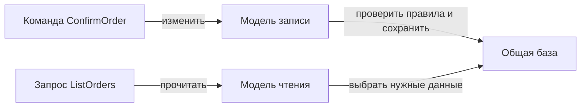
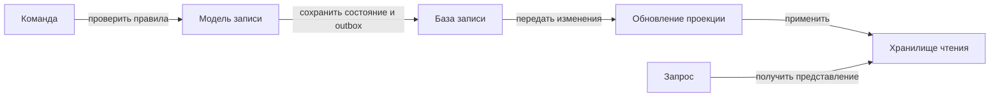
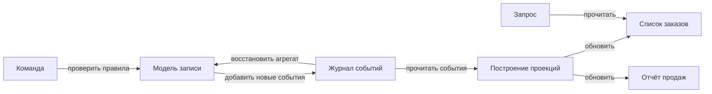

# 1. Основные понятия

## 1.1. CQS: разделение методов

**CQS — Command Query Separation, разделение команд и запросов на уровне методов.** Метод либо изменяет состояние, либо возвращает данные без изменения наблюдаемого состояния.

В строгой формулировке:

- **Command — команда:** изменяет состояние и не возвращает значение.
- **Query — запрос:** возвращает результат и не изменяет наблюдаемое состояние.

Например:

```ruby
class Cart
  def initialize
    @items = []
  end

  def add(product)
    @items << product
    nil
  end

  def items_count
    @items.size
  end
end
```

`add` изменяет корзину, `items_count` только читает её. Явный `nil` предотвращает случайный возврат изменённого массива — результата выражения `@items << product`.

**Смысл CQS — предсказуемость:** вызов метода чтения не должен неожиданно добавлять товар, списывать деньги или менять статус.

Это ориентир, а не запрет на все смешанные операции. Например, извлечение элемента из очереди одновременно возвращает его и изменяет очередь; разделение этих действий иногда ухудшает удобство или атомарность. [Описание CQS у Martin Fowler](https://martinfowler.com/bliki/CommandQuerySeparation.html)

## 1.2. CQRS: разделение моделей

**CQRS — Command Query Responsibility Segregation, разделение моделей изменения и чтения данных.** Подход развивает идею CQS, но применяется к устройству приложения, а не только к отдельным методам.

**Модель записи (write model)** выражает допустимые изменения и защищает бизнес-правила. **Модель чтения (read model)** предоставляет данные в форме, удобной для конкретных запросов.

Например, при оформлении заказа модель записи проверяет наличие позиций, фиксирует цену и управляет переходами состояния. Для списка заказов нужна другая форма:

```ruby
{
  order_id: 42,
  customer_name: "Анна",
  total_cents: 150_000,
  status_label: "Ожидает оплаты"
}
```

Это **DTO — Data Transfer Object**, структура для передачи данных. Она не обязана предоставлять методы изменения заказа.

| Подход | Что разделяется |
|---|---|
| CQS | Методы изменения и чтения |
| CQRS | Модели и пути обработки изменений и запросов |

**CQRS не требует двух баз, брокера или отдельных сервисов.** Разные модели могут работать с одной базой: запись — через доменные объекты, чтение — через специализированные запросы. Просто наличие методов `create` и `show` ещё не означает CQRS. [Описание CQRS у Martin Fowler](https://martinfowler.com/bliki/CQRS.html)



Диаграмма показывает простой вариант с общей базой. Разделение оправдано, когда потребности чтения и изменения действительно различаются; иначе оно добавляет лишние компоненты.

## 1.3. Команда как намерение, запрос как чтение

**Команда выражает намерение изменить состояние, но не гарантирует успешное выполнение.** Например, `ConfirmOrder` может быть отклонена, если заказ пуст или уже отменён.

Предпочтительно называть действие по бизнес-смыслу:

```text
ConfirmOrder(order_id: 42)
```

Такой контракт яснее, чем `SetOrderStatus(status: "confirmed")`: он обозначает операцию, внутри которой проверяются необходимые условия.

**Запрос получает данные без намеренного изменения бизнес-состояния**, например `ListCustomerOrders` или `GetOrderDetails`.

```ruby
# Условные интерфейсы приложения
ConfirmOrder.call(order_id: 42)
ListCustomerOrders.call(customer_id: 7)
```

Команды и запросы могут выполняться синхронно. Асинхронная доставка команды — отдельное решение, а не обязательное свойство CQRS.

**В прикладном CQRS команда может возвращать служебный результат:** идентификатор созданного заказа, подтверждение выполнения или ошибки. Это практическое отличие от строгого CQS. Важно не превращать обработчик команды одновременно в универсальный механизм чтения.

Запрос не должен незаметно подтверждать заказ или обновлять цену. Технические действия вроде диагностического логирования обычно рассматривают отдельно от изменения предметного состояния.

**Данные чтения не заменяют проверку при записи.** Даже если интерфейс показал доступный товар, команда резервирования должна повторно проверить условия с учётом конкурентных изменений.

## 1.4. CQRS и Event Sourcing независимы

**Event Sourcing — хранение изменений как последовательности событий, из которой восстанавливается состояние.** CQRS отвечает на другой вопрос: используются ли разные модели для записи и чтения.

| Подход | Главный вопрос |
|---|---|
| CQRS | Как разделить изменение и получение данных? |
| Event Sourcing | Как хранить историю изменений и восстанавливать состояние? |

Возможны разные сочетания:

- **CQRS без Event Sourcing:** состояние заказов хранится в обычных таблицах, чтение использует отдельные запросы или проекции.
- **Event Sourcing без отдельной read-модели:** состояние восстанавливается из событий, запросы читают восстановленный объект.
- **Оба подхода:** запись сохраняет события, а чтение использует построенные по ним проекции.

**Projection — проекция:** производное представление данных для чтения. Если она обновляется асинхронно, возникает задержка между записью и её отображением. Но такая задержка не является обязательным свойством любого CQRS. [Варианты реализации CQRS](https://learn.microsoft.com/en-us/azure/architecture/patterns/cqrs)

Публикация `OrderConfirmed` через брокер сама по себе не означает Event Sourcing: источником истины может оставаться строка заказа в базе.

**Запомнить:** CQS разделяет обязанности методов, CQRS — модели записи и чтения, Event Sourcing — способ хранения; ни один из этих подходов автоматически не требует остальных.

# 2. Модель записи

## 2.1. Проектирование команд

**Модель записи отвечает за допустимые изменения состояния. Команда выражает намерение выполнить конкретное бизнес-действие**, например `ConfirmOrder` — «подтвердить заказ», а не просто заменить значение поля.

Команда содержит необходимые данные и технический контекст:

```json
{
  "command_id": "cmd-815",
  "type": "ConfirmOrder",
  "order_id": 42,
  "expected_version": 7,
  "initiator_id": "user-12",
  "idempotency_key": "confirm-order:attempt-730"
}
```

| Поле | Назначение |
|---|---|
| `type` | Действие в повелительном смысле |
| `order_id` и параметры | Объект изменения и необходимые данные |
| `initiator_id` | Кто инициировал действие |
| `command_id` | Идентификатор команды |
| `idempotency_key` | Защита одной логической операции от повторного эффекта |
| `expected_version` | Версия, на основе которой принято решение |

Инициатора определяют из доверенного контекста аутентификации. **Произвольное поле `initiator_id` из запроса не доказывает личность и права.**

При повторе той же операции ключ идемпотентности сохраняют. Повтор с изменёнными параметрами должен выявляться как конфликт. Иногда роль ключа выполняет `command_id`, если контракт гарантирует его стабильность между попытками.

**Команда должна выражать задачу, а не устройство хранения.** `CancelOrder` позволяет проверить правила отмены, тогда как универсальный `UpdateOrder` может скрыть недопустимый переход состояния. [Рекомендации CQRS](https://learn.microsoft.com/en-us/azure/architecture/patterns/cqrs)

## 2.2. Валидация и инварианты агрегата

**Агрегат — группа связанных объектов, рассматриваемая как единое целое для изменения и соблюдения бизнес-правил.** **Корень агрегата** управляет доступными операциями. Например, заказ управляет своими позициями и подтверждением.

Проверки распределяют по ответственности:

| Проверка | Где выполнять |
|---|---|
| Типы, обязательность, допустимый размер | На входной границе |
| Полномочия инициатора | В слое авторизации |
| Загрузка и сохранение агрегата | В обработчике команды |
| Допустимость изменения | В агрегате |
| Уникальность и целостность хранения | В базе данных |

**Инвариант — условие, которое должно сохраняться после допустимой операции.** Например, подтверждённый заказ содержит хотя бы одну позицию.

```ruby
class Order < ApplicationRecord
  def confirm!
    raise InvalidTransition unless status == "draft"
    raise EmptyOrder unless items.exists?

    update!(status: "confirmed")
  end
end
```

Пример сокращён: исключения определены приложением, а согласованность работы с позициями обеспечивается отдельным механизмом.

**Проверка на входе не заменяет проверку агрегата.** Другой контроллер, задача или обработчик сообщения тоже может вызвать операцию.

Однако одна проверка в памяти не защищает от конкуренции. Если другой процесс одновременно удаляет позицию, нужна согласованная стратегия изменения всего агрегата.

Правило, зависящее от другого сервиса, нельзя надёжно обеспечить только методом заказа. Например, реальное резервирование товара выполняет склад, а заказ учитывает его результат.

## 2.3. Результат команды и данные отображения

**Результат команды сообщает о её судьбе, а read-модель предоставляет данные для отображения.** В прикладном CQRS команда может возвращать идентификаторы, статус и ошибки — строгий запрет на возвращаемое значение из CQS здесь не обязателен.

Важно различать:

| Результат | Значение |
|---|---|
| `accepted` | Команда надёжно принята, выполнение ещё впереди |
| `completed` | Изменение успешно зафиксировано |
| `rejected` | Команда отклонена по правилам или правам |
| `conflict` | Состояние изменилось конкурентно |

Например, асинхронный ответ:

```json
{
  "command_id": "cmd-815",
  "status": "accepted",
  "status_url": "/operations/cmd-815"
}
```

**Если команда выполняется синхронно, не нужно скрывать известный результат за словом «принято».** Можно вернуть подтверждение выполнения, `order_id` и новую версию.

Обработчик не обязан дополнительно собирать карточку заказа, доставку и историю оплаты. Эти данные получает запрос к read-модели.

Если чтение обновляется асинхронно, успешное выполнение команды не гарантирует немедленного появления изменений на экране. Контракт должен объяснять, как клиент узнаёт о завершении и актуальности представления.

## 2.4. Оптимистичная блокировка

**Оптимистичная блокировка обнаруживает изменение объекта после его загрузки.** Вместе с данными хранится версия: обновление выполняется только при совпадении ожидаемой версии с текущей.

В Rails используется целочисленный столбец `lock_version`:

```ruby
first  = Order.find(42)
second = Order.find(42)

first.update!(comment: "Позвонить перед доставкой")
second.update!(comment: "Оставить у двери")
# ActiveRecord::StaleObjectError
```

После первого обновления версия увеличивается, поэтому второе сохранение устаревшего объекта отклоняется. Это штатный механизм Active Record. [Optimistic Locking в Rails](https://api.rubyonrails.org/classes/ActiveRecord/Locking/Optimistic.html)

**Версию пользовательского решения тоже нужно передать в команду.** Если обработчик просто загрузит свежую запись, он не узнает, что пользователь редактировал старую форму. Поэтому используют `expected_version` и обеспечивают проверку версии при сохранении.

При конфликте можно вернуть понятную ошибку и предложить обновить данные. Автоматический повтор допустим, если команда остаётся осмысленной: агрегат загружают заново и повторно проверяют правила.

**Нельзя просто убрать проверку версии или перезаписать чужие изменения.** Идемпотентность также не заменяет блокировку: первая защищает от повторов одной операции, вторая — от конфликта разных операций.

Блокировка строки заказа не охватывает автоматически все связанные строки. Изменения позиций должны участвовать в согласованном протоколе версии агрегата или защищаться другим подходящим способом.

**Запомнить:** команда выражает намерение, агрегат защищает правила, результат сообщает о выполнении, а версия помогает обнаружить конкурентное изменение до потери данных.

# 3. Модель чтения

## 3.1. Проектирование под экран или API

**Read-модель — представление данных, оптимизированное для определённых запросов.** Она отвечает на вопрос «что нужно показать или вернуть?», а не повторяет устройство доменной модели записи.

Например, экран списка заказов требует:

```json
{
  "order_id": 42,
  "customer_name": "Анна",
  "items_count": 3,
  "total_cents": 150000,
  "currency": "RUB",
  "payment_status": "captured"
}
```

Для этого не обязательно загружать полноценный объект заказа со всеми позициями и методами изменения состояния.

Проектирование начинают с потребностей чтения:

- какие поля нужны;
- по чему фильтровать и сортировать;
- как устроена пагинация;
- насколько свежими должны быть данные;
- кто имеет право их видеть.

**Одна модель может обслуживать несколько похожих запросов.** Создавать отдельное хранилище для каждого экрана необязательно. Но попытка сделать универсальную read-модель для всех задач часто возвращает исходную сложность.

Результат обычно передают как **DTO — Data Transfer Object**, структуру данных без методов бизнес-изменения. Разделение моделей не требует разделения баз. [Варианты CQRS](https://learn.microsoft.com/en-us/azure/architecture/patterns/cqrs)

## 3.2. Денормализация и предварительные вычисления

**Денормализация — хранение данных в форме с намеренным дублированием ради удобного и быстрого чтения.** Например, имя покупателя и сумма заказа находятся в одной строке проекции, хотя исходно принадлежат разным таблицам.

**Предварительная агрегация — вычисление итогов до запроса пользователя.** Вместо повторного суммирования всех позиций сохраняют `total_cents`, вместо подсчёта строк — `items_count`.

Термин «агрегация» здесь означает вычисление итогов, а не DDD-агрегат модели записи.

| Приём | Выигрыш | Цена |
|---|---|---|
| Скопировать имя покупателя | Меньше соединений таблиц | Нужно определить обновление копии |
| Сохранить число позиций | Не считать позиции при каждом чтении | Нужно учитывать добавления и удаления |
| Подготовить дневную выручку | Быстрый отчёт | Нужно учитывать возвраты и исправления |

**Копирование требует точного смысла данных.** «Имя покупателя сейчас» нужно обновлять при переименовании. «Имя, указанное при оформлении» является историческим снимком и может оставаться прежним.

Сохранённую проекцию также называют **materialized view — материализованным представлением**. В архитектурном смысле это не обязательно встроенный объект базы: представление может поддерживать отдельный обработчик. [Паттерн Materialized View](https://learn.microsoft.com/en-us/azure/architecture/patterns/materialized-view)

Предварительные вычисления оправданы, если сокращают значимые затраты чтения. Они добавляют стоимость обновления, контроль свежести и восстановление. Простой индекс или обычный SQL-запрос иногда решает задачу дешевле.

## 3.3. Выбор хранилища

**Хранилище выбирают по форме запросов, требованиям свежести и стоимости сопровождения.** CQRS не предписывает конкретную технологию.

| Вариант | Когда полезен | Ограничение |
|---|---|---|
| Те же таблицы в той же БД | Достаточно отдельного пути чтения | Чтение и запись делят ресурсы |
| Отдельные таблицы проекций | Нужны готовые объединения и итоги | Требуется обновление и восстановление |
| Поисковый индекс | Нужны полнотекстовый поиск и сложные фильтры | Возможна задержка индексации |
| Кеш | Нужны быстрые повторные чтения | Нужны политика устаревания и поведение при промахе |

Первые два варианта могут использовать один физический сервер. **Логическое разделение не обеспечивает автоматическую изоляцию нагрузки.** Отдельное хранилище позволяет масштабировать чтение независимо, но добавляет синхронизацию. [Хранилища в CQRS](https://learn.microsoft.com/en-us/azure/architecture/patterns/cqrs)

Пример чтения из подготовленной таблицы в Rails:

```ruby
# OrderSummary — поддерживаемая проекция заказов
rows = OrderSummary
  .where(customer_id: current_user.id)
  .order(created_at: :desc, order_id: :desc)
  .limit(20)
  .pluck(:order_id, :total_cents, :currency, :payment_status)
```

Пример показывает только выборку первой страницы. Формирование DTO и дальнейшая пагинация опущены; схема проекции условная.

**Кеш или индекс не должны становиться единственным местом хранения невосстановимых данных по случайности.** Для производного представления определяют источник восстановления: исходные таблицы, снимок или достаточную историю событий.

При асинхронном обновлении нужно также определить, что увидит клиент сразу после команды, пока read-модель ещё отстаёт.

## 3.4. Граница обработчика запросов

**Query handler — обработчик запроса — выбирает разрешённые данные и формирует ответ без изменения бизнес-состояния.**

В нём уместны:

- фильтрация, сортировка и пагинация;
- ограничение видимости по пользователю или организации;
- выбор полей, форматирование и вычисления для отображения.

Например, преобразовать сумму из минимальных единиц в строку для экрана допустимо. Решить, какую скидку применить к новому заказу, — задача модели записи.

**«Без бизнес-правил» не означает «без авторизации».** Запрос обязан предотвращать доступ к чужим заказам и чувствительным полям.

Нельзя подтверждать заказ, резервировать товар или исправлять его цену во время чтения карточки. Иначе повтор запроса изменит состояние, а поведение станет неожиданным.

Поле `can_cancel` допустимо как подсказка интерфейсу, но оно не даёт разрешение на отмену. Команда `CancelOrder` заново проверяет права и актуальные условия. Желательно не создавать независимую противоречащую реализацию правил ради такой подсказки.

**Read-модель показывает известное состояние, но не гарантирует допустимость следующего изменения.** Даже свежий результат может устареть до выполнения команды.

**Запомнить:** проектируй чтение под запросы, денормализуй по необходимости и учитывай свежесть; решение о допустимости изменения остаётся на стороне записи.

# 4. Уровни разделения

## 4.1. Один сервис, одна база и общие таблицы

**Минимальный вариант CQRS — разные модели записи и чтения, работающие внутри одного приложения с общими таблицами.** Разделение существует в коде и ответственности, а не обязательно в инфраструктуре.

Например:

```ruby
# Запись: загрузка заказа и проверка правил
ConfirmOrder.call(order_id: 42)

# Чтение: подготовка данных для списка
ListCustomerOrders.call(customer_id: 7)
```

Это условные интерфейсы приложения. Первый использует модель заказа с бизнес-правилами, второй может выполнять специализированный SQL и возвращать простые структуры данных.

**Отдельная модель чтения не обязательно означает сохранённую копию.** Она может вычислять результат непосредственно из исходных таблиц.

При чтении из той же основной базы не возникает отдельной задержки проекции, хотя результат по-прежнему зависит от границ транзакции и выбранного уровня изоляции. Чтение с реплики — уже дополнительное решение со своими гарантиями свежести.

Преимущество — разделение сложной логики изменений и запросов без нового контура синхронизации. Ограничение — общие ресурсы и структура хранения: тяжёлый отчёт может мешать оформлению заказов.

**Два класса с одинаковой логикой сами по себе не дают пользы CQRS.** Разделение должно отражать действительно разные потребности записи и чтения. Такой вариант с общей базой описан в [материалах по CQRS](https://learn.microsoft.com/en-us/azure/architecture/patterns/cqrs).

## 4.2. Отдельные таблицы или схемы в той же базе

**Следующий вариант — сохранённая read-модель в отдельных таблицах**, например `order_summaries`. Она содержит готовые данные для чтения:

```text
orders + order_items → order_summaries
                       order_id
                       items_count
                       total_cents
                       payment_status
```

Можно использовать отдельную **схему базы данных — пространство имён для объектов**, например `read.order_summaries`. Это организационное разделение, а не отдельный сервер.

Есть два основных способа обновления:

| Способ | Свежесть | Цена |
|---|---|---|
| В той же транзакции, что и запись | Исходные данные и проекция фиксируются вместе | Обновление проекции увеличивает время записи |
| Асинхронно после фиксации | Возможна задержка | Нужны надёжная передача изменений и восстановление |

Для синхронного варианта при поддержке общей транзакции можно сохранить заказ и его краткое представление атомарно. Но ошибка обновления представления тогда способна откатить всю команду.

**Общая база не гарантирует синхронность обновления:** если проекцию строит фоновая задача, она может отставать.

Потребители читают проекцию, а изменения бизнес-состояния направляют через модель записи. Саму проекцию обновляет назначенный механизм построения, а не произвольные обработчики запросов.

Отдельные таблицы позволяют независимо выбирать индексы и денормализацию, но сохраняют конкуренцию за ресурсы базы.

## 4.3. Отдельные хранилища записи и чтения

**Физическое разделение позволяет выбирать и масштабировать хранилища по разным требованиям.** Например, заказы записываются в реляционную базу, а каталог для поиска обслуживается поисковым индексом.



Outbox показан как один из вариантов. Возможны также **CDC — Change Data Capture, передача изменений из журнала базы**, и другие механизмы.

**Отдельные хранилища не требуют отдельных сервисов**, а наличие read-реплики само по себе не означает CQRS: реплика может лишь копировать исходную структуру без разделения моделей.

Главная новая задача — согласованность двух хранилищ. Обычная локальная транзакция не охватывает их автоматически. Нужны обработка дублей, порядок изменений, контроль задержки и возможность пересоздать представление. [Раздельные хранилища CQRS](https://learn.microsoft.com/en-us/azure/architecture/patterns/cqrs)

Клиенту необходимо объяснить состояние после команды: изменение уже зафиксировано, но список заказов может ещё показывать прежние данные. Нельзя выдавать недоступность проекции за неуспех самой команды.

## 4.4. Цена каждого уровня

**Более сильное разделение расширяет возможности оптимизации, но увеличивает число механизмов, которые нужно поддерживать.**

| Вариант | Основная польза | Дополнительная сложность |
|---|---|---|
| Разные модели, общие таблицы | Понятные пути записи и чтения | Больше интерфейсов и тестов |
| Отдельные таблицы, общая транзакция | Быстрое чтение без задержки проекции после commit | Поддержка производных данных, более дорогая запись |
| Асинхронные таблицы в той же БД | Обновление вынесено из команды | Повторы, лаг и восстановление |
| Разные хранилища | Независимое масштабирование и технологии | Синхронизация, инфраструктура, миграции и диагностика |

Это **варианты, а не обязательные ступени развития**. Разные части приложения могут использовать разные решения.

Выбор стоит связывать с измеримой проблемой: временем запроса, нагрузкой, сложностью доменной модели или требованиями поиска. Нередко отдельного query-объекта и индекса достаточно.

**Производная модель должна иметь план восстановления:** откуда брать данные, как построить новую версию и как переключить чтение без выдачи частично готового результата.

CQRS полезно применять к конкретной области, где выгоды превышают расходы, а не распространять автоматически на всё приложение. На риск избыточной сложности отдельно указывает [Martin Fowler](https://martinfowler.com/bliki/CQRS.html).

**Запомнить:** начинай с необходимого разделения ответственности; отдельные таблицы добавляют поддержку проекций, отдельные хранилища — ещё и распределённую согласованность.

# 5. Синхронизация read-моделей

## 5.1. Синхронное и асинхронное обновление

**Проекция — производное представление исходных данных для чтения.** Её обновление должно учитывать все изменения, влияющие на результат: создание, редактирование и удаление.

Если исходные таблицы и проекция находятся в одной транзакционной базе, их можно обновлять вместе:

```ruby
Order.transaction do
  order.confirm!

  OrderSummary.find_by!(order_id: order.id).update!(
    status: order.status,
    total_cents: order.total_cents
  )
end
```

Предполагается одна база и общее соединение транзакции, существующая строка проекции и отсутствие внешних вызовов.

**Состояние и проекция фиксируются атомарно:** ошибка обновления представления откатывает команду. Это обеспечивает согласованность после commit, но увеличивает длительность и связность операции записи.

При асинхронном варианте команда сохраняет состояние, а отдельный обработчик позднее обновляет проекцию.

| Вариант | Преимущество | Ограничение |
|---|---|---|
| Одна транзакция | Нет отдельного отставания проекции после фиксации | Обновление чтения влияет на запись |
| Асинхронно | Можно независимо масштабировать и восстанавливать обработку | Возникают лаг, повторы и ошибки доставки |

**Eventual consistency — итоговая согласованность — не означает автоматического восстановления.** Для асинхронного варианта нужны контроль задержки, повторы и сверка данных. Общая база сама по себе не устраняет лаг, если обновление выполняется в фоне.

## 5.2. Передача изменений: outbox и CDC

**Transactional Outbox сохраняет бизнес-изменение и сообщение о нём в одной транзакции.** Затем отдельный отправитель публикует сохранённые сообщения.

Это закрывает окно между «заказ сохранён» и «событие отправлено». Однако после сбоя между публикацией и отметкой об отправке событие может уйти повторно. [Паттерн Transactional Outbox](https://docs.aws.amazon.com/prescriptive-guidance/latest/cloud-design-patterns/transactional-outbox.html)

**CDC — Change Data Capture — извлечение изменений базы**, часто из её транзакционного журнала, и передача их другим компонентам.

| Подход | Что получает обработчик | Особенность |
|---|---|---|
| Outbox с отправителем | Сообщение, явно сформированное приложением | Контракт отделён от структуры бизнес-таблиц |
| CDC бизнес-таблиц | Изменения строк | Проекция зависит от схемы хранения |
| CDC outbox-таблицы | Изменения записей с готовыми сообщениями | Совмещает оба подхода |

**Outbox и CDC не являются взаимоисключающими альтернативами.** Например, Debezium умеет читать outbox-таблицу и преобразовывать её записи в сообщения. [Outbox Event Router](https://debezium.io/documentation/reference/stable/transformations/outbox-event-router.html)

Изменение строки не всегда равно бизнес-событию: один заказ может обновить несколько таблиц, а смысл «заказ подтверждён» потребует дополнительной интерпретации.

Для обоих вариантов определяют порядок, обработку удалений, позиции восстановления и срок доступности исходных изменений. Потеря необходимого участка истории может потребовать повторной загрузки данных.

## 5.3. Идемпотентность проекций

**Идемпотентная проекция после повтора одного изменения остаётся в том же состоянии, что после однократного применения.**

Присваивание полного значения обычно проще защитить от дублей, чем накопительное изменение:

```text
Установить total_cents = 150000
Повтор не увеличивает сумму

Добавить 150000 к выручке
Повтор ошибочно увеличивает итог ещё раз
```

Для событий сохраняют отметку обработки вместе с изменением проекции:

```ruby
ApplicationRecord.transaction do
  AppliedEvent.create!(
    projection: "daily_sales_v2",
    event_id: event.fetch("event_id")
  )

  summary.increment!(
    :revenue_cents,
    event.fetch("data").fetch("amount_cents")
  )
end
```

Пример предполагает одну базу и уникальное ограничение на `(projection, event_id)`. Конфликт именно этого ограничения обрабатывают как уже выполненное применение. Остальные ошибки требуют отдельной реакции.

**Подтверждение сообщения или продвижение позиции выполняют после надёжной фиксации результата.** Для других хранилищ нужен эквивалентный атомарный механизм либо иной безопасный алгоритм.

Идемпотентность не исправляет нарушение порядка. Старое событие может перезаписать новые данные, даже если оно поступило впервые. Поэтому дополнительно используют версии и согласованную последовательность обработки.

При создании новой версии проекции её дедупликация должна быть независимой: отметки старой версии не должны блокировать построение новой.

## 5.4. Перестроение при изменении структуры

**Перестроение — повторное создание проекции из достаточного источника данных.** Источником может быть история событий, согласованный снимок или текущие таблицы владельца.

Не каждое изменение требует полного пересчёта: иногда достаточно миграции или заполнения нового поля. Но при изменении логики агрегации полное построение часто проще проверить.

Безопасная последовательность:

1. Создать новую версию таблицы или индекса.
2. Выбрать согласованную границу снимка и потока изменений.
3. Загрузить исходные данные и применить последующие изменения без пропусков.
4. Догнать текущую обработку и проверить результат.
5. Переключить чтение, сохранив возможность отката.

**Построение рядом с рабочей версией позволяет не показывать частично готовые данные.** Подход с версионированной заменой описан в [паттерне Materialized View](https://learn.microsoft.com/en-us/azure/architecture/patterns/materialized-view).

Обычная выгрузка «пока приложение работает» без согласования границы опасна: изменения могут потеряться или примениться дважды.

**Outbox не обязательно хранит всю историю.** Если старые события удалены, а текущие таблицы не содержат нужных исторических сведений, восстановить проекцию с прежним смыслом невозможно.

Перестроение должно менять только производные данные. Повторное чтение событий ради отчёта не должно повторно отправлять письма или списывать деньги.

**Запомнить:** синхронизация требует надёжного источника изменений, атомарного применения и контроля порядка; перестроение — достаточных данных и согласованной границы между историей и текущим потоком.

# 6. Итоговая согласованность

## 6.1. Измерение задержки read-модели

**Итоговая согласованность — eventual consistency: после изменения источника истины производные данные обновляются с задержкой и сходятся с ним при успешном применении всех изменений.** При асинхронном CQRS сохранение заказа ещё не означает, что его новое состояние доступно в read-модели. [CQRS: ограничения согласованности](https://learn.microsoft.com/en-us/azure/architecture/patterns/cqrs)

**Проекция — представление данных, построенное из источника истины под определённые запросы.** Например, карточка заказа с общей суммой и статусом оплаты.

Основная метрика:

```text
Задержка проекции =
время доступности изменения для чтения − время фиксации изменения
```

Измеряй не только среднее, но и **p95/p99 — значения, в которые укладываются 95%/99% измерений**. Среднее может скрывать заказы, обновляющиеся значительно дольше остальных.

Дополнительно полезны:

| Метрика | Что помогает заметить |
|---|---|
| Возраст самого старого необработанного изменения | Длительное ожидание конкретного обновления |
| Количество ожидающих изменений | Рост очереди обработки |
| Ошибки и остановки проектора | Причину отсутствия обновлений |
| Отставание применённой позиции от источника | Насколько обработчик продвинулся по журналу |

**Возраст последнего обработанного события не равен задержке:** если новых заказов нет, старая отметка времени нормальна. И наоборот, метрика только успешно обработанных событий не обнаружит потерянное событие.

Для времени на разных машинах учитывай рассинхронизацию часов. Допустимую задержку задавай отдельно для каждого представления: например, секунды для карточки заказа и минуты для отчёта — это требования конкретного продукта, а не свойства CQRS.

## 6.2. Интерфейс с учётом задержки

**Интерфейс должен различать принятие команды, выполнение изменения и обновление проекции.** Сообщение «принято» не всегда означает «сохранено», а «сохранено» — «уже видно во всех представлениях».

| Подход | Как работает | Ограничение |
|---|---|---|
| **Оптимистичное отображение** | Интерфейс сразу показывает предполагаемый результат | При отказе нужна коррекция и понятное сообщение |
| **Read-your-writes** | Последующее чтение учитывает собственную подтверждённую запись пользователя | Требует явного механизма обеспечения свежести |
| **Статус «обрабатывается»** | Интерфейс показывает промежуточное состояние и проверяет результат позже | Нужны предел ожидания и реакция на зависание |

**Read-your-writes — гарантия видимости собственных записей**, а не гарантия самых свежих данных от всех пользователей.

Один из способов реализации — передавать минимальную ожидаемую версию:

```text
Команда изменила заказ → подтверждена версия 18
Запрос карточки → требуется версия не ниже 18
Проекция содержит 17 → ограниченно ждём или читаем источник истины
Проекция содержит 18 → возвращаем результат
```

Здесь предполагается, что версия относится к одному заказу, а проектор применяет необходимые изменения последовательно. Максимальный номер увиденного события сам по себе не доказывает отсутствие пропусков.

**Ожидание должно иметь таймаут.** После него можно вернуть статус ожидания либо использовать заранее предусмотренное чтение из модели записи. Фиксированный `sleep(1)` не обеспечивает свежесть.

Оптимистичное отображение подходит, например, для изменения комментария. Показывать окончательную успешную оплату до подтверждения обычно недопустимо.

## 6.3. Когда читать модель записи

**Критичные решения проверяй по данным, которыми владеет сторона записи.** Устаревшая проекция подходит для отображения приблизительного остатка, но не должна разрешать продажу последнего товара.

| Сценарий | Подход |
|---|---|
| Список заказов, статистика продаж | Read-модель с допустимой задержкой |
| Подтверждение только что изменённого адреса | Read-your-writes или чтение модели записи |
| Резервирование последней единицы товара | Проверка и изменение остатка на стороне записи |
| Проверка возможности отмены заказа | Проверка актуального состояния при выполнении команды |

**Чтение актуальных данных не устраняет гонку между проверкой и изменением.** Два запроса могут одновременно увидеть один свободный товар. Проверку инварианта — правила, которое должно сохраняться, — и запись нужно согласовать транзакцией, блокировкой или контролем версии.

Чтение модели записи не нарушает CQRS: разделение обязанностей не запрещает специализированный запрос к авторитетному состоянию. При этом учитывай реплики, кеши и изоляцию транзакций: название «модель записи» само по себе не гарантирует свежесть конкретного чтения.

## 6.4. Обнаружение и исправление расхождений

**Расхождение проекции — отличие от ожидаемого представления источника истины.** Пока изменение находится в допустимом окне задержки, это ожидаемое отставание. Пропуск события или ошибка преобразования могут оставить постоянное расхождение.

Для обнаружения используй **reconciliation — периодическую сверку**: сравнение версий, наличия записей и контрольных значений. Сравнивать нужно соответствующие версии или согласованные снимки, иначе обычное обновление во время проверки даст ложную тревогу.

Исправление зависит от причины:

- повторно обработать пропущенные изменения;
- пересчитать проекцию отдельного заказа;
- исправить обработчик и перестроить представление полностью.

**Перестроение возможно только при наличии достаточных исходных данных.** Для текущей карточки может хватить основной БД; для исторического отчёта могут понадобиться сохранённые события или история изменений.

Большую проекцию удобно строить отдельно: получить согласованный снимок и позицию журнала, применить последующие изменения, проверить результат и переключить чтение. Повторы должны обрабатываться идемпотентно — без повторного эффекта. Старое представление можно обслуживать до готовности нового. [Восстановление и обновление проекций](https://learn.microsoft.com/en-us/azure/architecture/patterns/materialized-view)

Ручное исправление только read-модели обычно временно: следующий пересчёт снова воспроизведёт ошибку, если её причина осталась.

**Запомнить:** измеряй задержку, показывай промежуточное состояние, проверяй критичные правила на стороне записи и обеспечивай сверку и восстановление проекций.

# 7. CQRS и Event Sourcing

## 7.1. Состояние как последовательность событий

**Event Sourcing — подход, при котором источником истины является сохранённая последовательность событий, а текущее состояние вычисляется из неё.** Вместо перезаписи строки заказа сохраняют факты его изменения:

```text
Поток order-42:
1. OrderPlaced
2. ItemAdded(product_id: 7, quantity: 2)
3. OrderConfirmed
4. OrderCancelled
```

**Поток событий (event stream)** содержит упорядоченную историю конкретной сущности или агрегата. Применение событий по порядку восстанавливает состояние — этот процесс называют **rehydration**.

Упрощённый Ruby-пример:

```ruby
def apply(event)
  case event.fetch("type")
  when "OrderPlaced"    then @status = "draft"
  when "OrderConfirmed" then @status = "confirmed"
  when "OrderCancelled" then @status = "cancelled"
  end
end
```

Пример показывает только восстановление статуса. Полная реализация обрабатывает все поддерживаемые события и явно сообщает о неизвестных типах.

При обработке новой команды приложение восстанавливает агрегат, проверяет актуальные правила и сохраняет новые события. Запись обычно проверяет ожидаемую версию потока, чтобы обнаружить конкурентное изменение.

**Повторное применение истории не должно заново решать, разрешалось ли прошлое действие по сегодняшним правилам.** События уже фиксируют принятые факты. Для воспроизводимости в них сохраняют необходимые результаты, например согласованную цену, а не рассчитывают её заново по текущему каталогу.

Обычный журнал аудита рядом с таблицей ещё не означает Event Sourcing. Главное различие — возможность восстановить состояние из авторитетной истории. [Описание Event Sourcing](https://martinfowler.com/eaaDev/EventSourcing.html)

## 7.2. Проекции по журналу событий

**Проекция преобразует события в представление для конкретного чтения.** Один журнал может питать список заказов, историю покупателя и отчёт продаж.



**CQRS разделяет модели записи и чтения, а Event Sourcing определяет способ хранения.** Их удобно сочетать, но CQRS может использовать обычные таблицы, а Event Sourcing — восстановленный объект без отдельной сохранённой read-модели.

Для надёжной проекции нужны порядок применения, защита от повторов и **checkpoint — сохранённая позиция обработки**. Позиция не должна продвигаться так, чтобы сбой приводил к пропуску ещё не сохранённых изменений.

**Replay — повторное чтение истории — должен обновлять производные данные без повторных внешних эффектов.** Пересчёт отчёта не должен отправлять покупателю старые письма или повторять списания.

При асинхронном построении проекция отстаёт от журнала. Это требует контроля свежести и понятного поведения интерфейса.

## 7.3. Snapshots, версии и рост журнала

**Snapshot — снимок состояния агрегата на определённой позиции потока.** Он ускоряет восстановление: приложение загружает снимок, затем применяет только более поздние события.

```text
Snapshot: order-42, stream_version = 100
Затем применить события 101–107
```

Снимок — оптимизация, а не автоматическая замена истории. Снимок заказа также не равен снимку отчётной проекции: они содержат разные данные и служат разным задачам.

| Что версионируется | Зачем |
|---|---|
| Позиция потока | Порядок и контроль конкуренции |
| Схема события | Интерпретация сохранённых данных |
| Формат снимка | Совместимость восстановленного состояния |
| Логика проекции | Построение нужной версии read-модели |

При изменении формата событий сохраняют поддержку старых версий либо используют **upcaster — преобразователь старого представления в поддерживаемое**. Он не может достоверно придумать отсутствующие исторические сведения.

**Рост журнала увеличивает требования к хранению, резервному копированию и времени перестроения.** Нужны измерения, архивирование и проверка восстановления. Удаление старых событий может лишить систему исторических запросов и возможности построить новые проекции; одного снимка агрегата для них часто недостаточно.

Отдельная сложность — персональные данные в долговечной истории: заранее определяют минимизацию, сроки хранения и механизм удаления или обезличивания. Снимки, эволюция событий и обслуживание истории входят в существенные издержки подхода. [Ограничения Event Sourcing](https://learn.microsoft.com/en-us/azure/architecture/patterns/event-sourcing)

## 7.4. Когда Event Sourcing избыточен

**Event Sourcing оправдан, когда история изменений является важной частью задачи**, например требуется объяснять происхождение состояния, восстанавливать прошлые состояния или строить новые представления по сохранённым фактам.

| Потребность | Возможная более простая альтернатива |
|---|---|
| Только текущее состояние | Обычные таблицы |
| История редактирования | Таблица аудита |
| Быстрое чтение сложного экрана | CQRS с проекцией |
| Передача изменений другим сервисам | События и outbox |
| Несколько отчётов | Отдельные отчётные таблицы |

**Наличие брокера, CQRS или событий не является причиной внедрять Event Sourcing.** Он добавляет долговременные обязательства: совместимость истории, восстановление, версии снимков и осторожное изменение логики применения событий.

Для простого CRUD-приложения эта цена часто превышает пользу. Подход можно применять только к выбранной области, не переводя на него весь магазин.

История также не становится полноценным аудитом автоматически: нужны сведения об инициаторе, защита от несанкционированных изменений и контролируемый доступ.

**Запомнить:** CQRS разделяет запись и чтение, Event Sourcing делает события источником истины; проекции и снимки ускоряют работу, но требуют сохранять возможность корректно интерпретировать историю.

# Список литературы

https://habr.com/ru/companies/otus/articles/747668/ - CQRS
https://habr.com/ru/companies/otus/articles/518282/ - Event Sourcing Part 1