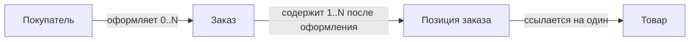
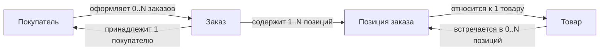

# 1. Сбор требований к данным

## 1.1. Сущности, атрибуты и связи из сценариев

**Требования к данным описывают информацию и гарантии, необходимые для выполнения пользовательских и системных сценариев.** Структуру начинают проектировать с действий, а не с выбора базы.

Например, сценарий «покупатель оформляет заказ» помогает выделить:

- **сущности** — объекты с собственной идентичностью: заказ, товар, покупатель;
- **атрибуты** — характеристики: дата заказа, количество, цена;
- **связи** — отношения: заказ принадлежит покупателю и содержит позиции.

**Позиция заказа — отдельное понятие**, связывающее заказ с товаром и сохраняющее количество и согласованную цену.



Здесь показана концептуальная структура, а не готовые таблицы.

Для связей уточняют **кардинальность — допустимое количество связанных объектов**, обязательность и поведение при удалении. Например, может ли заказ существовать без зарегистрированного покупателя? Что происходит с его позициями после удаления товара из каталога?

**Различайте текущие данные и исторический снимок.** Цена товара сегодня и цена продажи в заказе — разные факты. Пересчёт старого заказа по текущей цене обычно нарушит его смысл.

На этом этапе не обязательно решать, будет ли позиция строкой таблицы или вложенным документом. Сначала определяют идентичность, жизненный цикл и правила данных.

## 1.2. Основные запросы и пути доступа

**Путь доступа — способ найти нужные данные: по идентификатору, диапазону, фильтрам или связям.** Перечень запросов показывает, какую структуру и индексы придётся поддерживать.

| Сценарий | Условия поиска | Результат |
|---|---|---|
| Карточка заказа | `order_id` | Заказ с позициями |
| История покупателя | `customer_id`, диапазон дат | Страница заказов |
| Работа склада | Статус, склад, время создания | Следующие задания |
| Поиск товара | Текст, категория, цена | Отсортированный список |
| Отчёт продаж | Период, валюта | Итоги по дням |

Для каждого запроса фиксируют частоту, ожидаемое число результатов, сортировку, пагинацию и требования свежести.

Например, «история заказов» — неполное описание. Более полезное: «последние 20 заказов покупателя, сортировка по времени и идентификатору, переход к следующей странице».

**Нужны и сценарии записи:** создание заказа с позициями, смена статуса, резервирование остатка. Они определяют границы атомарности и конкуренции.

Запрос по одному ключу и поиск по произвольным сочетаниям фильтров предъявляют разные требования. Но один сложный отчёт не обязательно должен определять устройство всей операционной базы: его можно вынести в отдельное представление.

Типичная ошибка — перечислить только удобные запросы. Заранее учитывают массовые выгрузки, удаление, сверку и административные операции.

## 1.3. Объём, рост и нагрузка

**Оценка нагрузки — набор числовых предположений, по которым можно проверить решение.** Важны не только общий объём, но и распределение обращений.

Условный расчёт:

```text
100 000 заказов в день
× 5 позиций
= 500 000 позиций в день

× 365 дней
≈ 182,5 млн позиций в год
```

Если средняя запись позиции занимает условно 200 байт, получится около 36,5 ГБ исходных данных в год. **Это не размер всей базы:** дополнительно нужны индексы, служебные данные, реплики, журналы и резервные копии.

| Показатель | Что уточнить |
|---|---|
| Объём | Число записей, средний и максимальный размер |
| Рост | Прирост в день и горизонт планирования |
| Чтение/запись | Частота и стоимость разных операций |
| Пики | Запросы в секунду, длительность и характер всплеска |
| Конкуренция | Сколько операций одновременно меняют одни данные |
| Распределение | Горячие товары, покупатели или временные диапазоны |

Среднее поступление заказов не определяет пик распродажи. Соотношение «90% чтений» тоже мало говорит без деталей: чтение по ключу и сканирование миллионов строк имеют разную стоимость.

**Отделяйте измерения от прогнозов.** Для неизвестных значений задают диапазон и проверяют чувствительность решения: что изменится при десятикратном росте?

## 1.4. Согласованность, задержка, хранение и доступность

**Нефункциональные требования определяют, при каких условиях данные остаются пригодными для работы.** Их задают по операциям.

| Требование | Пример формулировки |
|---|---|
| Согласованность | Резервирование не допускает отрицательного остатка при конкуренции |
| Задержка | 99% чтений карточки заказа укладываются в согласованный срок |
| Свежесть | Поиск отражает изменение товара не позднее минуты |
| Хранение | Детальная история доступна за установленный период |
| Доступность | Определённая доля корректных запросов успешно обслуживается за месяц |

**Задержка ответа и свежесть различаются:** быстро возвращённая карточка может содержать устаревший статус.

Вместо общего «нужна строгая согласованность» описывают наблюдаемое поведение: должен ли клиент сразу видеть собственную запись, допустимо ли отставание отчёта, какие изменения фиксируются вместе.

Для доступности уточняют отказ: потеря узла, недоступность зоны или разрыв сети. Также задают **RPO — допустимую потерю данных во времени** и **RTO — допустимое время восстановления**.

Срок хранения связывают с архивированием, удалением и возможностью восстановить производные представления. «Хранить всё» без оценки стоимости и назначения — слабое требование.

Результат раздела — проверяемый профиль нагрузки и гарантий. Он позволяет сравнивать базы на одинаковых сценариях, а не по общим обещаниям скорости.

**Запомнить:** сначала опиши факты, операции, объёмы и допустимые отказы; структуру и базу выбирают под эти требования.

# 2. Моделирование данных

## 2.1. Концептуальная, логическая и физическая модели

**Модель данных описывает, какие сведения существуют, как связаны и какие правила должны соблюдать.** Уровни модели отвечают на разные вопросы.

| Уровень | Основной вопрос | Пример |
|---|---|---|
| **Концептуальный** | Какие бизнес-понятия и отношения существуют? | Заказ содержит позиции и принадлежит покупателю |
| **Логический** | Как устроены данные независимо от конкретной СУБД? | У позиции есть идентификатор заказа, количество и цена |
| **Физический** | Как реализовать хранение в выбранной базе? | Таблицы, типы столбцов, индексы и ограничения |

Например, концептуальное понятие «цена продажи» превращается в логический атрибут позиции, а затем — в физические столбцы `unit_price_cents` и `currency`.

**Переход между уровнями — уточнение, а не механическое переименование сущностей в таблицы.** В документной модели позиции могут быть вложены в заказ, в реляционной — храниться отдельно.

Физическая модель учитывает запросы, объём и конкуренцию. Однако оптимизация хранения не должна незаметно менять смысл: текущая цена товара и зафиксированная цена продажи остаются разными фактами.

Модели можно развивать итеративно. Для небольшого приложения необязательно создавать три отдельных документа, но полезно различать принимаемые решения.

## 2.2. ER-диаграмма и кардинальность

**ER — Entity–Relationship — модель сущностей и связей.** Диаграмма помогает проверить, какие объекты связаны и сколько участников допускается с каждой стороны.

Для оформленных заказов:



Здесь использован flowchart для отображения ER-связей. Предполагается, что гостевых заказов нет, а товар после продажи не удаляется физически.

**Кардинальность задаёт минимум и максимум связанных объектов:** `0..1`, `1`, `0..N`, `1..N`.

Отношение заказов и товаров — **многие ко многим**. Позиция заказа превращает его в две связи «один ко многим» и хранит собственные атрибуты: количество и цену.

**Обязательность может зависеть от состояния.** Черновик допускает ноль позиций, оформленный заказ — нет. Простая линия «один ко многим» этого различия не выражает: правило нужно описать отдельно.

Также определяют последствия удаления. Удаление покупателя не должно случайно уничтожить финансовую историю, а удаление заказа может требовать удаления его позиций — если такая операция вообще разрешена.

## 2.3. Выбор первичных ключей

**Первичный ключ — выбранный уникальный и обязательный идентификатор строки.** Он может состоять из одного или нескольких столбцов.

Важно разделять **происхождение ключа** и **его формат**:

| Вариант | Свойства и ограничения |
|---|---|
| **Естественный ключ** | Имеет бизнес-смысл, например код валюты; требует стабильности и ясной области уникальности |
| **Суррогатный ключ** | Создан специально для идентификации, например последовательный `bigint` |
| **UUID** | 128-битный формат; свойства генерации зависят от версии |
| **ULID** | 128-битный идентификатор со временем и случайной частью, обычно записываемый 26 символами |

UUID и ULID обычно используют именно как суррогатные ключи — это не взаимоисключающие категории.

**UUIDv4 основан на случайности, UUIDv7 содержит временную составляющую.** Версия влияет на упорядочивание и характер вставок в индекс. Ни один UUID не заменяет ограничение уникальности. [Спецификация UUID](https://www.rfc-editor.org/rfc/rfc9562.html)

ULID сортируется по временной составляющей, но внутри одной миллисекунды порядок зависит от способа генерации; монотонный вариант требует соответствующей поддержки. Это не глобальный порядок распределённых операций. [Спецификация ULID](https://github.com/ulid/spec)

**Email часто неудобен как первичный ключ:** он меняется и содержит персональные данные. Практичный вариант — внутренний ID и отдельное ограничение уникальности бизнес-ключа.

Размер ключа влияет на индексы и внешние ссылки. Непредсказуемость идентификатора также не заменяет авторизацию.

## 2.4. Ограничения целостности

**Ограничения базы защищают данные независимо от того, какой код выполняет запись.** Для реляционной модели:

| Ограничение | Что обеспечивает |
|---|---|
| `NOT NULL` | Значение обязательно |
| `UNIQUE` | Уникальность значения или сочетания |
| `FOREIGN KEY` | Ссылка ведёт на существующую запись |
| `CHECK` | Значения удовлетворяют выражению |
| `PRIMARY KEY` | Уникальная обязательная идентификация строки |

Пример PostgreSQL:

```sql
CREATE TABLE order_items (
  id bigint GENERATED ALWAYS AS IDENTITY PRIMARY KEY,
  order_id bigint NOT NULL REFERENCES orders(id),
  product_id bigint NOT NULL REFERENCES products(id),
  quantity integer NOT NULL CHECK (quantity > 0),
  unit_price_cents bigint NOT NULL CHECK (unit_price_cents >= 0),
  UNIQUE (order_id, product_id)
);
```

Предполагаются существующие `orders` и `products`. Последний `UNIQUE` вводит бизнес-правило: товар встречается в заказе только одной строкой. Если строки могут различаться скидкой или вариантом комплектации, это ограничение нужно изменить.

**`CHECK (quantity > 0)` не заменяет `NOT NULL`:** в PostgreSQL результат `NULL` не считается нарушением `CHECK`. Обычный `UNIQUE` также по умолчанию допускает несколько `NULL`; поведение нужно учитывать отдельно. [Ограничения PostgreSQL](https://www.postgresql.org/docs/current/ddl-constraints.html)

Внешний ключ не проверяет доступность товара или допустимость оформления заказа. `CHECK` также не предназначен для произвольных правил между строками.

Проверки приложения дают понятные ошибки, а ограничения базы защищают от конкурентных записей и обходных путей. Особенно важно не заменять `UNIQUE` предварительным запросом «такой записи ещё нет»: два процесса могут одновременно получить одинаковый ответ.

**Запомнить:** сначала моделируй смысл и связи, затем выбирай ключи и физическое хранение; ограничения базы закрепляют только явно сформулированные правила.

# 3. Нормализация и денормализация

## 3.1. Третья нормальная форма и аномалии

**Нормализация — организация реляционных данных по зависимостям между атрибутами**, уменьшающая избыточность и риск противоречий.

**Функциональная зависимость `A → B` означает: каждому значению A соответствует одно значение B.** Например, `customer_id → customer_name`, если речь о текущем имени покупателя.

Основные шаги:

| Форма | Требование |
|---|---|
| **1NF** | Нет повторяющихся групп вроде `product_1`, `product_2`; значения соответствуют выбранным доменам |
| **2NF** | Выполнена 1NF; неключевые атрибуты зависят от всего составного кандидатного ключа, а не его части |
| **3NF** | Выполнена 2NF; устранены транзитивные зависимости неключевых атрибутов от ключей |

**Кандидатный ключ** — минимальный набор атрибутов, однозначно определяющий строку. Один из таких ключей выбирают первичным.

Пример проблемной таблицы:

```text
orders(order_id, customer_id, customer_name)
```

Зависимости:

```text
order_id → customer_id → customer_name
```

Если здесь хранится текущее имя покупателя, его нужно повторять во всех заказах. Разделение:

```text
customers(customer_id, customer_name)
orders(order_id, customer_id)
```

Это устраняет характерные **аномалии — нежелательные последствия изменения данных**:

- обновления: имя исправили только в части заказов;
- вставки: покупателя нельзя сохранить без заказа;
- удаления: удаление последнего заказа уничтожает сведения о покупателе.

Это практическое объяснение; формально 3NF требует, чтобы для каждой нетривиальной зависимости `X → A` либо X был суперключом, либо A входил в какой-либо кандидатный ключ. [Введение в нормализацию](https://learn.microsoft.com/en-us/office/troubleshoot/access/database-normalization-description)

**Историческое имя в заказе — другой факт.** Если поле означает «имя на момент оформления», его сохранение нельзя автоматически считать ошибочным дублированием текущего имени.

## 3.2. Осознанная денормализация

**Денормализация — намеренное хранение избыточных или заранее объединённых данных ради упрощения чтения.**

Например, экран поддержки часто показывает заказ вместе с текущим именем покупателя. Можно поддерживать представление:

```text
order_summaries(
  order_id,
  customer_id,
  customer_name,
  total_cents,
  status
)
```

Оно уменьшает необходимость соединений и вычислений при каждом запросе. Но при изменении имени нужно обновить связанные копии.

**Денормализацию выбирают после измерений.** Медленный запрос сначала стоит проверить на отсутствие индексов, лишние поля и N+1 — множество дополнительных запросов к связанным объектам. Соединения таблиц сами по себе не являются проблемой.

Для каждой копии определяют:

| Вопрос | Пример ответа |
|---|---|
| Где источник истины? | Имя принадлежит таблице покупателей |
| Как обновляется копия? | В общей транзакции или обработчиком изменений |
| Допустима ли задержка? | До минуты для экрана поддержки |
| Как исправлять расхождения? | Сверка и перестроение представления |

**Ускорение чтения оплачивается дополнительной записью, хранением и синхронизацией.** При частых изменениях и редком чтении денормализация может ухудшить общую эффективность.

## 3.3. Вычисляемые значения и цена поддержки

**Вычисляемое значение получается из других данных:** сумма позиции, итог заказа, число неоплаченных заказов.

Есть несколько способов его получать:

| Способ | Преимущество | Цена |
|---|---|---|
| Рассчитывать при чтении | Нет отдельной копии результата | Повторные вычисления |
| Generated column | База поддерживает выражение автоматически | Ограничения выражения и стоимость обновления |
| Сохранённый итог | Быстрое чтение | Нужно учитывать все изменения источников |
| Материализованное представление | Удобные готовые результаты | Требуется обновление и контроль свежести |

Например, в PostgreSQL сумму строки можно хранить как generated column:

```sql
line_total_cents bigint GENERATED ALWAYS AS
  (quantity::bigint * unit_price_cents) STORED
```

Фрагмент предполагает существующие числовые столбцы. Но сумму всех позиций заказа так получить нельзя: выражение generated column ограничено текущей строкой и не допускает подзапросов. [Generated columns PostgreSQL](https://www.postgresql.org/docs/current/ddl-generated-columns.html)

**Сохранённый итог нужно обновлять при добавлении, изменении и удалении позиций**, включая конкурентные операции. Для асинхронного расчёта дополнительно нужны защита от дублей и сверка.

Не каждое числовое поле следует пересчитывать: согласованная цена продажи — исторический факт, а не функция текущей цены каталога.

## 3.4. JSON-поля в реляционной базе

**JSON-поле хранит структурированный документ внутри столбца.** Оно полезно для изменяющихся характеристик товаров, внешних payload и необязательных метаданных.

Например:

```json
{
  "color": "black",
  "screen_inches": 14,
  "ports": ["usb-c", "hdmi"]
}
```

В PostgreSQL `json` сохраняет исходное текстовое представление, а `jsonb` — разобранную структуру и поддерживает индексацию. `jsonb` не сохраняет порядок ключей и повторяющиеся ключи объекта. [JSON-типы PostgreSQL](https://www.postgresql.org/docs/current/datatype-json.html)

**Корректный JSON не гарантирует правильной структуры:** обязательность `color`, тип диагонали и допустимые значения требуют дополнительных проверок. Ограничения возможны, но обычно сложнее обычных типизированных столбцов.

Часто используемые ключи связей, уникальные бизнес-идентификаторы и обязательные суммы удобнее хранить явно. Обычный внешний ключ не проверяет автоматически все идентификаторы, спрятанные в JSON-массиве.

Индексы выбирают под конкретные операции: один индекс не ускоряет любой запрос к документу. Обновление части JSON также блокирует строку, поэтому большой документ с независимо изменяемыми частями способен создавать конкуренцию.

**JSON позволяет гибкую структуру, но не отменяет моделирование и миграции:** новые версии приложения всё равно должны понимать ранее сохранённые документы.

**Запомнить:** нормализуй зависимости, денормализуй измеренные узкие места и для каждой копии или вычисляемого значения определяй обновление; JSON используй для подходящих документов, сохраняя явные правила данных.

# 4. Индексы и запросы

## 4.1. Типы и составные индексы

**Индекс — дополнительная структура, помогающая базе находить строки без полного просмотра таблицы.** Он полезен, когда поддерживает конкретные условия поиска или порядок выдачи.

Ниже — свойства индексов PostgreSQL; в других СУБД возможности могут отличаться.

| Тип | Подходящие операции | Ограничение |
|---|---|---|
| **B-tree** | Равенство, диапазоны, сортировка | Не ускоряет любой поиск внутри строки |
| **Hash** | Проверка равенства `=` | Не поддерживает диапазоны и сортировку |
| **GIN — Generalized Inverted Index** | Поиск элементов массивов, содержимого `jsonb`, полнотекстовый поиск | Может быть дорогим при обновлении |
| **GiST — Generalized Search Tree** | Диапазоны, геометрия, поиск ближайших объектов | Возможности зависят от типа данных и операторов |

GIN — **инвертированный индекс**: он связывает элементы значения с содержащими их строками. GiST — расширяемая инфраструктура индексирования, а не один универсальный алгоритм поиска. [Типы индексов PostgreSQL](https://www.postgresql.org/docs/current/indexes-types.html)

**Составной индекс включает несколько столбцов.** Это отдельное свойство: например, составной индекс может быть B-tree.

```sql
CREATE INDEX orders_customer_created_idx
ON orders (customer_id, created_at DESC, id DESC);
```

Он подходит для последних заказов конкретного покупателя. Для B-tree особенно важны ограничения по ведущим столбцам; порядок столбцов выбирают под запросы, а не механически по правилу «самый уникальный первым».

**Отсутствие условия по первому столбцу не делает индекс безусловно бесполезным**, но может существенно снизить эффективность. Конкретное решение проверяют по плану. [Составные индексы](https://www.postgresql.org/docs/current/indexes-multicolumn.html)

## 4.2. Индекс под запрос и план выполнения

**План выполнения — выбранная базой последовательность поиска, соединения, сортировки и других операций.**

Для индекса выше проверим запрос:

```sql
EXPLAIN (ANALYZE, BUFFERS)
SELECT id, created_at, total_cents
FROM orders
WHERE customer_id = 42
ORDER BY created_at DESC, id DESC
LIMIT 20;
```

Здесь SQL нагляднее ORM: видны фильтр, сортировка и ограничение результата.

**`EXPLAIN` показывает оценки, а `EXPLAIN ANALYZE` действительно выполняет запрос** и добавляет фактические показатели. Для изменяющих запросов это означает выполнение изменений.

Основные элементы:

| В плане | Что означает |
|---|---|
| `Seq Scan` | Последовательное чтение таблицы |
| `Index Scan` | Поиск через индекс с обращением к строкам |
| `Bitmap Heap Scan` | Чтение подходящих страниц по предварительно собранной карте |
| `Sort` | Отдельная сортировка |
| `rows` и `actual rows` | Ожидаемое и фактическое число строк |
| `loops` | Число выполнений узла |
| `Buffers` | Обращения к буферам и чтение блоков |

**`cost` — условная оценка планировщика, а не миллисекунды.** Большое расхождение ожидаемого и фактического числа строк может указывать на неточные статистики или сложные зависимости данных. При `loops > 1` фактическое время и число строк узла показаны в среднем на выполнение. [Чтение EXPLAIN](https://www.postgresql.org/docs/current/using-explain.html)

`Seq Scan` не обязательно плох: для маленькой таблицы или выборки большей части строк он может быть выгоднее индекса. Сравнивают реальные затраты, а не наличие слова `Index`.

## 4.3. Стоимость индексов

**Индекс ускоряет некоторые чтения ценой дополнительного хранения и работы при изменениях.**

Вставка должна добавить необходимые индексные записи. Обновление индексируемых значений и удаление также требуют обслуживания. Индексы занимают диск, используют кеш, увеличивают объём резервных копий и время некоторых операций сопровождения.

Поэтому индекс на каждый столбец — обычно слабая стратегия.

Перед добавлением проверяют:

- насколько запрос важен и часто выполняется;
- сколько строк он отбирает;
- можно ли использовать существующий индекс;
- как изменятся задержка записи и объём хранения.

**Широкий составной индекс не заменяет автоматически все более узкие.** И обратное: несколько отдельных индексов не всегда обеспечивают ту же эффективность, что один подходящий составной.

Проверять нужно на реалистичном объёме и распределении данных. Индекс, полезный для одного покупателя с миллионом заказов, может иначе вести себя для большинства покупателей.

Неиспользуемые индексы рассматривают на удаление после наблюдения за репрезентативным периодом, учитывая редкие отчёты и ограничения уникальности.

## 4.4. Offset и keyset-пагинация

**Пагинация разбивает результат на ограниченные порции.** Для предсказуемости нужен полный порядок: например, время и уникальный `id`.

**Offset-пагинация** пропускает заданное число строк:

```sql
ORDER BY created_at DESC, id DESC
LIMIT 20 OFFSET 10000
```

Она удобна для перехода к номеру страницы. Но пропущенные строки всё равно обрабатываются, поэтому глубокие страницы могут замедляться. Вставки и удаления между запросами также сдвигают границы. [LIMIT и OFFSET](https://www.postgresql.org/docs/current/queries-limit.html)

**Keyset-пагинация** продолжает чтение после последнего ключа предыдущей страницы:

```sql
SELECT id, created_at, total_cents
FROM orders
WHERE customer_id = 42
  AND (created_at, id) < (:last_created_at, :last_id)
ORDER BY created_at DESC, id DESC
LIMIT 20;
```

Это условные именованные параметры. Предполагаются `NOT NULL` у ключей сортировки и индекс из первой подглавы.

**Курсор должен содержать оба значения:** одной даты недостаточно при совпадающих временных отметках.

Keyset обычно эффективнее для последовательного просмотра больших списков, но не позволяет просто перейти на произвольную страницу. Изменение ключей сортировки всё ещё может вызвать пропуски или повторы; фиксированный снимок результатов требует отдельного решения.

**Запомнить:** выбирай индекс под фильтры и сортировку, проверяй фактический план и цену записи; для глубокого последовательного просмотра рассматривай keyset вместо большого offset.

# 5. Типы баз данных

## 5.1. Реляционные: PostgreSQL и MySQL

**Реляционная БД представляет данные как отношения, обычно отображаемые таблицами со строками, столбцами и ограничениями.** SQL позволяет фильтровать, объединять и агрегировать данные.

PostgreSQL и MySQL с InnoDB подходят для заказов, платежей и резервов, где важны транзакции, уникальность и связи. [PostgreSQL](https://www.postgresql.org/docs/18/tutorial.html), [InnoDB](https://dev.mysql.com/doc/refman/8.4/en/innodb-introduction.html)

Например, создание заказа и его позиций можно выполнить в одной транзакции: сохранить всё либо откатить изменения.

**Связи и сложные запросы не обеспечивают производительность автоматически.** Нужны подходящие индексы, планы выполнения и защита от конкуренции. Транзакция также не распространяется сама на внешний платёжный API.

Реляционная база — разумная отправная точка для многих бизнес-приложений, включая небольшой магазин. Но название типа не определяет все возможности: обе системы поддерживают и другие способы работы с данными.

## 5.2. Документные: MongoDB

**Документная БД хранит записи как документы с полями, вложенными объектами и массивами.** MongoDB использует BSON — бинарное представление документов с дополнительными типами.

Например, карточку товара удобно хранить вместе с характеристиками:

```json
{
  "_id": "product-7",
  "name": "Ноутбук",
  "specs": { "ram_gb": 16, "screen_inches": 14 },
  "variants": [
    { "sku": "LAP-7-BLACK", "color": "black" }
  ]
}
```

**Гибкая схема не означает отсутствие схемы.** Нужно определять допустимые поля, типы, индексы и совместимость старых документов.

Вложение полезно для данных, читаемых и изменяемых вместе. Бесконтрольно растущие массивы, например вся история покупок клиента, требуют другого моделирования. [Вложенные данные MongoDB](https://www.mongodb.com/docs/manual/data-modeling/embedding/)

Операции с одним документом атомарны; MongoDB также поддерживает многодокументные транзакции, но они добавляют стоимость. **«Документная» не означает «без транзакций».** [Транзакции MongoDB](https://www.mongodb.com/docs/manual/core/transactions/)

## 5.3. Key-value: Redis

**Key-value хранилище обращается к значению по ключу.** Redis дополнительно предоставляет структуры данных: строки, хеши, множества и другие типы. [Типы Redis](https://redis.io/docs/latest/develop/data-types/)

Примеры ключей:

```text
product:7:card       → кеш карточки
session:abc123       → данные сессии
rate-limit:user:42   → счётчик запросов
```

Подход полезен, когда известен ключ и нужны быстрые операции над ограниченной структурой.

**Кеш требует политики устаревания, а сессии и счётчики — понимания последствий потери.** Redis поддерживает сохранение на диск через снимки RDB и журнал AOF; долговечность зависит от настроек, поэтому его нельзя считать ни всегда временным, ни автоматически надёжным. [Persistence Redis](https://redis.io/docs/latest/operate/oss_and_stack/management/persistence/)

Атомарная операция над счётчиком не создаёт общей транзакции с базой заказов.

## 5.4. Колоночные аналитические: ClickHouse

**Колоночное хранение располагает значения столбцов совместно**, что помогает читать только нужные поля и эффективно сжимать данные.

ClickHouse ориентирован на аналитические запросы: например, посчитать продажи по категориям за год, прочитав дату, категорию и сумму из большого набора строк. Он использует SQL и поддерживает соединения таблиц. [Колоночная модель ClickHouse](https://clickhouse.com/resources/engineering/what-is-columnar-database)

**Аналитическая БД не является универсальной заменой операционной.** Частые изменения отдельных записей и транзакционные сценарии оформления заказа требуют отдельной оценки.

Эффективность зависит от структуры таблиц, сортировки, объёма и характера загрузки. Преимущество на больших агрегатах не доказывает преимущество при получении одной карточки по ID.

## 5.5. Wide-column: Cassandra

**Wide-column — модель распределённого хранения, в которой данные организуют вокруг ключей партиций и структуры запросов.** Это не то же самое, что аналитическое хранение по столбцам.

Cassandra используют для больших распределённых нагрузок, в том числе интенсивной записи. **Горизонтальное масштабирование** означает распределение данных и работы между узлами.

Модель проектируют под известные запросы: например, события доставки по `shipment_id` и диапазону времени. Для другого пути чтения может понадобиться отдельная таблица с копиями данных. [Моделирование Cassandra](https://cassandra.apache.org/doc/stable/cassandra/developing/data-modeling/intro.html)

Цена — денормализация, управление размером партиций и ограниченная свобода произвольных запросов. Плохой ключ создаёт горячую партицию; добавление узлов не исправляет это автоматически. Гарантии согласованности нужно выбирать под операции и конфигурацию.

## 5.6. Поисковые: Elasticsearch и OpenSearch

**Поисковые системы оптимизированы для нахождения документов по тексту и оценки релевантности — соответствия запросу.**

Они используют **инвертированный индекс**, связывающий термины с документами. **Анализатор** преобразует текст в поисковые элементы: результат зависит от языка, разбиения и нормализации. [Elasticsearch](https://www.elastic.co/docs/solutions/search/full-text/how-full-text-works), [OpenSearch](https://docs.opensearch.org/latest/query-dsl/full-text/index/)

Пример — поиск «лёгкий ноутбук» с фильтром по цене и сортировкой по релевантности.

**Поисковый индекс часто является производной копией каталога.** Нужны обновление, контроль свежести и восстановление. Найденная цена не должна автоматически становиться окончательной ценой покупки.

Для простого поиска может хватить возможностей реляционной БД: отдельный кластер оправдывают требованиями и измерениями.

## 5.7. Time series и графовые БД

**Time series database — БД временных рядов — ориентирована на измерения во времени:** задержки API, загрузку склада, температуру хранения. Важны временные диапазоны, агрегация по интервалам и политика хранения.

Типичный риск — **кардинальность**, число уникальных комбинаций меток. Идентификатор каждого запроса как метка может резко увеличить затраты; пределы зависят от реализации. [Пример ограничений InfluxDB OSS v2](https://docs.influxdata.com/influxdb/v2/write-data/best-practices/resolve-high-cardinality/)

**Графовая БД представляет объекты узлами, а отношения — связями.** Она полезна для обходов: найти покупателей, связанных общими адресами и устройствами, или исследовать цепочки поставщиков. [Модель Neo4j](https://neo4j.com/docs/getting-started/graph-database/)

Наличие связей само по себе не требует графовой БД: простые соединения удобно выполнять в SQL. Аналогично временная отметка в таблице ещё не делает специализированную time series БД необходимой.

**Запомнить:** тип БД выбирают по операциям и гарантиям; категории пересекаются, а дополнительное хранилище должно оправдывать стоимость синхронизации и эксплуатации.

# 6. Гарантии и масштабирование

## 6.1. ACID, изоляция и аномалии

**ACID — свойства транзакций, позволяющие управлять корректностью изменений.**

| Свойство | Смысл |
|---|---|
| **Atomicity — атомарность** | Изменения транзакции фиксируются вместе либо откатываются |
| **Consistency — целостность** | Соблюдаются заданные ограничения и инварианты |
| **Isolation — изоляция** | Ограничено влияние конкурентных транзакций друг на друга |
| **Durability — долговечность** | Подтверждённые изменения сохраняются в рамках гарантий системы |

**База не знает всех бизнес-правил автоматически:** необходимые ограничения и проверки должен задать разработчик. Долговечность также зависит от конфигурации записи и допустимой модели отказа.

Основные аномалии:

- **Dirty read — грязное чтение:** видны ещё не зафиксированные изменения.
- **Non-repeatable read — неповторяемое чтение:** повторное чтение строки даёт другое значение из-за чужого commit.
- **Phantom read — фантомное чтение:** повторная выборка по условию возвращает изменившийся набор строк.
- **Serialization anomaly:** совместный результат не соответствует никакому последовательному выполнению транзакций.

Уровни SQL задают минимальные гарантии:

| Уровень | Грязное чтение | Неповторяемое | Фантомы | Аномалия сериализации |
|---|---|---|---|---|
| Read Uncommitted | Возможно | Возможна | Возможны | Возможна |
| Read Committed | Нет | Возможна | Возможны | Возможна |
| Repeatable Read | Нет | Нет | Допускаются стандартом | Возможна |
| Serializable | Нет | Нет | Нет | Нет |

**Реализация может давать более сильные гарантии.** В PostgreSQL Read Uncommitted работает как Read Committed, а Repeatable Read предотвращает и фантомы. Serializable может отклонить транзакцию с ошибкой сериализации — приложение должно повторить её целиком. [Изоляция PostgreSQL](https://www.postgresql.org/docs/current/transaction-iso.html)

Например, два оформления читают остаток `1` и оба решают продать товар. Сам факт использования транзакций не предотвращает ошибку: нужны подходящая изоляция, блокировка или атомарное условное изменение.

## 6.2. CAP и PACELC

**CAP описывает ограничение распределённой системы при сетевом разделении**, когда части системы не могут обмениваться сообщениями.

- **C — consistency:** линейризуемость, то есть операции выглядят как выполненные над одной копией с соблюдением реального порядка.
- **A — availability:** каждый запрос к исправному узлу в итоге получает предусмотренный ответ, а не отказ из-за необходимости согласования.
- **P — partition tolerance:** система рассматривается в условиях возможного сетевого разделения.

**При разделении нельзя гарантировать одновременно C и A для всех операций.** Например, изолированный узел либо отклоняет запись, сохраняя согласованность, либо принимает её без связи с остальными и допускает расхождение. Формула «выберите любые два из трёх» скрывает это условие. [Доказательство CAP](https://www.comp.nus.edu.sg/~gilbert/pubs/BrewersConjecture-SigAct.pdf)

**PACELC дополняет картину:** при Partition возникает компромисс Availability/Consistency, Else — без разделения — Latency/Consistency. Согласование реплик может увеличивать задержку даже при исправной сети. [Работа Daniel Abadi](https://www.cs.umd.edu/~abadi/papers/abadi-pacelc.pdf)

**Consistency в CAP отличается от C в ACID**, а доступность CAP — от месячного процента успешных запросов. Не стоит назначать всей БД ярлык CP или AP без указания операций, настроек и поведения при сбое.

## 6.3. Репликация, шардирование и партиционирование

**Это разные механизмы, которые можно сочетать.**

| Механизм | Что делает | Пример |
|---|---|---|
| **Репликация** | Поддерживает копии данных | Основной узел заказов и резервные реплики |
| **Шардирование** | Распределяет разные части данных между узлами | Заказы распределены по ключу покупателя |
| **Партиционирование** | Делит логическую таблицу на части | Заказы разбиты по месяцам |

Репликация помогает доступности и иногда масштабированию чтения. **Она не распределяет автоматически нагрузку записи:** в схеме с одним лидером записи по-прежнему проходят через него.

Шардирование масштабирует объём и обработку, но усложняет межшардовые запросы, транзакции и перенос данных. Плохой ключ создаёт **hotspot — перегруженный участок**.

Партиционирование может упрощать удаление старых данных и сокращать чтение за счёт исключения ненужных частей — **partition pruning**. В PostgreSQL оно само по себе не распределяет таблицу между серверами. [Партиционирование PostgreSQL](https://www.postgresql.org/docs/current/ddl-partitioning.html)

Терминология продуктов различается: шардирование часто называют горизонтальным партиционированием. Поэтому важно уточнять физическое размещение и ответственность узлов, а не только название.

## 6.4. Поведение при отказе узла

**Отказоустойчивость определяется конфигурацией и протоколом восстановления, а не наличием нескольких серверов.**

Для схемы «основной узел — реплики» проверяют:

| Вопрос | Почему важен |
|---|---|
| Когда подтверждается запись? | Определяет риск потери подтверждённых данных |
| Кто выбирает нового лидера? | Влияет на время восстановления |
| Как исключается старый лидер? | Предотвращает два независимых центра записи |
| Что читает клиент во время переключения? | Возможны ошибки или устаревшие данные |
| Как восстанавливается вернувшийся узел? | Нужно исключить конфликтующие истории |

При **асинхронной репликации** подтверждённые изменения могут ещё не попасть на выбранную реплику и потеряться при переключении. **Синхронная репликация** уменьшает этот риск в пределах выбранных гарантий, но ожидание недоступных реплик может остановить запись. [Репликация PostgreSQL](https://www.postgresql.org/docs/current/warm-standby.html)

В системах с кворумом операции требуют установленного количества участников. Потеря одного узла может быть допустима, потеря большинства — остановить часть операций.

**Тайм-аут клиента не доказывает откат:** commit мог состояться до разрыва соединения. Поэтому повторы изменений требуют идемпотентности или проверки результата.

Поведение проверяют испытаниями: остановка лидера, задержка реплики, разрыв сети и восстановление. Измеряют потерю данных и время возврата к работе. Репликация не заменяет резервные копии: ошибочное удаление тоже может реплицироваться.

**Запомнить:** гарантии оценивают для конкретных операций и отказов; ACID управляет транзакциями, CAP/PACELC объясняют распределённые компромиссы, а масштабирование требует проверенного размещения и восстановления данных.

# 7. Критерии выбора

## 7.1. Матрица сравнения баз данных

**Матрица выбора — сравнение кандидатов по требованиям конкретной системы.** Она помогает заменить утверждение «эта БД быстрее» проверяемыми доводами.

Сначала определяют **обязательные условия**, затем сравнивают оставшиеся варианты. Если база не обеспечивает необходимую атомарность, высокая скорость чтения не компенсирует этот недостаток.

| Критерий | Что проверять |
|---|---|
| Модель данных | Связи, вложенность, историю, ограничения целостности |
| Запросы | Поиск по ключу, соединения, агрегаты, полнотекстовый поиск |
| Согласованность | Транзакции, изоляцию, чтение после записи, поведение реплик |
| Масштабирование | Рост объёма, чтения и записи, распределение ключей |
| Эксплуатация | Резервные копии, восстановление, обновления, наблюдение |
| Экспертиза | Кто умеет диагностировать и обслуживать систему |
| Лицензия | Условия конкретной версии, редакции и способа использования |
| Стоимость | Инфраструктуру, поддержку, сопровождение и миграцию |

**Сравнивают конкретные конфигурации**, а не только названия: одиночный узел и отказоустойчивый кластер имеют разные расходы и гарантии.

Если используют баллы и веса, критерии должны иметь понятные основания. Например, «восстановление проверено за 20 минут» полезнее оценки «эксплуатация — 5».

**Неизвестное отмечают как неизвестное**, а не заменяют средним баллом. Именно такие пункты становятся задачами прототипа.

Начинать с путей доступа и требований, а сочетать модели хранения только при обоснованном различии задач рекомендует [руководство по выбору моделей данных](https://learn.microsoft.com/en-us/azure/architecture/data-guide/technology-choices/understand-data-store-models).

## 7.2. Стандарты организации и поддержка на площадке

**Подходящая база должна быть не только функционально пригодной, но и обслуживаемой в реальной среде.**

Под площадкой понимают среду размещения: собственный дата-центр, облако или корпоративную платформу. Проверяют:

- доступные версии и редакции;
- управляемый сервис либо возможность самостоятельной эксплуатации;
- резервное копирование и восстановление;
- интеграцию с доступами, секретами и мониторингом;
- дежурство, поддержку и процедуру эскалации.

Например, команда умеет разрабатывать под выбранную БД, но инфраструктурная платформа не поддерживает её резервирование. Значит, проект должен самостоятельно обеспечить эту возможность и учесть её стоимость.

**Стандарт организации — сильное исходное ограничение, но не доказательство пригодности для любой задачи.** Если стандартная база не выполняет обязательное требование, исключение обосновывают измерениями и планом сопровождения.

Различают компетенции разработки и эксплуатации. Умение написать запрос не означает готовность восстановить кластер после отказа.

Облачное обслуживание также не снимает всех обязанностей: приложение по-прежнему отвечает за структуру данных, права, характер запросов и корректную реакцию на ошибки.

## 7.3. Прототип и нагрузочная проверка

**Прототип проверяет рискованную гипотезу минимальной реализацией.** Он должен воспроизводить важный сценарий, а не демонстрировать подключение к базе.

Пример гипотезы:

> Выбранная конфигурация обслуживает историю заказов и оформление покупки при ожидаемом пике, сохраняя требуемые задержки и корректность.

Числовые критерии задают заранее. Например: целевая частота операций, предел p99 — задержки, в которую укладываются 99% запросов, — и допустимая доля ошибок.

| Что воспроизвести | Зачем |
|---|---|
| Реалистичный объём и размеры записей | Маленькая таблица скрывает проблемы |
| Распределение ключей | Найти горячие товары и покупателей |
| Смесь чтения и записи | Увидеть взаимное влияние |
| Пики и длительную нагрузку | Проверить накопление очередей и деградацию |
| Холодный и прогретый кеш | Не принять удачный кеш за общую производительность |
| Отказ и восстановление | Проверить обещанные гарантии |

**Измеряют не только скорость:** нужны потребление ресурсов, блокировки, ошибки и соблюдение бизнес-инвариантов. Быстрая продажа одного остатка двум покупателям — не успешный результат.

Сохраняют версии, конфигурацию, данные и сценарий теста. Сравниваемые варианты должны обеспечивать сопоставимые гарантии долговечности и доступности. [Рекомендации по нагрузочному тестированию](https://learn.microsoft.com/en-us/azure/well-architected/performance-efficiency/performance-test)

Результат прототипа ограничен его условиями. Он снижает неопределённость, но не доказывает поведение при любом будущем росте.

## 7.4. Когда достаточно существующей БД

**Новая база оправданна, если её выигрыш превышает стоимость дополнительной технологии и интеграции.** Сначала проверяют возможности уже используемого решения.

Например, медленный список заказов может требовать:

1. Исправить запрос и устранить N+1.
2. Добавить подходящий индекс.
3. Изменить пагинацию.
4. Подготовить отдельное представление.
5. Только затем оценивать другое хранилище.

Это возможный порядок исследования, а не обязательная последовательность для всех задач.

**Отдельный поисковый или аналитический контур может быть оправдан**, если нужны специфические операции либо изоляция нагрузки. Но вместе с ним появляются синхронизация, версии, контроль свежести и восстановление копий.

Обратная крайность — удерживать все задачи в одной БД независимо от результатов измерений. Если существующая система не выполняет требования, привычность не устраняет ограничение.

Решение фиксируют с причиной, альтернативой, результатами проверки и условиями пересмотра. Особенно полезно записать, почему выбранного решения достаточно на текущем горизонте роста.

**Запомнить:** выбирай базу по обязательным гарантиям, измеренным сценариям и полной стоимости сопровождения; новую технологию добавляй ради доказанной необходимости.

# 8. Эволюция схемы

## 8.1. Миграции без простоя: expand–contract

**Миграция схемы — управляемое изменение структуры базы.** Во время постепенной выкладки старые и новые экземпляры приложения могут работать одновременно, поэтому схема должна временно поддерживать оба варианта.

**Expand–contract** разделяет несовместимое изменение на расширение, перенос использования и удаление прежней структуры. [Описание Parallel Change](https://martinfowler.com/bliki/ParallelChange.html)

Допустим, нужно переименовать `orders.comment` в `delivery_note`, сохранив смысл и значения:

| Этап | Действие |
|---|---|
| **Expand — расширить** | Добавить nullable-столбец `delivery_note`, оставить `comment` |
| Подготовить запись | Выпустить код, поддерживающий оба столбца и согласованно обновляющий их |
| **Backfill — заполнить историю** | Перенести существующие значения небольшими порциями |
| Переключить чтение | После проверки читать `delivery_note`, продолжая поддерживать старый столбец для отката |
| Подготовить удаление | Выпустить код, который больше не обращается к `comment`, дождаться замены всех экземпляров |
| **Contract — сократить** | Отдельной миграцией удалить `comment` |

**Перед окончательной сверкой должны прекратиться записи старым кодом.** Иначе backfill скопирует значение, после чего старый экземпляр изменит только `comment`. Сам backfill также не должен затирать конкурентные изменения: нужны условные обновления, версии или подходящие блокировки.

Временная запись двух столбцов одной строки может быть атомарной в общей транзакции. Это отличается от несогласованной записи в две независимые системы.

**Совместимая схема ещё не гарантирует отсутствие простоя.** DDL — команды изменения структуры — может брать блокировки, перестраивать таблицу или создавать высокую нагрузку. Для конкретной БД проверяют длительность, необходимые блокировки и возможность ограничить ожидание.

Большие переносы делают возобновляемыми и управляют их темпом. Создание обязательных ограничений обычно отделяют от первоначального добавления поля и заполнения данных.

## 8.2. Версионирование миграций вместе с кодом

**Версионируемая миграция — файл изменения с устойчивым идентификатором, хранящийся в системе контроля версий.** Он позволяет воспроизводить переходы между состояниями схемы.

В Rails миграции находятся в `db/migrate`, а применённые версии учитываются в `schema_migrations`. Текущее описание структуры сохраняется в `db/schema.rb` или `db/structure.sql`. [Active Record Migrations](https://guides.rubyonrails.org/active_record_migrations.html)

```text
db/migrate/
  20261104090000_add_delivery_note_to_orders.rb
  20261110120000_remove_comment_from_orders.rb
```

Имена иллюстрируют раздельные этапы, а не обязательный интервал между ними.

**Уже применённую в общих окружениях миграцию обычно не переписывают:** исправление оформляют новым файлом. Иначе одинаковая версия начнёт означать разные изменения.

В плане выкладки фиксируют порядок: совместимое расширение → код → перенос данных → переключение → удаление.

Схемные миграции желательно отделять от длительных преобразований данных. Особенно осторожно используют текущие классы моделей в исторических миграциях: их callbacks и правила со временем изменяются.

**Обратимость структуры не означает восстановление данных.** Откат удаления столбца может создать его заново, но не вернуть прежние значения.

## 8.3. Резервные копии, восстановление и хранение

**План восстановления определяет, как вернуть данные и работоспособное приложение после ошибки миграции или отказа.**

| Параметр | Что определить |
|---|---|
| **RPO** | Допустимую потерю данных во времени |
| **RTO** | Допустимое время восстановления |
| Покрытие | Базы, файлы, конфигурацию, необходимые ключи |
| Проверку | Пробное восстановление и контроль целостности |
| Хранение | Срок доступности копий и журналов |
| Совместимость | Какая версия приложения работает с восстановленной схемой |

В PostgreSQL **PITR — Point-in-Time Recovery** позволяет восстановиться до выбранного момента с помощью базовой копии и необходимой непрерывной последовательности WAL — журнала изменений. Одного логического дампа для такого механизма недостаточно. [Восстановление PostgreSQL](https://www.postgresql.org/docs/current/continuous-archiving.html)

**Восстановление всей базы назад может потерять корректные изменения, сделанные после миграции.** Поэтому иногда безопаснее восстановить копию отдельно и выборочно вернуть повреждённые данные.

Реплика не заменяет резервную копию: ошибочное изменение тоже реплицируется.

Срок хранения рабочих данных и срок хранения backup задают отдельно. После восстановления учитывают ранее выполненные удаления, чтобы нежелательные данные не вернулись в использование.

## 8.4. Выбор БД и модели в ADR

**ADR — Architecture Decision Record — сохраняет контекст архитектурного решения, выбор и последствия.** Он объясняет, почему структура подходит требованиям, а не только перечисляет технологии. [Рекомендации по ADR](https://docs.aws.amazon.com/prescriptive-guidance/latest/architectural-decision-records/adr-process.html)

Для заказов запись может включать:

| Часть | Пример |
|---|---|
| Контекст | Связанные позиции, конкурентные изменения, история покупателя |
| Выбор | Реляционная БД, нормализованные основные таблицы |
| Альтернатива | Документ заказа с вложенными позициями |
| Причина | Нужны транзакции, ограничения и разнообразные SQL-запросы |
| Последствия | Требуются индексы, контроль блокировок и совместимые миграции |
| Подтверждение | Результаты прототипа и нагрузочной проверки |
| Пересмотр | Измеренные ограничения роста или новые пути доступа |

Указывают также конкретную версию или редакцию БД, требования восстановления и допустимую задержку производных представлений.

**ADR не заменяет журнал миграций.** Он фиксирует значимые решения; обычное добавление поля не всегда требует отдельного документа. При изменении архитектурного выбора новую запись связывают с предыдущей, сохраняя причины пересмотра.

**Запомнить:** расширяй схему совместимо, переноси данные под контролем конкуренции и удаляй старое после обновления всех участников; миграции, восстановление и причины выбора должны быть воспроизводимыми.

# Список литературы

https://www.youtube.com/watch?v=vFmajCQ7Wuc - ACID 
https://www.youtube.com/watch?v=GAe5oB742dw - ACID (eng)
https://www.youtube.com/watch?v=0kq99Y8m0gw - Нормальные формы