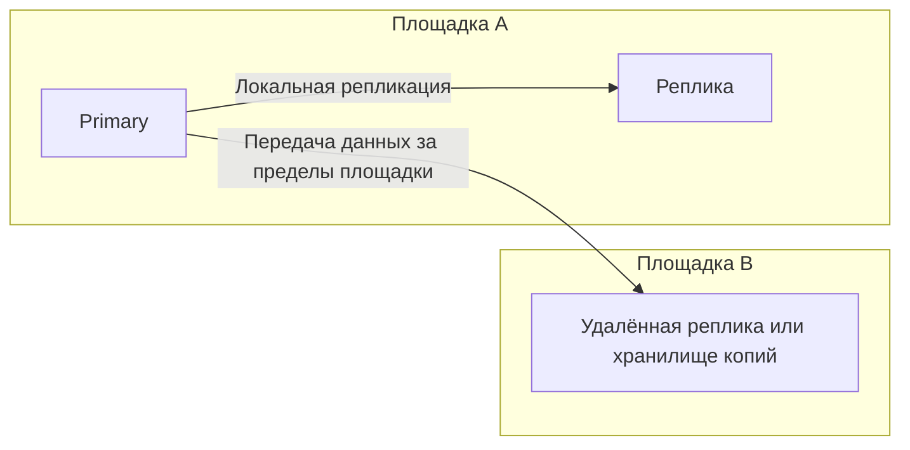

# 1. Отказ узла и потеря площадки

## 1.1. Разный масштаб отказа

**Отказ узла** — потеря отдельного сервера или виртуальной машины. Остальная инфраструктура может продолжать работать: сеть доступна, реплика получает подключения, приложение использует соседний сервер.

**Потеря площадки** — недоступность инфраструктуры целиком в пределах выбранного места размещения. Причиной может стать отключение питания, отказ общей сети или хранилища, пожар либо недоступность машинного зала.

Площадка не обязательно физически уничтожена. Если оборудование исправно, но до него невозможно добраться по сети, для сервиса результат может быть тем же.

| Сценарий | Что может остаться доступным |
|---|---|
| Сломался диск primary | Реплика на независимом диске |
| Выключился сервер primary | Другие серверы той же площадки |
| Отказало общее хранилище | Только узлы с независимым хранением |
| Пропала сеть или питание площадки | Ресурсы за её пределами |

**Домен отказа (failure domain)** — группа компонентов, которые могут одновременно потеряться из-за общей причины. Два сервера могут быть разными узлами, но принадлежать одному домену отказа по питанию, сети или дискам.

Для интернет-магазина локальная авария может означать переключение БД на соседний сервер. При потере площадки потребуется также вернуть приложение, доступ к резервным данным и клиентский маршрут.

**Катастрофоустойчивость** — способность восстановить сервис после такого крупного отказа. Её оценивают по доступности всей необходимой инфраструктуры, а не только запасного процесса PostgreSQL.

## 1.2. Границы защиты локальной реплики

**Локальная реплика** — копия базы, работающая в той же площадке. Она полезна при отказе primary, если сама реплика и необходимые для переключения компоненты остаются доступны.

Например, PostgreSQL работает на серверах A и B в одном машинном зале. При отказе A сервер B может стать новым primary. При отключении питания всего зала недоступны оба.

**Реплика рядом защищает от тех отказов, которые не затрагивают её общие зависимости с primary.** Даже разные серверы не обеспечивают независимость, если используют одно хранилище или один критический сетевой узел.



Диаграмма показывает границу размещения, а не готовую схему восстановления. Удалённая реплика и резервная копия позволяют восстанавливаться разными способами и за разное время.

При проверке независимости задают конкретные вопросы:

- Доступны ли удалённые данные без сети исходной площадки?
- Не остались ли только там ключи расшифрования и учётные данные?
- Где работает механизм выбора primary?
- Есть ли снаружи ресурсы для запуска базы и приложения?

Удалённое хранение мало помогает, если единственный способ получить к нему доступ исчезает вместе с основной площадкой.

## 1.3. Отдельные RPO и RTO для потери площадки

**RPO (Recovery Point Objective)** — максимально допустимая потеря последних изменений, выраженная временным интервалом.

**RTO (Recovery Time Objective)** — максимально допустимое время до восстановления согласованного уровня обслуживания.

Эти цели задают **для конкретного сценария отказа**. Требования к локальному переключению и потере площадки могут различаться:

| Сценарий | Пример RPO | Пример RTO |
|---|---:|---:|
| Отказ primary внутри площадки | Без потери подтверждённых транзакций | 30 секунд |
| Полная недоступность площадки | Не более 5 минут изменений | 2 часа |

Это условные требования бизнеса, а не гарантии какой-либо технологии.

Например, площадка потеряна в 14:00, а вне неё доступно состояние базы на 13:57. Фактический разрыв составляет три минуты. Наличие внутри потерянной площадки более свежей реплики не сокращает этот разрыв, пока она недоступна.

В RTO площадки входят обнаружение аварии, решение о восстановлении, подготовка ресурсов, получение данных, запуск БД, проверки и возврат приложения к обслуживанию.

**Финиш нужно определить заранее:** например, магазин снова принимает и сохраняет заказы. Доступность только каталога не удовлетворяет такому критерию.

Кроме времени, полезно обозначить последствия потери данных: какие заказы или статусы платежей придётся сверять с внешними системами.

## 1.4. Почему локальные замеры нельзя переносить на площадку

**Проверка сценария потери площадки** — испытание, в котором восстановление выполняют без ресурсов и зависимостей основной площадки.

Локальное переключение за 20 секунд не доказывает возможность такого же переключения между площадками. В локальном тесте могли сохраниться:

- работающие приложение и механизм координации;
- быстрый доступ к реплике;
- готовые сетевые маршруты;
- ключи, настройки и свободные вычислительные ресурсы.

При потере площадки часть этих компонентов потребуется восстановить отдельно. Удалённая копия также может быть менее свежей, а передача данных — более долгой.

Для отдельной проверки фиксируют момент условной аварии, последнюю доступную точку данных и время до успешного прикладного сценария. Если используется уже скачанная копия или заранее подготовленный сервер, это явно указывают как условие результата.

**Замер подтверждает только испытанные условия.** Восстановление ночью на свободном оборудовании не гарантирует такой же результат при высокой нагрузке и ограниченных ресурсах.

Если полноценное испытание пока не проведено, оценки помечают как расчётные. Их используют для планирования, но не выдают за подтверждённые RPO и RTO.

**Запомнить:** локальная HA защищает от ограниченного отказа, а потеря площадки требует независимых ресурсов, собственных RPO и RTO и отдельной проверки восстановления.

# 2. RPO и RTO площадки

## 2.1. RPO: допустимая потеря последних транзакций

**RPO (Recovery Point Objective)** — максимально допустимый интервал последних изменений, которые можно потерять при аварии. Для потери площадки учитывают данные, сохранившиеся **за её пределами** и пригодные для восстановления.

Например, **RPO = 5 минут** означает: при аварии в 14:00 должна быть возможность восстановить состояние как минимум до 13:55. Локальная реплика со всеми транзакциями не помогает выполнить это требование, если она потеряна вместе с primary.

Требование записывают вместе со сценарием:

> При полной потере основной площадки допускается потеря не более пяти минут последних транзакций. Резервная площадка и её хранилище считаются доступными.

**RPO = 0 для подтверждённых транзакций** означает, что операции, на фиксацию которых клиент получил успешный ответ, должны сохраниться при предусмотренном отказе. Это не гарантирует известный результат запроса, во время которого оборвалось соединение.

Для магазина временной интервал полезно дополнить последствиями: сколько заказов и изменений статусов платежей может попасть в него при пиковой нагрузке. Потеря одной минуты ночью и во время распродажи имеет разную цену.

Типичная ошибка — считать RPO равным расписанию копирования. Важны фактическая доставка данных за пределы площадки, целостность цепочки восстановления и доступность ключей.

## 2.2. RTO: восстановление чтения и записи

**RTO (Recovery Time Objective)** — максимально допустимое время от нарушения обслуживания до восстановления заданных функций на резервной площадке.

Критерий завершения должен быть прикладным: например, магазин снова читает существующие заказы, создаёт новые и подтверждает их сохранение. Работающий процесс PostgreSQL или доступность только чтения этого ещё не доказывают.

Пример бюджета при **RTO = 60 минут**:

| Этап | Плановое время |
|---|---:|
| Обнаружение аварии и решение о переходе | 10 минут |
| Подготовка резервной среды | 10 минут |
| Переключение или восстановление данных | 25 минут |
| Проверки и перевод приложения | 10 минут |
| Резерв времени | 5 минут |

Это предварительный бюджет, который проверяют тренировкой.

В расчёт включают зависимости: доступ к секретам, сеть, вычислительные ресурсы, механизм координации и адрес подключения приложения. Если резервная БД готова, но приложение осталось на потерянной площадке, сервис не восстановлен.

**RTO зависит от состояния готовности резерва.** Заранее работающая реплика и сервер, который ещё предстоит заказать, настроить и загрузить данными, — разные исходные условия. Их явно указывают в плане.

## 2.3. Выбор способа по требованиям

**Стратегия восстановления площадки** — сочетание способа сохранения данных, готовности резервных ресурсов и процедуры возвращения сервиса.

| Подход | Когда рассматривать | Главное ограничение |
|---|---|---|
| Синхронная реплика на другой площадке | Нельзя терять подтверждённые транзакции | Задержка подтверждения и зависимость от удалённой площадки |
| Асинхронная реплика | Допустима ограниченная потеря, требуется быстрое переключение | Последние транзакции могут не успеть передаться |
| Физическая копия и архив WAL | Допустимо время на развёртывание и восстановление | Передача файлов и воспроизведение журнала увеличивают RTO |

При синхронной схеме подтверждение должно **обязательно включать надёжное сохранение на другой площадке**. Если достаточно ответа любой одной реплики и ответить может локальная, защита от потери площадки не обеспечена. Также выбирают нового primary, содержащего подтверждённые изменения.

Асинхронная реплика позволяет не ждать удалённого подтверждения, но её отставание может вырасти при перегрузке или обрыве связи. Поэтому обычная задержка «меньше секунды» не доказывает гарантированный RPO в секунду. [Документация PostgreSQL: потоковая и синхронная репликация](https://www.postgresql.org/docs/current/warm-standby.html)

Для восстановления из копии нужны **базовая физическая копия и непрерывная цепочка WAL (Write-Ahead Log) — журнала изменений** вне исходной площадки. Свежесть доступного WAL определяет достижимую точку, а возраст базовой копии влияет на объём воспроизведения. Логический дамп нельзя использовать как основу для применения WAL. [Документация: Continuous Archiving](https://www.postgresql.org/docs/current/continuous-archiving.html)

**Низкий RPO не означает низкий RTO:** журнал может быть почти свежим, но восстановление большой базы займёт часы.

Ни одна строка таблицы не гарантирует заданные числа без измерений. При асинхронной схеме заранее решают, что делать при превышении допустимого отставания: ограничивать запись или признавать временное нарушение цели.

## 2.4. Цена межплощадочной синхронности

**RTT (Round-Trip Time)** — время прохождения сообщения до удалённого узла и ответа обратно. Синхронное подтверждение транзакции включает ожидание сети и необходимой обработки на реплике.

Упрощённо:

```text
Ожидание удалённого подтверждения ≈
  передача WAL и ответ
  + очереди и сохранение WAL на реплике
```

Часть локальной и удалённой работы может выполняться параллельно, поэтому это не точная формула полной задержки `COMMIT`.

Если RTT между площадками составляет 40 мс, подтверждение записи нельзя оценивать только по скорости локального диска. При множестве коротких последовательных транзакций влияние сети становится особенно заметным.

В PostgreSQL при выбранных синхронных репликах `synchronous_commit = on` ожидает надёжного сохранения WAL на них, а `remote_apply` дополнительно ждёт применения изменений. `remote_write` даёт более слабую гарантию при сбое ОС удалённого узла. [Документация: synchronous_commit](https://www.postgresql.org/docs/current/runtime-config-wal.html#GUC-SYNCHRONOUS-COMMIT)

Измеряют задержки под рабочей нагрузкой, включая редкие медленные ответы, и отдельно проверяют обрыв межплощадочной связи. **Если обязательное удалённое подтверждение недоступно, фиксация записей будет ждать.** Переход к асинхронной работе возвращает доступность ценой изменения гарантии сохранности.

**Запомнить:** RPO задаёт требуемую сохранность данных вне площадки, RTO — готовность вернуть сервис; межплощадочная синхронность сокращает риск потери ценой задержки и зависимости записи от удалённого подтверждения.

# 3. Копия вне площадки

## 3.1. Базовая копия и журнал в независимом хранилище

**Копия вне площадки (off-site backup)** — резервные данные, которые остаются доступны при полной потере защищаемой площадки.

Для физического восстановления PostgreSQL за её пределами должны находиться:

- **Базовая копия (base backup)** — исходная копия файлов кластера.
- **Архив WAL (Write-Ahead Log)** — журнал изменений, необходимый для восстановления копии и продвижения к выбранной точке.
- Служебные файлы, описывающие копию и нужную историю восстановления.

**Базовая копия и WAL должны образовывать пригодный комплект.** Для восстановления нужна непрерывная последовательность необходимых сегментов журнала. Наличие свежих файлов WAL не помогает, если между ними и базовой копией есть пропуск. [Документация PostgreSQL: Continuous Archiving](https://www.postgresql.org/docs/current/continuous-archiving.html)

Например, базовая копия магазина хранится на площадке B, но архив WAL остаётся на диске площадки A. После потери A восстановиться до последних заказов не получится: удалённая базовая копия сама по себе их не содержит.

Отдельный каталог или сетевое хранилище в том же машинном зале не обеспечивают защиту от потери этого зала. Проверяют физическое размещение, питание, сеть и зависимости доступа.

**Независимость касается не только файлов.** Ключи расшифрования, учётные данные, каталог копий и инструкция восстановления должны быть доступны без основной площадки. Иначе сохранённый архив может оказаться практически недоступным.

## 3.2. Подтверждение доставки и читаемости

**Доставка копии** считается завершённой, когда полный результат сохранён в целевом хранилище и проверен со стороны, которая будет выполнять восстановление.

Полезно разделять статусы:

| Статус | Что доказано |
|---|---|
| Создана локально | Источник подготовил копию |
| Передана | Целевое хранилище подтвердило завершение загрузки |
| Прочитана и проверена | Полученные данные доступны и прошли проверки целостности |
| Восстановлена | Из удалённого комплекта удалось получить работающую БД |

Файл ненулевого размера может быть обрезанным. Наличие объекта в списке хранилища также не доказывает, что его получится полностью скачать и расшифровать.

После передачи проверяют полноту набора файлов, размеры и **контрольные суммы (checksums)** — вычисленные отпечатки содержимого. Проверку чтения выполняют с резервной площадки, используя её учётную запись, сеть и ключи.

Для физической копии с `backup_manifest` можно применять `pg_verifybackup`: утилита сверяет файлы с описанием копии и проверяет необходимый для её восстановления WAL. Она не заменяет пробное восстановление и не подтверждает всю последующую цепочку журнала до произвольной точки. [Документация: pg_verifybackup](https://www.postgresql.org/docs/current/app-pgverifybackup.html)

**Успех локального архивирования не всегда означает межплощадочную доставку.** Если журнал сначала попадает в локальный промежуточный каталог, а затем отправляется отдельным процессом, второй этап требует собственного контроля.

До проверки нового удалённого комплекта предыдущий пригодный комплект не должен исчезнуть из-за ротации.

## 3.3. Вклад доставки в RPO и восстановления в RTO

**RPO** ограничивает допустимую потерю последних изменений. Для межплощадочного архива важно, насколько свежая **восстановимая** история уже находится вне основной площадки.

Задержка складывается из нескольких частей:

```text
Ожидание завершения сегмента WAL
+ очередь отправки
+ передача
+ сохранение в удалённом хранилище
```

В PostgreSQL обычное архивирование работает с завершёнными сегментами. При небольшой активности ожидание их заполнения может быть значительным. `archive_timeout` помогает ограничить ожидание переключения сегмента, но не устраняет сбои передачи и очередь доставки. [Документация: архивирование WAL](https://www.postgresql.org/docs/current/runtime-config-wal.html#RUNTIME-CONFIG-WAL-ARCHIVING)

Пример: площадка потеряна в 14:00, а удалённый комплект позволяет восстановиться до 13:57. Разрыв составляет три минуты. Если один обязательный сегмент отсутствует, достижимая точка может оказаться значительно старше, несмотря на наличие более новых файлов.

**RTO** ограничивает время возвращения сервиса. В него входят получение копии из удалённого хранилища, распаковка и расшифрование, восстановление файлов, применение WAL и прикладные проверки.

Свежесть базовой копии влияет прежде всего на объём последующего воспроизведения журнала: более старая копия может обеспечить тот же RPO при полном WAL, но потребовать больше времени для восстановления.

**Не смешивай два вида передачи:** доставка журнала до аварии влияет на возможную потерю данных, а получение файлов при восстановлении — на продолжительность простоя.

## 3.4. Проверка именно межплощадочного пути

**Межплощадочная тренировка восстановления** — уже знакомый цикл backup и restore, выполненный без использования ресурсов защищаемой площадки.

Не нужно изобретать новую проверку таблиц или отдельный прикладной сценарий. Используют прежние проверки целостности, ролей, чтения и записи, но меняют исходные условия:

1. Выбирают копию и WAL, уже находящиеся в удалённом хранилище.
2. Исключают доступ к основной площадке, включая локальные каталоги и сервисы получения секретов.
3. Восстанавливают чистый экземпляр на резервной площадке.
4. Выполняют сверку и прикладную проверку магазина.
5. Фиксируют достигнутую точку данных и длительность каждого этапа.

Для имитации потери площадки учитывают только данные, доставленные к моменту условной аварии. Если тест продолжает получать недостающий WAL с «потерянного» источника, результат завышает реальную готовность.

В отчёте отдельно отмечают идентификатор удалённой копии, доступную цепочку WAL, результат чтения и расшифрования, время получения файлов и полное время восстановления.

**Локальная проверка подтверждает работу процедуры с локальными ресурсами. Межплощадочная должна дополнительно доказать независимость доступа и сохранность удалённого комплекта.**

**Запомнить:** защищает не факт отправки копии, а полный читаемый комплект вне площадки, из которого удалось восстановиться без обращения к потерянной инфраструктуре.

# 4. Реплика на другой площадке

## 4.1. Асинхронная реплика как постоянно обновляемый резерв

**Асинхронная реплика** получает изменения primary, но primary подтверждает транзакции клиентам, не ожидая их сохранения на ней.

При размещении реплики на другой площадке изменения непрерывно передаются за пределы основного места хранения. Это обычно сокращает возможную потерю данных относительно редких копий без непрерывной доставки журнала.

Например, ночная копия магазина позволяет потерять почти сутки заказов. Исправно работающая удалённая реплика может отставать лишь на несколько секунд. Однако это наблюдаемый результат, а не гарантированный предел.

В PostgreSQL потоковая репликация передаёт **WAL (Write-Ahead Log)** — журнал изменений — по мере его появления. Реплика сохраняет и воспроизводит журнал, постепенно догоняя primary. [Документация: Streaming Replication](https://www.postgresql.org/docs/current/warm-standby.html#STREAMING-REPLICATION)

Удалённая реплика помогает и с **RTO — временем восстановления сервиса**: основная масса данных уже находится на работающем сервере. Остаются применение накопленного журнала, безопасное повышение до primary и перевод клиентов.

**Реплика не заменяет резервные копии.** Она воспроизводит также ошибочные удаления. Кроме того, резервная площадка должна иметь ресурсы для рабочей нагрузки: небольшой сервер для хранения копии может оказаться непригоден для обслуживания магазина.

## 4.2. Отставание и оценка возможной потери

**Replication lag — отставание реплики** — разница между состоянием primary и этапами получения, сохранения или применения журнала на реплике.

Эти этапы имеют разные последствия:

| Где находятся изменения | Что означает потеря основной площадки |
|---|---|
| Только на primary | Изменения могут быть потеряны |
| Надёжно сохранены на удалённой реплике | Могут быть воспроизведены без исходного primary |
| Уже применены на реплике | Входят в её восстановленное состояние |

**Отставание применения может служить консервативной оценкой потенциальной потери только при сопоставлении актуальных позиций в одной истории WAL.** Реальная потеря может быть меньше: часть ещё не применённого журнала уже сохранена на реплике.

Например, для момента аварии установлено:

- primary содержит изменения до 14:00:00;
- удалённая реплика сохранила непрерывный журнал до 13:59:58;
- применила его пока только до 13:59:50.

При исправном журнале реплика может воспроизвести сохранённые изменения до 13:59:58. Десять секунд отставания применения не означают потерю десяти секунд данных.

Но **последнее показание мониторинга не является безусловной верхней границей потери**. Если измерение сделано минуту назад, primary за эту минуту мог подтвердить множество новых заказов.

В PostgreSQL поля `write_lag`, `flush_lag` и `replay_lag` отражают задержки обработки недавнего WAL, а не гарантированный RPO или прогноз времени догона. При отсутствии активности они также не подходят для прямого измерения «возраста потерянных данных». [Документация: pg_stat_replication](https://www.postgresql.org/docs/current/monitoring-stats.html#MONITORING-PG-STAT-REPLICATION-VIEW)

Поэтому сохраняют позиции WAL, время наблюдения и состояние связи. **RPO — допустимую потерю последних изменений — проверяют по достижимому состоянию**, учитывая неопределённость после последнего наблюдения.

## 4.3. Синхронная реплика и задержка подтверждения

**Синхронная межплощадочная репликация** требует подтверждения от удалённой реплики перед успешным завершением транзакции для клиента.

Она может обеспечить отсутствие потери подтверждённых транзакций при потере основной площадки, если:

- подтверждение обязательно включает нужную удалённую реплику;
- используется надёжное сохранение WAL;
- новая роль primary передаётся узлу с этими изменениями;
- настройки отдельных транзакций не ослабляют гарантию.

В PostgreSQL при настроенных синхронных репликах `synchronous_commit = on` ожидает сохранения WAL на их дисках. `remote_apply` дополнительно ожидает применения изменений. [Документация: synchronous_commit](https://www.postgresql.org/docs/current/runtime-config-wal.html#GUC-SYNCHRONOUS-COMMIT)

**Дополнительная задержка приходится прежде всего на подтверждение `COMMIT`, а не обязательно на каждый SQL-оператор.** Если заказ создаётся несколькими запросами внутри одной транзакции, ожидание удалённого подтверждения относится к её фиксации. При отдельных автоматически фиксируемых запросах оно возникает для каждой такой транзакции.

Цена включает сетевое время до другой площадки и обратно, очереди и работу удалённого диска. Медленная сеть влияет на скорость оформления заказов даже при исправном primary.

При потере обязательной синхронной реплики подтверждения могут блокироваться. Переход на асинхронный режим восстанавливает возможность записи, но меняет гарантию сохранности — это должно быть заранее согласованным решением.

## 4.4. Кто разрешает переход на резервную площадку

**Активация резервной площадки** — согласованное разрешение обслуживать запись на ней с исключением одновременной записи на прежнем primary.

В плане явно указывают:

| Вопрос | Что должно быть определено |
|---|---|
| Кто принимает решение? | Оркестратор или ответственный оператор |
| На каких основаниях? | Состояние координации, узлов и данных |
| Как исключается старый primary? | Проверенное ограждение или протокол прекращения его права записи |
| Кто переводит клиентов? | Механизм маршрутизации и процедура переподключения |

**Потеря связи между площадками не доказывает гибель основной площадки.** Она может продолжать обслуживать собственных клиентов. Если резерв повысится только из-за тайм-аута, возникнет **split-brain** — два пишущих primary с расходящимися данными.

PostgreSQL предоставляет повышение реплики, но обнаружение отказа и безопасную координацию выполняет внешняя система. Необходима также защита от возвращения старого primary в самостоятельную запись. [Документация: Failover](https://www.postgresql.org/docs/current/warm-standby-failover.html)

Автоматика допустима при проверенных правилах координации и ограждения. Ручное решение также не заменяет эти проверки: оператор должен следовать инструкции, а не просто выбирать доступный сервер.

**Запомнить:** удалённая реплика сокращает путь восстановления, но её отставание нужно интерпретировать по этапам WAL и свежести измерений; переход на неё разрешают только при исключённой одновременной записи двух площадок.

# 5. План восстановления

## 5.1. Последовательность перехода на вторую площадку

**План восстановления (Disaster Recovery Plan, DR plan)** — инструкция, по которой сервис возвращают к работе после крупной аварии. Она определяет действия, ответственных, условия перехода между шагами и причины остановки.

Для базы данных порядок выглядит так:

| Шаг | Что должно быть подтверждено |
|---|---|
| Объявить потерю площадки | Выполнены критерии аварии, решение зафиксировано |
| Запретить запись на остатках первой площадки | Прежний primary не может продолжить или самостоятельно возобновить запись |
| Подготовить экземпляр на второй площадке | Доступны ресурсы, совместимое ПО, настройки и секреты |
| Восстановить данные или повысить реплику | Достигнуто выбранное состояние, разрешена роль нового primary |
| Проверить данные | Пройдены сверка и контрольное чтение и запись |
| Перевести приложения | Рабочие клиенты подключаются к новому primary и обслуживают запросы |

**Ограждение (fencing)** — лишение прежнего primary возможности принимать запись. Оно необходимо и тогда, когда часть первой площадки ещё работает или может внезапно вернуться в сеть.

Способ подготовки данных зависит от резерва:

- **Готовая реплика:** проверить её состояние, применить доступный журнал и выполнить предусмотренное повышение.
- **Резервная копия:** подготовить чистый экземпляр, загрузить файлы и воспроизвести необходимый **WAL — журнал изменений**.

Это альтернативные ветки плана, а не обязательные последовательные действия.

Прикладную проверку проводят через контролируемый экземпляр приложения до открытия общего трафика. Например, проверяют существующий заказ, создают тестовый и подтверждают его сохранение.

Для каждого шага записывают ожидаемый результат и действие при ошибке. **Нельзя продолжать только потому, что команда завершилась:** важно, достигнуто ли требуемое состояние. Подготовку ресурсов можно выполнять параллельно, но разрешение записи на новом primary зависит от безопасности предыдущих шагов.

## 5.2. Условия объявления потери площадки

**Критерий активации плана** — заранее согласованное условие, при котором начинается аварийное восстановление на другой площадке.

Один неудачный запрос или краткий сетевой тайм-аут недостаточен. Наблюдатель не всегда может отличить потерю площадки от неисправности собственного сетевого маршрута.

Условие может учитывать:

- недоступность критичных сервисов из нескольких независимых точек;
- длительность нарушения;
- сведения от инфраструктуры или оператора площадки;
- невозможность восстановить обслуживание локальным переключением;
- решение назначенного ответственного.

Пример формулировки:

> План активирует руководитель инцидента, если критичные сервисы площадки недоступны из двух независимых точек более пяти минут, локальное восстановление не помогает и оценка ремонта угрожает целевому RTO.

Это условный пример. Для разных сервисов допустимое ожидание будет различаться.

**RTO — допустимое время восстановления сервиса — уже расходуется во время диагностики.** Слишком короткое ожидание повышает риск ложного переключения, слишком долгое может сделать целевой срок недостижимым.

При этом объявление аварии и разрешение новой записи — разные решения. Можно начать подготовку резервной площадки, пока ещё проверяется ограждение старого primary. Краткий разрыв связи не должен автоматически обходить эту проверку.

## 5.3. Пароли, конфигурация и подключения вне основной площадки

**Независимые средства восстановления** — всё необходимое для запуска сервиса, доступное без первой площадки. Одних файлов базы для этого недостаточно.

В плане указывают местонахождение и способ получения:

| Что требуется | Что описать |
|---|---|
| Пароли и ключи | Хранилище секретов, роли доступа, резервный способ входа |
| Ключи расшифрования копий | Доступность и проверенный порядок использования |
| Конфигурация | Версия настроек БД, приложения, сети и средств координации |
| ПО и расширения | Доступные пакеты или образы нужных версий |
| Подключение приложения | Адрес записи, механизм смены маршрута, ответственный |
| Учётные записи управления | Доступ к резервной инфраструктуре и сетевым настройкам |

**В инструкции хранят ссылки и порядок доступа, а не открытые пароли.** Сама инструкция также должна быть доступна вне основной площадки.

Например, копия заказов сохранена на площадке B, но ключ расшифрования выдаёт единственный сервис на площадке A. Формально копия существует, однако восстановление заблокировано.

Проверяют также скрытые зависимости: вход через недоступную систему единой авторизации, получение конфигурации из локального репозитория, управление адресом приложения через внутреннюю панель.

Для перевода клиентов записывают, как обновляется цель подключения и как приложения заменяют старые соединения. Наличие постоянного имени сервера не гарантирует мгновенного переключения всех работающих процессов.

## 5.4. Условие остановки: нет пригодного источника данных

**Стоп-условие** — ситуация, в которой продолжение инструкции не может дать заявленный результат или создаёт дополнительный риск.

Если основная площадка недоступна, а вне неё **нет ни пригодной копии, ни реплики**, восстановление прежней базы по этому плану невозможно. Пустой экземпляр PostgreSQL не возвращает историю заказов и платежей.

Нужно различать случаи:

| Состояние резерва | Решение |
|---|---|
| Реплика или копия пригодна | Продолжить с проверкой достижимой точки |
| Резерв есть, но он старше допустимого | Зафиксировать нарушение RPO и получить предусмотренное планом решение |
| Копия есть, но отсутствует обязательный журнал | Определить, достижимо ли вообще согласованное состояние |
| Пригодного источника нет | Остановить восстановление данных и эскалировать инцидент |

**RPO — допустимая потеря последних изменений — не следует молча пересматривать во время восстановления.** Более старое состояние может быть полезно, но его использование и последствия должны быть явно согласованы.

Остановка плана не означает прекращение всех действий. Можно выяснять возможность возвращения исходных дисков, искать другие сохранённые копии и сверять внешние записи о платежах. Однако реконструкция данных из внешних систем или запуск магазина с пустой базой — отдельные сценарии, а не успешное восстановление прежнего состояния.

**Запомнить:** план должен определять не только порядок запуска второй площадки, но и право на переключение, независимый доступ ко всем ресурсам и условия, при которых продолжать нельзя.

# 6. Проверка и возврат

## 6.1. Проверочное восстановление без перевода пользователей

**Проверочное восстановление (restore drill)** — выполнение плана на резервной площадке с проверкой данных и приложения. Если боевое переключение недоступно, пользователей оставляют на основной площадке, а восстановленный экземпляр изолируют.

Используют копию и журнал, доступные вне основной площадки. Проверяют получение секретов, подготовку сервера, восстановление БД и прикладной сценарий. Тестовое приложение не должно отправлять реальные платежи, уведомления или заявки в доставку.

**Изоляция должна исключать попадание тестового сервера в рабочий маршрут записи.** Он не должен случайно объявиться новым primary в действующей системе координации.

Если резервом служит работающая реплика, для проверки записи предпочтительно подготовить отдельный тестовый экземпляр из её данных. Повышение самой аварийной реплики меняет её роль и временно лишает рабочую систему этого резерва.

Такая тренировка подтверждает многое, но не всё:

| Проверяется | Остаётся непроверенным без дополнительных испытаний |
|---|---|
| Доступность удалённых данных и ключей | Реальное ограждение основной площадки |
| Восстановление и целостность БД | Переключение пользовательского маршрута |
| Работа тестового приложения | Переподключение всех рабочих клиентов |
| Время выполненных этапов | Поведение под полной пользовательской нагрузкой |

**Успешный стендовый тест не следует называть полным боевым переключением.** В отчёте явно обозначают границы проверки.

## 6.2. Контрольные данные и фактические RPO/RTO

**Контрольный набор** — заранее выбранные строки и ожидаемые значения, по которым проверяют восстановленное состояние.

Для магазина он может включать заказ с позициями, платёж, резерв товара и несколько операций около выбранной точки восстановления. Сверяют идентификаторы, суммы, статусы и связи между таблицами. Дополнительно используют число строк и контрольные суммы выбранных данных.

Эталон должен соответствовать **восстанавливаемой точке**, а не текущей рабочей базе, которая продолжает изменяться. Совпадение небольшой выборки повышает уверенность, но не доказывает целостность всех данных.

**RPO** — допустимая потеря последних изменений. Для тренировки фиксируют момент условной аварии и последнюю подтверждённо достижимую точку по данным, уже находившимся вне основной площадки.

Например:

```text
Условная авария:              14:00
Достижимое состояние данных:  13:58
Фактический разрыв:           2 минуты
```

Нельзя после условной аварии незаметно догрузить недостающий журнал с «потерянной» площадки: это улучшит результат искусственно. Наличие одного старого контрольного заказа также не определяет точную границу потери.

**RTO** — допустимое время до восстановления обслуживания. Записывают длительность от начала сценария до успешного чтения и зафиксированной записи через тестовое приложение.

Если пользовательский маршрут не переключался, формулируют результат так:

> Тестовая среда восстановлена за 42 минуты. Перевод рабочих клиентов и полный RTO сервиса не проверены.

Измеренные этапы, расчётные оценки и непроверенные действия в отчёте разделяют.

## 6.3. Возврат на основную площадку без потери новых записей

**Failback — возврат** — управляемый перенос обслуживания обратно после восстановления основной площадки. Ниже предполагается, что реальное аварийное переключение уже произошло и резервная площадка принимает рабочие заказы.

Пусть A — прежняя основная площадка, B — действующая резервная. **После переключения именно B содержит актуальную рабочую историю**, включая новые заказы. Старые файлы A нельзя просто запустить как primary.

Безопасная последовательность:

1. Подготовить A как реплику действующего primary на B.
2. Передать данные и дождаться догона.
3. Запланировать краткую остановку записи и завершение активных транзакций на B.
4. Убедиться, что A получила и применила весь журнал с финальными изменениями B.
5. Исключить самостоятельную запись на B и выполнить плановую передачу роли A.
6. Перевести приложения на A, проверить чтение и запись.
7. Подключить B как реплику A и подтвердить возобновление репликации.

PostgreSQL предусматривает повторную подготовку бывшего primary как standby — резервного узла, следующего за новым primary. [Документация: Failover](https://www.postgresql.org/docs/current/warm-standby-failover.html)

Если истории разошлись, при выполнении необходимых условий может помочь `pg_rewind`; иначе используют новую базовую копию. **`pg_rewind` не объединяет независимые транзакции:** он приводит целевой узел к истории выбранного источника. Уникальные изменения старой ветки сохраняют для разбора до её перезаписи. [Документация: pg_rewind](https://www.postgresql.org/docs/current/app-pgrewind.html)

Возврат не обязан происходить сразу после ремонта A. Сначала полезно восстановить резервирование и убедиться в устойчивости площадки. Результат failback — не только работа на A, но и снова готовая реплика, архивирование и копирование.

## 6.4. Обновление плана по результатам проверки

**Актуализация плана** — исправление инструкции на основании фактического выполнения, а не только теоретического обзора.

Во время тренировки фиксируют каждое отклонение:

| Обнаружено | Что изменить |
|---|---|
| Ключ доступен только через основную площадку | Организовать независимый доступ |
| Подготовка сервера заняла дольше ожидаемого | Пересмотреть готовность резерва и бюджет времени |
| Потребовалась незаписанная команда | Добавить шаг, условия выполнения и проверку результата |
| Приложение использовало старый адрес | Исправить процедуру маршрутизации и переподключения |

Для исправлений назначают ответственного и срок. В отчёте сохраняют версию использованной инструкции, журналы, результаты сверки и измерения.

**Ручной обход ошибки не становится правильным решением автоматически.** Если проверка прошла только после отключения защиты или выдачи лишних прав, устраняют причину, а не закрепляют обход.

Изменённые шаги проверяют повторно; при изменении существенных зависимостей повторяют весь сценарий. До этого новую версию плана считают обновлённой, но ещё не подтверждённой практикой.

**Запомнить:** тренировка должна честно показывать проверенные RPO и RTO, а возврат — переносить актуальную историю с резервной площадки и восстанавливать резервирование.
