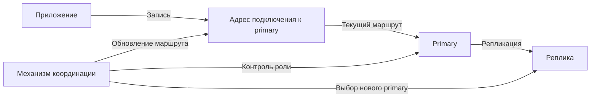
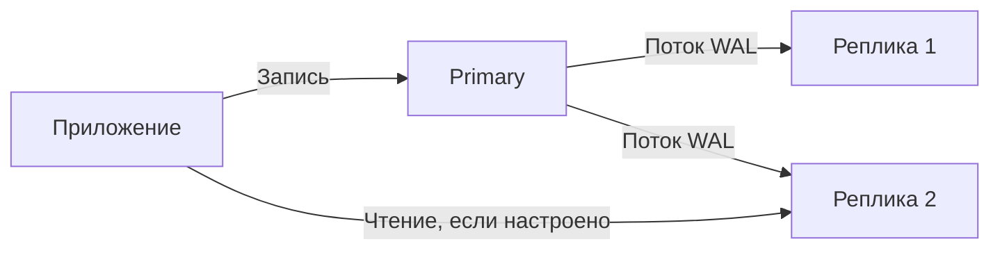
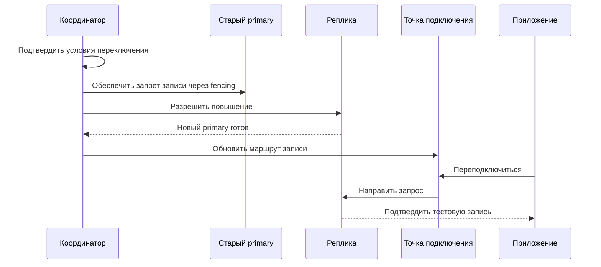
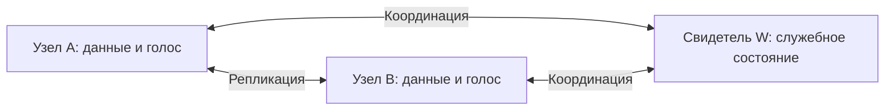
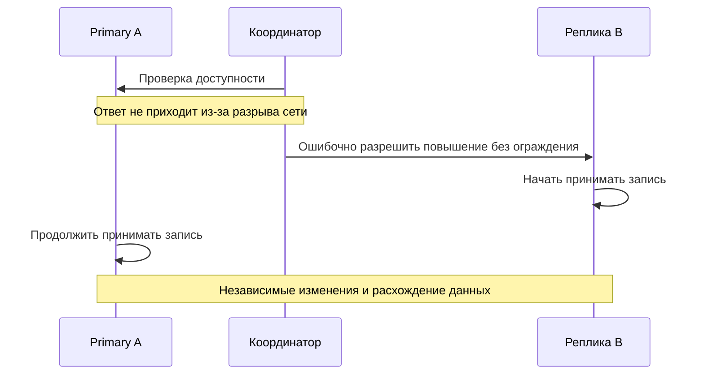
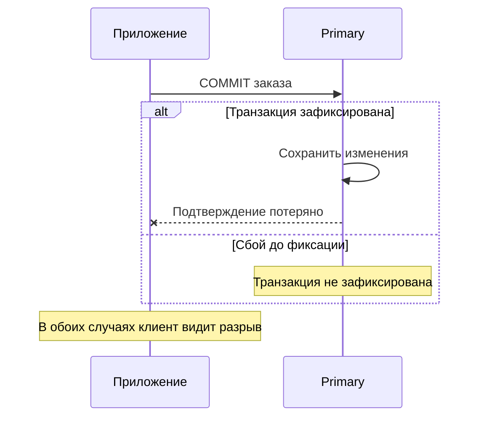

# 1. Что даёт высокая доступность базы

## 1.1. Реплика для чтения и продолжение записи после отказа

**Высокая доступность — High Availability (HA)** — способность системы сохранять или быстро восстанавливать обслуживание при предусмотренных отказах. Для магазина важно не только показывать каталог, но и продолжать создавать заказы.

В схеме с одним пишущим узлом **primary — первичный узел** принимает изменения, а **replica — реплика** получает их копию. Реплика, обслуживающая чтение, помогает разгрузить primary, но сама по себе ещё не обеспечивает доступность записи.

| Возможность | Реплика для чтения | Схема HA для записи |
|---|---|---|
| Выполнять запросы чтения | Да, если настроено | Обычно да |
| Содержать актуальные данные | В пределах задержки репликации | По установленным требованиям |
| Заменить отказавший primary | Не обязательно предусмотрено | Есть процедура выбора и переключения |
| Перенаправить приложение | Не обязательно предусмотрено | Часть процедуры восстановления |

**Failover — аварийное переключение** — передача роли primary другому узлу после отказа. В PostgreSQL физическую реплику можно повысить до primary, но обнаружение отказа и координация переключения требуют внешнего механизма. [Документация PostgreSQL: Failover](https://www.postgresql.org/docs/current/warm-standby-failover.html)

Например, после отказа primary каталог продолжает открываться с реплики, но оформление заказа выдаёт ошибку. Чтение доступно, а цель HA для записи не достигнута.

**Наличие второй копии данных не равно готовому failover.** Нужны подходящий кандидат, безопасная передача роли и подключение приложения к новому primary.

## 1.2. Допустимый простой и потеря подтверждённых транзакций

Гарантии доступности задают двумя отдельными требованиями:

- **RTO (Recovery Time Objective)** — допустимое время восстановления записи.
- **RPO (Recovery Point Objective)** — допустимая потеря последних изменений, обычно выраженная временным интервалом.

Пример требования магазина: «При отказе одного узла запись возобновляется не позднее чем через 30 секунд; транзакции, успешное завершение которых подтверждено приложению, не теряются».

**Подтверждённая транзакция** здесь означает, что приложение получило успешный ответ на `COMMIT` — фиксацию изменений.

При **асинхронной репликации** primary может подтвердить транзакцию до её сохранения на реплике. Если он погибнет раньше передачи данных, после переключения уже подтверждённый заказ может исчезнуть.

**Синхронная репликация** позволяет связывать подтверждение с получением или сохранением изменений на выбранных репликах. Конкретная гарантия зависит от настройки подтверждений и того, какой узел станет новым primary. Недоступность необходимых реплик может задержать завершение записи. [Документация: Synchronous Replication](https://www.postgresql.org/docs/current/warm-standby.html#SYNCHRONOUS-REPLICATION)

Поэтому обещание «потерь нет» требует уточнения: **при каких отказах, с какими настройками и правилами выбора нового primary**.

Отдельный случай — соединение оборвалось во время `COMMIT`. Приложение не знает, зафиксирована ли транзакция. Повторное создание заказа должно использовать тот же уникальный ключ операции, чтобы повтор запроса не создал дубликат.

## 1.3. Узлы, сеть и выбор primary как единая схема

**Схема HA** включает все компоненты, необходимые для безопасного продолжения работы: серверы БД, диски, сеть, механизм координации и путь подключения приложения.



Диаграмма показывает логические роли. Сам механизм координации тоже должен выдерживать предусмотренные отказы.

**Сетевая недоступность не доказывает остановку узла.** Если реплика перестала видеть primary, тот может продолжать обслуживать другую часть клиентов.

Отсюда два важных понятия:

- **Кворум (quorum)** — необходимое число голосов участников для принятия решения, часто большинство.
- **Split-brain** — ситуация, когда несколько узлов одновременно считают себя primary и принимают конфликтующие записи.

Кворум помогает согласовать выбор, но требуется также **fencing — принудительное лишение старого primary возможности обслуживать запись**, например его надёжная остановка или изоляция. PostgreSQL отдельно подчёркивает необходимость предотвращать одновременную работу старого и нового primary. [Документация: Failover](https://www.postgresql.org/docs/current/warm-standby-failover.html)

Участники голосования не обязательно хранят данные БД. Поэтому большинство голосов само по себе не доказывает сохранность последних заказов.

При проверке отказа одного узла оценивают весь путь: кто обнаружил проблему, кто разрешил переключение, куда подключилось приложение и может ли старый primary продолжать запись. Две БД на одном физическом сервере не защищают от потери этого сервера.

## 1.4. Высокая доступность и резервное копирование

**Резервная копия — backup** сохраняет данные для последующего восстановления. **HA** сокращает перерыв обслуживания благодаря заранее подготовленным работающим компонентам.

| Событие | Основной механизм |
|---|---|
| Отказ primary | Переключение на подготовленную реплику |
| Ошибочное удаление заказов | Восстановление прежнего состояния |
| Повреждение всех доступных копий | Восстановление из независимого хранилища |
| Плановое обслуживание узла | Управляемое переключение |

Реплика обычно получает и корректные изменения, и ошибочное удаление. Поэтому она не заменяет историю резервных копий.

Восстановление из архива требует получения файлов, подготовки среды и обработки данных. Подготовленная реплика позволяет сократить этот путь, хотя конкретное время переключения всё равно нужно измерять. [Документация: Standby Servers](https://www.postgresql.org/docs/current/warm-standby.html)

Для небольшого сервиса восстановление из копии может удовлетворять требованиям. Если допустимый простой записи измеряется секундами, обычно нужна подготовленная схема переключения. **HA и backup дополняют друг друга и проверяются разными сценариями.**

**Запомнить:** высокая доступность записи — это безопасное переключение всей системы с измеримыми пределами простоя и потери данных, а не просто наличие реплики.

# 2. Топология

## 2.1. Один primary и несколько реплик

**Топология** — расположение узлов и связей между ними: кто принимает запись, откуда реплики получают изменения и какие узлы могут заменить отказавший сервер.

**Потоковая репликация (streaming replication)** PostgreSQL передаёт записи **WAL (Write-Ahead Log)** — журнала изменений — с primary на физические реплики без ожидания заполнения целого файла журнала.



В этой схеме запись принимает один primary. Реплики воспроизводят изменения и при соответствующей настройке обслуживают чтение. По умолчанию потоковая репликация асинхронная: primary не ждёт подтверждения реплики перед ответом клиенту. [Документация PostgreSQL: Streaming Replication](https://www.postgresql.org/docs/current/warm-standby.html#STREAMING-REPLICATION)

Например, реплика 1 предназначена для аварийного переключения, а реплика 2 — для отчётов по заказам. Разделение полезно, если тяжёлые отчёты мешают реплике своевременно воспроизводить изменения.

**Replication lag — отставание реплики** — разница между состоянием primary и реплики. Поэтому только что созданный заказ может ещё не отображаться при чтении с неё.

Несколько реплик увеличивают выбор кандидатов, но не делают любой узел пригодным для переключения. Учитывают актуальность данных, производительность и расположение: новый primary должен выдержать рабочую нагрузку.

## 2.2. Синхронная репликация и цена сохранности

**Синхронная репликация** связывает успешное подтверждение транзакции с подтверждением от необходимого числа реплик. Она нужна, когда потеря уже подтверждённых заказов при предусмотренном отказе недопустима.

Уровень ожидания имеет значение:

| Режим `synchronous_commit` | Чего ждёт primary от выбранных синхронных реплик |
|---|---|
| `on` | Надёжного сохранения WAL на диске |
| `remote_apply` | Дополнительно — применения изменений, после которого они видны запросам |
| `remote_write` | Записи в файловую систему, без гарантии сохранения при сбое ОС реплики |

Эти гарантии действуют при настроенном выборе синхронных реплик через `synchronous_standby_names`. Одного `synchronous_commit = on` без них недостаточно. [Документация: synchronous_commit](https://www.postgresql.org/docs/current/runtime-config-wal.html#GUC-SYNCHRONOUS-COMMIT)

**Цена синхронности — дополнительное ожидание при фиксации транзакции:** передача по сети, обработка и сохранение WAL на реплике. Чем дальше узлы и медленнее диски, тем заметнее задержка.

Есть и цена доступности. Если единственная обязательная синхронная реплика недоступна, подтверждение записей может остановиться. Две БД позволяют иметь две копии данных, но после потери одной нельзя одновременно продолжать сохранять каждую новую запись на двух узлах.

Важно заранее выбрать поведение: ждать восстановления резервирования или временно ослабить гарантию. Для продолжения работы с двумя сохраняемыми копиями после отказа одного узла обычно нужны как минимум три узла данных и подходящая процедура перенастройки.

**Синхронность не разрешает переключаться на произвольную отстающую реплику.** Новый primary должен содержать подтверждённые изменения; иначе гарантия будет нарушена самим переключением.

## 2.3. Два узла и третий голос

**Кворум (quorum)** — достаточное число участников для принятия согласованного решения. В схеме простого большинства:

```text
Большинство = floor(N / 2) + 1
```

Для двух участников нужны два голоса. При разрыве связи каждая сторона имеет только один — большинства нет. Если обе самостоятельно разрешат себе запись, возникает **split-brain**: два независимых primary с расходящимися данными.

С тремя голосующими участниками большинство составляет два. При разделении `2 + 1` решение может принять сторона с двумя участниками.

Но **число голосов и число копий данных — разные величины**. Третий участник координации может не хранить заказы. Он помогает принять решение, но не заменяет синхронную реплику.

Также нельзя считать любой **witness — узел-свидетель** полноценным участником одного и того же алгоритма большинства. Например, witness в repmgr предоставляет дополнительную информацию о доступности primary; его роль отличается от участника распределённого хранилища Patroni. [Документация repmgr: Witness Server](https://www.repmgr.org/docs/current/repmgrd-witness-server.html)

Третий голос должен находиться в подходящей области отказа. Размещение его на том же физическом сервере, что и один из двух остальных участников, может привести к потере сразу двух голосов.

Кворум дополняют механизмом, лишающим старый primary возможности записи. Сам подсчёт голосов не останавливает уже работающий сервер.

## 2.4. Где находится правило переключения

**Оркестратор HA** — компонент, который контролирует состояние узлов и выполняет согласованную процедуру смены primary.

| Вариант | Где искать правило |
|---|---|
| Patroni | Настройки Patroni и состояние в DCS |
| repmgr | Настройки `repmgrd`, проверки и команды переключения |
| Ручная схема | Проверенная инструкция и назначенный ответственный |

**DCS (Distributed Configuration Store)** — распределённое хранилище состояния и конфигурации, например etcd. Patroni использует его для координации роли primary. Число узлов DCS рассматривают отдельно от числа серверов PostgreSQL. [Документация Patroni: FAQ](https://patroni.readthedocs.io/en/latest/faq.html)

В Patroni `synchronous_mode` ограничивает выбор кандидатов, а дополнительный `synchronous_mode_strict` запрещает отключать синхронность при отсутствии подходящей реплики. Это повышает сохранность ценой возможной остановки подтверждения записи. [Документация: Replication Modes](https://patroni.readthedocs.io/en/latest/replication_modes.html)

В repmgr автоматическое переключение выполняет `repmgrd`; поведение задают, в частности, `failover`, `promote_command` и `follow_command`. Сам факт установки repmgr не означает включённую автоматику. [Документация: repmgrd Configuration](https://www.repmgr.org/docs/current/repmgrd-basic-configuration.html)

Для любой схемы должно быть понятно: кто обнаруживает отказ, выбирает кандидата, блокирует старый primary и перенаправляет приложение. Ручная процедура допустима, если её фактическое время укладывается в требования.

**Запомнить:** проектируй отдельно поток данных, условия подтверждения записи и механизм выбора primary; третий голос помогает координации, но не заменяет третью копию данных.

# 3. Failover

## 3.1. Плановое и аварийное переключение

**Switchover — плановое переключение** — управляемая передача роли primary при работоспособном исходном узле. Его используют для обслуживания, обновления оборудования и проверки процедуры.

**Failover — аварийное переключение** — назначение нового primary после отказа или потери доступности прежнего. Информация о его последних транзакциях при этом может быть неполной.

| Критерий | Switchover | Failover |
|---|---|---|
| Исходный primary | Доступен и управляем | Недоступен или неисправен |
| Подготовка | Можно ограничить запись и дождаться реплики | Возможность дождаться последних изменений ограничена |
| Потеря данных | Можно обеспечить переключение без потерь | Зависит от репликации и выбора кандидата |
| Основная задача | Контролируемая смена ролей | Безопасное восстановление обслуживания |

Например, перед обслуживанием сервера магазин временно приостанавливает создание заказов, завершает активные операции и переключается на догнавшую реплику. При внезапной потере сервера такой подготовки нет.

Patroni различает операции `switchover` и `failover`; аварийное ручное переключение может допускать действия с риском потери данных. Их нельзя считать взаимозаменяемыми командами. [Документация Patroni: patronictl](https://patroni.readthedocs.io/en/latest/patronictl.html)

**Плановое переключение тоже может прерывать подключения.** Отсутствие потери данных не означает отсутствие ошибок у клиентов.

## 3.2. Последовательность безопасного failover

**Promotion — повышение реплики** — перевод её в роль primary с возможностью записи. Это один этап failover, а не вся процедура.



Диаграмма показывает логический порядок. **Fencing — принудительное лишение узла возможности записи** — может выполняться через управление питанием, инфраструктуру или другой проверенный механизм, даже если сам PostgreSQL не отвечает.

Шаги процедуры:

1. **Обнаружить отказ.** Проверить условия недоступности и право на переключение по принятому механизму координации. Один тайм-аут не доказывает остановку primary.
2. **Исключить запись на старом узле.** Защититься также от его самостоятельного возвращения после восстановления сети.
3. **Повысить допустимую реплику.** Дождаться завершения необходимого воспроизведения журнала и готовности к записи.
4. **Перевести клиентов.** Обновить маршрут и проверить переподключение приложения.
5. **Подтвердить результат.** Выполнить прикладное чтение и зафиксировать тестовую запись.

Простое удаление старого primary из балансировщика не всегда достаточно: существующие или прямые подключения могут сохраниться.

PostgreSQL предоставляет механизм повышения реплики, но обнаружение отказа и координацию выполняет внешняя схема. Старый primary нельзя просто вернуть в обслуживание как независимый пишущий узел. [Документация PostgreSQL: Failover](https://www.postgresql.org/docs/current/warm-standby-failover.html)

## 3.3. Отставание и выбор реплики

**Отставание реплики** характеризует, насколько она не догнала primary по получению или применению WAL — журнала изменений.

Для анализа используют **LSN (Log Sequence Number)** — позицию в WAL. Важно различать:

- **Полученный и сохранённый WAL:** изменения уже доступны реплике для воспроизведения.
- **Применённый WAL:** изменения уже воспроизведены в её данных.

На физической реплике можно посмотреть:

```sql
SELECT
  pg_last_wal_receive_lsn() AS received_and_flushed,
  pg_last_wal_replay_lsn()  AS replayed;
```

Первая функция показывает последнюю позицию WAL, полученную потоковой репликацией и сохранённую на диске; вторая — применённую позицию. [Документация: Recovery Information Functions](https://www.postgresql.org/docs/current/functions-admin.html#FUNCTIONS-RECOVERY-INFO-TABLE)

При прочих равных реплика с большим объёмом применённого журнала обычно быстрее готова обслуживать запросы. Но **максимальная применённая позиция не всегда означает наиболее полные данные**.

Например, реплика A применила больше WAL, а B получила ещё больше, но пока отстаёт по применению. B потенциально содержит более свежие изменения и может воспроизвести их перед завершением повышения.

Сравнивают узлы одного кластера с совместимой историей **timeline — веткой изменений**. Учитывают также ограничения оркестратора, синхронные подтверждения и здоровье узла. Patroni, например, имеет отдельные правила допустимого отставания и выбора кандидатов в синхронном режиме. [Документация: Replication Modes](https://patroni.readthedocs.io/en/latest/replication_modes.html)

При асинхронной репликации даже лучший доступный кандидат может не содержать последние подтверждённые заказы.

## 3.4. Перевод приложений на новый primary

**Стабильная точка подключения** позволяет приложению находить текущий primary без изменения конфигурации каждого процесса.

Возможные варианты:

| Механизм | Что меняется при переключении |
|---|---|
| Прокси или балансировщик | Сервер назначения для новых подключений |
| Виртуальный IP-адрес | Узел, которому принадлежит адрес |
| DNS-имя | Адрес в записи, с учётом кеширования |
| Список серверов в клиенте | Выбранный сервер при новом подключении |

Например, libpq поддерживает несколько адресов и `target_session_attrs=read-write`, чтобы выбирать соединение, допускающее запись. Это клиентский выбор, а не механизм согласования primary или защиты от split-brain. [Документация: параметры подключения libpq](https://www.postgresql.org/docs/current/libpq-connect.html)

**Открытое соединение не переносится вместе с адресом.** Проверяют, что приложение обнаруживает разрыв, удаляет неисправное соединение из пула и создаёт новое. Пул — набор повторно используемых подключений.

В тренировке проверяют веб-процессы и фоновые задания: все должны снова записывать данные без ручной правки адресов.

Если соединение оборвалось во время фиксации заказа, результат операции может быть неизвестен. Повтор выполняют с тем же уникальным ключом операции, чтобы не создать второй заказ.

**Запомнить:** failover завершён, когда старый primary больше не может писать, подходящая реплика стала новым primary, а приложения переподключились и подтвердили запись.

# 4. Кворум

## 4.1. Большинство как условие принятия решения

**Кворум (quorum)** — необходимое число участников, подтверждающих решение. Здесь рассматривается схема **строгого большинства**: нужно больше половины голосов установленного состава участников.

```text
Кворум = floor(N / 2) + 1
```

| Голосующих участников | Требуется голосов | Допустимо недоступных участников |
|---|---:|---:|
| 2 | 2 | 0 |
| 3 | 2 | 1 |
| 4 | 3 | 1 |
| 5 | 3 | 2 |

Недоступные участники учитываются в общем числе: нельзя объявить один оставшийся узел «большинством доступных». Изменение состава — отдельная согласованная процедура. Например, etcd использует большинство для согласования состояния и не может продолжать такие операции после его потери. [Документация etcd: FAQ](https://etcd.io/docs/v3.6/faq/)

**Любые два большинства одного состава пересекаются.** Это позволяет протоколу предотвращать противоречащие решения, если участники соблюдают правила голосования и смены лидера. Сам арифметический подсчёт без этих правил безопасности не обеспечивает.

Важно различать:

- **Кворум координации:** кто имеет право быть primary.
- **Подтверждение репликации:** на каких узлах сохранена транзакция.

Большинство, разрешившее назначить primary, ещё не доказывает, что на нём присутствуют все подтверждённые заказы.

## 4.2. Свидетель: участие в решении без копии заказов

**Witness — свидетель** — вспомогательный участник, помогающий принять решение о переключении без хранения полной копии прикладных данных.

В условной схеме голосования «узел A + узел B + свидетель W» свидетель даёт третий голос. При разделении сети сторона, способная согласовать решение двумя голосами, получает большинство.



Это концептуальная схема, а не универсальное устройство PostgreSQL HA. Конкретная роль свидетеля зависит от инструмента.

Например, **witness в repmgr** хранит служебные метаданные и помогает оценить доступность primary, но не является потоковой репликой с заказами. Его нельзя автоматически приравнивать к голосующему узлу другого протокола. [Документация repmgr: Witness Server](https://www.repmgr.org/docs/current/repmgrd-witness-server.html)

Поэтому «свидетель не хранит данные» точнее читать как **«не хранит прикладную копию базы»**: служебное состояние ему может быть необходимо.

Свидетель не заменяет резервирование данных. Если обе БД потеряны, из его голоса нельзя восстановить заказы. Если реплика отстала, свидетель не передаст ей недостающие транзакции.

Размещают его так, чтобы отказ одного сервера не уничтожил сразу узел данных и свидетеля. При этом учитывают сетевую топологию и требования конкретного инструмента.

## 4.3. Почему двух узлов недостаточно для большинства при разрыве связи

**Сетевое разделение (network partition)** — ситуация, когда работающие узлы перестают обмениваться сообщениями между собой.

Допустим, A был primary, а B — репликой. После разрыва связи:

- A не получает ответы от B, но продолжает видеть часть клиентов.
- B не получает ответы от A и предполагает, что primary отказал.

Для B одинаково выглядят два разных события: **A выключился** и **путь до A оборвался**. Один тайм-аут не позволяет надёжно различить их.

Если B повысит себя, а A продолжит запись, возникнет **split-brain** — несколько primary с расходящимися данными. Например, обе стороны независимо зарезервируют последний экземпляр товара для разных заказов.

При строгом большинстве двух участников необходимы оба голоса. В разделении `1 + 1` ни одна сторона не может самостоятельно подтвердить новое решение.

Два узла могут использовать другую проверенную схему, например гарантированное отключение прежнего primary перед повышением реплики. Но это уже дополнительный механизм безопасности, а не появившееся большинство.

**Отсутствие ответа — повод начать проверку, а не разрешение стать primary.**

## 4.4. Потеря большинства и остановка записи

Для рассматриваемой схемы действует правило: **сторона без большинства не должна сохранять право записи после истечения предусмотренного протоколом срока этого права**.

При разделении трёх участников:

| Разделение | Ожидаемое поведение |
|---|---|
| `2 + 1` | Большинство может продолжить работу при наличии пригодного узла данных; меньшинство прекращает запись |
| `1 + 1 + 1` | Никто не получает большинство; запись останавливается |

Это сознательный выбор: временно отказать в оформлении заказа безопаснее, чем подтвердить несовместимые заказы на разных primary.

Остановка не обязательно происходит в момент первого потерянного пакета. Протокол использует тайм-ауты и может выдавать **lease — ограниченное по времени право лидерства**. Новый primary не должен получить право записи одновременно с ещё действующим правом старого.

В обычном режиме Patroni невозможность продлить блокировку лидера в **DCS — распределённом хранилище координации** — приводит к отказу от роли primary до истечения блокировки. Это поведение обеспечивает Patroni, а не самостоятельный подсчёт голосов PostgreSQL. [Документация Patroni: DCS Failsafe Mode](https://patroni.readthedocs.io/en/latest/dcs_failsafe_mode.html)

Есть специально предусмотренные исключения: Patroni `failsafe_mode` при определённых условиях допускает работу существующего primary без доступного DCS, если его признают все известные участники Patroni. Это отдельный протокол безопасности, а не разрешение меньшинству продолжать запись.

**Запомнить:** большинство определяет право принимать решения, репликация — сохранность данных; без подтверждённого права лидерства запись прекращают, чтобы не получить два primary.

# 5. Split-brain

## 5.1. Два пишущих узла и расходящиеся данные

**Split-brain** — состояние, в котором два узла одной схемы с единственным primary одновременно принимают запись, а их данные расходятся. Каждый считает себя действующим primary и подтверждает операции своим клиентам.

Например, до разрыва связи на складе оставался один ноутбук:

| Узел A | Узел B |
|---|---|
| Создал заказ покупателя Анны | Создал заказ покупателя Бориса |
| Зарезервировал последний ноутбук | Зарезервировал тот же ноутбук |
| Подтвердил успешное оформление | Подтвердил успешное оформление |

Обе базы могут быть внутренне корректными: ограничения соблюдены, транзакции завершены. Но вместе они описывают несовместимые обязательства магазина — один товар обещан двум покупателям.

**Split-brain отличается от отставания реплики.** При отставании реплика воспроизводит единую историю primary. При split-brain возникают независимые продолжения общей истории. PostgreSQL описывает такие ветки через **timeline — историю изменений после переключения**. [Документация Patroni: Watchdog Support](https://patroni.readthedocs.io/en/latest/watchdog.html)

Не следует путать этот сбой с намеренно спроектированной системой **multi-primary**, где несколько узлов принимают запись по специальному протоколу согласования или разрешения конфликтов. Простое повышение второй физической реплики такой системы не создаёт.

## 5.2. Как возникает split-brain

Главная причина — **новый primary получает право записи, пока старый ещё способен записывать**.

Типичные ситуации:

- **Разрыв сети.** Реплика не видит primary, но тот продолжает обслуживать часть приложений.
- **Ложное обнаружение отказа.** Перегрузка, задержки сети или временная пауза процесса воспринимаются как окончательная потеря узла.
- **Преждевременное повышение.** Оператор или автоматика повышает реплику до подтверждённого ограждения прежнего primary.
- **Возвращение старого узла.** После перезапуска он снова начинает работать как primary, хотя эта роль уже передана.



**Недоступность для координатора не означает недоступность для клиентов.** Поэтому ни тайм-аут, ни перенос адреса подключения сами по себе не доказывают остановку старого primary.

PostgreSQL отдельно требует предусмотреть механизм, который не позволит вернувшемуся старому узлу работать одновременно с новым primary. [Документация: Failover](https://www.postgresql.org/docs/current/warm-standby-failover.html)

## 5.3. Ограждение старого primary

**Fencing — ограждение** — механизм, который гарантированно лишает прежний primary возможности принимать запись до разрешения записи на новом.

Критический порядок:

```text
Подтвердить ограждение старого primary
→ повысить выбранную реплику
→ направить клиентов на новый primary
```

Возможные способы зависят от инфраструктуры:

| Способ | Условие надёжности |
|---|---|
| Остановка PostgreSQL | Остановка подтверждена, самопроизвольный запуск исключён |
| Выключение сервера или виртуальной машины | Отключение выполнено через доступный независимый механизм |
| Сетевая изоляция | Закрыты все пути записи, включая существующие и локальные подключения |
| Watchdog | Настроено своевременное принудительное отключение или перезапуск |

**Watchdog — сторожевой механизм** — перезапускает систему, если перестаёт получать регулярный сигнал работоспособности. Patroni использует его как дополнительную защиту на случай, если обычная остановка PostgreSQL не сработала вовремя, например из-за зависания управляющего процесса. [Документация Patroni: Watchdog Support](https://patroni.readthedocs.io/en/latest/watchdog.html)

Удалить сервер из балансировщика недостаточно, если остались прямые подключения или фоновые задания с доступом к нему. Аналогично, отправленная команда остановки ещё не является подтверждением её выполнения.

**Если безопасность ограждения не установлена, переключение не должно создавать второго писателя.** Конкретный протокол может обеспечивать это через ограниченное по времени право лидерства и принудительное прекращение записи.

## 5.4. Что делать с разошедшимися историями

**Восстановление после split-brain** включает два разных решения: какую историю сделать основной и как обработать операции, оставшиеся только в другой ветке.

Общий порядок:

1. Прекратить неконтролируемую запись и исключить повторное раздвоение.
2. Сохранить обе ветки, необходимые журналы и сведения о клиентских операциях до перезаписи файлов.
3. Выбрать основной узел по принятой процедуре и требованиям сохранности.
4. Найти уникальные и конфликтующие изменения второй ветки.
5. Согласовать необходимые операции на прикладном уровне и вернуть второй узел как реплику.

**«Самая свежая база» не обязательно содержит все нужные данные.** На A может быть один подтверждённый заказ, а на B — другой. Выбор только по времени последней записи не объединяет их.

Для PostgreSQL `pg_rewind` может подготовить разошедшийся узел к следованию выбранному источнику. Но **он не объединяет транзакции двух primary**: собственная расходящаяся история целевого узла не сохраняется как набор действующих изменений. Утилита требует необходимых WAL и предварительных условий, включая контрольные суммы данных либо `wal_log_hints`, а также `full_page_writes`. Если условия не выполнены, может потребоваться новая базовая копия. [Документация: pg_rewind](https://www.postgresql.org/docs/current/app-pgrewind.html)

В примере с ноутбуком недостаточно перенести обе строки заказов: нужно решить, кому достанется товар, проверить платежи и при необходимости выполнить возврат. Репликация не принимает такие бизнес-решения.

**Запомнить:** split-brain предотвращают запретом одновременной записи; после расхождения сначала выбирают основную историю и разбирают потерянные операции, затем восстанавливают репликацию.

# 6. Клиенты после переключения

## 6.1. Пул соединений и подключение к новому primary

**Пул соединений (connection pool)** — набор открытых подключений к базе, которые приложение повторно использует для запросов. В Rails пул выдаёт соединения потокам выполнения и возвращает их после использования. [Документация Rails: ConnectionPool](https://api.rubyonrails.org/classes/ActiveRecord/ConnectionAdapters/ConnectionPool.html)

После переключения primary адрес назначения может измениться, но **уже открытое соединение не переносится на новый сервер**. Оно остаётся связано со старым узлом, пока не будет закрыто или оборвано.

Поэтому проверяют всю цепочку:

1. Старые подключения перестают обслуживать запись и закрываются.
2. Пул обнаруживает неисправные соединения и больше не выдаёт их для работы.
3. Новые подключения идут к новому primary.
4. Запросы приложения снова завершаются успешно.

Стабильное DNS-имя или прокси упрощают выбор сервера, но не заменяют обработку разрывов. DNS-кеширование также может задержать переход новых подключений.

В libpq — клиентской библиотеке PostgreSQL — можно задать несколько серверов и `target_session_attrs=read-write` для выбора подключения, допускающего запись. Это работает при установлении соединения и не переносит выполняющуюся транзакцию. [Документация: параметры подключения](https://www.postgresql.org/docs/current/libpq-connect.html)

**Проверять нужно все процессы:** веб-приложение, фоновые задания, планировщики и долгоживущие обработчики. Успешный новый запрос из консоли не доказывает, что рабочие пулы восстановились.

## 6.2. Когда допустим повтор транзакции

**Идемпотентная операция (idempotent operation)** при повторном выполнении не создаёт дополнительного бизнес-эффекта. Например, повтор запроса создания заказа с тем же ключом операции должен возвращать тот же заказ, а не создавать второй.

Для безопасного повтора обычно нужны:

- постоянный **idempotency key — ключ операции**, сохраняемый между попытками;
- уникальное ограничение в БД, предотвращающее дублирование;
- атомарная фиксация результата и связи с ключом;
- проверка, что повторный запрос с тем же ключом содержит те же параметры.

Условный интерфейс приложения:

```ruby
Orders::Create.call(
  customer: customer,
  items: items,
  idempotency_key: checkout_request_id
)
```

Это пример собственного сервиса, а не встроенный метод Rails. Его реализация должна обеспечивать перечисленные гарантии. Один параметр с названием `idempotency_key` ничего не гарантирует.

После разрыва **повторяют всю транзакцию на новом соединении**, а не только последний SQL-запрос. Решения, зависящие от данных, вычисляют заново. В Rails не следует перехватывать ошибку БД внутри транзакционного блока и продолжать работать в уже испорченной транзакции. [Документация Rails: Transactions](https://api.rubyonrails.org/classes/ActiveRecord/Transactions/ClassMethods.html)

Повторы ограничивают числом попыток и общим временем, добавляя паузы, чтобы не перегрузить восстанавливающуюся базу.

**Допустимый неизвестный результат и допустимый повтор — разные требования.** Бизнес может разрешать потерю необязательного события, но запрещать его дублирование. Для платежей и резервирования товара нельзя считать повтор безопасным только потому, что исход операции неизвестен.

Внешний платёж не откатывается вместе с транзакцией PostgreSQL. Для него нужны собственная защита от повторов и сверка с провайдером.

## 6.3. Ошибка записи и потерянное подтверждение

**Неопределённый результат (ambiguous outcome)** возникает, когда клиент не может установить, завершилась ли операция.

При разрыве во время `COMMIT` возможны две истории:



**Ошибка соединения не доказывает откат.** Если сервер успел зафиксировать заказ, слепой повтор без защиты может создать дубликат.

Обратная ситуация — сервер вернул явный отказ, например нарушение ограничения, и транзакция завершилась откатом. Тогда причина известна: повтор без изменения входных данных обычно бесполезен.

После неопределённого результата приложение ищет сохранённый результат по ключу операции на актуальном primary. Однако при асинхронном failover отсутствие записи не доказывает, что её никогда не было: она могла остаться только на прежнем primary. Поэтому сохранность транзакций и клиентская идемпотентность должны рассматриваться вместе.

Пользователю в такой ситуации корректнее показать «Проверяем результат оформления», чем уверенно сообщать, что заказ не создан.

## 6.4. Ошибки в окне переключения

**Окно переключения** — интервал, в котором клиенты ещё теряют старые подключения или не могут полноценно работать с новым primary.

В тренировке записывают фактически наблюдавшиеся ошибки:

| Ошибка | Что может означать |
|---|---|
| Разрыв соединения, сброс сокета | Старый сервер остановлен или соединение потеряно |
| Тайм-аут подключения | Новый маршрут или сервер ещё недоступен |
| `57P01 admin_shutdown` | Соединение завершено из-за административного отключения |
| `57P03 cannot_connect_now` | Сервер пока не принимает подключения |
| `25006 read_only_sql_transaction` | Запись попала в транзакцию только для чтения |
| Тайм-аут получения соединения из пула | Приложение не дождалось свободного подключения |

**SQLSTATE** — пятисимвольный код ошибки PostgreSQL. Для классификации он надёжнее текста сообщения, но сетевой сбой может не сопровождаться серверным кодом. [Документация: PostgreSQL Error Codes](https://www.postgresql.org/docs/current/errcodes-appendix.html)

В журнал включают время, процесс приложения, сервер назначения, класс исключения, SQLSTATE при наличии, этап операции, номер попытки и итог. Особо отмечают ошибки во время `COMMIT` и операции с неустановленным результатом.

Успех проверки — восстановление работы всех клиентов в установленный срок, отсутствие дубликатов и учёт неопределённых операций, а не полное отсутствие кратковременных ошибок.

**Запомнить:** переподключение восстанавливает доступ к базе, но не определяет судьбу оборванной транзакции; безопасный повтор требует идемпотентности или явно согласованных последствий.

# 7. Проверка отказа узла

## 7.1. Остановка primary как проверка реального отказа

**Проверка отказа (failure test)** — управляемое отключение компонента, позволяющее проверить обнаружение аварии, переключение и восстановление работы приложения.

Для сценария потери первичного узла останавливают именно **узел primary**, например виртуальную машину на испытательном стенде. Остановка только передачи WAL — журнала изменений — моделирует нарушение репликации: primary при этом может продолжать принимать заказы.

Нужно точно обозначить, что проверялось:

| Воздействие | Проверяемый сценарий |
|---|---|
| Остановка репликации | Отставание или потеря связи с репликой |
| Остановка PostgreSQL | Отказ процесса БД |
| Выключение виртуальной машины | Потеря узла вместе с его процессами |
| Разрыв сети | Недоступность узла при возможном продолжении его работы |

**Корректное выключение и внезапный отказ — разные испытания.** При корректном завершении система может успеть выполнить подготовительные действия. Такой результат нельзя автоматически переносить на потерю питания или зависание.

Перед испытанием сохраняют роли узлов, состояние репликации, параметры переключения и контрольные заказы. Проверочный клиент запускают заранее через обычный адрес приложения.

Команда отключения зависит от инфраструктуры. Её берут из процедуры стенда и сохраняют вместе с результатом. Если проверяется автоматический failover, ручное повышение реплики во время опыта меняет сценарий: это нужно явно отметить.

## 7.2. Время до первой подтверждённой записи

**Наблюдаемое время переключения** — интервал от зафиксированного отказа до первой успешно подтверждённой записи на новом primary через обычный клиентский маршрут.

```text
Время переключения =
  момент подтверждения первой записи на новом primary
  − момент остановки прежнего primary
```

Отдельно сохраняют момент отправки команды отключения и момент подтверждённой остановки. Если точный момент отказа неизвестен, указывают, какая отметка использована.

Проверочный клиент регулярно создаёт записи с уникальными ключами операций. Для каждой попытки фиксируют начало, результат, время подтверждения и сервер, выполнивший операцию.

Пример результатов:

| Событие | Время |
|---|---|
| Primary A остановлен | 12:00:00 |
| Координатор обнаружил отказ | 12:00:08 |
| Реплика B стала primary | 12:00:15 |
| Клиент подтвердил запись на B | 12:00:21 |

Измеренное время — **21 секунда**. Именно его сравнивают с требованием доступности записи, а не только 15 секунд до повышения реплики.

**Успешный `SELECT 1` не подтверждает восстановление записи.** Нужна фиксация транзакции, после которой контрольная запись читается через новое подключение. Выполнение `INSERT` без успешного завершения `COMMIT` недостаточно.

Если клиент пробует писать раз в секунду, замер имеет соответствующую погрешность обнаружения. После первой удачи продолжают проверки, чтобы исключить кратковременное восстановление с повторными сбоями.

## 7.3. Возвращение бывшего primary

**Безопасное возвращение узла** означает, что включённый старый primary не начинает самостоятельно принимать запись.

После запуска допустимы два состояния:

- узел остаётся остановленным или изолированным до подготовки;
- узел присоединён как реплика нового primary и воспроизводит его изменения.

PostgreSQL требует предусмотреть защиту от одновременной работы старого и нового primary. Для восстановления резервирования бывший primary подготавливают как реплику выбранного действующего узла. [Документация: Failover](https://www.postgresql.org/docs/current/warm-standby-failover.html)

Проверяют **прямой адрес старого узла**, а не только общий адрес приложения. Иначе исправный маршрут на B может скрыть, что A тоже принимает запись.

Если подключение к старому узлу разрешено:

```sql
SELECT pg_is_in_recovery();
SHOW transaction_read_only;
```

Для физической реплики ожидаются `true` и `on`. `pg_is_in_recovery()` показывает, выполняется ли восстановление. [Документация: Recovery Information Functions](https://www.postgresql.org/docs/current/functions-admin.html#FUNCTIONS-RECOVERY-INFO-TABLE)

Дополнительно выполняют контролируемую попытку записи в заранее подготовленную обычную тестовую таблицу. Она должна быть запрещена состоянием узла. Отказ из-за отсутствия прав у пользователя сам по себе не доказывает, что сервер является репликой.

**Проверка после завершения запуска не исключает короткого опасного интервала.** Поэтому наблюдают узел с момента включения и сохраняют журналы запуска, смены роли и ограждения.

## 7.4. Команды, роли и доказательства переключения

**Протокол испытания** — набор данных, по которым другой человек может восстановить ход проверки и оценить результат.

Сохраняют:

- дату, топологию и версии компонентов;
- точные команды отключения и включения, время и результат их выполнения;
- роли и состояние узлов до отказа, после переключения и после возвращения;
- ошибки клиента и первую подтверждённую запись;
- результат проверки старого primary и сохранности контрольных заказов.

Для идентификации сервера в подключении:

```sql
SELECT
  inet_server_addr() AS server_ip,
  inet_server_port() AS server_port,
  pg_is_in_recovery() AS in_recovery;
```

Адрес и порт относятся к серверу текущего подключения; при локальном Unix-сокете они могут быть `NULL`. Их сопоставляют с инвентарём узлов. [Документация: Session Information Functions](https://www.postgresql.org/docs/current/functions-info.html#FUNCTIONS-INFO-SESSION-TABLE)

Если используется Patroni, дополнительно сохраняют вывод:

```bash
patronictl -c /etc/patroni.yml list
```

Путь условный; конфигурация должна обеспечивать доступ к нужному кластеру. Команда показывает состав и роли участников. [Документация Patroni: patronictl](https://patroni.readthedocs.io/en/latest/patronictl.html)

Ожидаемый итог:

| Узел | До отказа | После переключения | После возвращения |
|---|---|---|---|
| A | Primary | Выключен | Реплика или изолирован |
| B | Реплика | Primary | Primary |

**Статус координатора сопоставляют с фактической работой БД и клиента.** Один вывод «Leader» не подтверждает ни доступность записи приложению, ни отсутствие второго пишущего узла.

**Запомнить:** успешная проверка показывает потерю primary, измеренное возобновление записи через обычный маршрут и безопасное возвращение старого узла без права самостоятельной записи.
