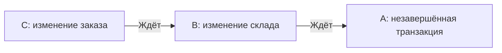

# 1. Что наблюдать

## 1.1. Метрика должна отвечать на вопрос

**Метрика** — числовое наблюдение за состоянием системы или её работой во времени. Начинать мониторинг PostgreSQL полезно с эксплуатационных вопросов, а не со списка всех доступных показателей.

| Вопрос | Что наблюдать | Важное ограничение |
|---|---|---|
| Сервер принимает соединения? | Результат проверки доступности и настоящего подключения | Доступность порта не подтверждает доступ приложения |
| Запросы укладываются в срок? | Длительность запросов, ошибки и таймауты | Среднее скрывает редкие медленные запросы |
| Соединений хватает? | Число клиентских сессий и оставшийся запас | Много соединений не означает много работающих запросов |
| Сессии не мешают друг другу? | Число и длительность ожиданий блокировок | Короткие ожидания могут быть нормальными |
| Диск не заполняется? | Доступное место и скорость его расходования | Размер базы не равен заполненности файловой системы |
| Реплика успевает за primary? | Позиции получения и применения журнала, состояние связи | Отсутствие новых записей не равно отставанию |

**Сессия** — подключение клиента к PostgreSQL. **Блокировка** координирует совместный доступ к данным; проблема возникает, когда ожидание мешает выполнить операцию в допустимый срок.

Например, `pg_isready` проверяет, принимает ли PostgreSQL соединения, но для получения статуса не требует правильных учётных данных. Поэтому успешный результат не подтверждает, что роль приложения может подключиться к нужной базе. [Документация: pg_isready](https://www.postgresql.org/docs/current/app-pg-isready.html)

Практическую доступность дополняют небольшим запросом из среды приложения. Если требуется проверить запись, используют отдельную контролируемую операцию: успешное чтение не доказывает возможность сохранить заказ.

## 1.2. Симптом приложения и причина в СУБД

**Симптом** — наблюдаемое ухудшение обслуживания. **Причина** — состояние или событие, которое его вызвало.

Рост задержки API оформления заказа — симптом. Он может возникнуть из-за PostgreSQL, платёжного API, сети или ожидания свободного соединения внутри приложения.

На стороне СУБД разные причины дают разные сочетания признаков:

| Наблюдение | Что проверить дальше |
|---|---|
| API замедлился, растут ожидания блокировок | Блокирующую сессию и длительность её транзакции |
| Подключения отклоняются, запас соединений исчерпан | Рост числа сессий и настройки пулов |
| SQL выполняется дольше, накопились ожидания ввода-вывода | Состояние дисков, нагрузку и характер запросов |
| API медленный, запросы БД остаются быстрыми | Пул приложения, сеть и другие зависимости |
| Растёт отставание реплики | Передачу журнала и скорость его применения |

`pg_stat_activity` показывает текущие сессии, их состояние и события ожидания. Поля `state` и `wait_event` рассматривают вместе: активный запрос может ждать ресурс, а не использовать процессор. [Документация: pg_stat_activity](https://www.postgresql.org/docs/current/monitoring-stats.html#MONITORING-PG-STAT-ACTIVITY-VIEW)

**Совпадение по времени ещё не доказывает причину.** Нужна проверяемая цепочка: например, длинная транзакция удерживает блокировку, другие запросы ждут её, оформление заказа превышает допустимое время.

Не следует автоматически завершать сессии только потому, что график задержки вырос.

## 1.3. Небольшой набор показателей с действием

**Алерт (alert)** — уведомление о состоянии, требующем внимания или действия. Полезный алерт содержит не только порог, но и длительность нарушения, владельца и первый шаг диагностики.

Для начала достаточно контролировать доступность, задержку и ошибки запросов, запас соединений, длительные блокировки, свободное место и состояние репликации.

Примеры правил:

| Сигнал | Условие | Первое действие |
|---|---|---|
| Подключение не работает | Несколько последовательных неудачных проверок | Проверить сеть, состояние сервера и журнал |
| Соединения заканчиваются | Малый запас сохраняется заданное время | Найти источник роста сессий |
| Блокировка задерживает заказы | Ожидание превышает бюджет операции | Определить блокирующую транзакцию |
| Диск скоро заполнится | Запаса недостаточно для времени реакции | Найти источник роста и подготовить расширение |
| Реплика нарушает цель свежести | Отставание подтверждено актуальными наблюдениями | Проверить связь и воспроизведение журнала |

**Порог выбирают из требований и нормальной нагрузки.** Универсальное «диск заполнен на 80%» не учитывает размер диска и скорость роста. Иногда важнее прогноз времени до заполнения.

Для задержки полезен **p95 — значение, в которое укладываются 95% наблюдений**. Но и его оценивают вместе с числом запросов, ошибками и типом операции.

Условия должны отсеивать краткие допустимые всплески, но оставлять достаточно времени на реакцию. Если дежурный не понимает, что делать после уведомления, правило ещё не готово.

## 1.4. Источник и смысл каждой метрики

**Источник метрики** определяет, что именно измерено и какие ограничения есть у результата.

| Источник | Что даёт |
|---|---|
| Представления PostgreSQL | Сессии, ожидания, накопленные счётчики и состояние репликации |
| Экспортер | Получение и передачу показателей в систему мониторинга |
| Журнал PostgreSQL | Ошибки и события с контекстом |
| ОС или агент узла | Свободное место, ресурсы сервера и состояние дисков |
| Приложение | Время ожидания пула и длительность обращения со стороны клиента |

**Экспортер (exporter)** — компонент, собирающий показатели и публикующий их для мониторинга. Для его метрики нужно знать исходный запрос или системный показатель: название само по себе не объясняет смысл.

Например, `pg_stat_replication` показывает состояние непосредственно подключённых реплик. Его показатели задержки не являются готовой гарантией возможной потери данных. [Документация: pg_stat_replication](https://www.postgresql.org/docs/current/monitoring-stats.html#MONITORING-PG-STAT-REPLICATION-VIEW)

Журнал может содержать медленные запросы, если соответствующее журналирование настроено. Выборка только медленных запросов не описывает распределение длительности всех обращений. [Документация: Error Reporting and Logging](https://www.postgresql.org/docs/current/runtime-config-logging.html)

Для каждой метрики сохраняют источник, единицы, интервал сбора, способ агрегации и условия сброса. **Отсутствие данных — не нулевое значение:** отказ экспортера не означает отсутствие блокировок или ошибок.

**Запомнить:** наблюдай доступность, задержки и ограниченные ресурсы; у каждой метрики должны быть понятный источник, эксплуатационный вопрос и действие при нарушении.

# 2. Запросы

## 2.1. Включение pg_stat_statements и основные показатели

**`pg_stat_statements`** — расширение PostgreSQL, собирающее накопленную статистику групп однотипных SQL-запросов. Запросы, различающиеся значениями параметров, обычно объединяются.

Для подключения добавляют модуль в конфигурацию:

```conf
shared_preload_libraries = 'pg_stat_statements'
compute_query_id = auto
```

Если в `shared_preload_libraries` уже перечислены модули, их сохраняют. После перезапуска сервера в базе для наблюдения выполняют:

```sql
CREATE EXTENSION IF NOT EXISTS pg_stat_statements;
```

Самого `CREATE EXTENSION` без предварительной загрузки модуля недостаточно. [Документация: pg_stat_statements](https://www.postgresql.org/docs/current/pgstatstatements.html)

Основные поля:

| Поле | Значение |
|---|---|
| `calls` | Число выполнений |
| `total_exec_time` | Суммарное время выполнения, мс |
| `mean_exec_time` | Среднее время выполнения, мс |
| `rows` | Суммарное число возвращённых или изменённых строк |

**`rows` не показывает все просмотренные строки.** Запрос может просканировать миллион заказов и вернуть десять. Для оценки внутренней работы нужен план выполнения.

Начальная выборка для текущей базы:

```sql
SELECT queryid, calls,
       round(total_exec_time::numeric, 1) AS total_ms,
       round(mean_exec_time::numeric, 1) AS mean_ms,
       rows, query
FROM pg_stat_statements
WHERE dbid = (
  SELECT oid FROM pg_database
  WHERE datname = current_database()
)
ORDER BY total_exec_time DESC
LIMIT 10;
```

Время планирования учитывается отдельно при включённом сборе соответствующей статистики. Среднее время выполнения также не является полной задержкой API: ожидание соединения в приложении сюда не входит.

## 2.2. Приоритет по суммарному времени

**Суммарное время** помогает найти запросы, которые в совокупности занимают больше всего времени выполнения, даже если отдельный вызов относительно быстрый.

Пример за одинаковые десять минут:

| Запрос | Вызовы | Среднее | Суммарно |
|---|---:|---:|---:|
| Получение позиций заказа | 100 000 | 20 мс | 2 000 с |
| Тяжёлый отчёт | 10 | 5 000 мс | 50 с |

Для уменьшения общей нагрузки первый запрос может оказаться более выгодной целью. Например, приложение выполняет его отдельно для каждого заказа, хотя могло загрузить позиции одной группой.

**Суммарное время не равно загрузке CPU.** Оно может включать ожидания, а параллельные обращения перекрываются по календарному времени. Поэтому сумма в 2 000 секунд за десять минут не является противоречием.

Для расследования всплеска сравнивают **приращения счётчиков за интервал**, а не только значения за всю историю:

```text
Среднее за интервал =
  прирост total_exec_time / прирост calls
```

При сбросе статистики или исчезновении записи такой расчёт нужно начать заново.

Сопоставление помогает различить причины:

- выросло число вызовов, среднее стабильно — вероятно, изменилась нагрузка;
- число вызовов стабильно, среднее выросло — изменились условия выполнения;
- выросли оба показателя — эффекты могут усиливать друг друга.

Приоритет по сумме не отменяет пользовательских требований. Редкий запрос оплаты, превышающий допустимое время, может быть важнее массового фонового запроса.

## 2.3. Чтение данных и временные файлы

**Ввод-вывод (I/O)** — чтение и запись данных. **Временные файлы** используются, в частности, когда сортировка или хеширование не помещаются в выделенную память.

В `pg_stat_statements` полезны:

| Поля | Что показывают |
|---|---|
| `shared_blks_hit`, `shared_blks_read` | Попадания в общий буферный кеш PostgreSQL и прочитанные блоки |
| `shared_blk_read_time` | Время чтения общих блоков |
| `temp_blks_read`, `temp_blks_written` | Объём работы с временными блоками |
| `temp_blk_read_time`, `temp_blk_write_time` | Время чтения и записи временных блоков |

Определения полей приведены в [документации расширения](https://www.postgresql.org/docs/current/pgstatstatements.html). Для измерения времени I/O нужен `track_io_timing = on`; его накладные расходы оценивают на своей системе. При выключенном сборе нулевые времена не доказывают отсутствия ожиданий. [Документация: track_io_timing](https://www.postgresql.org/docs/current/runtime-config-statistics.html#GUC-TRACK-IO-TIMING)

Для обычного непараллельного выполнения ориентировочно сравнивают:

```text
Чтение: Δshared_blk_read_time / Δtotal_exec_time
Временные файлы:
  (Δtemp_blk_read_time + Δtemp_blk_write_time) / Δtotal_exec_time
```

Это диагностические отношения, а не точная раскладка времени на взаимоисключающие части. При параллельной работе накопленные времена участников нельзя напрямую трактовать как доли календарной длительности.

Чтение вне буферного кеша PostgreSQL может обслуживаться кешем ОС, поэтому число прочитанных блоков не равно числу физических обращений к диску.

Рост временных файлов — повод проверить план и объём промежуточных данных. Автоматически увеличивать память всем запросам опасно: её одновременно расходуют многие операции и соединения.

## 2.4. План выполнения и рост данных

**План выполнения (query plan)** — выбранный PostgreSQL способ выполнить запрос: какие таблицы читать, как соединять, фильтровать и сортировать строки.

Для конкретного запроса магазина:

```sql
EXPLAIN (ANALYZE, BUFFERS)
SELECT id, total_cents
FROM orders
WHERE customer_id = 42
ORDER BY created_at DESC
LIMIT 20;
```

**`ANALYZE` здесь действительно выполняет запрос.** Даже чтение может создать значительную нагрузку; изменяющие запросы нельзя исследовать таким способом без учёта их эффекта. `BUFFERS` показывает работу с блоками. [Документация: Using EXPLAIN](https://www.postgresql.org/docs/current/using-explain.html)

Сравнивают планы до и после ухудшения:

- оценки числа строк и фактическое количество;
- способ чтения и соединения таблиц;
- сортировки с выходом на диск;
- число повторений узлов плана;
- прочитанные блоки и отфильтрованные строки.

Всплеск времени не обязательно означает смену плана. Тот же план может обрабатывать больше заказов, работать с холодным кешем или конкурировать за диск.

И наоборот, смена плана не обязательно является ошибкой: при росте доли подходящих строк последовательное чтение может быть оправданным.

Для сравнения сохраняют параметры запроса, план, объём и распределение данных, время изменения схемы или выпуска приложения. **Без исторического плана можно установить текущее поведение, но нельзя уверенно утверждать, что план изменился.**

**Запомнить:** ищи дорогие группы запросов по интервалу, отделяй частоту от стоимости вызова и проверяй причину по I/O, плану и фактическому объёму обрабатываемых данных.

# 3. Блокировки и ожидания

## 3.1. Чтение wait_event_type и wait_event

**Событие ожидания (wait event)** показывает, какого ресурса или события сейчас ждёт процесс PostgreSQL.

В `pg_stat_activity`:

- `wait_event_type` — категория ожидания;
- `wait_event` — конкретное событие внутри категории;
- `state` — состояние сессии, которое рассматривают вместе с ожиданием.

```sql
SELECT pid, application_name, state,
       wait_event_type, wait_event,
       clock_timestamp() - xact_start AS transaction_age,
       query
FROM pg_stat_activity
WHERE datname = current_database()
  AND wait_event IS NOT NULL;
```

`pid` — идентификатор серверного процесса. Для полного просмотра чужих сессий нужны соответствующие права, например роль `pg_read_all_stats`.

| Категория | Как понимать |
|---|---|
| `Lock` | Ожидание блокировки объекта или транзакции |
| `IO` | Ожидание операции ввода-вывода |
| `Client` | Ожидание взаимодействия с клиентом |
| `LWLock` | Ожидание внутренней блокировки структур PostgreSQL |

**`active` не означает «использует CPU».** Запрос может выполняться и одновременно ждать блокировку. А `ClientRead` у свободной сессии часто означает нормальное ожидание следующей команды. [Документация: pg_stat_activity](https://www.postgresql.org/docs/current/monitoring-stats.html#MONITORING-PG-STAT-ACTIVITY-VIEW)

Возраст транзакции не равен длительности ожидания. Транзакция могла работать минуту и заблокироваться только сейчас. Для алерта важно измерять именно нужный интервал, а не подписывать любой возраст как «время блокировки».

## 3.2. Кто блокирует и кто ждёт

**Цепочка блокировок** — последовательность зависимостей между сессиями: одна ждёт другую, которая сама может ждать третью.

Для поиска непосредственных блокирующих процессов используют `pg_blocking_pids()`:

```sql
SELECT w.pid AS waiting_pid,
       w.query AS waiting_query,
       b.pid AS blocking_pid,
       b.state AS blocking_state,
       clock_timestamp() - b.xact_start AS blocking_tx_age,
       b.query AS blocking_query
FROM pg_stat_activity AS w
CROSS JOIN LATERAL
  unnest(pg_blocking_pids(w.pid)) AS p(pid)
LEFT JOIN pg_stat_activity AS b ON b.pid = p.pid
WHERE w.datname = current_database();
```

Функция учитывает как держателей конфликтующей блокировки, так и некоторые блокирующие запросы впереди в очереди. Это надёжнее самодельного соединения `pg_locks` только по имени таблицы. [Документация: pg_blocking_pids](https://www.postgresql.org/docs/current/functions-info.html#FUNCTIONS-INFO-SESSION-TABLE)

Результат — пары «ждущий → блокирующий». По ним восстанавливают цепочку:



В этом примере разбирать нужно прежде всего A, а не только самый заметный запрос C.

**`idle in transaction` — сессия без выполняющегося запроса, но с открытой транзакцией.** Она может продолжать удерживать блокировки. Показанный `query` тогда является последним запросом, а не обязательно командой, которая приобрела все удерживаемые блокировки.

Сначала выясняют владельца транзакции и причину задержки. Завершение сессии вызывает откат её незавершённой работы и требует осознанного решения. Повторные снимки помогают подтвердить устойчивую цепочку: состояние может измениться прямо во время наблюдения.

## 3.3. Строка, отношение или ввод-вывод

**Блокировка строки** защищает конкретную строку от конфликтующих изменений. Например, две транзакции одновременно уменьшают остаток одного товара.

**Блокировка отношения (relation lock)** относится к объекту вроде таблицы. Такие блокировки получают и обычные запросы, но ожидание возникает только при несовместимых режимах. Например, изменение структуры таблицы может конфликтовать с работающими транзакциями.

| Наблюдение | Возможная причина | Что проверить |
|---|---|---|
| `Lock / transactionid` | Ожидание завершения другой транзакции, часто из-за изменения той же строки | Блокирующую транзакцию и её операции |
| `Lock / tuple` | Конкуренция за блокировку строки | Конкурентные изменения одних данных |
| `Lock / relation` | Несовместимая блокировка таблицы или другого отношения | Объект и режим блокировки |
| `IO / DataFileRead` | Ожидание чтения файла данных | План, объём чтения и состояние хранения |

**Ожидание строки не обязательно отображается как `tuple`.** Информация о блокировках строк обычно хранится в самих строках; ожидающая сессия часто ждёт идентификатор транзакции владельца. [Документация: pg_locks](https://www.postgresql.org/docs/current/view-pg-locks.html)

Для уточнения объекта смотрят `pg_locks`: `locktype`, `relation`, `mode`, `granted`. Значение `granted = false` означает ожидаемую блокировку; `waitstart` помогает определить начало такого ожидания.

Не всякое ожидание устраняется поиском блокирующей сессии. При `IO` проблема может быть в большом чтении или медленном хранилище, а при `LWLock` — во внутренней конкуренции. Массовое завершение клиентских сессий не является универсальным решением.

## 3.4. Взаимоблокировки: журнал и счётчик

**Deadlock — взаимоблокировка** — цикл ожиданий, в котором участники не могут продолжить работу без внешнего вмешательства.

Например:

- транзакция A изменила товар 10 и ждёт товар 20;
- транзакция B изменила товар 20 и ждёт товар 10.

PostgreSQL обнаруживает цикл и прерывает одну из транзакций. Поэтому к моменту ручной проверки цепочка уже может исчезнуть. [Документация: Deadlocks](https://www.postgresql.org/docs/current/explicit-locking.html#LOCKING-DEADLOCKS)

Счётчик по базам:

```sql
SELECT datname, deadlocks, stats_reset
FROM pg_stat_database
WHERE datname = current_database();
```

**`deadlocks` — накопленное число обнаруженных взаимоблокировок.** Для уведомления используют прирост за интервал, учитывая сброс статистики. Положительное значение само по себе не означает, что взаимоблокировка существует сейчас. [Документация: pg_stat_database](https://www.postgresql.org/docs/current/monitoring-stats.html#MONITORING-PG-STAT-DATABASE-VIEW)

В журнале ищут сообщение `deadlock detected` и сведения об участвующих процессах, блокировках и запросах. Дополнительно `log_lock_waits` позволяет журналировать длительные ожидания блокировок; порог связан с `deadlock_timeout`. Это отдельный сигнал, а не счётчик взаимоблокировок. [Документация: log_lock_waits](https://www.postgresql.org/docs/current/runtime-config-logging.html#GUC-LOG-LOCK-WAITS)

Типичные меры — одинаковый порядок изменения объектов и короткие транзакции. После взаимоблокировки при допустимости повтора выполняют всю транзакцию заново, а не только последний запрос.

**Запомнить:** сначала определи тип ожидания, затем найди цепочку и её начало; текущие блокировки исследуют по сессиям, а уже разрешённые deadlock — по приросту счётчика и журналу.

# 4. Соединения

## 4.1. Число соединений по состояниям

**Соединение** — установленный канал между клиентом и PostgreSQL. Оно занимает серверные ресурсы даже тогда, когда SQL сейчас не выполняется.

Основные состояния в `pg_stat_activity`:

| Состояние | Значение |
|---|---|
| `active` | Выполняется запрос, который может также ждать ресурс |
| `idle` | Сессия ждёт следующую команду вне транзакции |
| `idle in transaction` | Транзакция открыта, но команда сейчас не выполняется |
| `idle in transaction (aborted)` | Транзакция завершилась ошибкой, клиент ещё не закончил её обработку |

Сводка по клиентским подключениям:

```sql
SELECT datname, application_name, state, count(*) AS connections
FROM pg_stat_activity
WHERE backend_type = 'client backend'
GROUP BY datname, application_name, state
ORDER BY connections DESC;
```

Фильтр исключает фоновые процессы из подсчёта клиентских сессий. Группировка помогает найти приложение или обработчик, создающий много соединений. Для полного наблюдения нужны соответствующие права. [Документация: pg_stat_activity](https://www.postgresql.org/docs/current/monitoring-stats.html#MONITORING-PG-STAT-ACTIVITY-VIEW)

**Много `idle` не обязательно означает утечку:** пул может сохранять подключения для повторного использования. Однако они продолжают занимать места.

Рост `active` тоже неоднозначен. Это может быть увеличение полезной работы, замедление SQL или накопление запросов, ожидающих блокировку. Поэтому число сессий сопоставляют с событиями ожидания и задержками приложения.

## 4.2. Лимит сервера и суммарная ёмкость пулов

**`max_connections`** ограничивает число обычных одновременных подключений к серверу PostgreSQL. Это общий бюджет для всех баз и клиентов экземпляра, а не отдельный лимит каждой базы.

```sql
SHOW max_connections;
SHOW superuser_reserved_connections;
SHOW reserved_connections;
```

`reserved_connections` доступен в PostgreSQL 16+. Вместе с `superuser_reserved_connections` он выделяет места для привилегированных подключений, которые обычное приложение использовать не должно. [Документация: Connection Settings](https://www.postgresql.org/docs/current/runtime-config-connection.html#RUNTIME-CONFIG-CONNECTION-SETTINGS)

**Пул приложения (connection pool)** — набор повторно используемых подключений. При прямом подключении к БД считать нужно сумму максимумов всех пулов:

```text
Потенциальные подключения =
  веб-процессы × пул каждого процесса
  + фоновые процессы × их пулы
  + остальные клиенты
```

Например:

| Потребитель | Расчёт | Максимум |
|---|---:|---:|
| Веб-приложение | 8 процессов × 10 | 80 |
| Фоновые обработчики | 4 процесса × 5 | 20 |
| Отчёты и интеграции | Отдельный бюджет | 15 |
| **Всего** | | **115** |

То, что каждый отдельный пул меньше `max_connections = 150`, ещё ничего не гарантирует. При развёртывании старые и новые процессы могут временно работать одновременно.

Различают две проблемы:

- **Пул исчерпан:** потоки приложения ждут соединение, хотя на сервере ещё есть места.
- **Серверный лимит исчерпан:** приложение пытается открыть подключение, но PostgreSQL его отклоняет.

Для первой нужны метрики ожидания и занятости пула; одного `pg_stat_activity` недостаточно.

## 4.3. Долгие idle in transaction

**Долгая простаивающая транзакция** — открытая транзакция, в которой клиент длительное время не отправляет команды.

Она может удерживать блокировки и сохранять старую границу видимости данных. **Снимок (snapshot)** определяет, какие версии строк видны транзакции; пока старые версии потенциально нужны, очистка не может их удалить.

Последствия — ожидания других запросов и **раздувание таблиц (bloat)** из-за накопления ненужных версий строк. Конкретное влияние зависит от уровня изоляции и уже выполненных операций: не каждая открытая транзакция удерживает одинаковый снимок.

```sql
SELECT pid, application_name, state,
       clock_timestamp() - state_change AS idle_for,
       clock_timestamp() - xact_start AS transaction_age,
       backend_xmin,
       query
FROM pg_stat_activity
WHERE state LIKE 'idle in transaction%'
ORDER BY state_change;
```

**`idle_for` и возраст транзакции — разные величины.** Для состояния ожидания клиента длительность считают от `state_change`. `backend_xmin` помогает исследовать удерживаемую границу видимости, но не является полной оценкой всех последствий сессии.

Типичный пример: приложение обновило заказ внутри транзакции, затем ждёт ответ API доставки перед фиксацией. Всё это время соединение занято, а приобретённые блокировки могут оставаться.

Основное исправление — сокращать транзакции и не держать их открытыми во время ненужного внешнего ожидания. Защитный параметр `idle_in_transaction_session_timeout` завершает сессию после слишком долгого простоя внутри транзакции. Его выбирают с учётом нормальных операций и обработки разрыва клиентом. [Документация: таймаут простаивающей транзакции](https://www.postgresql.org/docs/current/runtime-config-client.html#GUC-IDLE-IN-TRANSACTION-SESSION-TIMEOUT)

Алерт связывают с длительностью, владельцем и влиянием: наличие таких сессий требует разбора, а не безусловного массового завершения.

## 4.4. Запас на обслуживание и репликацию

**Бюджет подключений** — распределение серверной ёмкости между рабочей нагрузкой, обслуживанием и аварийным доступом.

Для обычных приложений ориентир такой:

```text
Сумма максимумов пулов
≤ max_connections
  − привилегированный резерв
  − подключения остальных клиентов
  − эксплуатационный запас
```

В запас включают мониторинг, миграции, консоли, кратковременное перекрытие процессов при выпуске и рост числа экземпляров. Проверяют также сценарий переключения, когда несколько приложений одновременно переподключаются.

**Репликацию учитывают отдельно по её лимитам.** Потоковые отправители WAL используют `max_wal_senders`; сюда входят подключения реплик и клиентов потокового базового копирования. Для них нужен запас на дополнительные подключения и переподключение после разрыва. Нельзя считать все строки `pg_stat_activity` обычными клиентскими подключениями и механически вычитать их из одного бюджета. [Документация: max_wal_senders](https://www.postgresql.org/docs/current/runtime-config-replication.html#GUC-MAX-WAL-SENDERS)

При наличии внешнего пулера отдельно считают клиентские подключения к нему и серверные подключения от него к PostgreSQL.

**Увеличение `max_connections` не является универсальным исправлением:** оно повышает потребление ресурсов и может усилить конкуренцию. Сначала выясняют, нужны ли все соединения и почему они долго заняты. [Документация: max_connections](https://www.postgresql.org/docs/current/runtime-config-connection.html#GUC-MAX-CONNECTIONS)

**Запомнить:** наблюдай состояния и возраст сессий, считай суммарные пулы всех процессов и сохраняй запас; долгие открытые транзакции опасны даже при свободных местах подключения.

# 5. Диск, WAL и чекпоинты

## 5.1. Свободное место: данные и WAL

**Том** — файловая система или дисковый ресурс, где PostgreSQL хранит файлы. **WAL (Write-Ahead Log)** — журнал изменений, необходимый для восстановления после сбоя и репликации.

Отдельно контролируют место для:

- каталога данных;
- `pg_wal`, если журнал вынесен на другой том;
- дополнительных табличных пространств;
- временных файлов и журналов сервера.

**Размер базы не показывает свободное место на томе.** Там могут находиться WAL, копии, журналы и посторонние файлы. Поэтому доступную ёмкость получают из метрик ОС, агента узла или системы хранения.

| Показатель | Зачем нужен |
|---|---|
| Свободные байты и процент | Оценить оставшийся запас |
| Скорость заполнения | Обнаружить ускорение роста |
| Расчётное время до заполнения | Понять, успеет ли команда отреагировать |
| Размер каталога WAL | Найти накопление журнала |

Например, свободные 100 ГБ при росте 20 ГБ в час дают примерно пять часов запаса. Это оценка при сохранении текущей скорости, а не гарантированный срок.

Рост WAL может быть связан с интенсивной записью, ошибками архивирования или удержанием журнала для репликации. **`max_wal_size` не является жёстким ограничением размера `pg_wal`**: фактический объём способен его превышать. [Документация: настройки WAL](https://www.postgresql.org/docs/current/runtime-config-wal.html#GUC-MAX-WAL-SIZE)

При алерте сначала определяют источник роста и способ безопасного освобождения или расширения места. Файлы из `pg_wal` нельзя удалять вручную как обычные старые журналы.

## 5.2. Частота и длительность чекпоинтов

**Checkpoint — контрольная точка** — этап, на котором PostgreSQL обеспечивает запись необходимых изменённых страниц на диск и фиксирует позицию для последующего восстановления.

**Грязный буфер (dirty buffer)** — страница в памяти, изменённая относительно её дисковой версии. Запись таких страниц создаёт нагрузку на хранилище.

Чекпоинты запускаются по времени, объёму WAL и явным запросам. Слишком частые контрольные точки увеличивают работу по записи и могут усиливать задержки. Однако слишком редкие способны увеличить объём работы при восстановлении после сбоя. [Документация: WAL Configuration](https://www.postgresql.org/docs/current/wal-configuration.html)

В PostgreSQL 17+ основные показатели находятся в `pg_stat_checkpointer`:

```sql
SELECT num_timed, num_requested,
       write_time, sync_time,
       buffers_written, stats_reset
FROM pg_stat_checkpointer;
```

| Поле | Смысл |
|---|---|
| `num_timed` | Число запусков по таймеру |
| `num_requested` | Число запрошенных чекпоинтов |
| `write_time` | Накопленное время фазы записи, мс |
| `sync_time` | Накопленное время фазы синхронизации файлов, мс |
| `buffers_written` | Число записанных общих буферов |

В более старых версиях соответствующие показатели находились в `pg_stat_bgwriter` под другими именами. Состав полей проверяют для своей версии. [Документация: pg_stat_checkpointer](https://www.postgresql.org/docs/current/monitoring-stats.html#MONITORING-PG-STAT-CHECKPOINTER-VIEW)

Смотрят **приращения за интервал**, учитывая сброс статистики. Число записанных буферов можно перевести в байты через размер блока PostgreSQL.

**Долгая фаза записи не обязательно означает медленный диск:** работа намеренно распределяется во времени. Причины отдельных чекпоинтов и их длительность уточняют по журналу. Рост `num_requested` сам по себе не доказывает, что нужно увеличить `max_wal_size`.

## 5.3. Раздувание таблиц и индексов

**Bloat — раздувание** — лишнее пространство в таблицах и индексах, увеличивающее размер хранения и объём работы с данными.

После обновления или удаления старые версии строк не исчезают немедленно. **Autovacuum — автоматическая очистка** — запускает обслуживание, освобождающее пригодное для повторного использования пространство.

Признаки проблемы:

- таблица или индексы растут быстрее полезных данных;
- увеличивается оценка числа мёртвых строк;
- очистка не запускается вовремя, долго работает или не устраняет накопление;
- длительные транзакции мешают удалению старых версий.

Для первичного наблюдения используют `pg_stat_user_tables`: `n_live_tup`, `n_dead_tup`, `last_autovacuum`, `autovacuum_count`. Это оценки и история активности, **не точный процент раздувания**. [Документация: статистика таблиц](https://www.postgresql.org/docs/current/monitoring-stats.html#MONITORING-PG-STAT-ALL-TABLES-VIEW)

Например, таблица заказов выросла вдвое при почти неизменном числе заказов после массовых обновлений статуса. Это повод проверить очистку и фактическую занятость страниц, но не готовое доказательство bloat.

**Обычный `VACUUM` преимущественно освобождает пространство для повторного использования внутри файлов**, а не возвращает весь объём ОС. `VACUUM FULL` переписывает таблицу, требует дополнительного места и сильной блокировки, поэтому не подходит как автоматическая реакция на любой рост. [Документация: Routine Vacuuming](https://www.postgresql.org/docs/current/routine-vacuuming.html)

Для индексов отдельно исследуют размер и плотность заполнения. Малое число мёртвых строк после очистки ещё не означает, что индекс компактен. Сначала устраняют причину накопления, затем планируют необходимое обслуживание.

## 5.4. Задержка чтения и ожидание ввода-вывода

**Задержка I/O** — время ожидания чтения или записи на уровне системы хранения. Один и тот же план запроса может работать медленнее без изменения SQL.

Например, получение последних заказов стало занимать 800 мс вместо 50 мс. Возможные причины: холодный кеш, конкурирующая запись чекпоинта, резервное копирование или ухудшение работы хранилища.

Сопоставляют несколько источников:

| Источник | Что проверить |
|---|---|
| `pg_stat_activity` | Наличие ожиданий типа `IO` |
| `pg_stat_io`, времена I/O запросов | Изменение объёма и длительности операций |
| Метрики ОС или хранилища | Задержки, очереди, пропускную способность |
| План и статистика запроса | Число прочитанных блоков и обработанных строк |

Для времён I/O требуется соответствующий сбор, в частности `track_io_timing`; нули при выключенном измерении не означают мгновенное чтение. [Документация: сбор статистики](https://www.postgresql.org/docs/current/monitoring-stats.html)

**Разделяй «читаем больше» и «каждое чтение стало медленнее».** Первый случай направляет к плану, объёму данных и кешированию; второй — к конкуренции за хранилище и его состоянию. Оба эффекта могут возникать одновременно.

**Запомнить:** контролируй запас места и причины роста, оценивай чекпоинты по интервалам, проверяй эффективность очистки и связывай задержки SQL с реальной работой хранилища.

# 6. Задержка репликации

## 6.1. Отставание в байтах и секундах

**Задержка репликации (replication lag)** показывает, насколько реплика отстаёт от источника изменений. Далее рассматривается физическая потоковая репликация PostgreSQL.

**LSN (Log Sequence Number)** — позиция в WAL, журнале изменений. Разность позиций показывает объём журнала между ними в байтах.

На primary можно получить общий разрыв до применения:

```sql
SELECT application_name, state,
       pg_wal_lsn_diff(
         pg_current_wal_lsn(), replay_lsn
       ) AS replay_gap_bytes,
       EXTRACT(EPOCH FROM replay_lag) AS replay_lag_seconds
FROM pg_stat_replication;
```

`pg_wal_lsn_diff()` вычисляет разницу позиций WAL. **Байты WAL не равны объёму потерянных строк или размеру таблиц.** [Документация: функции управления WAL](https://www.postgresql.org/docs/current/functions-admin.html)

Два столбца запроса нельзя считать эквивалентными измерениями:

- разрыв в байтах показывает объём ещё не применённого журнала по известным позициям;
- `replay_lag` показывает задержку применения недавнего WAL с учётом получения подтверждения на primary.

**`replay_lag` не прогнозирует время догона.** После прекращения активности значение может некоторое время сохраняться, затем стать `NULL`. Это не означает автоматически ни неисправность, ни нулевое отставание. [Документация: pg_stat_replication](https://www.postgresql.org/docs/current/monitoring-stats.html#MONITORING-PG-STAT-REPLICATION-VIEW)

Для проверки свежести в секундах можно регулярно записывать небольшой контрольный маркер на primary и наблюдать его появление на реплике. Учитывают интервал записи и синхронизацию часов.

Разность текущего времени и времени последней воспроизведённой транзакции без такого маркера может вводить в заблуждение: на primary просто могло не быть новых транзакций.

## 6.2. Отправка, сохранение и применение

**Этапы репликации** помогают определить, где именно накапливается очередь.

| Позиция | Что произошло |
|---|---|
| `sent_lsn` | WAL отправлен primary |
| `write_lsn` | Реплика сообщила о записи WAL в файловую систему |
| `flush_lsn` | Реплика сообщила о надёжном сохранении WAL на диске |
| `replay_lsn` | Реплика сообщила о применении WAL |

Здесь **flush — сброс на устойчивое хранение**, а не очистка журнала. Значения поступают с подтверждениями, поэтому наблюдение не является мгновенным снимком всей распределённой системы. [Документация: pg_stat_replication](https://www.postgresql.org/docs/current/monitoring-stats.html#MONITORING-PG-STAT-REPLICATION-VIEW)

Для диагностики сравнивают разрывы:

```text
Текущая позиция → sent_lsn:       очередь до отправки
sent_lsn → write_lsn:            передача и запись на реплике
write_lsn → flush_lsn:           сохранение на диске
flush_lsn → replay_lsn:          применение сохранённого WAL
```

Например, если `flush_lsn` почти догнал primary, но `replay_lsn` далеко позади, журнал уже доставлен. Проверять следует применение на реплике: её ресурсы, паузу воспроизведения, конфликты с запросами.

Если растёт разрыв до `write_lsn`, исследуют сеть, отправитель и принимающую сторону. **Один разрыв не доказывает единственную причину:** он включает несколько этапов и задержку обратной связи.

Отдельно контролируют наличие ожидаемой реплики. После отключения её строка может исчезнуть из `pg_stat_replication`; отсутствие строки нельзя превращать в «отставание равно нулю». При каскадной репликации проверяют каждый участок пути.

## 6.3. Отдельный порог для чтения с реплики

**Порог свежести чтения** — максимально допустимое отставание данных для конкретного пользовательского сценария.

Требования различаются:

| Использование реплики | Возможное требование |
|---|---|
| Аналитический отчёт | Допустимо отставание на минуты |
| Каталог товаров | Допустимость зависит от показываемых данных |
| Только что созданный заказ | Пользователь ожидает увидеть собственную запись |
| Проверка остатка перед резервированием | Нужна согласованная операция, а не просто «небольшой lag» |

Условный алерт: контрольный маркер отстаёт более чем на две секунды в течение 30 секунд. Числа выбирают по требованиям приложения и частоте наблюдений.

**Алерт с выдержкой не обеспечивает строгую свежесть каждого ответа.** Если устаревшее чтение недопустимо, нужен механизм маршрутизации или согласованности: например, чтение соответствующего сценария с primary.

Для реакции на отставание можно временно исключать реплику из маршрута чтения. Но заранее проверяют, выдержит ли primary дополнительную нагрузку.

Байтовый порог полезен для оценки очереди, временной — для пользовательского ожидания. При скачках интенсивности записи фиксированное число мегабайт не соответствует постоянному числу секунд.

## 6.4. Слоты и риск заполнения WAL-диска

**Слот репликации (replication slot)** сохраняет информацию о потребителе и препятствует преждевременному удалению необходимого ему WAL. Отключённый потребитель способен вызвать длительное накопление журнала.

На primary:

```sql
SELECT slot_name, slot_type, active,
       pg_wal_lsn_diff(
         pg_current_wal_lsn(), restart_lsn
       ) AS retained_span_bytes,
       wal_status, safe_wal_size
FROM pg_replication_slots;
```

`restart_lsn` — самая ранняя позиция WAL, которая ещё может понадобиться потребителю. `active` показывает использование слота, но не подтверждает достаточную скорость обработки. `wal_status` и `safe_wal_size` помогают оценить состояние удержания при настроенном ограничении. [Документация: pg_replication_slots](https://www.postgresql.org/docs/current/view-pg-replication-slots.html)

**Разрыв от `restart_lsn` — не точный размер файлов на диске.** Диапазоны разных слотов перекрываются, поэтому складывать их как независимые объёмы нельзя. Одновременно наблюдают фактическое свободное место и скорость роста `pg_wal`.

`max_slot_wal_keep_size` ограничивает удержание WAL слотами при контрольных точках; значение `-1` разрешает неограниченное удержание. При превышении ограничения необходимые файлы могут быть удалены, и продолжение репликации потребует восстановления потребителя. Это не жёсткая квота всего каталога WAL. [Документация: max_slot_wal_keep_size](https://www.postgresql.org/docs/current/runtime-config-replication.html#GUC-MAX-SLOT-WAL-KEEP-SIZE)

При алерте выясняют владельца слота и причину остановки. Удаление «неактивного» слота без проверки может разрушить возможность догона.

**Запомнить:** наблюдай отдельно доставку и применение WAL, задавай свежесть по сценарию чтения и проверяй, не превращает ли отставший потребитель слот в причину заполнения диска.

# 7. Экспорт метрик

## 7.1. Подключение экспортера к Prometheus

**Exporter — отдельный процесс, который читает статистику PostgreSQL и отдаёт её в формате метрик.** Prometheus периодически опрашивает его HTTP-адрес `/metrics`. Такой опрос называется **scrape**.

Для `postgres_exporter` задают подключение к базе и отдельную учётную запись мониторинга. В PostgreSQL для чтения статистики можно использовать встроенную роль `pg_monitor`; выдавать суперпользователя ради мониторинга обычно не требуется. Стандартный порт экспортера — `9187`. [Документация postgres_exporter](https://github.com/prometheus-community/postgres_exporter)

Пример фрагмента `prometheus.yml`:

```yaml
scrape_configs:
  - job_name: postgres
    scrape_interval: 15s
    static_configs:
      - targets: ["postgres-exporter:9187"]
```

Здесь предполагается, что экспортер уже запущен, настроен на нужную базу и доступен Prometheus по указанному имени. **Этот конфиг включает опрос, но не запускает экспортер и не настраивает его подключение к PostgreSQL.** Интервал `15s` — пример, его выбирают с учётом нужной скорости обнаружения сбоя и стоимости сбора. [Настройка Prometheus](https://prometheus.io/docs/prometheus/latest/configuration/configuration/)

После подключения проверяют два уровня: доступен ли endpoint экспортера и успешно ли он читает статистику базы. Успешный HTTP-опрос сам по себе не доказывает полноту метрик.

## 7.2. Какие метрики оставлять

**Collector — часть экспортера, которая собирает определённую группу показателей.** Нужен небольшой набор, позволяющий ответить на вопросы об обслуживании запросов и состоянии ресурсов.

| Группа | Что экспортировать | Основной источник |
|---|---|---|
| Запросы | Число вызовов, суммарное время, строки, операции с блоками | `pg_stat_statements` |
| Соединения | Число сессий по состояниям, лимит подключений | `pg_stat_activity`, настройки сервера |
| Блокировки | Ожидающие блокировки, число взаимоблокировок | `pg_locks`, `pg_stat_activity`, `pg_stat_database` |
| Диск | Свободное место, дисковый ввод-вывод, размеры объектов | ОС и статистика PostgreSQL |
| Репликация | Отставание, состояние реплик, удержание WAL слотами | `pg_stat_replication`, `pg_replication_slots` |

В `postgres_exporter` сборщик `stat_statements` включается отдельно и требует установленного расширения `pg_stat_statements`. Наличие представления в PostgreSQL не означает, что все его поля автоматически экспортируются: проверяют доступные collectors и фактический `/metrics` установленной версии. [Настройки сборщиков](https://github.com/prometheus-community/postgres_exporter/blob/master/docs/configuration.md)

**Размер базы не показывает свободное место на диске.** Для файловых систем и дискового ввода-вывода обычно отдельно подключают `node_exporter`, наблюдающий нужный сервер и тома. [Документация node_exporter](https://github.com/prometheus/node_exporter)

Также количество блокировок не равно числу проблем: множество выданных блокировок нормально. Для диагностики важны ожидания и их длительность.

## 7.3. Сверка с PostgreSQL

**Сверка метрик — проверка того, что экспорт сохранил смысл, единицы измерения и область подсчёта исходного показателя.**

Например, распределение клиентских соединений можно проверить SQL-запросом:

```sql
SELECT datname, state, count(*) AS connections
FROM pg_stat_activity
WHERE backend_type = 'client backend'
GROUP BY datname, state;
```

Затем результат сравнивают с соответствующими рядами Prometheus, учитывая фильтры конкретного collector.

При сверке проверяют:

- **Экземпляр и базу:** сравниваются один сервер и одинаковый набор сессий.
- **Время:** между SQL-запросом и последним scrape нагрузка могла измениться.
- **Единицы:** миллисекунды нельзя напрямую сравнивать с секундами.
- **Агрегацию:** сумма по всем базам отличается от значения одной базы.
- **Тип показателя:** накопленный счётчик вызовов отличается от скорости вызовов в секунду.

Для счётчиков полезно сравнивать прирост за одинаковый интервал, учитывая сброс статистики. Для текущего числа соединений — близкие по времени значения.

**Отсутствующая метрика — не ноль.** Причиной могут быть выключенный collector, недостаточные права или ошибка сбора. Отдельные collectors могут завершаться с ошибкой независимо друг от друга. [Права и ошибки сбора](https://github.com/prometheus-community/postgres_exporter/blob/master/docs/database-permissions.md)

## 7.4. Метки и кардинальность

**Метки, или labels, описывают измерения метрики; кардинальность — количество различных комбинаций их значений.** Каждая комбинация создаёт отдельный временной ряд и расходует память, диск и ресурсы обработки Prometheus. [Рекомендации по инструментированию](https://prometheus.io/docs/practices/instrumentation/)

Обычно подходят ограниченные значения: экземпляр, база, состояние соединения. Опасны идентификаторы заказов и пользователей, PID сессий и полный SQL-текст: число значений постоянно растёт.

Для запросов используют `queryid`, а текст смотрят в `pg_stat_statements`. Там хранится представительный, обычно нормализованный текст, **а не история каждого выполнения**. Идентификатор также не следует считать неизменным между мажорными версиями PostgreSQL. [Документация pg_stat_statements](https://www.postgresql.org/docs/current/pgstatstatements.html)

**Короткий идентификатор сам по себе не ограничивает кардинальность.** Если уникальных запросов много, нужен ограниченный набор отслеживаемых идентификаторов или заранее определённые группы, например `orders_lookup` и `payment_update`. Даже меняющийся top-N со временем создаёт множество разных рядов.

**Запомнить:** экспорт должен сохранять смысл исходной статистики, показывать сбои самого сбора и ограничивать число временных рядов.

# 8. Алерты

## 8.1. Условия срабатывания

**Алерт — правило, которое обнаруживает отклонение и сообщает, что требуется действие.** Полезное правило связывает показатель с конкретным риском: запросы тормозят, соединения заканчиваются, реплика отдаёт устаревшие данные.

Начальные условия можно задать так. **Числа ниже — примеры для стенда, а не универсальные нормы.**

| Сигнал | Пример условия | Что проверить |
|---|---|---|
| Доля долгих запросов | Более 5% выполнений дольше 1 секунды за 5 минут, при достаточном числе вызовов | Какие запросы замедлились, планы, ввод-вывод |
| Ожидание блокировок | Более 5 сессий ждут блокировку | Блокирующую сессию, длительность транзакции |
| Заполнение пула | Занято более 90% ёмкости конкретного пула | Очередь получения соединения, долгие запросы, утечки |
| Свободное место | На томе данных или WAL осталось менее 15% | Скорость заполнения, удержание WAL, временные файлы |
| Отставание реплики | Превышен допустимый для чтения интервал свежести | Приём и применение WAL, нагрузку реплики |

**Долю долгих выполнений нельзя получить из среднего времени `pg_stat_statements`.** Среднее скрывает распределение длительностей. Нужна гистограмма — счётчики наблюдений по диапазонам времени — либо отдельные счётчики всех и долгих выполнений. Источником может быть инструментирование запросов приложения. [Гистограммы Prometheus](https://prometheus.io/docs/practices/histograms/), [поля pg_stat_statements](https://www.postgresql.org/docs/current/pgstatstatements.html)

Заполнение пула измеряют на стороне приложения или используемого пулера. Отношение подключений PostgreSQL к `max_connections` показывает другой ресурс — ёмкость сервера.

Для диска учитывают также абсолютный остаток и скорость роста. Для реплики заранее определяют смысл задержки: техническая метрика `replay_lag` не всегда равна возрасту данных, которые читает приложение.

## 8.2. Порог и интервал `for`

**Порог определяет недопустимое значение, а `for` — сколько времени условие должно сохраняться до тревоги.**

В Prometheus правило проходит состояния:

- **inactive** — условие не выполняется;
- **pending** — условие выполняется, но время `for` ещё не прошло;
- **firing** — условие сохранялось на каждой оценке правила в течение `for`.

Если условие исчезло в состоянии pending, отсчёт прерывается. [Правила алертов Prometheus](https://prometheus.io/docs/prometheus/latest/configuration/alerting_rules/)

Не путай **окно расчёта** и **выдержку `for`**. Доля ошибок за последние 5 минут с `for: 2m` означает: вычисленная доля должна превышать порог непрерывно две минуты. Это не фиксированная задержка в семь минут после начала сбоя.

Порог подбирают по обычной нагрузке и допустимому влиянию на пользователя. Для доли долгих запросов нужен минимальный объём наблюдений: один медленный вызов из двух даст 50%, но мало говорит об устойчивой проблеме.

Длительный `for` снижает шум, но откладывает реакцию. Если диск заполнится через минуту, выдержка в пять минут бесполезна. Учитывают также интервалы сбора, вычисления правил и доставки уведомления.

## 8.3. Аннотация с дальнейшими действиями

**Аннотация — пояснение к алерту: что произошло и как начать диагностику.** Она должна помогать дежурному без необходимости вспоминать устройство системы.

Пример правила с **условной метрикой** `shop_db_pool_utilization_ratio`: приложение должно отдельно экспортировать долю занятых соединений от 0 до 1 с метками `instance` и `pool`.

```yaml
groups:
  - name: shop-database
    rules:
      - alert: DatabasePoolNearlyFull
        expr: shop_db_pool_utilization_ratio > 0.9
        for: 2m
        labels:
          severity: warning
        annotations:
          summary: "Пул {{ $labels.pool }} почти заполнен"
          description: >-
            Экземпляр {{ $labels.instance }}:
            доля занятых соединений {{ $value }}.
            Проверьте очередь получения соединения,
            долгие транзакции и ожидающие блокировки.
```

В готовом правиле также указывают ссылку на нужный график и **runbook — инструкцию диагностики и восстановления**. Prometheus поддерживает шаблоны `$labels` и `$value` в аннотациях. Меняющееся значение помещают в аннотацию, чтобы оно не меняло идентичность алерта через метки. [Аннотации и шаблоны](https://prometheus.io/docs/prometheus/latest/configuration/alerting_rules/)

## 8.4. Проверка срабатывания и восстановления

**Проверка алерта должна пройти весь путь: условие → firing → уведомление → устранение → resolved.**

На стенде проверяют:

1. Короткое превышение: появляется pending, но firing не наступает.
2. Устойчивое превышение: после `for` появляется firing и приходит уведомление.
3. Устранение причины: показатель возвращается в норму, алерт закрывается.
4. Пропажу метрик: потеря наблюдения обнаруживается отдельно, а не трактуется как исправление базы.

Для проверки блокировок можно удержать транзакцию над тестовым заказом и создать ожидающие сессии. После завершения блокирующей транзакции ожидание должно исчезнуть.

В Prometheus правило возвращается в **inactive**, а **resolved** обозначает завершение алерта в уведомлениях. Доставку уведомления о восстановлении проверяют отдельно: она зависит, в частности, от `send_resolved` выбранной интеграции Alertmanager. [Настройки Alertmanager](https://prometheus.io/docs/alerting/latest/configuration/)

Порог и выдержку можно дополнительно проверить на искусственных рядах через `promtool test rules test.yml`. Такой тест проверяет логику правила, но не доставку уведомлений. [Тестирование правил](https://prometheus.io/docs/prometheus/latest/configuration/unit_testing_rules/)

**Запомнить:** хороший алерт имеет понятное условие, обоснованную выдержку, следующее действие и проверенный путь до уведомления о восстановлении.
