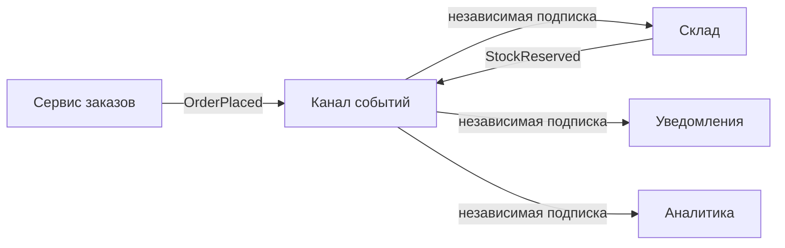
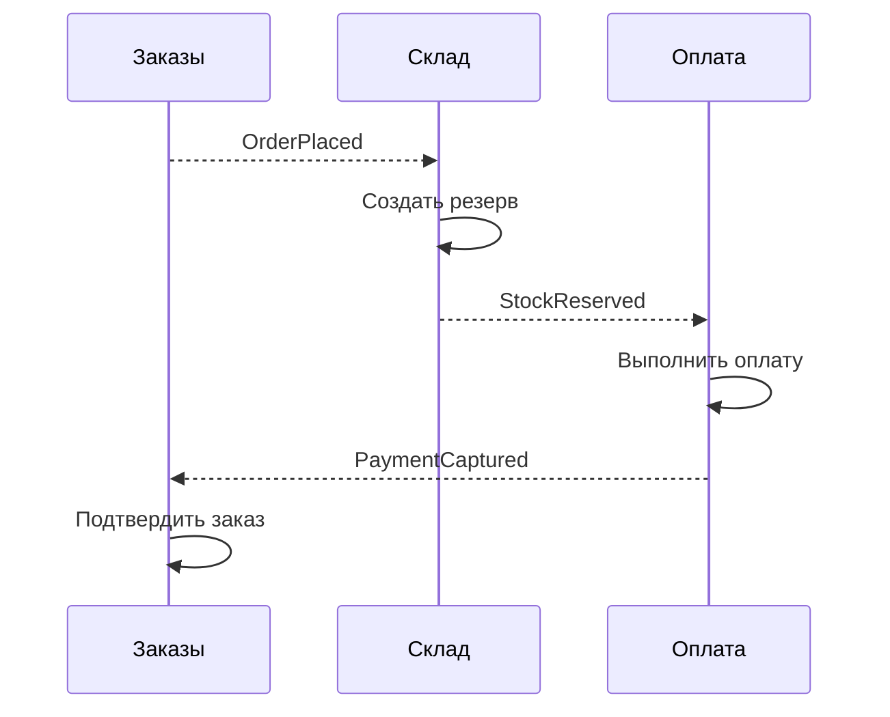
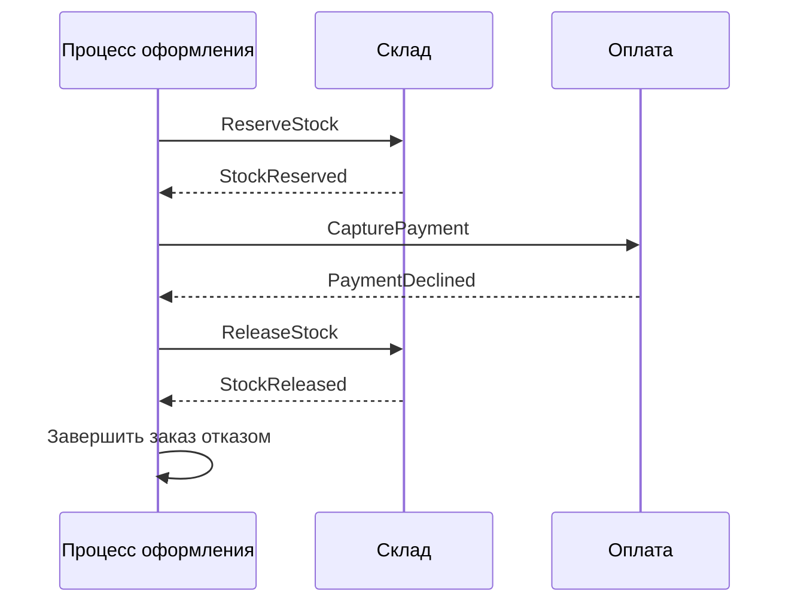
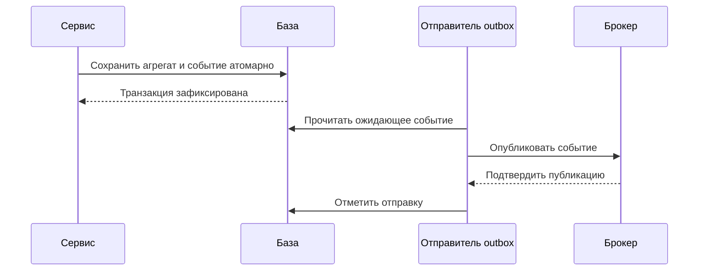
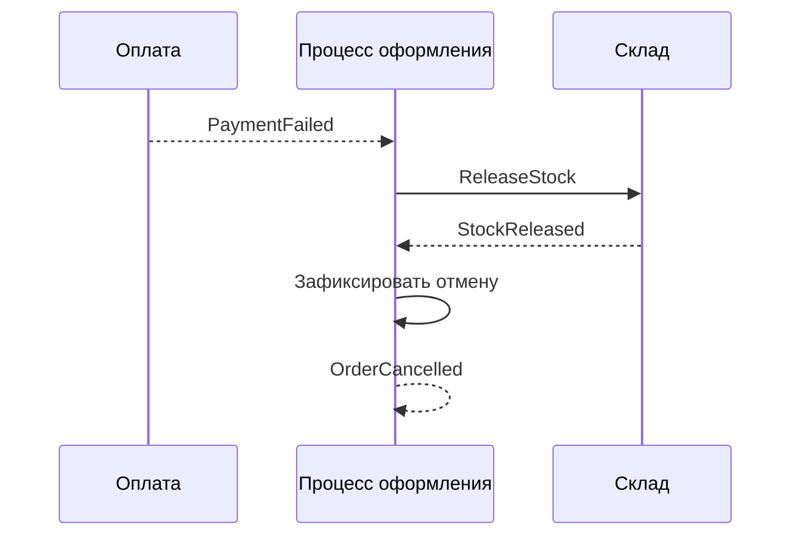

# 1. Основные понятия

## 1.1. Событие как произошедший факт

**Событие (event) — сообщение о факте, который уже произошёл.** В событийной архитектуре — **Event-driven architecture, EDA** — компоненты реагируют на такие факты и могут порождать следующие события.

**Событие предметной области (domain event)** выражает значимое для бизнеса изменение: `OrderPlaced` — заказ оформлен, `PaymentCaptured` — деньги списаны, `ShipmentDispatched` — отправление передано перевозчику.

Название обычно отражает прошедшее действие:

```json
{
  "event_id": "evt-815",
  "type": "PaymentCaptured",
  "occurred_at": "2026-10-31T10:15:00Z",
  "data": {
    "order_id": 42,
    "payment_id": "pay-730",
    "amount_cents": 150000,
    "currency": "RUB"
  }
}
```

**Факт должен иметь точный смысл.** Если сервис только отправил запрос провайдеру, публиковать `PaymentCaptured` рано. Подходящее событие — `PaymentRequested`, если оно обозначает действительно зафиксированный запрос оплаты.

Событие сообщает исторический факт. Если позже деньги вернули, прежнее событие не становится ложным: появляется новое — `PaymentRefunded`.

**EDA не равна Event Sourcing.** Event Sourcing хранит состояние через последовательность событий как источник истины. В EDA сервис может хранить обычные таблицы, а события использовать для взаимодействия.

## 1.2. Событие, команда и запрос

**Различие определяется намерением сообщения, а не способом доставки.** Все три вида могут передаваться по сети, а команда и запрос — через брокер.

| Вид | Смысл | Пример | Ожидание |
|---|---|---|---|
| **Событие — event** | «Это произошло» | `OrderPlaced` | Заинтересованные компоненты могут отреагировать |
| **Команда — command** | «Выполни действие» | `ReserveStock` | Есть ответственный исполнитель и результат действия |
| **Запрос — query** | «Предоставь данные» | `GetStockAvailability` | Нужен ответ с данными без намеренного изменения бизнес-состояния |

Например, после `OrderPlaced` координатор процесса может отправить команду `ReserveStock`. Склад выполняет её и публикует `StockReserved` либо сообщает об отказе.

**Событие не гарантирует, что кто-то выполнил следующий шаг.** Для обязательного бизнес-процесса нужно отдельно обеспечить подписку, обработку, повторы и контроль завершения.

Название также не меняет смысл сообщения автоматически. Если издатель отправляет `OrderPlaced` единственному получателю и требует конкретного действия по скрытому соглашению, зависимость от этого действия всё равно существует. Её стоит явно отразить в контракте процесса.

Для команд полезен повелительный смысл, для событий — описание факта. Это облегчает понимание ответственности, хотя само по себе не обеспечивает правильную архитектуру.

## 1.3. Производитель, канал доставки и потребители

**Производитель (producer) фиксирует факт и публикует событие. Канал доставки передаёт его. Потребитель (consumer) интерпретирует событие и выполняет свою реакцию.**



В примере склад резервирует товар, уведомления сообщают о приёме заказа, аналитика учитывает оформление. У каждого потребителя свой прогресс и свои ошибки.

**Независимые потребители должны получать событие независимо.** Если склад и уведомления конкурируют за одну очередь, событие может обработать только один из них — это другая модель.

Канал доставки может быть внутрипроцессным механизмом, брокером или журналом событий. **EDA не обязательно предполагает брокер**, но взаимодействие между процессами требует явных решений о хранении, доставке и восстановлении.

Обязанности сторон тоже различаются:

- производитель отвечает за достоверность события и его надёжную публикацию;
- канал — за оговорённые свойства передачи и хранения;
- потребитель — за корректную обработку, включая возможные повторы.

Изменение базы и публикация не становятся атомарными автоматически. Для надёжной передачи факта часто используют outbox: событие сохраняют вместе с бизнес-изменением, затем отправляют отдельно.

## 1.4. Слабая связность и итоговое согласование

**Слабая связность означает, что изменение одного компонента требует меньше согласованных изменений остальных.** Издателю события обычно не нужно знать адреса и реализацию всех подписчиков.

Например, к `OrderPlaced` можно подключить аналитику, не добавляя новый вызов в сервис заказов. Но зависимости остаются:

- от схемы и смысла события;
- от правил доставки и порядка;
- от ожидаемого поведения процесса.

**Асинхронность уменьшает временную связность**, если канал надёжно сохраняет события: потребитель может обработать их после восстановления. Она не отменяет ограничений хранения и допустимой задержки.

**Eventual consistency — итоговая согласованность:** связанные состояния могут временно различаться, но должны прийти к согласованному результату при выполнении необходимых условий доставки и обработки.

Например, заказ уже принят, а склад ещё не создал резерв. Клиент видит «Подтверждаем наличие», а не «Заказ готов к отправке».

Итог не обязательно означает успех: при отсутствии товара согласованным результатом может быть отмена заказа и возврат оплаты.

**Согласованность не наступает сама по себе.** Нужны явные состояния, идемпотентность, повторы, обнаружение зависших шагов и компенсации. Отдельные локальные транзакции продолжают защищать изменения внутри каждого сервиса.

EDA полезна для независимых реакций и длительных процессов. Для короткой операции с обязательным немедленным ответом прямой вызов может быть проще.

**Запомнить:** событие сообщает факт, команда требует действия, запрос получает данные; событийная архитектура разделяет реакции, но требует явно доводить общий процесс до согласованного результата.

# 2. Виды событий

## 2.1. Событие предметной области, интеграционное событие и уведомление

**Событие предметной области (domain event) выражает значимый бизнес-факт внутри модели приложения.** Например, `OrderPlaced` сообщает, что заказ прошёл установленные правила оформления и был принят.

Такое событие может использовать внутренние понятия модели и обрабатываться внутри одного процесса. Его публикация внешним системам не обязательна.

**Интеграционное событие (integration event) — публичный контракт о факте, предназначенный для других компонентов или систем.** Оно должно иметь устойчивую структуру, понятный смысл и правила совместимости.

| Вид | Основная задача | Пример |
|---|---|---|
| Domain event | Выразить факт внутри предметной модели | Заказ оформлен по правилам магазина |
| Integration event | Передать факт через границу системы | Сообщить складу и аналитике об оформлении |
| Event notification | Сообщить о факте с минимумом подробностей | Передать ID заказа, детали получить отдельно |

**Уведомление о событии (event notification)** — способ передать минимум информации, достаточный, чтобы получатель узнал об изменении. Это не обязательно третий независимый класс: интеграционное событие может быть таким уведомлением.

Например, `OrderPlaced` с одним `order_id` уведомляет потребителя, но для комплектации ему придётся запросить состав заказа. Если сообщение уже содержит необходимые позиции, потребитель может работать автономнее.

Термин «уведомление» также используют для email и push. Это другой смысл: письмо покупателю является реакцией на событие, а не самим бизнес-фактом.

**Внутреннее событие не стоит автоматически превращать во внешний контракт.** Между ними может потребоваться преобразование, скрывающее детали модели.

## 2.2. Конверт и достаточность данных

**Конверт события содержит метаданные, а payload — данные о факте.** Минимальный состав определяется контрактом:

```json
{
  "event_id": "evt-815",
  "type": "OrderPlaced",
  "occurred_at": "2026-10-31T10:15:00Z",
  "schema_version": "1.0.0",
  "data": {
    "order_id": 42,
    "items": [
      { "product_id": 7, "quantity": 2 }
    ]
  }
}
```

Здесь:

- `event_id` идентифицирует событие и сохраняется при повторной доставке;
- `type` объясняет произошедший факт;
- `occurred_at` обозначает время факта, а не время чтения;
- `schema_version` задаёт версию структуры и договорённостей;
- `data` содержит сведения для обработки.

При необходимости добавляют источник, correlation ID и версию бизнес-сущности. **Версия схемы и версия заказа решают разные задачи:** первая помогает интерпретировать сообщение, вторая — понимать последовательность изменений заказа.

«Достаточно данных» зависит от реакции. Для аналитики может понадобиться сумма, для резервирования — позиции, для письма — язык и контакт получателя.

| Подход | Преимущество | Ограничение |
|---|---|---|
| Минимальное уведомление | Небольшое сообщение | Получатель зависит от дополнительного запроса |
| Событие с необходимыми данными | Автономная обработка | Больше данных и обязательств по контракту |

**Дополнительный запрос может вернуть уже изменившееся состояние.** Если потребителю важны сведения именно на момент оформления, передают соответствующий снимок или ссылку на неизменяемую версию.

Не нужно помещать в каждое событие всё, что потенциально может понадобиться любому будущему потребителю.

## 2.3. Границы публичных данных

**Payload должен описывать бизнес-факт, а не сериализовать внутренний объект целиком.** Иначе устройство приложения становится частью внешнего контракта.

Например, вместо условного:

```ruby
payload = order.attributes
```

лучше явно выбрать поля:

```ruby
payload = {
  order_id: order.id,
  total_cents: order.total_cents,
  currency: order.currency
}
```

Это концептуальный пример формирования payload. Он не показывает надёжную публикацию и предполагает, что значения соответствуют зафиксированному факту.

Во внешний контракт обычно не включают технические флаги модели, внутренние имена классов, служебные ошибки и поля, смысл которых известен только реализации.

**Секреты не должны путешествовать вместе с событием:** пароли, API-токены и закрытые ключи не нужны потребителям для понимания факта. Заголовки также не являются защищённым хранилищем.

Персональные данные передают только необходимым получателям. Общий поток `OrderPlaced`, доступный аналитике и складу, не обязан содержать полный профиль покупателя. Для адреса доставки может быть уместнее отдельный ограниченный контракт.

При этом внутренний domain event может содержать ссылки на объекты модели. Ограничения публичного формата особенно важны при преобразовании в integration event.

## 2.4. Имена фактов в прошедшем времени

**Имя события должно сообщать, что уже произошло, и насколько завершён этот факт.**

| Событие | Смысл |
|---|---|
| `OrderPlaced` | Заказ оформлен |
| `PaymentAuthorized` | Средства авторизованы |
| `PaymentCaptured` | Списание подтверждено |
| `ShipmentDispatched` | Отправление передано в доставку |

Различия важнее самого грамматического правила: авторизация платежа не равна списанию, а создание отправления не равно фактической отгрузке.

`CapturePayment` — команда выполнить списание. `PaymentCaptured` — факт успешного выполнения. `PaymentCaptureRequested` тоже может быть событием, если оно достоверно сообщает о зарегистрированном запросе, а не выдаёт намерение за результат.

**Неоднозначные имена вроде `OrderUpdated` заставляют потребителя угадывать смысл изменения.** Они допустимы для общего уведомления об обновлении, но для бизнес-реакций часто полезнее `OrderCancelled` или `DeliveryAddressChanged`.

**Запомнить:** различай внутренний факт и публичный контракт, передавай необходимые данные о моменте события и называй точно то, что уже произошло.

# 3. Хореография и оркестрация

## 3.1. Хореография: участники реагируют на события

**Хореография (choreography) — организация процесса, при которой участники самостоятельно реагируют на события друг друга.** Единого компонента, определяющего каждый следующий шаг, нет.

Например, после оформления заказа склад создаёт резерв, а сервис оплаты реагирует на успешное резервирование:



Стрелки событий показывают логические зависимости; брокер опущен.

Каждый участник знает собственное правило реакции. Склад не обязан знать, что после него работает оплата: он сообщает достоверный факт `StockReserved`.

**Хореография удобна для независимых реакций:** уведомления и аналитика могут подписаться на `OrderPlaced`, не меняя издателя и друг друга.

Однако если процесс требует строгой последовательности, эта последовательность всё равно существует — просто распределена между подписчиками. При отказе оплаты кто-то должен освободить резерв, а при отсутствии ответа — обнаружить зависание. Отсутствие координатора не отменяет этих обязанностей.

## 3.2. Оркестрация: процесс явно управляет шагами

**Оркестрация (orchestration) — организация процесса, при которой координатор хранит его состояние и определяет следующие действия.** Он отправляет команды участникам и обрабатывает результаты.



Здесь команды и результаты могут передаваться асинхронно через брокер. **Оркестрация не означает длинную цепочку синхронных HTTP-вызовов.**

Координатор знает, что заказ находится в состоянии `awaiting_payment`, сколько можно ждать и какая компенсация нужна при отказе. Склад при этом сохраняет собственные правила резервирования, а платёжный сервис — правила оплаты.

Оркестратор — логическая роль. Для небольшого приложения это может быть компонент внутри сервиса заказов, а не отдельный сервис. Но для длительного процесса его состояние должно переживать перезапуск.

Оба подхода применяются при реализации **Saga — процесса из локальных транзакций с компенсациями при неудаче**. Оркестрация централизует управление последовательностью, хореография распределяет его между участниками. [Паттерн Saga](https://learn.microsoft.com/en-us/azure/architecture/patterns/saga)

## 3.3. Когда цепочка событий становится непрозрачной

**Непрозрачная цепочка — процесс, для которого трудно определить текущее состояние, следующий обязательный шаг и ответственного за восстановление.**

Например, заказ оплачен, но доставка не создана. Приходится выяснять: событие не опубликовано, подписчик остановлен, условие реакции не выполнено или доставка создана, но ответ потерян.

Признаки проблемы:

- для понимания сценария нужно читать обработчики нескольких сервисов;
- неизвестно, кто обнаруживает отсутствие следующего события;
- участники образуют циклы реакций;
- компенсации дублируются или противоречат друг другу;
- небольшое изменение требует согласованной выкладки многих подписчиков.

**Correlation ID помогает найти связанные записи, но сам не хранит состояние процесса.** Трасса также не заменяет сведения о том, какой шаг ожидается и когда истекает срок ожидания.

| Вопрос | Хореография | Оркестрация |
|---|---|---|
| Где задан следующий шаг? | В реакциях участников | В координаторе |
| Где искать общий прогресс? | Нужна отдельная проекция или иной механизм | В сохранённом состоянии процесса |
| Как добавить независимого подписчика? | Обычно без изменения цепочки | Можно подписаться на события вне координатора |
| Кто управляет тайм-аутами и компенсациями? | Ответственность нужно распределить | Обычно координатор |

Оркестрация делает маршрут заметнее, но тоже может стать сложной. Если координатор начинает рассчитывать складские остатки и проверять платёжные правила, он забирает чужую бизнес-логику. Его задача — управлять процессом, а не реализовывать все операции.

## 3.4. Выбор для оформления заказа

**Для оформления с обязательным резервированием, оплатой, сроками ожидания и компенсациями выберем оркестрацию.** Причина — необходимость явно знать состояние каждого заказа и довести его до подтверждения либо корректного отказа.

Это решение основано на допущениях: склад и оплата — отдельные системы, шаги могут завершаться позже, а ошибки требуют восстановления.

Короткая запись решения:

| Часть | Содержание |
|---|---|
| Выбор | Координатор оформления с сохранённым состоянием |
| Последовательность | Зарезервировать товар → оплатить → подтвердить заказ |
| Отказ оплаты | Освободить резерв |
| Неизвестный результат | Сверить состояние или безопасно повторить операцию |
| Альтернатива | Цепочка реакций на события |
| Причина | Централизованный контроль сроков, прогресса и компенсаций |
| Последствия | Нужно поддерживать надёжность и совместимость самого координатора |

Порядок шагов зависит от бизнеса: иногда сначала авторизуют оплату, затем резервируют товар. Это отдельное решение.

**Независимые реакции оставим хореографическими:** после `OrderConfirmed` уведомления отправляют письмо, аналитика обновляет отчёт. Их временная недоступность не должна автоматически отменять заказ.

Для короткой цепочки из нескольких простых реакций хореография может оказаться достаточной. Выбор пересматривают при появлении ветвлений, длительных ожиданий и сложного восстановления.

**Запомнить:** хореография распределяет реакции, оркестрация явно управляет процессом; обязательные шаги, сроки и компенсации должны иметь владельца при любом подходе.

# 4. Владение данными

## 4.1. Владелец события — источник факта

**Владелец события — компонент, который отвечает за достоверность соответствующего бизнес-факта и его контракт.** Событие публикуют из границы, где этот факт действительно установлен.

| Факт | Владелец |
|---|---|
| `OrderPlaced` | Компонент заказов |
| `PaymentCaptured` | Компонент оплаты |
| `StockReserved` | Компонент склада |
| `ShipmentDispatched` | Компонент доставки |

Например, сервис заказов может запросить списание, но не должен объявлять `PaymentCaptured` только потому, что команда отправлена. Факт подтверждает компонент оплаты, опираясь на результат платёжного провайдера.

**Владение относится к конкретному смыслу, а не обязательно ко всей сущности.** Сведения об оплате заказа принадлежат платёжному компоненту, а решение «заказ можно подтвердить» — компоненту, управляющему заказом.

Координатор может получить `StockReserved` и `PaymentCaptured`, затем опубликовать собственное `OrderConfirmed`. Это новый факт, основанный на результатах участников.

Технический отправитель outbox при этом может быть отдельным процессом. Он доставляет событие, но не становится владельцем его бизнес-смысла.

## 4.2. Изменения только через владельца

**Владелец данных контролирует их изменение и соблюдение инвариантов — условий корректности состояния.** Другие компоненты обращаются к его API или отправляют команды, а не записывают напрямую в его таблицы.

Например, доставка не должна самостоятельно менять остаток:

```text
Нежелательно:
Доставка → UPDATE таблицы склада

Через контракт:
Доставка → команда ReleaseStock → Склад
```

Во втором случае склад сам проверяет, существует ли резерв, можно ли его освободить и не была ли операция выполнена раньше.

Прямой доступ к чужой базе создаёт скрытую зависимость от её структуры и позволяет обойти правила владельца. Изменение столбца или способа хранения превращается в совместную миграцию нескольких систем.

**Это правило относится к логическим границам владения, а не требует отдельной базы для каждого класса.** В модульном приложении компоненты могут использовать одну физическую базу, сохраняя ответственность за запись в своих модулях.

Команда также не гарантирует успеха: владелец вправе её отклонить. Идентификатор заказа или полученное событие сами по себе не дают права изменять его состояние.

## 4.3. Собственное представление потребителя

**Проекция (projection), или модель чтения (read model), — данные, которые потребитель строит из событий для собственных задач.** Она может содержать только нужные поля, объединять несколько источников и иметь другую структуру.

Например, поддержке нужен экран заказа:

```text
OrderPlaced        → номер заказа и позиции
PaymentCaptured    → состояние оплаты
ShipmentDispatched → отправление и номер отслеживания
```

Поддержка хранит собственную проекцию:

```json
{
  "order_id": 42,
  "payment_status": "captured",
  "shipment_status": "dispatched",
  "tracking_number": "TRACK-815"
}
```

**Проекция не становится источником истины для исходных фактов.** Нажатие «вернуть оплату» должно инициировать действие у владельца, а не просто заменить `payment_status` в этой таблице.

Такое представление уменьшает число запросов к другим сервисам и позволяет оптимизировать чтение. Цена — задержка обновления и необходимость восстановления. Это разновидность паттерна **Materialized View — материализованного представления**. [Описание паттерна](https://learn.microsoft.com/en-us/azure/architecture/patterns/materialized-view)

Нужно определить допустимую давность данных, обработку удаления и изменения сведений, а также начальную загрузку. **Восстановление из событий возможно только при наличии достаточной истории.** Если её нет, потребуется снимок состояния или API выгрузки владельца.

Для критичного решения локальная копия может оказаться слишком старой. Например, отображать доступность товара по проекции допустимо, а окончательное резервирование всё равно выполняет склад.

## 4.4. Идемпотентное применение событий

**Идемпотентное применение означает, что повтор события не меняет результат сверх первого успешного применения.**

Простое присваивание часто устойчиво к дублю:

```ruby
projection.update!(payment_status: "captured")
```

Но увеличение счётчика — нет:

```ruby
projection.increment!(:payments_count)
```

Повтор второго действия увеличит значение снова. Для таких изменений можно атомарно сохранять отметку обработки и результат:

```ruby
ApplicationRecord.transaction do
  ProcessedEvent.create!(
    consumer: "support_projection",
    event_id: event.fetch("event_id")
  )

  projection.update!(payment_status: "captured")
end
```

Предполагаются одна база и уникальное ограничение на `(consumer, event_id)`. Конфликт именно этого ограничения означает уже применённое событие; его обрабатывают отдельно от остальных ошибок. Такой подход описывает паттерн **Idempotent Consumer**. [Описание паттерна](https://microservices.io/patterns/communication-style/idempotent-consumer.html)

**Защита от дублей не защищает от нарушения порядка.** Если после `PaymentRefunded` придёт старое `PaymentCaptured`, простое присваивание вернёт неверное состояние.

Поэтому отдельно определяют порядок, версии источника и правила применения. Для полного снимка можно отклонять устаревшую версию. Для последовательных изменений пропуск версии может потребовать ожидания или сверки: молча отбросить предыдущие изменения нельзя.

У событий разных владельцев могут быть независимые последовательности версий. Не стоит сравнивать версию платежа и версию доставки как один общий счётчик.

**Запомнить:** факт публикует его владелец, изменения проходят через его правила, потребитель хранит собственную проекцию и отдельно защищается от дублей, устаревших событий и пропусков.

# 5. Доставка и порядок

## 5.1. At-least-once и дедупликация событий

**At-least-once — доставка с возможными повторами:** если подтверждение не получено, сообщение может поступить снова. Гарантия действует в рамках настроенных условий хранения и восстановления, а не при любых возможных отказах.

Обычный сценарий: потребитель сохранил результат, но завершился до подтверждения брокеру. Следующая доставка повторяет уже выполненную работу.

**Дедупликация — обнаружение повторного события по стабильному `event_id`.** При повторной публикации того же события этот идентификатор сохраняют.

Условный Rails-пример:

```ruby
ApplicationRecord.transaction do
  ProcessedEvent.create!(
    consumer: "shipping",
    event_id: event.fetch("event_id")
  )

  Shipment.create!(
    order_id: event.fetch("data").fetch("order_id")
  )
end

# Подтверждение доставки — после фиксации транзакции
```

Предполагаются одна база и уникальное ограничение на `(consumer, event_id)`. Конфликт именно этого ограничения обрабатывают отдельно: событие уже применено, повтор можно подтвердить.

**Отметку и бизнес-эффект сохраняют атомарно.** Иначе возможны либо повторное изменение, либо отметка об обработке без самого результата.

Идентификатор потребителя нужен, чтобы склад и доставка могли независимо применить одно событие. Для внешнего HTTP-вызова локальной транзакции недостаточно: требуется идемпотентность внешней операции или сверка её результата.

Дедупликация по событию также не обнаруживает два разных события, ошибочно описывающих одну операцию. Здесь помогает дополнительное бизнес-ограничение, например уникальность доставки для конкретного запроса на отгрузку.

## 5.2. Порядок в пределах ключа агрегата

**Агрегат — группа связанных объектов, изменяемых как единое целое для соблюдения бизнес-правил.** Например, заказ с его позициями. Ключом его событий может быть `order_id`.

```text
key = order-42
OrderPlaced → OrderConfirmed → OrderCancelled

key = order-57
OrderPlaced → OrderConfirmed
```

Между разными заказами общий порядок обычно не нужен.

В Kafka порядок записей определён внутри **партиции — раздела топика**. При согласованной стратегии распределения одинаковый ключ направляет события в одну партицию. [Ключи и порядок Kafka](https://kafka.apache.org/intro/)

**Одного ключа недостаточно для порядка бизнес-эффектов.** Нужно обеспечить последовательность:

1. Изменений агрегата и формирования событий.
2. Публикации событий этого агрегата.
3. Их применения потребителем.

Если отправители опубликовали версию 12 раньше версии 11, брокер не восстановит бизнес-последовательность самостоятельно. Аналогично параллельные обработчики могут завершить второе событие раньше первого.

Полезно передавать `aggregate_version` или отдельный номер события в потоке. Контракт должен объяснять, обязана ли последовательность быть непрерывной: если публикуется только часть изменений агрегата, пропуски его версий могут быть нормальны.

**Дубли, устаревшие события и пропуски — разные ситуации.** Для последовательных изменений нельзя просто отбросить предыдущую версию и считать состояние корректным. Может потребоваться ожидание, повторное чтение или сверка с владельцем.

## 5.3. Публикация после фиксации и outbox

**Событие о состоявшемся изменении публикуют только после фиксации этого изменения.** Иначе потребитель увидит факт, который затем исчезнет из-за отката.

Однако обычная последовательность «сохранить → отправить» оставляет окно потери: процесс может остановиться между шагами.

**Transactional Outbox закрывает этот разрыв:** бизнес-изменение и запись события сохраняются в одной транзакции, а отдельный отправитель публикует сохранённые события. [Паттерн Transactional Outbox](https://docs.aws.amazon.com/prescriptive-guidance/latest/cloud-design-patterns/transactional-outbox.html)



**Outbox не исключает повторов.** Если брокер принял событие, а отправитель не сохранил отметку, последующая попытка отправит его снова. Это одна из причин обязательной готовности потребителя к дублям.

Механизм также должен сохранять порядок событий одного агрегата при работе нескольких отправителей. Обычный callback после фиксации транзакции устраняет публикацию до commit, но сам по себе не обеспечивает восстановление после сбоя процесса.

## 5.4. Повторы, предел попыток и ошибочные события

**Политика повторов определяет, какие ошибки повторяются, с какой задержкой и когда автоматическая обработка прекращается.**

| Ситуация | Реакция |
|---|---|
| Временная недоступность зависимости | Повтор с задержкой |
| Неверная структура события | Изоляция без бесполезных повторов |
| Неизвестная версия | Карантин и диагностика |
| Исчерпаны попытки или срок обработки | Очередь ошибок и восстановление |

Задержки увеличивают через **backoff**, а случайный разброс — **jitter** — уменьшает одновременные повторы. Фиксируют число попыток **всего**, общий срок обработки и сохраняют счётчик между перезапусками.

**DLQ — Dead Letter Queue, очередь ошибочных сообщений**, выведенных из обычной обработки. В RabbitMQ маршрутизация в неё может выполняться через настроенный Dead Letter Exchange; без соответствующей конфигурации ожидаемого переноса не будет. [Dead Letter Exchanges](https://www.rabbitmq.com/docs/dlx)

Сохраняют исходное событие, причину, попытки и время ошибки. Назначают владельца разбора и порядок повторного запуска после исправления.

**Перенос в DLQ не решает вопрос порядка.** Если событие версии 11 изолировано, применение версии 12 может быть недопустимо. Нужно явно выбрать: остановить продвижение соответствующего ключа, временно сохранить следующие события либо использовать безопасный для данной модели способ восстановления.

**Запомнить:** готовься к дублям, обеспечивай порядок по агрегату на всём пути и сохраняй события через надёжную публикацию; повтор и DLQ должны иметь пределы и владельца восстановления.

# 6. Эволюция событий

## 6.1. Версии и совместимые изменения

**Эволюция событий — изменение их контракта с сохранением работы поддерживаемых участников.** Контракт включает структуру, смысл полей и значение самого факта.

В конверте можно явно указывать версию:

```json
{
  "type": "PaymentCaptured",
  "schema_version": "1.1.0",
  "data": {
    "payment_id": "pay-730",
    "amount_cents": 150000,
    "currency": "RUB"
  }
}
```

Формат версии и правила её повышения определяет команда. Номер сам по себе совместимость не обеспечивает.

| Изменение | Оценка |
|---|---|
| Добавить необязательное поле | Часто совместимо, если старые потребители допускают его |
| Добавить обязательное поле | Старые события могут стать невалидными |
| Удалить или переименовать поле | Старый код может перестать работать |
| Изменить тип | Может нарушить чтение и обработку |
| Добавить значение `enum` | Старый потребитель может не знать новую ветвь |
| Сохранить тип, изменить единицы суммы | Структура прежняя, смысл несовместим |

**Совместимость проверяют в двух направлениях:**

- **Backward compatibility:** новый потребитель читает старые события.
- **Forward compatibility:** старый потребитель читает новые события.
- **Full compatibility:** выполняются оба условия.

Реестр схем может автоматизировать структурные проверки, но правила зависят от формата и политики. Например, для JSON Schema существенно, разрешены ли дополнительные свойства. [Совместимость в Confluent Schema Registry](https://docs.confluent.io/platform/current/schema-registry/fundamentals/schema-evolution.html)

**Изменение смысла факта иногда требует нового типа события**, а не только версии схемы. `PaymentAuthorized` и `PaymentCaptured` описывают разные факты и не должны незаметно заменять друг друга.

## 6.2. Потребители обновляются независимо

**Независимая выкладка означает, что старые и новые версии компонентов некоторое время работают одновременно.** Кроме того, новый потребитель получает накопленные старые события.

Для совместимого расширения часто подходит такой порядок:

1. Подготовить потребителей к обоим форматам.
2. Начать публиковать новый формат.
3. Проверить обработку и завершить переход.
4. Удалить старую поддержку только после оценки истории, повторов и возможности отката.

**Нельзя требовать новый формат только потому, что обновился производитель:** в очередях и архиве остаются прежние сообщения.

При несовместимом изменении возможны отдельный тип или канал новой версии, временная публикация двух форматов либо преобразователь. Двойная публикация требует контроля: потребитель не должен применить один факт дважды через разные версии.

Для чтения истории полезен **upcaster — преобразователь старого представления события в поддерживаемое внутреннее представление**:

```ruby
# Условный пример: в версии 1 валюта по контракту всегда RUB
def normalize(event)
  data = event.fetch("data")

  case event.fetch("schema_version")
  when "1"
    data.merge("currency" => "RUB")
  when "2"
    data
  else
    raise UnsupportedEventVersion
  end
end
```

Допущение о рублях должно следовать из старого контракта. **Преобразователь не может достоверно восстановить данные, которых никогда не было.** Неизвестную версию обрабатывают явно, а не молча интерпретируют как последнюю.

## 6.3. Повторное чтение истории и хранение

**Replay — повторное чтение событий**, например для восстановления проекции, исправления расчёта или загрузки нового аналитического потребителя. Потребность в replay определяет требования к истории.

| Задача | Что нужно сохранить |
|---|---|
| Пережить простой потребителя | Данные за простой, восстановление и запас |
| Пересчитать отчёт за год | Нужные события за этот период |
| Построить состояние с нуля | Достаточную полную историю либо снимок и последующие события |
| Восстановиться после удаления данных из брокера | Отдельный архив или иной источник |

**Retention — политика хранения — должна учитывать не только срок, но и ограничения объёма.** В Kafka удаление может зависеть от времени и размера; compaction сохраняет значения по ключам по особым правилам и не заменяет полную историю изменений. [Политики хранения Kafka](https://kafka.apache.org/41/configuration/topic-configs/)

Обычная очередь с удалением подтверждённых сообщений не является архивом. EDA также не означает, что каждое событие хранится бессрочно или позволяет восстановить всё состояние.

Для replay сохраняют схемы и возможность интерпретации старых версий. Продумывают обработку удалённых или скрытых персональных данных и доступность файлов, на которые ссылаются события.

**Повторный расчёт проекции не должен повторно списывать деньги или отправлять письма.** Replay обычно запускают в отдельном режиме или контуре без нежелательных внешних эффектов. Простое отключение дедупликации в рабочем потребителе опасно.

## 6.4. Новый потребитель без изменения производителя

**Событийная архитектура позволяет подключить новую реакцию к существующему контракту**, если событие уже содержит достаточные данные и доступно новому подписчику.

Например, к `OrderPlaced` подключается аналитика:

```text
OrderPlaced
  ├── Склад
  ├── Уведомления
  └── Новый потребитель аналитики
```

Издатель продолжает публиковать тот же факт. Настраиваются подписка, права, обработчик и наблюдение нового потребителя.

В Kafka независимому потребителю обычно назначают отдельную consumer group и определяют начальную позицию чтения. Повторное чтение ограничено доступной историей. [Модель Kafka](https://kafka.apache.org/intro/)

**Подключение без изменения производителя возможно не всегда.** Если нужны отсутствующие сведения, придётся расширить контракт, использовать другой источник или согласовать выгрузку.

Если история начинается со снимка, нужно согласовать его границу с потоком: иначе изменения во время выгрузки потеряются или применятся повторно. Перед рабочим запуском потребитель догоняет поток и проверяет полноту своей модели.

**Запомнить:** эволюция должна учитывать одновременно разные версии потребителей и возраст событий; новый подписчик независим от производителя лишь в пределах доступного контракта и сохранённой истории.

# 7. Наблюдаемость процесса

## 7.1. Корреляция и причинность

**Correlation ID связывает сообщения одного бизнес-процесса, а causation ID указывает непосредственную причину конкретного сообщения.** Эти идентификаторы отвечают на разные вопросы: «к какому сценарию относится?» и «из-за чего появилось?».

```json
{
  "event_id": "evt-303",
  "type": "StockReserved",
  "correlation_id": "checkout-42",
  "causation_id": "cmd-302",
  "data": {
    "order_id": 42,
    "reservation_id": "res-815"
  }
}
```

Здесь событие относится к оформлению `checkout-42` и возникло после команды `cmd-302`. Идентификатор причины может ссылаться как на событие, так и на команду — это нужно закрепить в контракте.

Правила передачи:

- новый процесс получает correlation ID;
- следующие команды и события сохраняют его;
- новое сообщение получает собственный ID;
- его causation ID указывает на вызвавшее его сообщение;
- повторная доставка сохраняет исходные идентификаторы.

**`order_id` не всегда заменяет correlation ID:** один заказ может участвовать в разных процессах — оформлении, возврате, повторной доставке.

Техническую трассировку связывают отдельно через `trace_id` и spans. Для асинхронных операций OpenTelemetry предусматривает передачу контекста и ссылки между spans, в том числе при нескольких причинах обработки. [Трассировка сообщений OpenTelemetry](https://opentelemetry.io/docs/specs/semconv/messaging/messaging-spans/)

## 7.2. Восстановление истории одного заказа

**История процесса должна показывать выполненные шаги, текущую точку ожидания и дальнейшее обязательное действие.** Набора разрозненных строк «сообщение получено» для этого недостаточно.

Например:

| Сообщение | Причина | Что стало известно |
|---|---|---|
| `OrderPlaced`, `evt-301` | Исходная команда оформления | Заказ принят |
| `ReserveStock`, `cmd-302` | `evt-301` | Запрошен резерв |
| `StockReserved`, `evt-303` | `cmd-302` | Резерв создан |
| `CapturePayment`, `cmd-304` | `evt-303` | Запрошено списание |
| `PaymentFailed`, `evt-305` | `cmd-304` | Получен окончательный отказ |

По этой истории видно: после отказа оплаты нужно освободить резерв и завершить оформление соответствующим результатом.

**Сортировка по времени не доказывает причинный порядок.** Часы сервисов могут различаться, публикация — задерживаться, сообщения — приходить повторно. Для восстановления используют причинные связи, версии сущностей и сохранённые переходы процесса.

Полезно различать время возникновения факта, публикации, получения и завершения обработки. Это позволяет отделить задержку доставки от медленной работы потребителя.

Историю можно собирать в отдельную проекцию. Она должна учитывать дубли и сама иметь контролируемую задержку. **Отсутствие записи в этой проекции ещё не доказывает отсутствие бизнес-факта.**

Логи и трассы помогают диагностике, но из-за выборочного сохранения и ограниченного срока хранения не всегда подходят как единственное хранилище значимых переходов процесса.

## 7.3. Лаг, ошибки и возраст незавершённого процесса

**Наблюдение должно охватывать транспорт, обработчики и конечный бизнес-результат.**

| Показатель | Что показывает |
|---|---|
| Лаг потребителя | Насколько чтение или подтверждённая обработка отстаёт от потока |
| Ошибки и повторы | Какие шаги не выполняются с первой попытки |
| Возраст незавершённого процесса | Сколько клиент ждёт итогового результата |
| Время в текущем состоянии | На каком шаге процесс задержался |
| Размер и возраст DLQ | Сколько работы выведено из автоматической обработки |
| Незавершённые компенсации | Сохраняются ли нежелательные последствия отказа |

В Kafka доступны метрики лага и скорости чтения; при использовании конкретного показателя нужно понимать, какую позицию он измеряет. [Мониторинг Kafka](https://kafka.apache.org/41/operations/monitoring/)

**Нулевой лаг не означает, что заказ завершён.** Событие могли прочитать, а процесс — остановиться в ожидании оплаты или компенсации.

Возраст процесса считают от его начала, время состояния — от последнего перехода. Повторная попытка не должна обнулять общее ожидание.

Для каждого ожидающего состояния задают срок и ответственного. Например: если `awaiting_payment` длится больше установленного времени, нужно запросить статус оплаты. Тайм-аут сам по себе не позволяет объявить списание неуспешным.

Сигнал дежурному связывают с последствиями: «заказы не подтверждаются в срок» или «резервы после отказа оплаты не освобождаются». Идентификаторы отдельных заказов оставляют в диагностике, а метрики агрегируют по ограниченному набору признаков.

## 7.4. Компенсации через явные факты

**Компенсация — отдельное действие, устраняющее последствия ранее выполненного шага.** Наблюдаемыми должны быть и её запуск, и подтверждённый результат.



Диаграмма условная: `OrderCancelled` публикуется после выполнения необходимых для этого сценария компенсаций.

**`PaymentFailed` — факт отказа оплаты, `ReleaseStock` — команда, `StockReleased` — факт завершения компенсации.** Нельзя считать резерв освобождённым только потому, что команда отправлена.

Значение `OrderCancelled` нужно определить точно. Если заказ уже запрещено исполнять, но возврат денег продолжается, это можно представить отдельными состояниями: заказ отменён, возврат ожидается. Одно событие не должно скрывать незавершённые обязательства.

Компенсация тоже может завершиться ошибкой. Нужны сохранённый прогресс, безопасные повторы, срок ожидания и возможность ручного восстановления. Она не обязательно возвращает систему в первоначальное состояние. [Компенсирующая транзакция](https://learn.microsoft.com/en-us/azure/architecture/patterns/compensating-transaction)

**Запомнить:** корреляция объединяет процесс, причинность объясняет переходы, а наблюдаемость должна показывать не только доставку событий, но и завершение обязательных шагов и компенсаций.

# 8. Границы применимости

## 8.1. Когда событийная архитектура оправдана

**Event-driven architecture, EDA, полезна, когда несколько компонентов должны независимо реагировать на факты и могут делать это с допустимой задержкой.**

Например, после `OrderConfirmed`:

- склад начинает комплектацию;
- уведомления отправляют письмо;
- аналитика обновляет показатели;
- программа лояльности начисляет бонусы.

Издатель сообщает факт, а подписчики самостоятельно управляют своей реакцией. Новый подписчик может появиться без изменения издателя, если существующий контракт содержит необходимые данные.

Другие основания для выбора:

| Условие | Возможная польза |
|---|---|
| Пики нагрузки | Надёжный канал временно накапливает работу |
| Разная скорость компонентов | Каждый потребитель обрабатывает события доступным темпом |
| Разные команды-владельцы | Участники могут независимо развивать обработчики |
| Нужна история обработки | Сохраняемый поток позволяет повторное чтение |

Эти преимущества соответствуют типичным сценариям применения EDA. [Описание архитектурного стиля](https://learn.microsoft.com/en-us/azure/architecture/guide/architecture-styles/event-driven)

**Независимость требует устойчивого контракта и ясного владения.** Разделение команд само по себе не устраняет связность: если каждое изменение события требует общей выкладки, автономность остаётся ограниченной.

Очередь также не решает постоянную нехватку производительности. Если обработка устойчиво медленнее поступления, задержка будет расти.

## 8.2. Когда событийная схема избыточна

**EDA избыточна, когда её инфраструктура и модель отказов сложнее решаемой задачи.**

Для линейного сценария внутри одного сервиса обычные вызовы часто понятнее:

```ruby
Order.transaction do
  order.calculate_total!
  order.reserve_local_stock!
  order.confirm!
end
```

Пример условный: все изменения находятся в одной базе, а методы не выполняют внешние побочные эффекты. При таких допущениях локальная транзакция может обеспечить необходимые гарантии без брокера.

Превращение каждого метода в отдельного подписчика затруднит понимание последовательности и ошибок. При этом **локальные domain events могут быть полезны и в монолите** — например, для отделения независимых реакций. Они не требуют обязательного перехода к распределённой архитектуре.

**Если операция требует немедленной согласованности нескольких изменений, асинхронное распространение событий не обеспечивает её автоматически.** Например, недопустимо сначала подтвердить заказ, а позже выяснить, что обязательный резерв создать нельзя, если контракт обещает окончательное подтверждение сразу.

Но и синхронный HTTP-вызов не создаёт общей транзакции между сервисами. Возможно, строгий инвариант стоит обеспечить внутри одной границы владения, а события публиковать после его выполнения.

Практический вариант часто смешанный: критичное изменение выполнить локально, а уведомления и аналитику обновить асинхронно.

## 8.3. Цена отладки и тестирования

**В событийном процессе результат зависит не только от кода, но и от доставки, времени, повторов и состояния нескольких участников.**

Одинаковый исходный запрос может приводить к разным последовательностям технических действий: обработчик перезапустился, событие пришло повторно, зависимость ответила позже. Поэтому диагностика требует correlation ID, причинных связей, сохранённого состояния процесса и метрик его продвижения.

Тестирование полезно разделять по ответственности:

| Уровень | Что проверять |
|---|---|
| Обработчик | Бизнес-реакцию и идемпотентность |
| Контракт | Структуру, смысл и совместимость сообщений |
| Интеграция | Публикацию, подтверждения, повторы и восстановление |
| Процесс | Итог при успехе, отказе и компенсации |

**Недостаточно проверить только успешную цепочку.** Существенные сценарии — сбой после фиксации данных, повторная доставка, нарушение порядка, неизвестная версия и отсутствие ожидаемого результата.

Например, тест подтверждает не только появление доставки после `OrderConfirmed`, но и отсутствие второй доставки после повтора того же события.

Вместо фиксированного ожидания вроде «спать пять секунд» лучше ждать конкретного наблюдаемого условия с конечным сроком. Сам срок нужен, чтобы зависший тест завершался понятной ошибкой.

Не каждый сценарий требует запуска всей системы. Большую часть правил можно проверить изолированно, оставив сквозным тестам наиболее важные взаимодействия.

## 8.4. Решение и альтернатива в ADR

**ADR — Architecture Decision Record, запись архитектурного решения:** контекст, выбранный подход и его последствия. Важно сохранить причину выбора, а не только название технологии. [Рекомендации по ADR](https://docs.aws.amazon.com/prescriptive-guidance/latest/architectural-decision-records/adr-process.html)

Пример краткой записи:

| Часть | Содержание |
|---|---|
| Контекст | После подтверждения заказа нужны независимые уведомления, аналитика и бонусы |
| Решение | Публиковать `OrderConfirmed`, реакции выполнять асинхронно |
| Альтернатива | Последовательно вызывать получателей из оформления заказа |
| Причина | Сбой необязательной реакции не должен задерживать подтверждение заказа |
| Последствия | Нужны outbox, идемпотентность, совместимость и наблюдение за задержкой |
| Ограничение | Обязательные проверки заказа выполняются до публикации факта |
| Пересмотр | Изменились требования к срокам, согласованности или составу реакций |

Указывают измеримые ожидания: допустимую задержку, нагрузку, срок хранения и время восстановления. Значения должны следовать из требований и измерений.

**ADR фиксирует компромисс.** Например, более быстрый ответ достигается ценой промежуточных состояний и более сложного восстановления. Если обстоятельства изменились, новое решение связывают с прежним, сохраняя историю причин.

**Запомнить:** EDA оправдана независимыми реакциями и допустимой задержкой; выбирай её вместе с расходами на доставку, диагностику и восстановление, а альтернативу и последствия записывай в ADR.
