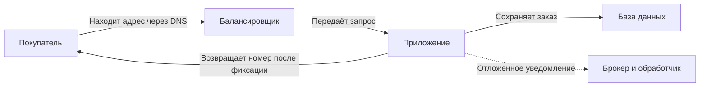
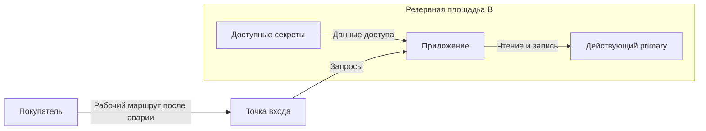
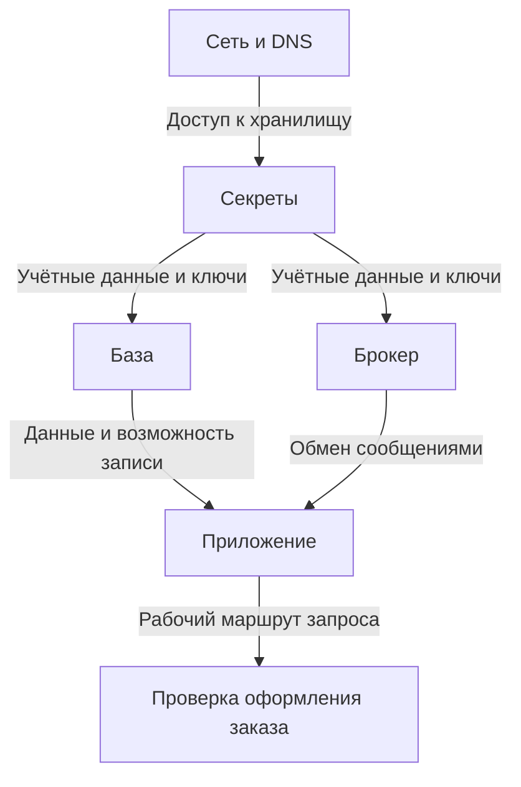

# 1. Граница решения

## 1.1. Компоненты и зависимости решения

**Граница решения** определяет, какие компоненты участвуют в пользовательском сценарии и какие зависимости нужны для его работы и восстановления.

**HA (High Availability)** — высокая доступность при предусмотренных отказах. **DR (Disaster Recovery)** — восстановление после крупной аварии. На уровне решения обе задачи охватывают весь путь запроса, а не только приложение или базу.

Для интернет-магазина состав может выглядеть так:

| Компонент | Роль |
|---|---|
| Приложение | Проверяет запрос и выполняет бизнес-правила |
| База данных | Хранит заказы, платежи и остатки |
| Кэш | Ускоряет чтение, иногда хранит сессии |
| Брокер сообщений | Передаёт задания на обработку |
| Балансировщик | Направляет запросы на доступные экземпляры |
| Внешние API | Выполняют платежи, расчёт доставки и другие операции |
| DNS | Позволяет найти сервис по имени |
| Хранилище секретов | Предоставляет пароли, ключи и сертификаты |

**Зависимость** — компонент или сервис, без которого определённая операция не может завершиться либо восстановиться после сбоя.

Нужно различать зависимости рабочего запроса и восстановления. Например, уже запущенное приложение может временно работать с полученным паролем БД, но новый экземпляр не запустится без хранилища секретов. DNS может не участвовать в каждом запросе из-за кеширования, но потребуется новым клиентам.

Типичная ошибка — перечислить серверы и пропустить управление инфраструктурой, сеть или доступ к ключам. Компонент входит в рассмотрение, если его отказ способен сорвать выбранный сценарий или восстановление.

## 1.2. Владельцы и право на переключение

**Владелец компонента** — команда или организация, отвечающая за его эксплуатацию и восстановление. **Право на переключение** — возможность выполнить конкретное действие с необходимыми доступами и полномочиями.

Владение и управление не всегда совпадают. Команда приложения может отвечать перед пользователями за оформление заказа, но не иметь права повышать реплику управляемой базы.

Пример распределения:

| Компонент | Владелец | Возможности команды решения |
|---|---|---|
| Приложение | Команда магазина | Перезапуск и перенос нагрузки |
| База | Команда платформы | Запрос переключения по процедуре |
| DNS | Инфраструктурная команда | Изменение записи через согласованный доступ |
| Платёжный API | Внешний провайдер | Обращение в поддержку, предусмотренный обход |
| Секреты | Команда безопасности или платформы | Получение нужных секретов по назначенной роли |

Для каждой зависимости фиксируют:

- кто принимает решение и кто выполняет действие;
- как связаться с ответственным во время аварии;
- какие доступы необходимы и где они доступны;
- что команда может сделать самостоятельно.

**Техническая возможность нажать кнопку не означает наличие безопасной процедуры.** Например, переключение базы требует проверки данных и исключения второго пишущего узла.

Время ожидания другой команды входит в восстановление решения. Если доступ к панели управления зависит от потерянной площадки, формально выданных прав может оказаться недостаточно.

## 1.3. Какие отказы переживаем, а какие останавливают сценарий

**Модель отказов** — перечень сбоев, которые решение обязано выдерживать, с описанием ожидаемого поведения.

Для каждой зависимости определяют один из вариантов: продолжить работу, перейти в ограниченный режим или остановить конкретную операцию.

| Отказ | Возможное поведение магазина | Условие |
|---|---|---|
| Одного экземпляра приложения | Направить запросы на другие | Достаточно оставшейся мощности |
| Кэша каталога | Читать данные из БД | База выдерживает дополнительную нагрузку |
| Брокера уведомлений | Отложить отправку сообщений | Намерение отправить сообщение надёжно сохранено |
| Платёжного API | Не подтверждать оплату | Можно показать ожидание или предложить допустимую альтернативу |
| Всех доступных копий БД | Остановить создание заказов | Нет безопасного места сохранения |

**Деградация (graceful degradation)** — сохранение части функций с явно ограниченным поведением. Например, заказ принят, но письмо придёт позже.

При этом обход зависимости должен быть спроектирован заранее. Отключение кэша может перегрузить БД. Продолжение работы без брокера может потерять уведомления, если задания нигде больше не сохраняются.

Критичность определяется использованием, а не названием технологии. Кэш с вычисляемыми значениями можно восстановить; «кэш», в котором лежит единственная копия корзины, уже хранит значимое состояние.

**Остановить небезопасную операцию иногда правильнее, чем сохранить внешнюю видимость доступности.** Нельзя показывать «Оплачено», если платёжный сервис не подтвердил результат.

## 1.4. Основной пользовательский сценарий как критерий доступности

**Критический пользовательский сценарий (critical user journey)** — конкретный путь пользователя, успешность которого определяет доступность решения.

Для магазина можно выбрать:

> Покупатель оформляет заказ, система надёжно сохраняет его и возвращает номер в пределах согласованного времени.

Нужно уточнить границы: входят ли в успех оплата и резерв товара или допускается заказ со статусом «Ожидает обработки». От этого зависит набор обязательных компонентов.

Здесь уведомление не входит в критерий успешного оформления, но его последующая доставка остаётся отдельным обязательством.

**Доступность измеряют по результату сценария, а не по числу работающих процессов.** Ответ `200 OK` бесполезен, если заказ не сохранён. Работающая главная страница не подтверждает возможность оформления.

Для проверки задают допустимое время ответа, ожидаемые данные и отсутствие дублирования при повторе запроса. Затем выполняют сценарий при предусмотренных отказах.

Один основной сценарий помогает согласовать архитектуру и критерии восстановления. Он не отменяет проверки других функций, но не позволяет объявить всё решение доступным только потому, что один его компонент отвечает.

**Запомнить:** HA и DR проектируют для пользовательского результата: с полным списком зависимостей, владельцами, допустимыми отказами и проверяемым критерием успеха.

# 2. Цели по компонентам

## 2.1. Класс отказа: процесс, узел или площадка

**Класс отказа** — масштаб события, для которого задают требования к компоненту. Один компонент может иметь несколько целей для разных классов.

| Класс | Что теряется | Что может сохранить работоспособность |
|---|---|---|
| Процесс | Запущенный экземпляр программы | Другие процессы, сервер, диски |
| Узел | Сервер или виртуальная машина | Экземпляры на других узлах |
| Площадка | Инфраструктура в одном месте размещения | Независимые ресурсы другой площадки |

Например, перезапуск процесса приложения занимает секунды. Потеря узла потребует переноса нагрузки, а потеря площадки — доступных экземпляров приложения, базы, сети и секретов за её пределами.

**Требование записывают парой «компонент + класс отказа».** Формулировка «база восстанавливается за минуту» неполна: она может быть реалистична для переключения между готовыми узлами и недостижима при загрузке копии на новой площадке.

Дополнительно фиксируют предпосылки: сколько отказов происходит одновременно, какие зависимости остаются доступны и достаточна ли оставшаяся мощность.

Типичная ошибка — проверить остановку процесса и объявить устойчивость к потере узла. При таком тесте могли сохраниться локальные файлы, сетевой адрес и другие процессы, которые исчезнут вместе с сервером.

## 2.2. Цели для компонентов с состоянием и без него

**Компонент с состоянием (stateful)** хранит информацию, потеря которой влияет на дальнейшую работу: заказы, сообщения, пользовательские файлы, сессии.

Для него задают:

- **RPO (Recovery Point Objective)** — допустимую потерю последних изменений.
- **RTO (Recovery Time Objective)** — допустимое время восстановления требуемого обслуживания.

**Компонент без состояния (stateless)** не хранит между запросами незаменимые данные локально. Его экземпляр можно заменить, получив настройки и необходимое состояние извне.

Для такого экземпляра RPO обычно **не применим**. Ему задают время возврата: запуск, получение секретов, подключение к зависимостям и прохождение проверки готовности. Значение «RPO = 0» здесь вводит в заблуждение: сохранять локальные данные просто не требуется.

| Компонент | Что считать состоянием | Подход к цели |
|---|---|---|
| База заказов | Заказы и их изменения | RPO и RTO |
| Брокер | Принятые сообщения, ещё не обработанные потребителями | RPO и RTO с учётом возможности повторной доставки |
| Хранилище файлов | Загруженные документы и изображения | RPO и RTO |
| Экземпляр приложения | При корректном устройстве незаменимого локального состояния нет | Время возврата экземпляра |
| Кэш | Зависит от содержимого | Восстановление значений или цели сохранности |

**Название технологии не определяет наличие состояния.** Если приложение хранит единственную копию загруженного файла на локальном диске, оно не является полностью stateless. Если «кэш» содержит невосстановимые корзины, для них нужны требования к сохранности.

При этом потеря stateless-процесса может оборвать запрос. Возможность заменить экземпляр не гарантирует, что пользовательская операция завершилась или безопасно повторяется.

## 2.3. Почему цели компонентов различаются

**Цель компонента должна следовать из последствий его отказа**, а не копироваться из общей таблицы.

Условный пример для отказа одного узла магазина:

| Компонент | Цель | Причина |
|---|---|---|
| База заказов | Не терять подтверждённые заказы, вернуть запись за 60 секунд | Без неё нельзя принимать новые заказы |
| Экземпляр приложения | Восстановить экземпляр за 5 минут | Оставшиеся экземпляры продолжают обслуживание |
| Обработчик писем | Возобновить обработку за 30 минут | Оформление заказа не зависит от немедленного письма |
| Кэш каталога | Вернуть за 10 минут | На время доступно чтение из БД |

Числа иллюстративные. Они допустимы только при выполнении условий: оставшихся экземпляров хватает, сообщения сохранены, база выдерживает работу без кэша.

**Время восстановления компонента и простой сценария могут различаться.** Приложение может потерять один экземпляр на пять минут без пользовательского простоя. И наоборот: база восстановилась за минуту, но ошибочная маршрутизация ещё десять минут мешает оформлению.

Различие целей полезно и для стоимости: нет необходимости обеспечивать мгновенное восстановление отложенных уведомлений, если бизнес допускает задержку. Но отложенная доставка не означает допустимую потерю задания.

## 2.4. Цель сценария и критический путь восстановления

**Обязательное звено** — зависимость, без которой выбранный пользовательский сценарий не может успешно завершиться.

Если оформление требует приложения, базы и платёжного API, доступность только первых двух недостаточна. Самое медленное обязательное звено задаёт нижнюю границу времени восстановления сценария.

Однако **общий срок не всегда равен максимальному RTO компонента**. Важен порядок действий:

| Организация восстановления | Как оценивать время |
|---|---|
| Независимые компоненты восстанавливаются параллельно | По самому долгому пути, затем общие проверки |
| Действия выполняются последовательно | Длительности зависимых этапов складываются |
| Есть рабочий обход зависимости | Учитывается время включения обхода и его ограничения |

Например, база готовится 12 минут, приложение параллельно — 5 минут, а итоговая проверка занимает 3 минуты. Сценарий можно вернуть примерно за 15 минут.

Если же приложение запускается только после восстановления базы, получается уже **12 + 5 + 3 = 20 минут**.

**Критический путь** — самая длинная цепочка зависимых действий, определяющая итоговую длительность. В неё также входят обнаружение отказа, принятие решения, получение доступов и перевод клиентов, если они ещё не учтены.

Для сохранности данных одного сравнения RPO тоже недостаточно. Заказ может сохраниться в БД, а сообщение на доставку — потеряться. Нужно проверить, можно ли восстановить обязательный бизнес-процесс из оставшихся данных.

Если обязательный внешний сервис не укладывается в цель, варианты ограничены: согласовать более слабую цель, подготовить альтернативу или изменить сценарий, например принимать заказ без немедленной оплаты.

**Запомнить:** цели задают для конкретных компонентов и классов отказа, а требования сценария проверяют по всей цепочке обязательных зависимостей и критическому пути восстановления.

# 3. Отказ узла и потеря площадки

## 3.1. Два сценария для каждого компонента

**Отказ узла** — потеря отдельного сервера или виртуальной машины. **Потеря площадки** — недоступность инфраструктуры в одном месте размещения вместе с общими зависимостями: сетью, питанием и хранилищами.

Для каждого компонента описывают оба сценария. Наличие второго экземпляра ещё не говорит, какой из них система выдерживает.

Пример для интернет-магазина:

| Компонент | При отказе одного узла | При потере площадки |
|---|---|---|
| Приложение | Балансировщик направляет запросы на оставшиеся экземпляры | Запускается или используется приложение на другой площадке |
| База заказов | Выполняется локальное переключение на реплику | Используется удалённая реплика либо восстановление из копии |
| Кэш | Запросы идут на другой узел или временно в БД | Кэш создаётся заново, если данные восстановимы |
| Брокер | Работают оставшиеся участники при достаточном составе | Нужен отдельный способ сохранения и восстановления сообщений |
| Балансировщик | Используется резервный экземпляр | Требуется доступная точка входа вне потерянной площадки |
| Секреты | Доступен другой экземпляр хранилища | Нужен независимый доступ с резервной площадки |

Это примеры ожидаемого поведения, а не свойства компонентов по умолчанию.

**Описание отказа должно заканчиваться результатом для сценария:** оформление продолжает работать, временно останавливается или переходит в ограниченный режим. Формулировки «есть резерв» недостаточно.

Для внешнего API внутренние узлы могут быть неизвестны. Тогда фиксируют наблюдаемую недоступность сервиса и предусмотренную реакцию магазина.

## 3.2. Где есть локальная HA, а где — DR

**HA (High Availability)** — высокая доступность при предусмотренных отказах. **DR (Disaster Recovery)** — восстановление после крупной аварии, например потери площадки.

В плане полезно отмечать область защиты каждого компонента:

| Отметка | Что она означает |
|---|---|
| Локальная HA | Компонент выдерживает предусмотренный отказ внутри площадки |
| DR предусмотрен | Есть способ восстановления за её пределами |
| DR проверен | Процедура выполнена, результат и время зафиксированы |
| Защиты нет | Для выбранного отказа пригодного резерва или процедуры нет |

Например, три экземпляра приложения и две БД в одном машинном зале могут обеспечивать локальную HA. При потере зала все они становятся недоступны.

При этом DR не обязательно требует постоянно работающего двойника. Восстановление из удалённой копии тоже может быть частью DR, если его время и потеря данных укладываются в цели.

**Катастрофоустойчивость решения определяется всей обязательной цепочкой.** Если приложение и база восстанавливаются на второй площадке, но ключи доступны только на первой, полный сценарий ещё не защищён.

Отметка «DR проверен» относится к конкретным условиям: объёму данных, доступным ресурсам и испытанному классу отказа. Её нельзя автоматически распространять на любую аварию.

## 3.3. Согласованное размещение приложения и данных

**Согласованное резервирование** означает, что резервные компоненты образуют работоспособную цепочку и используют правильное актуальное состояние.

После потери площадки A приложение на B должно подключаться к действующему primary, доступному по процедуре восстановления. Запущенное приложение с адресом недоступной БД на A не восстанавливает оформление заказов.

Размещать приложение и БД строго на одной площадке не обязательно. Важно, чтобы сеть, задержки, доступы и отказоустойчивость выбранного пути соответствовали требованиям.

При проверке выясняют:

- откуда приложение получает адрес текущего primary;
- заменяются ли старые подключения после переключения;
- доступны ли нужные роли, пароли и сертификаты;
- куда подключаются фоновые обработчики и планировщики;
- хватает ли мощности резервной БД для всего приложения.

**Смена адреса не заменяет запрет записи на прежнем primary.** При сетевом разделении он может продолжить работу для части клиентов. Право записи и маршрутизация должны изменяться согласованно.

Критерий успеха — заказ прошёл через резервное приложение, сохранился в правильной БД и читается новым подключением. Проверка только запуска процессов этого не доказывает.

## 3.4. Общие отказы стойки и сети

**Домен отказа (failure domain)** — группа компонентов, которые могут одновременно стать недоступны из-за одной причины.

У доменов разные масштабы: процесс, сервер, стойка, сетевой сегмент, хранилище, площадка. Они могут пересекаться: серверы в разных стойках способны зависеть от одного общего хранилища.

Например, primary и реплика стоят на разных серверах, но подключены к одному коммутатору. Потеря любого сервера переживается, отказ коммутатора — нет.

Поэтому проверяют не только число экземпляров, но и их общие зависимости:

| Общая зависимость | Возможное последствие |
|---|---|
| Один физический сервер для нескольких ВМ | Одновременная потеря всех этих экземпляров |
| Питание или коммутатор стойки | Недоступность группы серверов |
| Общее дисковое хранилище | Потеря доступа primary и реплики к данным |
| Межплощадочный канал | Разрыв репликации и связи между компонентами |
| Единственный сервис управления | Невозможность выполнить переключение |

**Остановка процесса — самый узкий тест.** Она не подтверждает устойчивость к отказу стойки или сети.

Для каждого более широкого сценария проверяют, какие компоненты останутся доступны вместе, сохранится ли возможность принять безопасное решение и сможет ли эта оставшаяся цепочка обслужить нагрузку.

Если распределение по независимым доменам неизвестно, это фиксируют как непроверенное предположение, а не считают независимость доказанной.

**Запомнить:** резервирование оценивают по общим причинам отказа и работоспособности всей оставшейся цепочки — от точки входа приложения до актуальных данных и доступов.

# 4. Зависимости и порядок восстановления

## 4.1. Порядок определяется зависимостями

**Порядок восстановления** — последовательность действий, при которой каждый компонент получает необходимые условия для запуска и работы.

Базовый ориентир:

**Сеть и DNS → хранилище секретов → база → брокер → приложение → проверка сценария.**

Здесь **DNS (Domain Name System)** — система разрешения имён в сетевые адреса. Доступная сеть без работающего разрешения имён может быть недостаточна для подключения компонентов.

Этот порядок — исходный план, а не универсальная последовательность. Если база и брокер не зависят друг от друга, их можно восстанавливать параллельно:

В диаграмме брокер считается обязательным для запуска приложения. Если приложение умеет работать без него, это отражают отдельной веткой ограниченного режима.

**Важно восстановить не только процессы, но и связи между ними.** База может работать, однако приложение не подключится из-за сетевого правила, неправильного имени сервера или недоступного сертификата.

Параллельное выполнение сокращает время восстановления только там, где действия действительно независимы. Запуск приложения до готовности базы иногда полезен для подготовки, но не означает готовность принимать заказы.

## 4.2. Условия начала следующего шага

**Предусловие** — проверяемое состояние, без которого следующий шаг не может завершиться успешно.

Для каждого этапа записывают не просто «ждать базу», а конкретное условие:

| Следующий шаг | Обязательная зависимость | Как подтвердить готовность |
|---|---|---|
| Получить секреты | Сеть, адрес хранилища и способ аутентификации | Нужная учётная запись получает требуемый секрет |
| Восстановить базу | Хранилище копий, ключи и дисковое пространство | Копия читается, расшифровывается и помещается на диске |
| Подключить приложение к БД | Правильный primary и права приложения | Успешны подключение и контролируемая запись |
| Запустить обработчики | Брокер и необходимые очереди | Доступны публикация и получение тестового сообщения |
| Открыть пользовательский трафик | Обязательные компоненты сценария | Проверочный заказ сохранён и доступен для чтения |

**Readiness — готовность к обслуживанию** — более сильное условие, чем наличие процесса. Открытый сетевой порт не подтверждает правильную роль БД, наличие данных или доступ приложения.

У каждой проверки должны быть время ожидания и действие при неуспехе. Иначе инструкция превращается в бесконечное ожидание без понятного ответственного.

Проверки выполняют из среды потребителя: доступ администратора к базе со своего компьютера не доказывает доступ приложения с резервной площадки.

## 4.3. Деградация до восстановления зависимостей

**Деградация (graceful degradation)** — заранее предусмотренный ограниченный режим, сохраняющий полезные функции без нарушения бизнес-правил.

Для магазина возможны такие варианты:

| Недоступная зависимость | Допустимый режим | Обязательное условие |
|---|---|---|
| Кэш каталога | Читать каталог из БД | База выдерживает дополнительную нагрузку |
| Брокер уведомлений | Принимать заказы, отправить письма позже | Задания надёжно сохраняются до отправки |
| Платёжный API | Сохранять заказ как ожидающий оплаты | Пользователь не получает ложное подтверждение оплаты |
| База заказов | Показывать информационную страницу или доступный каталог | Создание заказа явно недоступно |

Например, **Transactional Outbox** — подход, при котором намерение отправить сообщение сохраняют в БД в одной транзакции с заказом. Отдельный обработчик передаёт сообщение в брокер после его восстановления.

Так можно пережить временную недоступность брокера, но необходимо учитывать повторную доставку, порядок обработки и рост накопленных заданий. Просто пропускать ошибку публикации недостаточно: уведомление может потеряться.

**Ограниченный режим должен иметь условия входа и выхода.** После восстановления зависимости проверяют её готовность, постепенно возвращают нагрузку и обрабатывают накопившуюся очередь.

Деградация не всегда означает выполнение исходной цели доступности. Если основной сценарий требует немедленной оплаты, сохранение неоплаченного заказа — полезная функция, но другой результат.

## 4.4. Циклы зависимостей и начальный запуск

**Циклическая зависимость** возникает, когда компонент A ждёт B, а B для восстановления нуждается в A.

Примеры:

- Хранилище секретов использует базу, пароль к которой находится только в этом хранилище.
- DNS обслуживается приложением, которому для запуска необходимо разрешить имя базы через тот же DNS.
- Инструкция восстановления доступна через систему входа, которая работает только на потерянной площадке.

Такие схемы могут годами работать без проблем, пока компоненты уже запущены. Цикл обнаруживается при **bootstrap — первоначальном запуске системы из остановленного состояния**.

Чтобы найти цикл, для каждого компонента задают вопрос: «Что требуется до его запуска и где это находится?» Проверяют также доступы, ключи, управление инфраструктурой и средства наблюдения.

Цикл разрывают явным независимым механизмом:

- отдельным минимальным слоем сети и разрешения имён;
- защищёнными аварийными учётными данными вне восстанавливаемой системы;
- независимым хранением ключей и инструкции;
- отдельной процедурой первоначального запуска с последующим переходом на обычную конфигурацию.

**Аварийный механизм тоже проверяют.** Недостаточно написать «использовать резервный пароль», если неизвестны его местонахождение, срок действия и ответственный за доступ.

После разрыва циклов получают **граф зависимостей** — схему компонентов и необходимых связей. По нему определяют последовательные этапы, возможный параллелизм и самый длинный путь до восстановления пользовательского сценария.

**Запомнить:** следующий шаг начинается после проверки нужной зависимости; ограниченные режимы проектируют заранее, а циклы разрывают независимым способом первоначального запуска.

# 5. Переключение клиентов

## 5.1. Как клиенты находят новую площадку

**Переключение клиентов** — перевод запросов пользователей и соседних систем на действующий экземпляр решения после смены узла или площадки.

Под клиентами понимают не только браузер, но и мобильное приложение, фоновый обработчик, платёжный сервис с обратными вызовами и другие интеграции.

Для каждой группы фиксируют способ обнаружения цели:

| Механизм | Что изменяется | Что должен сделать клиент |
|---|---|---|
| Стабильное DNS-имя | Адрес, соответствующий имени | Повторно разрешить имя при новом подключении |
| Балансировщик или прокси | Серверы назначения | Подключаться через прежнюю точку входа |
| Service discovery — реестр сервисов | Список доступных экземпляров | Получить обновлённые сведения |
| Список резервных адресов | Выбор доступной цели | Выполнить предусмотренный алгоритм подключения |
| Ручная настройка интеграции | Адрес у соседней системы | Дождаться изменения её владельцем |

Например, покупатели используют `shop.example`, а платёжный провайдер отправляет уведомления на отдельный адрес. Переключение сайта не доказывает, что уведомления о платежах тоже поступают на резервную площадку.

**Для каждого маршрута нужны владелец, действие и проверка результата.** Сам механизм изменения адресов должен быть доступен при потере основной площадки.

Помимо адреса проверяют сертификаты, сетевые разрешения и списки разрешённых IP. Новая площадка может принимать пользовательские запросы, но не иметь доступа к API доставки из-за другого исходящего адреса.

## 5.2. DNS, соединения и балансировщик

**TTL (Time to Live)** — срок, в течение которого DNS-запись допускается хранить в кеше. Изменение записи на DNS-сервере не удаляет немедленно уже сохранённые ответы у клиентов. [Стандарт DNS: RFC 1035](https://www.rfc-editor.org/rfc/rfc1035)

Если прежний TTL составлял час, уменьшение его до минуты непосредственно перед переключением не сокращает срок жизни ранее закешированной записи. Для планового перехода TTL меняют заранее.

**Пул соединений (connection pool)** повторно использует открытые подключения. Даже после обновления DNS уже установленное соединение может оставаться направленным на старую площадку.

Поэтому проверяют отдельно:

- получение нового адреса;
- закрытие неисправных или устаревших соединений;
- создание подключений к новой цели;
- успешное выполнение запросов через них.

Для PostgreSQL libpq поддерживает несколько серверов и выбор подключения с `target_session_attrs=read-write`. Такой выбор происходит при подключении и не переносит открытую транзакцию на другой сервер. [Документация: параметры подключения libpq](https://www.postgresql.org/docs/current/libpq-connect.html)

**Регистрация в балансировщике** означает включение экземпляра в набор возможных получателей трафика. До этого проверка готовности должна подтвердить доступность обязательных зависимостей, а не только работающий HTTP-процесс.

Удаление старого экземпляра из списка не всегда завершает существующие соединения. Поведение зависит от балансировщика и настроек. При плановом переходе возможен **draining — прекращение новых запросов с ожиданием завершения текущих**. При аварии ожидание ограничивают, а безопасность записи обеспечивают отдельно.

## 5.3. Окно ошибок и правила повторов

**Окно переключения** — ограниченный интервал, в котором допускаются временные ошибки из-за смены маршрута и переподключения.

Требование формулируют измеримо:

> После объявления переключения оформление заказа может возвращать временную ошибку не более 60 секунд. После восстановления повтор не должен создавать дубликат заказа.

Число условное. Это окно входит в общий бюджет восстановления, а не добавляется к нему бесплатно.

Для повторов задают:

- какие ошибки считаются временными;
- максимальное число попыток и общий срок ожидания;
- увеличивающиеся паузы и случайный разброс между попытками;
- поведение при неизвестном результате операции.

**Идемпотентность (idempotency)** — свойство операции, при котором повтор не создаёт дополнительного бизнес-эффекта. Для оформления заказа её обычно обеспечивают постоянным ключом операции и защитой от дубликатов на стороне сервиса.

HTTP-клиент не должен автоматически повторять неидемпотентный запрос, если не знает, что повтор безопасен или исходный запрос не был применён. [Стандарт HTTP: RFC 9110, раздел 9.2.2](https://www.rfc-editor.org/rfc/rfc9110#section-9.2.2)

Например, тайм-аут после отправки заказа может означать как отказ до сохранения, так и потерянный ответ после успешной записи. Повтор с новым ключом способен создать второй заказ.

**Повторы должны работать на ограниченном числе уровней.** Если одновременно повторяют браузер, прокси и приложение, небольшой сбой может вызвать лавину запросов. Для неопределённого результата полезнее сначала проверить состояние операции по её ключу.

## 5.4. Запрет записи на старой площадке

**Ограждение (fencing)** — лишение прежней площадки права выполнять изменяющие операции после передачи этого права новой.

Оно должно быть обеспечено **до разрешения записи на новой площадке**, а после перевода клиентов — дополнительно проверено.

Смена DNS или маршрута не является ограждением. На старой площадке могут сохраниться:

- клиенты с закешированными адресами;
- открытые подключения;
- фоновые задания и планировщики;
- прямые интеграции, обходящие общую точку входа.

Для БД исключают самостоятельную запись старого primary и его возвращение в эту роль после перезапуска. PostgreSQL прямо указывает на необходимость такой защиты при failover. [Документация: Failover](https://www.postgresql.org/docs/current/warm-standby-failover.html)

На уровне решения проверяют также побочные действия: старый обработчик не должен повторно списывать деньги или отправлять товар. Запрет записи в старую БД сам по себе не блокирует обращения к внешним API.

Проверку выполняют по прежним адресам и через сохранившиеся соединения, если они доступны в испытании. Подтверждают, что старая сторона не может выполнить запрещённую операцию, а новая успешно обслуживает основной сценарий.

**Переключение завершено, когда работают все обязательные клиентские маршруты и отсутствует второй источник независимых изменений.**

**Запомнить:** новый адрес — только часть перехода; нужны обновление соединений, ограниченные безопасные повторы и подтверждённый запрет записи на старой площадке.

# 6. Общий план

## 6.1. Единая таблица отказов и восстановления

**Общий план HA/DR** — документ, связывающий обнаружение отказов, действия по восстановлению компонентов и проверку пользовательского результата. **HA (High Availability)** отвечает за высокую доступность при предусмотренных отказах, **DR (Disaster Recovery)** — за восстановление после крупных аварий.

Единица таблицы — **компонент и конкретный отказ**. Для потери процесса и потери площадки нужны разные строки, даже если компонент один.

Ниже — условный пример для магазина. **RPO** обозначает допустимую потерю последних изменений, **RTO** — допустимое время восстановления обслуживания компонента. Для экземпляра без состояния вместо RPO ставят «не применим».

| Компонент | Отказ | Обнаружение | Действие | RPO | RTO / время возврата | Зависимость | Проверка |
|---|---|---|---|---|---|---|---|
| Приложение | Потеря узла | Проверки готовности и ошибки запросов | Автоматически исключить узел, запустить замену | Не применим | Экземпляр: 5 мин | Балансировщик, БД, секреты | Заказ создаётся через общий адрес |
| База | Потеря primary | Контроль состояния координатором | Выполнить локальный план переключения | 0 подтверждённых транзакций* | 60 с | Пригодная реплика, координация, ограждение | Запись на новом primary, отсутствие записи на старом |
| База | Потеря площадки | Независимые проверки и решение ответственного | Выполнить план восстановления БД на второй площадке | 5 мин | 45 мин | Удалённые данные, ключи, инфраструктура | Сверка данных и прикладная запись |
| Брокер уведомлений | Недоступность сервиса | Ошибки публикации и рост очереди отправки | Накапливать задания в БД, восстановить брокер по инструкции | Без потери заданий | 30 мин | БД с сохранёнными заданиями | Задания доставлены без повторного бизнес-эффекта |
| Точка входа | Потеря площадки | Внешняя проверка сценария | Перевести маршрут после подтверждения готовности резерва | Не применим | 10 мин после готовности резерва | DNS или балансировщик, приложение | Запрос проходит снаружи через новый маршрут |

\* Нулевая потеря требует соответствующих настроек репликации и безопасного выбора нового primary; сама запись в таблице ничего не гарантирует.

**Числа должны иметь определённую точку отсчёта.** «45 минут от аварии» и «10 минут после готовности базы» нельзя сравнивать или складывать без учёта зависимостей. Общую цель сценария проверяют отдельно по последовательности и параллельности этапов.

## 6.2. Действия, понятные дежурному

**Runbook — инструкция выполнения** — конкретные шаги, которые дежурный может выполнить без устных пояснений автора.

Фраза «восстановить приложение на резерве» слишком неопределённа. Для действия указывают:

- где его выполнять и как выбрать нужное окружение;
- необходимые права и предварительные условия;
- точную команду, операцию в панели или ссылку на процедуру;
- ожидаемый результат и допустимое время ожидания;
- условие остановки и порядок эскалации.

Например, запись «перевести трафик» раскрывают так:

> После подтверждения готовности резервного приложения и ограждения старой площадки изменить маршрут записи по инструкции NET-02. Проверить оформление контрольного заказа через внешний адрес. Если заказ не сохраняется в резервной БД, остановить дальнейшие изменения и вызвать ответственного за восстановление.

Идентификатор NET-02 здесь условный: в реальном плане он должен вести к доступной инструкции с конкретными действиями.

**Успешное выполнение команды и успешное восстановление — разные события.** Поэтому каждый шаг завершается проверкой результата, а не только кода завершения.

Команды не должны содержать открытые пароли. Вместо них указывают проверенный способ получения секрета. Сам план и связанные инструкции должны быть доступны при потере основной площадки.

## 6.3. Автоматические и ручные шаги

**Автоматический шаг** выполняет заранее настроенный механизм. **Ручной шаг** запускает или подтверждает назначенный человек. Между ними часто есть переход: автоматика обнаруживает проблему, человек разрешает межплощадочное восстановление.

Для каждого действия полезно записать:

| Поле | Пример |
|---|---|
| Исполнитель | Координатор HA |
| Условие запуска | Выполнены критерии отказа и безопасного переключения |
| Требуется решение человека | Нет для локального отказа |
| Ожидаемый результат | Новый primary принимает запись |
| Действие при неуспехе | Уведомить дежурного, не повышать второй узел обходным путём |

**«Автоматически» не означает «не требует наблюдения».** Дежурный должен видеть, запущен ли шаг, завершён ли он и какое состояние оставил после ошибки.

Особенно важно исключить одновременное управление: человек не должен вручную повышать реплику, пока автоматика выполняет собственное переключение. План описывает, как получить управление и подтвердить прекращение конфликтующих действий.

Повторный запуск тоже требует правил. Если действие частично выполнено, инструкция должна помогать определить текущее состояние, а не предлагать безусловно повторить всё сначала.

## 6.4. Связь с подробными планами базы данных

**Общий план координирует компоненты**, а специализированные инструкции описывают техническое восстановление каждого из них.

Вместо копирования всех шагов PostgreSQL общий документ ссылается на:

- план локального HA базы;
- план DR при потере площадки;
- процедуру проверки данных;
- процедуру возврата и восстановления резервирования.

Для каждой ссылки сохраняют **условия входа и ожидаемый результат**. Например:

> Запустить DB-DR-01 после объявления потери площадки и подтверждения ограждения. Результат: резервная БД доступна для чтения и записи, достигнутая точка данных зафиксирована, проверки завершены.

Ссылки привязывают к утверждённой версии или релизу инструкций. Изменение плана БД требует проверки общего порядка, доступов и бюджета времени.

**Общий документ не должен превращаться в список ссылок без связей.** В нём остаются ответственные, порядок запуска процедур, условия остановки и итоговая проверка оформления заказа.

**Запомнить:** единый план связывает отказ с исполнителем, действием и проверяемым результатом; технические подробности остаются в доступных специализированных инструкциях.

# 7. Проверка плана

## 7.1. Два сценария разного масштаба

**Проверка плана** — управляемое испытание, подтверждающее, что записанные действия возвращают пользовательский сценарий к работе в заданных условиях.

Выбирают два сценария:

| Сценарий | Пример воздействия | Что проверяется |
|---|---|---|
| Отказ одного узла | Остановить узел приложения или primary базы | Локальное обнаружение, переключение, оставшаяся мощность |
| Потеря зависимости или площадки | Сделать брокер недоступным либо исключить основную площадку | Ограниченный режим или межплощадочное восстановление |

Второй сценарий выбирают осознанно: **испытание отказа брокера не подтверждает готовность к потере площадки**. В отчёте называют именно проверенный класс отказа.

Для каждого сценария заранее определяют:

- исходное состояние и конкретное воздействие;
- ожидаемое поведение приложения;
- критерий успеха и допустимое время;
- условия остановки испытания;
- способ возвращения в устойчивое состояние.

Например, при потере одного узла приложения оформление заказов должно продолжиться на остальных. При недоступности брокера уведомлений заказы сохраняются, а задания на письма накапливаются без потери.

**Испытание должно соответствовать заявленному отказу.** Остановка процесса PostgreSQL не равнозначна потере сервера вместе с сетью и дисками. Если используют упрощённую имитацию, её ограничения фиксируют.

Для проверки резервирования также важно заранее дать реалистичную нагрузку: свободный резерв может успешно принять один запрос, но не весь поток заказов.

## 7.2. Проход по инструкции и фиксация расхождений

**Пошаговая проверка** означает выполнение актуальной версии плана с записью фактических действий и результатов.

До начала сохраняют роли узлов, состояние зависимостей, версию конфигурации и контрольные данные. Проверочный клиент выполняет основной сценарий до воздействия, во время отказа и после восстановления.

На каждом шаге отмечают:

| Что записывать | Пример |
|---|---|
| Ожидаемый результат | Неисправный узел исключён из маршрута |
| Фактический результат | Старые соединения продолжают отправлять запросы |
| Отклонение от инструкции | Потребовалась незаписанная операция |
| Причина задержки | Недостаточно прав у дежурного |
| Принятое действие | Вызван ответственный, шаг остановлен |

**Любая устная подсказка — полезный результат проверки:** она показывает, какой информации не хватает в документе. Особенно показательно, если план выполняет дежурный, который его не писал.

Не следует молча исправлять условия ради успешного отчёта. Если автоматика не сработала и реплику повысили вручную, отдельно фиксируют отказ автоматического пути и результат ручного восстановления.

При появлении небезопасного состояния — например, двух узлов, принимающих независимую запись, — выполняют предусмотренную остановку испытания. Продолжать только ради замера времени нельзя.

После восстановления проверяют не только первую удачную операцию, но и устойчивую работу, обработку накопившихся заданий и возвращение резервирования.

## 7.3. Фактическое время и отклонение от цели

**Фактическое время восстановления** измеряют от заранее определённого момента отказа до подтверждения требуемого пользовательского результата.

Полезно сохранять отдельные отметки: воздействие, обнаружение, решение, выполнение переключения, переподключение клиентов и успешная прикладная проверка.

Условный результат:

| Этап | Длительность |
|---|---:|
| Обнаружение отказа | 12 секунд |
| Принятие решения | 8 секунд |
| Переключение | 25 секунд |
| Возврат клиентов и проверка заказа | 30 секунд |
| **Всего** | **75 секунд** |

При **RTO (Recovery Time Objective) = 60 секунд** — допустимом времени восстановления — превышение составляет **15 секунд**.

**Сравнивать нужно одинаковые границы.** Нельзя сопоставлять время повышения реплики с целью, включающей полное восстановление оформления заказа.

Если оставшиеся экземпляры обслуживали все запросы без нарушения требований, потерянный узел мог восстанавливаться несколько минут без пользовательского простоя. Поэтому время возврата экземпляра и нарушение доступности сценария записывают отдельно.

Для компонентов с состоянием проверяют также **RPO (Recovery Point Objective)** — допустимую потерю последних изменений. Сопоставляют восстановленные данные с контрольными операциями и подтверждениями клиента. Несколько найденных заказов не доказывают отсутствие потерь во всей базе.

Если цель не удалось измерить, результат обозначают как **«не проверено»**, а не «выполнено». При проверках с интервалом в несколько секунд учитывают соответствующую точность определения момента восстановления.

## 7.4. Обновление общей таблицы

**Обновление плана** превращает обнаруженные расхождения в конкретные изменения процедуры, конфигурации или архитектуры.

По результатам испытания уточняют исходные столбцы общей таблицы:

| Обнаруженная проблема | Что обновить |
|---|---|
| Отказ обнаружен слишком поздно | Способ обнаружения и его ожидаемое время |
| Дежурному не хватает доступа | Зависимости, ответственного и порядок получения прав |
| Клиенты остаются на старом адресе | Действие переключения и проверку переподключения |
| Восстановление дольше цели | План улучшения, ресурсы или согласованные требования |
| Потеряны задания после отказа брокера | Способ сохранения состояния и проверку результата |

Дополнительно сохраняют дату испытания, фактические RPO/RTO, найденные ограничения и ссылку на отчёт. Для исправлений назначают владельца и срок.

**Целевые значения не заменяют фактическими автоматически.** Если восстановление заняло 75 секунд вместо 60, сначала фиксируют нарушение. Ослабление требования — отдельное согласованное решение, а не способ сделать отчёт успешным.

После исправления повторно проверяют затронутый путь. Изменение тайм-аутов, размещения компонентов или механизма переключения может потребовать повторения обоих сценариев.

Итоговый статус должен различать: «проверено», «проверено с ограничениями», «не выполнено» и «не проверено». Это показывает реальную готовность решения и оставшуюся работу.

**Запомнить:** проверка плана ценна обнаруженными расхождениями: измеряй пользовательский результат, сохраняй факты, исправляй процедуру и подтверждай изменения повторным испытанием.

