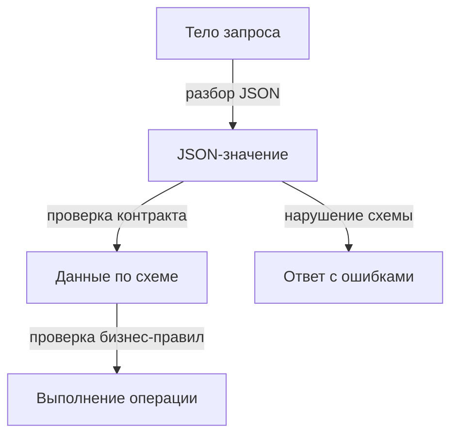
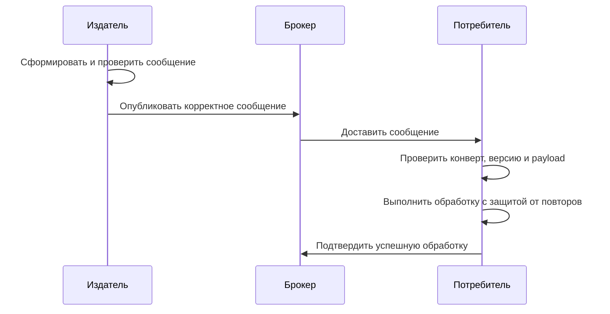

# 1. Основные понятия

## 1.1. JSON Schema как контракт структуры документа

**JSON Schema — декларативный язык описания структуры и ограничений JSON-данных.** «Декларативный» означает: мы указываем требования к данным, а проверку выполняет **validator — валидатор**, реализация стандарта. Схема служит контрактом между отправителем и получателем: какие поля ожидаются, какие значения допустимы. [Обзор JSON Schema](https://json-schema.org/overview/what-is-jsonschema)

Например, контракт запроса на добавление товара в заказ:

```json
{
  "$schema": "https://json-schema.org/draft/2020-12/schema",
  "type": "object",
  "properties": {
    "product_id": { "type": "integer", "minimum": 1 },
    "quantity": { "type": "integer", "minimum": 1 }
  },
  "required": ["product_id", "quantity"],
  "additionalProperties": false
}
```

Этой схеме соответствует:

```json
{ "product_id": 42, "quantity": 2 }
```

А строка `"2"` вместо числа `2` не соответствует требованию `integer`.

Здесь:

- `type` задаёт тип значения;
- `properties` описывает поля объекта;
- `minimum` задаёт нижнюю границу числа включительно;
- `required` перечисляет обязательные поля;
- `additionalProperties: false` запрещает остальные поля.

**Описание поля в `properties` само по себе не делает его обязательным.** Дополнительные поля также разрешены по умолчанию. Запрет полезен для строгого API, но может мешать совместимости при расширении сообщений. [Правила объектов](https://json-schema.org/understanding-json-schema/reference/object)

Схема проверяет уже разобранные данные: сначала JSON-парсер должен убедиться, что текст синтаксически корректен. Успешный разбор JSON ещё не означает соответствие контракту.

## 1.2. Диалекты и назначение `$schema`

**Диалект — набор ключевых слов JSON Schema и правил их интерпретации.** Выпуски draft-07, 2019-09 и 2020-12 задают разные диалекты. Слово *draft* в названии не означает, что выпуск непригоден для использования.

| Диалект | Что важно узнавать |
|---|---|
| draft-07 | Переиспользуемые определения обычно находятся в `definitions`. Позиционные элементы массива описываются массивом схем в `items` |
| 2019-09 | Появились `$defs`, словари ключевых слов (*vocabularies*) и `unevaluatedProperties`, учитывающий поля, проверенные другими частями схемы |
| 2020-12 | Для позиционных элементов массива используется `prefixItems`, а `items` описывает оставшиеся элементы. Обновлён механизм динамических ссылок |

Это ориентиры, а не полный список изменений. Различия описаны в официальных материалах для [2019-09](https://json-schema.org/draft/2019-09/release-notes) и [2020-12](https://json-schema.org/draft/2020-12).

**`$schema` фиксирует диалект самой схемы**, например:

```json
"$schema": "https://json-schema.org/draft/2020-12/schema"
```

Этот адрес также идентифицирует **meta-schema — метасхему**, то есть схему для проверки корректности других схем. Поэтому нужно различать:

- проверку схемы по метасхеме;
- проверку документа по прикладной схеме.

Без `$schema` версия может определяться настройками валидатора. **Указание диалекта не добавляет валидатору его поддержку**: совместимость реализации нужно проверять отдельно. `$schema` также не является версией вашего API или события. [Объявление диалекта](https://json-schema.org/understanding-json-schema/reference/schema)

## 1.3. Структурная проверка, бизнес-валидация и авторизация

Эти проверки отвечают на разные вопросы:

| Проверка | Вопрос | Пример для заказа |
|---|---|---|
| JSON Schema | Соответствуют ли данные контракту? | `quantity` — целое число не меньше 1 |
| Бизнес-валидация | Допустима ли операция по правилам предметной области? | На складе достаточно товара |
| Авторизация | Разрешена ли операция этому пользователю? | Пользователь может изменять этот заказ |

**Валидный документ не гарантирует допустимость операции.** В примере выше `product_id: 42` проходит схему, даже если такого товара нет в базе.

В Rails проверка схемы может выполняться на входе в приложение, авторизация — с учётом текущего пользователя, а бизнес-правила — при выполнении операции над заказом. Конкретный порядок зависит от сценария: иногда доступ следует проверить до загрузки и подробной проверки ресурса.

Граница определяется не только названием правила. Например, ограничение количества диапазоном `1–100` можно выразить в схеме, даже если оно возникло из бизнес-требования. Но доступность товара на текущем складе требует внешних данных.

Отдельная ловушка — **`format`**, например `"format": "email"`. В стандартных диалектах начиная с 2019-09 это по умолчанию аннотация, а не обязательная проверка. Поведение зависит от поддержки и настроек валидатора. Даже проверка формата email не подтверждает существование ящика. [Спецификация `format`](https://json-schema.org/draft/2020-12/json-schema-validation#section-7)

## 1.4. Где применяется схема

**Схему удобно применять на границе, где данные переходят между компонентами или поступают из внешнего источника.**

| Место | Пример | Практическая польза |
|---|---|---|
| Тело API-запроса | Создание заказа | Раннее обнаружение неверных типов и пропущенных полей |
| Событие | `OrderPaid` — «заказ оплачен» | Общий контракт для издателя и подписчиков |
| Конфигурация | Настройки доставки | Обнаружение ошибок до запуска обработки заказов |
| Сообщение брокера | Команда отправить уведомление | Проверка содержимого перед выполнением задачи |

**Событие и сообщение брокера — пересекающиеся понятия.** Событие описывает смысл данных: произошедший факт. Сообщение брокера описывает способ их передачи и может содержать событие или команду.

В распределённой системе полезно проверять данные перед отправкой и при получении: отправитель раньше обнаруживает свою ошибку, а получатель защищает собственную границу.

При этом схема не обеспечивает доставку, порядок сообщений или защиту от повторной обработки. Например, два одинаковых корректных сообщения об оплате всё равно требуют **идемпотентной обработки — обработки повторов без повторного побочного эффекта**.

**Запомнить:** JSON Schema фиксирует контракт данных в выбранном диалекте; бизнес-правила, права доступа и надёжность обработки требуют отдельных механизмов.

# 2. Типы и ограничения

## 2.1. Типы данных

**`type` определяет допустимый тип JSON-значения.** Типы можно задавать для всего документа, отдельных полей и элементов массива.

| Тип | Что означает | Пример |
|---|---|---|
| `object` | Объект с полями, имена которых — строки | `{"order_id": 42}` |
| `array` | Упорядоченный массив элементов | `[42, 57]` |
| `string` | Строка | `"pending"` |
| `number` | Число, включая целое | `19.95`, `20` |
| `integer` | Число без дробной части | `3` |
| `boolean` | Логическое значение | `true`, `false` |
| `null` | Явное пустое значение | `null` |

**Валидация сама по себе не преобразует типы:** `"3"` не становится числом, а `"false"` — логическим значением. Если библиотека предлагает преобразования, это дополнительное поведение, которое нужно учитывать отдельно.

`integer` определяется числовым значением: `3.0` также соответствует этому типу. Это отличается от проверки класса Ruby-объекта через `is_a?(Integer)`. [Числовые типы](https://json-schema.org/understanding-json-schema/reference/numeric)

Чтобы разрешить несколько типов, используют массив:

```json
{ "type": ["string", "null"] }
```

Для массива `items` задаёт схему каждого элемента:

```json
{
  "type": "array",
  "items": { "type": "integer", "minimum": 1 },
  "minItems": 1
}
```

Схема разрешает `[42, 57]`, но запрещает `[]` и `[42, "57"]`. **Сам по себе `type: "array"` не ограничивает типы элементов.** [Проверка массивов](https://json-schema.org/understanding-json-schema/reference/array)

## 2.2. Поля, границы и допустимые значения

**Ограничения уточняют, какие значения выбранного типа допустимы.** Для объекта обязанности разделены:

- `properties` — как проверять перечисленные поля, если они присутствуют;
- `required` — какие поля должны присутствовать;
- `additionalProperties` — что разрешено для остальных полей.

Например, схема позиции заказа в диалекте 2020-12:

```json
{
  "$schema": "https://json-schema.org/draft/2020-12/schema",
  "type": "object",
  "properties": {
    "sku": {
      "type": "string",
      "minLength": 1,
      "maxLength": 32,
      "pattern": "^[A-Z0-9-]+$"
    },
    "quantity": {
      "type": "integer",
      "minimum": 1,
      "maximum": 100
    },
    "delivery": {
      "enum": ["courier", "pickup"]
    }
  },
  "required": ["sku", "quantity"],
  "additionalProperties": false
}
```

Здесь `delivery` необязательно, но при наличии должно содержать одно из двух значений. **`enum` задаёт закрытый набор допустимых значений** и может содержать не только строки.

`additionalProperties` по умолчанию разрешает дополнительные поля. Значение `false` запрещает их, а схема вместо `false` позволяет проверять их значения. Это не механизм удаления лишних полей. [Проверка объектов](https://json-schema.org/understanding-json-schema/reference/object)

| Ограничение | Назначение |
|---|---|
| `minLength`, `maxLength` | Длина строки |
| `minItems`, `maxItems` | Количество элементов массива |
| `minProperties`, `maxProperties` | Количество полей объекта |
| `minimum`, `maximum` | Числовые границы включительно |
| `exclusiveMinimum`, `exclusiveMaximum` | Числовые границы без включения |

Например, `"exclusiveMinimum": 0` означает строго положительное число. В рассматриваемых диалектах значение этого ключа — число. [Спецификация ограничений](https://json-schema.org/draft/2020-12/json-schema-validation#section-6)

**`pattern` — регулярное выражение для строки.** По умолчанию достаточно совпадения с частью строки; `^` и `$` задают границы для проверки всей строки. Используется синтаксис семейства ECMA-262, поэтому Ruby-выражения нельзя переносить автоматически. Длина строки считается по Unicode-кодовым точкам, а не байтам: визуальный символ может состоять из нескольких таких точек. [Строковые ограничения](https://json-schema.org/understanding-json-schema/reference/string)

Типовые ограничения не заменяют `type`: например, `minLength` само по себе не запрещает число.

## 2.3. `format` и настройки валидатора

**`format` обозначает известный формат значения**, например `email`, `date` или `date-time`:

```json
{
  "type": "string",
  "format": "date-time"
}
```

Пример значения: `"2026-10-28T12:30:00+03:00"`.

Однако **наличие `format` не гарантирует проверку формата**. В стандартном диалекте 2020-12 он по умолчанию работает как аннотация — описание для инструментов. Проверка зависит от поддерживаемых возможностей и настроек валидатора; начиная с 2019-09 нельзя рассчитывать на неё как на обязательное поведение по умолчанию. [Требования к `format`](https://json-schema.org/draft/2020-12/json-schema-validation#section-7)

На практике нужно проверить документацию выбранной библиотеки и добавить отрицательный пример: например, убедиться, что `"not-a-date"` отклоняется.

Даже включённая проверка `email` не подтверждает существование почтового ящика. Аналогично корректный `date-time` не означает, что время доставки находится в будущем: это отдельное правило приложения.

## 2.4. Отсутствие поля, `null` и пустое значение

**Отсутствие поля — отсутствие ключа; `null` — присутствующее значение отдельного типа.** Пустая строка, массив и объект тоже являются значениями.

Для поля `comment`:

| Требование | Ограничение |
|---|---|
| Поле обязательно | `"required": ["comment"]` у объекта |
| Значение должно быть строкой | `"type": "string"` у поля |
| Разрешены строка и `null` | `"type": ["string", "null"]` |
| Строка должна быть непустой | `"type": "string", "minLength": 1` |

Например, для обязательной непустой строки:

| Документ | Результат |
|---|---|
| `{}` | Ошибка: поле отсутствует |
| `{"comment": null}` | Ошибка: неверный тип |
| `{"comment": ""}` | Ошибка: недостаточная длина |
| `{"comment": " "}` | Допустим: пробел — символ |
| `{"comment": "У двери"}` | Допустим |

**`required` проверяет присутствие, а не содержимое.** Пустой массив ограничивают через `minItems`, пустой объект — через `minProperties`. [Обязательные поля](https://json-schema.org/understanding-json-schema/reference/object#required)

В Ruby различие сохраняет проверка ключа:

```ruby
order = { "comment" => nil }

order.key?("comment") # true: поле присутствует
order["comment"]      # nil
```

Обращение `order["comment"]` вернёт `nil` и для отсутствующего ключа. Поэтому одной проверки значения недостаточно, если контракт различает отсутствие поля и явный `null`.

**Запомнить:** тип, присутствие поля и допустимость его содержимого — три отдельные проверки; поведение `format` нужно подтвердить для выбранного валидатора.

# 3. Композиция схем

## 3.1. Повторяемые определения: `$defs` и `$ref`

**Композиция — построение схемы из небольших переиспользуемых частей.** `$defs` хранит определения, а `$ref` применяет указанную схему к текущему значению.

Например, идентификаторы заказа и покупателя имеют одинаковые ограничения:

```json
{
  "$schema": "https://json-schema.org/draft/2020-12/schema",
  "$defs": {
    "positiveId": {
      "type": "integer",
      "minimum": 1
    }
  },
  "type": "object",
  "properties": {
    "order_id": { "$ref": "#/$defs/positiveId" },
    "customer_id": { "$ref": "#/$defs/positiveId" }
  },
  "required": ["order_id", "customer_id"]
}
```

`#/$defs/positiveId` — локальная ссылка через **JSON Pointer**, путь к части JSON-документа. Само размещение определения в `$defs` не накладывает ограничений на данные: определение нужно применить.

**`$ref` означает применение схемы, а не текстовую вставку.** Ссылки могут вести и во внешние документы; их разрешение зависит от настроек валидатора.

В draft-07 используется `definitions` вместо `$defs`. Кроме того, в draft-07 соседние с `$ref` ключи игнорируются, а начиная с 2019-09 могут добавлять ограничения. [Структурирование схем](https://json-schema.org/understanding-json-schema/structuring)

Выносить удобно устойчивые понятия: адрес доставки, идентификатор, позицию заказа. Для единственного простого поля отдельное определение может лишь усложнить чтение.

## 3.2. `allOf`, `anyOf`, `oneOf` и `not`

**Эти ключи объединяют проверки одного значения**, а не задают порядок действий.

| Ключ | Когда проверка успешна |
|---|---|
| `allOf` | Проходят все подсхемы |
| `anyOf` | Проходит хотя бы одна подсхема |
| `oneOf` | Проходит ровно одна подсхема |
| `not` | Указанная подсхема не проходит |

Первые три принимают массив схем, `not` — одну схему. **`oneOf` не выбирает первую подходящую ветвь:** совпадение с несколькими означает ошибку. [Правила композиции](https://json-schema.org/understanding-json-schema/reference/combining)

Например, покупатель должен оставить хотя бы один контакт:

```json
{
  "type": "object",
  "properties": {
    "email": { "type": "string", "minLength": 1 },
    "phone": { "type": "string", "minLength": 1 }
  },
  "anyOf": [
    { "required": ["email"] },
    { "required": ["phone"] }
  ]
}
```

Email и телефон вместе допустимы. Замена `anyOf` на `oneOf` запретит такую комбинацию.

Отдельный пример запрета: объект не должен одновременно содержать промокод и подарочный сертификат:

```json
{
  "type": "object",
  "not": {
    "required": ["promo_code", "gift_card_id"]
  }
}
```

Здесь `not` отрицает требование присутствия **обоих** полей. Одно поле или отсутствие обоих допустимы; типы их значений этот фрагмент не проверяет.

**`allOf` пересекает ограничения, а не объединяет определения полей как наследование.** Если одна ветвь содержит `additionalProperties: false`, она может отклонить поле, объявленное только в другой ветви. Для составных объектов в 2019-09 и 2020-12 полезен `unevaluatedProperties: false` на уровне объединения: он учитывает поля, обработанные применимыми подсхемами. [Закрытые составные объекты](https://json-schema.org/understanding-json-schema/reference/object#unevaluatedproperties)

## 3.3. Условные требования: `if` / `then` / `else`

**Условная схема выбирает дополнительные ограничения по результату проверки `if`.** Эти ключи поддерживаются начиная с draft-07, включая 2019-09 и 2020-12.

Для курьера нужен адрес, для самовывоза — пункт выдачи:

```json
{
  "type": "object",
  "properties": {
    "delivery": { "enum": ["courier", "pickup"] },
    "address": { "type": "string", "minLength": 1 },
    "pickup_point_id": { "type": "integer", "minimum": 1 }
  },
  "required": ["delivery"],
  "if": {
    "properties": {
      "delivery": { "const": "courier" }
    },
    "required": ["delivery"]
  },
  "then": { "required": ["address"] },
  "else": { "required": ["pickup_point_id"] }
}
```

`const` требует конкретного значения. Если `if` проходит, применяется `then`; иначе — `else`. Непрохождение самого условия не является ошибкой документа. Отсутствующая ветвь не добавляет ограничений. [Условная валидация](https://json-schema.org/understanding-json-schema/reference/conditionals#if-then-else)

**Ловушка: `properties` не требует присутствия поля.** Без `required` внутри условия отсутствие `delivery` тоже удовлетворяло бы `if`. В примере поле обязательно и на внешнем уровне; повторение делает условие самостоятельным и предотвращает неожиданное срабатывание ветви.

Пример требует нужное поле, но не запрещает поле другого варианта. Кроме того, проверка адреса выполняется при его наличии независимо от выбранной доставки: общие ограничения продолжают действовать.

## 3.4. Когда схема становится чрезмерно сложной

**Схема описывает допустимый документ; бизнес-процесс управляет действиями и состоянием системы.**

Условие «при курьерской доставке нужен адрес» подходит для схемы. Правило «после подтверждения оплаты зарезервировать товар, создать доставку и повторить отправку при сбое» требует кода, внешних данных и обработки ошибок.

Например, `"status": "paid"` может пройти схему, но это не доказывает, что платёж подтверждён провайдером. Аналогично корректный `pickup_point_id` не гарантирует, что пункт существует и работает.

Признаки перегруженного контракта:

- вложенные ветви повторяют состояния и переходы заказа;
- для понимания условия нужна история операций;
- правила зависят от пользователя, склада или платёжного сервиса;
- небольшое изменение создаёт множество пересекающихся вариантов.

Такие правила удобнее выразить в доменной логике — коде, отвечающем за правила предметной области. Простые ограничения данных при этом остаются в схеме.

Для композиции полезны тесты на пограничные случаи: не подходит ни одна ветвь, подходят несколько, отсутствует поле условия. Большое число ветвей также может увеличить стоимость проверки, особенно для `oneOf`.

**Запомнить:** `$ref` переиспользует ограничения, композиция объединяет проверки, условия уточняют контракт; бизнес-процесс выполняется в коде.

# 4. Эволюция схем

## 4.1. Добавление необязательных полей

**Совместимость — способность компонентов продолжать обмен данными после изменения контракта.** Её нужно проверять в двух направлениях:

- принимает ли новый потребитель старые документы;
- принимает ли старый потребитель новые документы.

Например, событие об оплате расширили необязательным полем:

```json
{
  "order_id": 42,
  "amount_cents": 150000,
  "payment_provider": "example"
}
```

Новый потребитель должен уметь обработать старое событие без `payment_provider`: поле не включают в `required`, а в коде предусматривают его отсутствие.

Но **необязательность нового поля не гарантирует совместимость со старым потребителем**. Его схема может содержать `additionalProperties: false` и отклонять неизвестное поле. Даже при успешной валидации код потребителя должен корректно его игнорировать. По умолчанию JSON Schema разрешает дополнительные поля. [Дополнительные поля](https://json-schema.org/understanding-json-schema/reference/object#additionalproperties)

Практический порядок обновления: сначала подготовить потребителей к расширению, затем начать отправлять новое поле. Для API-запросов это часто означает сначала обновить сервер, для ответов и событий — получателей.

Строгий запрет неизвестных полей полезен для обнаружения опечаток. Однако при независимом обновлении сервисов он требует более осторожного согласования изменений.

## 4.2. Удаление поля, смена типа и сужение `enum`

**Ломающее изменение нарушает ожидания хотя бы одной поддерживаемой стороны.** Последствия зависят от того, кто отправляет данные и кто их проверяет.

| Изменение | Что может сломаться |
|---|---|
| Отправитель перестал передавать поле | Старый потребитель требует поле или использует его в коде |
| Поле удалили из `properties` закрытой схемы | Старый отправитель продолжает передавать его, а новая схема запрещает |
| `order_id`: `integer` → `string` | Старый потребитель отклоняет строку, новый — прежнее число |
| `enum`: `["pending", "paid"]` → `["paid"]` | Ранее допустимые документы со статусом `pending` больше не проходят |
| Необязательное поле стало обязательным | Старые документы без него отклоняются |

Удаление поля только из `required` **ослабляет требование присутствия** и само по себе не запрещает прежние документы. Удаление из `properties` при разрешённых дополнительных полях тоже не означает запрет: поле просто перестаёт проверяться этой подсхемой.

У расширения `enum` есть обратная сторона: новая схема принимает больше значений, но старый потребитель может не понимать новый статус. **Расширение допустимых входов и расширение возможных выходов имеют разные последствия.**

Для миграции типа иногда временно принимают оба варианта:

```json
{ "type": ["integer", "string"] }
```

Это промежуточный контракт, а не завершённая миграция: приложение должно определить допустимые строки и правила обработки обоих представлений.

Проверять стоит не только схемы, но и реальные сценарии: документ может пройти валидацию и сломать расчёт, ветвление или отображение.

## 4.3. Версионирование схем API и событий

**Версия контракта идентифицирует конкретный набор договорённостей о данных.** Она отличается от диалекта JSON Schema:

```json
{
  "$schema": "https://json-schema.org/draft/2020-12/schema",
  "$id": "https://shop.example/schemas/order-paid/2.0.0"
}
```

Здесь `$schema` задаёт язык схемы, а `$id` — её идентификатор и базовый URI для разрешения ссылок. **`$id` не определяет правила версионирования и не гарантирует загрузку схемы по сети.** [Идентификация схем](https://json-schema.org/understanding-json-schema/structuring#id)

Для API версию контракта можно выбирать через URL, заголовок или согласованный тип содержимого. Для события — через тип события, метаданные сообщения либо поле в конверте:

```json
{
  "event_type": "order.paid",
  "schema_version": "2.0.0",
  "data": {
    "order_id": 42,
    "amount_cents": 150000
  }
}
```

Это пример соглашения приложения: JSON Schema не придаёт `schema_version` специального смысла.

Полезно различать **версию API** и **точную редакцию схемы**: несколько совместимых редакций могут относиться к одной версии API. Если используется SemVer — формат `MAJOR.MINOR.PATCH`, — команда должна определить, какие изменения считает совместимыми.

Для событий особенно важно сохранять старые контракты: сообщения могут долго лежать в очереди или повторно читаться из архива. Новая версия не обновляет уже опубликованные данные.

## 4.4. Актуальная версия и место хранения

**Источник истины — согласованное место, из которого берут утверждённые схемы.** Для небольшого проекта достаточно каталога в Git; для нескольких сервисов может быть удобен **schema registry — централизованный каталог схем и их версий**.

Например:

```text
contracts/
  events/order-paid/1.0.0.json
  events/order-paid/2.0.0.json
  api/create-order/1.1.0.json
  catalog.json
```

В каталоге или документации фиксируют:

- точный идентификатор и расположение каждой схемы;
- рекомендуемую версию для новых интеграций;
- версии, которые ещё поддерживаются;
- владельца контракта и порядок прекращения поддержки.

**«Актуальная» не обязательно означает «единственная допустимая».** Новые интеграции могут использовать версию 2, пока действующие потребители продолжают работать с версией 1.

Опубликованные версии желательно сохранять неизменными, включая используемые ими `$ref`: иначе старый контракт изменится незаметно. Указатель `latest` удобен для навигации, но рабочую интеграцию лучше привязывать к точной версии. В Git также важно отличать последнюю разработанную схему от уже выпущенной в эксплуатацию.

**Запомнить:** совместимость зависит от направления обмена и поведения потребителей; версии контрактов должны быть явными, воспроизводимыми и доступными вместе с историей.

# 5. Валидация на границе

## 5.1. Выбор валидатора и фиксация диалекта

**Валидатор — библиотека, которая проверяет данные по JSON Schema.** Для Ruby можно использовать `json_schemer`: он поддерживает draft-07, 2019-09 и 2020-12. Для примеров выберем 2020-12. [Документация JSONSchemer](https://github.com/davishmcclurg/json_schemer#readme)

При выборе важны не только поддерживаемые диалекты, но и поведение `format`, разрешение `$ref`, качество ошибок и производительность на ваших схемах.

Зафиксировать нужно:

- диалект через `$schema` в каждом самостоятельном документе схемы;
- версию библиотеки в зависимостях и lock-файле;
- настройки, влияющие на проверку;
- точную версию прикладного контракта.

Пример создания валидатора:

```ruby
require "json"
require "json_schemer"

schema = JSON.parse(File.read("contracts/create_order/1.0.0.json"))
raise "Invalid order schema" unless JSONSchemer.valid_schema?(schema)

ORDER_SCHEMA = JSONSchemer.schema(
  schema,
  format: true,
  insert_property_defaults: false
)
```

Предполагается, что файл содержит `$schema` для 2020-12. `format: true` явно включает проверку форматов, а `insert_property_defaults: false` отключает подстановку значений по умолчанию. Эти параметры и проверка метасхемой документированы библиотекой. [Использование и настройки](https://github.com/davishmcclurg/json_schemer#options)

**Проверку корректности самой схемы лучше выполнять при сборке или запуске приложения**, а не для каждого запроса. Ошибка контракта должна обнаруживаться до приёма пользовательских данных.

## 5.2. Проверка входа до бизнес-логики

**Валидация на границе — проверка данных при входе в контролируемую часть системы**, до создания заказа, списания денег или отправки уведомления.

Типичный путь запроса:



Аутентификация и авторизация тоже необходимы; их место зависит от сценария и здесь не показано.

В Rails действие может выглядеть так:

```ruby
def create
  input = JSON.parse(request.raw_post)
  errors = ORDER_SCHEMA.validate(input).to_a

  if errors.any?
    return render json: {
      errors: SchemaErrors.present(errors)
    }, status: 422
  end

  order = CreateOrder.call(input, current_user:)
  render json: { order_id: order.id }, status: 201
end
```

`validate` возвращает перечислитель ошибок. [API валидации](https://github.com/davishmcclurg/json_schemer#usage)

Пример сокращён: обработка некорректного JSON, доступа и бизнес-ошибок вынесена за его пределы; `SchemaErrors` и `CreateOrder` — компоненты приложения.

**Проверять нужно исходные данные до фильтрации, скрывающей нарушения.** Например, если сначала удалить неизвестные поля, схема уже не обнаружит их при `additionalProperties: false`. В Rails Strong Parameters решает другую задачу — ограничивает параметры для массового присваивания атрибутов модели.

Проверка также не заменяет ограничения размера запроса: слишком большой документ создаёт нагрузку ещё до бизнес-логики.

## 5.3. Путь, код и понятное сообщение

**Публичная ошибка — часть контракта API.** Клиенту нужны место проблемы, стабильный машинный код и понятное человеку сообщение:

```json
{
  "errors": [
    {
      "path": "/items/0/quantity",
      "code": "minimum",
      "message": "Количество должно быть не меньше 1"
    }
  ]
}
```

Здесь `path` использует **JSON Pointer — путь внутри JSON**; `0` обозначает первый элемент массива.

В стандартном выводе `json_schemer` есть `data_pointer`, `type` и служебные сведения о схеме. Для отсутствующих обязательных полей доступны `details["missing_keys"]`. [Примеры ошибок](https://github.com/davishmcclurg/json_schemer#usage)

**Ответ клиенту стоит формировать через собственный адаптер ошибок**, а не отправлять весь результат библиотеки. Адаптер:

- переводит внутренние типы ошибок в согласованные коды;
- формирует сообщения;
- для `required` указывает отсутствующее поле, а не только родительский объект;
- сокращает шум от вложенных `anyOf` и `oneOf`.

Не возвращайте трассировку исключения, содержимое схемы, внутренние пути и введённые секреты. Код ошибки должен оставаться стабильным, даже если текст сообщения или библиотека изменятся.

## 5.4. Ошибка схемы и ошибка бизнес-правила

**Нарушение схемы означает неверную форму данных; нарушение бизнес-правила — недопустимую операцию с корректно оформленными данными.** Дефект самой схемы — отдельная ошибка приложения.

| Ситуация | Категория | Пример кода |
|---|---|---|
| Тело нельзя разобрать как JSON | Синтаксис | `invalid_json` |
| `quantity` содержит `"two"` | Контракт данных | `type` |
| Запрошено больше товара, чем доступно | Бизнес-правило | `insufficient_stock` |
| Пользователь не может менять заказ | Авторизация | `forbidden` |
| Схема некорректна или `$ref` недоступен | Ошибка приложения | `internal_error` |

Для API можно договориться о `400` для некорректного JSON, `422` для нарушения контракта, `409` для конфликта с текущим состоянием. Это пример политики приложения, а не требование JSON Schema; бизнес-ошибки также могут использовать `422`.

**Даже успешная валидация не гарантирует успех операции.** Остаток товара может измениться между проверкой и резервированием. Поэтому бизнес-правила защищают внутри операции с подходящими транзакциями и ограничениями базы данных.

**Запомнить:** сначала проверь форму входа, затем допустимость операции; клиенту возвращай стабильные и понятные ошибки, а дефекты схемы обрабатывай как ошибки приложения.

# 6. Сообщения и события

## 6.1. Конверт сообщения

**Конверт — общие метаданные сообщения, отделённые от полезной нагрузки (payload).** Он помогает выбрать обработчик и схему, отследить сообщение и распознать повторную доставку.

**Событие описывает произошедший факт**, например `order.paid`. Сообщение — единица передачи: оно может содержать событие или команду выполнить действие.

Пример собственного формата конверта:

```json
{
  "id": "evt-8f21",
  "type": "order.paid",
  "occurred_at": "2026-10-28T12:30:00+03:00",
  "schema_version": "1.0.0",
  "data": {
    "order_id": 42,
    "amount_cents": 150000,
    "currency": "RUB"
  }
}
```

| Поле | Назначение |
|---|---|
| `id` | Идентификатор события, сохраняющийся при повторной доставке |
| `type` | Смысл события и ключ выбора обработчика |
| `occurred_at` | Время возникновения факта, а не получения сообщения |
| `schema_version` | Точная версия прикладного контракта |
| `data` | Данные о произошедшем факте |

Область уникальности `id` нужно определить: глобальная либо, например, в пределах источника. Если источников несколько, полезно добавить `source`.

**Версия прикладной схемы отличается от `$schema`:** первая описывает контракт события, второй задаёт диалект JSON Schema. [Объявление диалекта](https://json-schema.org/understanding-json-schema/reference/schema)

Имена полей выше — соглашение приложения. Альтернатива собственному формату — **CloudEvents**, стандарт конверта событий. У него свои атрибуты, включая `id`, `source`, `type`, `time` и `dataschema`; `specversion` обозначает версию CloudEvents, а не payload. [Спецификация CloudEvents](https://github.com/cloudevents/spec/blob/main/cloudevents/spec.md)

## 6.2. Проверка перед публикацией и при получении

**Отправитель проверяет, что выпускает корректное сообщение; получатель защищает собственную границу.** Одна проверка не заменяет другую: сервисы обновляются независимо, а старые сообщения могут поступать повторно.

Проверять нужно и конверт, и payload. Одной проверки `"data": {"type": "object"}` недостаточно: она ничего не говорит о полях оплаты.

Типичная последовательность:



Это общий сценарий для системы с подтверждениями; конкретный механизм зависит от брокера.

На стороне получателя сначала разбирают JSON и проверяют минимальный конверт. Затем по паре `(type, schema_version)` выбирают известную схему полного сообщения.

**Валидность не гарантирует однократную обработку.** Потребителю нужна идемпотентность — повторное получение события не должно повторно создавать доставку или списывать деньги. Один `id` этого не обеспечивает: приложение должно использовать его для обнаружения повторов.

Проверка также не решает проблему согласованности базы и публикации. Если заказ изменён, а отправка события не удалась, может потребоваться **Transactional Outbox** — сохранение события в той же транзакции, что и изменения заказа, с последующей публикацией.

## 6.3. Реакция на невалидное сообщение

**Реакция зависит от того, может ли повторная попытка устранить причину ошибки.**

| Ситуация | Разумная реакция |
|---|---|
| Сообщение не прошло проверку перед публикацией | Отказ от публикации, диагностика и метрика |
| Получен некорректный JSON или payload | Изоляция сообщения, метрика, разбор причины |
| Временно недоступен сервис обработки | Ограниченные повторы с увеличением задержки |
| Исчерпан лимит повторов | Очередь ошибок и уведомление ответственного |
| Нарушено бизнес-правило | Отдельная политика предметной области |

**Повтор неизменного сообщения обычно не исправляет нарушение схемы.** Бесконечный возврат в обработку создаёт *poison message* — сообщение, постоянно вызывающее сбой и расходующее ресурсы.

**Dead Letter Queue (DLQ) — очередь сообщений, выведенных из обычной обработки.** Попадание туда нужно настроить: оно не происходит автоматически во всех системах. Например, RabbitMQ использует Dead Letter Exchange для маршрутизации таких сообщений. [Dead Letter Exchanges](https://www.rabbitmq.com/docs/dlx)

При переносе в очередь ошибок нужно сохранить исходное сообщение и причину отказа. Подтверждать исходную доставку следует с учётом гарантии сохранения в карантине, иначе сообщение можно потерять.

Полезная метрика — количество отказов по типу, версии и коду ошибки. Идентификаторы сообщений лучше оставлять в диагностических записях, а не превращать в отдельные метки метрики.

## 6.4. Неизвестные и несовместимые версии

**Неизвестная версия означает отсутствие согласованного обработчика контракта.** Это отличается от известной версии с невалидными данными, но обе ситуации должны быть заметны.

Безопасная политика — явно перечислять поддерживаемые сочетания типа и версии. Нельзя молча выбирать `latest` или пробовать старую схему и считать успех доказательством совместимости: похожая структура может иметь другой смысл.

Если версия пока не поддерживается, сообщение можно сохранить в карантине до обновления потребителя. Повтор имеет смысл после изменения условий, а не сразу в бесконечном цикле.

Для миграции допустим **upcaster — преобразователь старого формата в новый внутренний формат**. Он должен явно знать исходную версию и сохранять смысл события. После преобразования полезно проверить результат новой схемой.

**Запомнить:** проверяй конверт и payload с обеих сторон, выбирай контракт явно, а невалидные и неизвестные сообщения обрабатывай по наблюдаемой политике без бесконечных повторов.

# 7. Проверка самих схем

## 7.1. Валидные и невалидные примеры рядом со схемой

**Тесты схемы проверяют, что контракт принимает нужные документы и отклоняет запрещённые.** Проверка по метасхеме необходима, но недостаточна: корректно написанная схема может описывать неверные требования.

Примеры удобно хранить рядом с конкретной версией контракта:

```text
contracts/create-order/1.0.0/
  schema.json
  valid/
    minimal.json
    with-comment.json
  invalid/
    missing-quantity.json
    quantity-as-string.json
    quantity-below-minimum.json
  expectations.json
```

**Fixture — сохранённый набор входных данных для теста.** Валидные fixtures показывают допустимые варианты, невалидные — конкретные нарушения.

Для поля `quantity` с типом `integer` и минимумом `1` полезны случаи:

| Данные | Ожидание |
|---|---|
| `1` | Допустимая нижняя граница |
| `2` | Обычное допустимое значение |
| `0` | Нарушение `minimum` |
| `"1"` | Нарушение типа |
| `null` | Нарушение типа |
| Поле отсутствует | Нарушение `required` |

Добавляйте примеры для необязательных полей, дополнительных свойств и каждой условной ветви. Для `oneOf` особенно важен документ, который случайно подходит сразу нескольким вариантам.

**Невалидный пример желательно строить из валидного, изменив одну существенную деталь.** Иначе непонятно, какое именно правило проверяет тест.

## 7.2. Проверка результата и причины отказа

**Недостаточно убедиться, что документ отклонён: он должен отклоняться по ожидаемой причине.** Иначе тест останется зелёным после случайного удаления нужного ограничения.

В Ruby с `json_schemer` можно проверять структурированные ошибки:

```ruby
schema = {
  "$schema" => "https://json-schema.org/draft/2020-12/schema",
  "type" => "object",
  "properties" => {
    "quantity" => { "type" => "integer", "minimum" => 1 }
  },
  "required" => ["quantity"]
}

schemer = JSONSchemer.schema(schema, format: true)
errors = schemer.validate({ "quantity" => 0 }).to_a

actual = errors.map do |error|
  [error.fetch("data_pointer"), error.fetch("type")]
end

assert_includes actual, ["/quantity", "minimum"]
```

Пример предполагает тест на Minitest и подключённый `json_schemer`. Метод `validate` возвращает перечислитель ошибок; в стандартном формате доступны `data_pointer` и `type`. [Документация JSONSchemer](https://github.com/davishmcclurg/json_schemer#usage)

Для валидного примера проверяют отсутствие ошибок, для невалидного — наличие ожидаемого ограничения и пути. При `required` путь может указывать на родительский объект: отсутствующие поля нужно проверять через `details["missing_keys"]`.

**Не привязывайте тесты к полному тексту сообщения или порядку ошибок**, если они не являются вашим публичным контрактом. Текст может измениться при обновлении библиотеки, а композиция — породить несколько связанных ошибок. Собственный адаптер публичных ошибок стоит тестировать отдельно.

Нужна и проверка самой схемы:

```ruby
assert JSONSchemer.valid_schema?(schema)
```

Она документирована библиотекой, но не заменяет проверок ссылок и прикладных примеров. [Проверка схем](https://github.com/davishmcclurg/json_schemer#usage)

## 7.3. Проверка совместимости изменений

**Совместимость проверяют относительно конкретного направления обмена**, а не только сравнением двух файлов.

| Проверка | Что обнаруживает |
|---|---|
| Старые документы → новая схема | Новый получатель перестал принимать прежние данные |
| Новые документы → старая схема | Старый получатель не принимает новые данные |
| Новые документы → старый обработчик | Структура допустима, но код неверно понимает данные |

Например, добавление обязательного `currency` обнаружится при проверке старых документов новой схемой. Добавление необязательного поля может обнаружить проблему в обратном направлении, если старая схема запрещает дополнительные свойства.

**Набор примеров даёт свидетельство совместимости, но не доказывает её для всех документов.** Для важных контрактов дополнительно анализируют изменения: `required`, типы, `enum`, границы, условные ветви и `$ref`.

Сравнивать нужно с опубликованной поддерживаемой версией, а не только с предыдущим коммитом. Если потребители поддерживают несколько версий, проверяют соответствующую матрицу совместимости.

Не следует обновлять fixtures только ради прохождения тестов. Если допустимый документ стал недопустимым, сначала определяют: это ошибка схемы, исправление прежнего дефекта или намеренное изменение контракта.

## 7.4. Запуск проверок в CI

**CI — Continuous Integration, непрерывная интеграция:** автоматический запуск проверок при изменениях проекта. Проверки контрактов должны завершаться до публикации новой схемы или приложения.

Минимальный набор:

1. Разобрать все файлы схем и примеров как JSON.
2. Проверить схемы по метасхеме выбранного диалекта.
3. Проверить разрешение используемых `$ref`.
4. Запустить валидные и невалидные примеры.
5. Проверить заявленную совместимость с поддерживаемыми версиями.

Используйте ту же версию валидатора и настройки, что в приложении: особенно `format`, обработку регулярных выражений и внешних ссылок. Зависимости лучше фиксировать, а схемы для `$ref` предоставлять воспроизводимо, без случайной зависимости от доступности сети.

**Проверка не должна успешно завершаться, если примеры не найдены.** Опечатка в пути, из-за которой запущено ноль тестов, создаёт ложную уверенность.

Официальный **JSON Schema Test Suite** проверяет реализацию спецификации валидатора. Он полезен для оценки инструмента, но не заменяет ваши примеры заказов, платежей и событий. [JSON Schema Test Suite](https://github.com/json-schema-org/JSON-Schema-Test-Suite)

**Запомнить:** проверяй корректность схемы, принятие и отклонение примеров по нужной причине, совместимость версий — и запускай всё это автоматически.

# 8. Границы схемы

## 8.1. Что схема не гарантирует

**JSON Schema проверяет документ относительно описанного контракта.** Стандартные ключевые слова не обращаются к базе данных, не определяют права текущего пользователя и не восстанавливают историю заказа.

| Требование | Возможность схемы | Что требуется дополнительно |
|---|---|---|
| Номер заказа уникален в базе | Проверить тип и форму номера | Уникальное ограничение в базе |
| Пользователь может вернуть заказ | Проверить структуру запроса | Авторизация с учётом пользователя и заказа |
| Оплаченный заказ можно отправить | Проверить допустимое значение `status` | Проверка текущего состояния и правил перехода |
| Повторное событие не создаёт вторую доставку | Проверить наличие `event_id` | Идемпотентная обработка |
| Элементы массива не повторяются | Проверить через `uniqueItems` | Уточнение того, что считается повтором |

**`uniqueItems` проверяет уникальность целых значений внутри одного массива**, а не уникальность записей в базе. Два объекта с одинаковым `product_id`, но разным `quantity` считаются разными значениями. [Спецификация `uniqueItems`](https://json-schema.org/draft/2020-12/json-schema-validation#section-6.4.3)

**Инвариант процесса — условие, которое должно сохраняться при выполнении операций**, например: «одна оплата не должна приводить к двум отгрузкам». Проверки отдельного документа для этого недостаточно.

При этом часть бизнес-ограничений можно выразить в схеме: диапазон количества, набор способов доставки, обязательность адреса. Граница проходит по необходимому контексту, а не по названию правила.

## 8.2. Проверка на границе доверия

**Граница доверия — место, где компонент принимает данные, корректность которых он не может гарантировать самостоятельно.** Это HTTP-запрос, сообщение брокера, импорт файла или ответ внешней системы.

Похожая проверка внутри сервиса не делает входную проверку лишней. У них разные задачи:

- схема рано обнаруживает нарушение контракта и позволяет вернуть понятную ошибку;
- доменная логика защищает правила операции независимо от способа вызова;
- база обеспечивает ограничения при конкурентных изменениях.

Например, схема требует положительное `quantity`, а операция резервирования дополнительно гарантирует, что остаток не станет отрицательным. Это разные гарантии, хотя обе связаны с количеством товара.

**Проверка отправителем не заменяет проверку получателем:** версии сервисов и контрактов могут различаться, сообщения могут поступать из других источников.

Однако повторять одну и ту же схему перед каждым внутренним методом обычно избыточно. После проверки можно передать данные во внутренний объект с определёнными гарантиями. Если затем структура существенно изменяется, прежняя валидация уже не подтверждает корректность результата.

## 8.3. Стоимость на горячем пути

**Горячий путь (hot path) — часто выполняемый участок, влияющий на задержку и пропускную способность системы.** Стоимость валидации зависит от размера документа, схемы, реализации и объёма собираемых ошибок.

Особого внимания требуют большие массивы, сложные регулярные выражения, глубокая вложенность и множество альтернатив. Для `oneOf` нужно установить, что подходит ровно одна ветвь; сложная вложенная композиция может заметно увеличивать объём работы. [Ограничения композиции](https://json-schema.org/understanding-json-schema/reference/combining)

Измерять полезно отдельно:

| Измерение | Зачем |
|---|---|
| Загрузка и подготовка схемы | Отделить разовые затраты от проверки документа |
| Корректные документы типичного размера | Оценить обычную нагрузку |
| Максимальные допустимые документы | Проверить верхнюю границу затрат |
| Невалидные документы со множеством ошибок | Оценить стоимость отказа и диагностики |
| p95/p99 — задержка для 95/99% проверок | Увидеть медленные случаи, скрытые средним |

Практические меры: переиспользовать подготовленный валидатор, заранее предоставлять внешние схемы, ограничивать размер входа и количество возвращаемых ошибок. Возможность раннего завершения зависит от библиотеки.

**`maxItems` не заменяет лимит размера HTTP-тела:** документ обычно сначала нужно получить и разобрать. Сложные регулярные выражения также требуют внимания к используемому движку. Спецификация отдельно рассматривает риски чрезмерного потребления ресурсов. [Соображения безопасности](https://json-schema.org/draft/2020-12/json-schema-core#section-13)

Оптимизировать стоит после измерений, сохраняя необходимые гарантии на границе.

## 8.4. Какие проверки остаются в коде

**Разделение проверок стоит фиксировать явно: правило, место выполнения и причина выбора.**

| Проверка | Где выполнять | Почему |
|---|---|---|
| Типы, обязательные поля, длины | JSON Schema на входе | Не требуют состояния системы |
| Доступ к заказу | Слой авторизации | Нужны пользователь и ресурс |
| Допустимость возврата | Доменная операция | Нужны состояние заказа и правила магазина |
| Резервирование остатка | Код операции и база | Нужна защита от конкурентных изменений |
| Уникальность внешнего номера платежа | Ограничение базы и обработка конфликта | Предварительная проверка может устареть |
| Подтверждение оплаты провайдером | Интеграционный код | Нужен внешний источник факта |

Условный Ruby-пример разделения обязанностей:

```ruby
def reserve_stock!(stock, quantity)
  stock.with_lock do
    raise InsufficientStock if stock.available < quantity

    stock.update!(available: stock.available - quantity)
  end
end
```

Предполагается, что `quantity` уже проверено как положительное целое, а все операции изменения остатка используют согласованный механизм защиты. Блокировка нужна потому, что два корректных запроса могут одновременно претендовать на последний товар. Одна JSON Schema эту ситуацию не предотвращает.

**Запомнить:** схема защищает контракт документа, код — правила операции, база — согласованность при конкуренции; проверки на границе сохраняют, а их стоимость измеряют.

