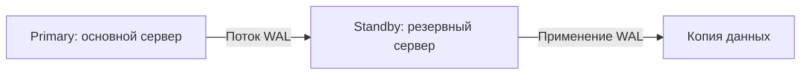

# 1. Физическая репликация

## 1.1. WAL как основа репликации

**WAL (Write-Ahead Log) — журнал упреждающей записи**, содержащий информацию для повторного применения изменений данных. PostgreSQL сначала сохраняет соответствующие записи WAL, а изменённые страницы таблиц и индексов может записать позже.

При **физической репликации** резервный сервер получает WAL и воспроизводит изменения поверх начальной физической копии данных. Передаются записи об изменениях, а не исходные SQL-запросы. Некоторые записи содержат полные образы страниц. [Документация WAL](https://www.postgresql.org/docs/current/wal-intro.html)



Реплицируется **кластер PostgreSQL — экземпляр со всеми его базами**, а не выбранные таблицы. Обычно нужны одинаковая основная версия PostgreSQL и совместимая платформа. Физическая репликация поэтому подходит для резервирования экземпляра, но не для выборочного переноса данных между разными версиями. [Ограничения и устройство репликации](https://www.postgresql.org/docs/current/warm-standby.html)

## 1.2. Настройка потоковой репликации

**Streaming replication — потоковая передача WAL** с основного сервера на резервный по постоянному соединению.

Минимальный стенд: два сервера с одинаковой версией PostgreSQL 18 в закрытой сети. Primary — `10.0.0.10`, standby — `10.0.0.11`. Предполагается обычный кластер без отдельных tablespace, с конфигурацией внутри каталога данных.

На primary задаём в `postgresql.conf`:

```ini
listen_addresses = '*'
wal_level = replica
max_wal_senders = 4
max_replication_slots = 4
```

Создаём отдельную роль через `psql`:

```sql
CREATE ROLE repl WITH LOGIN REPLICATION;
\password repl
```

В `pg_hba.conf` разрешаем подключение реплики:

```text
host replication repl 10.0.0.11/32 scram-sha-256
```

После изменения стартовых параметров перезапускаем primary. Значения `4` здесь — запас для небольшого стенда, а не универсальная рекомендация. [Параметры репликации](https://www.postgresql.org/docs/current/runtime-config-replication.html)

На standby под системным пользователем PostgreSQL настраиваем пароль подключения в `.pgpass` с правами `0600`. Затем создаём начальную копию:

```bash
pg_basebackup \
  -d "host=10.0.0.10 user=repl application_name=standby1" \
  -D /srv/pg-standby \
  -R -X stream -C -S standby1

pg_ctl -D /srv/pg-standby -w start
```

**Целевой каталог должен отсутствовать или быть пустым**, а экземпляр standby — остановлен. Команды используют бинарные файлы выбранной версии PostgreSQL.

Здесь `-R` создаёт настройки подключения и файл `standby.signal`, `-X stream` получает WAL во время копирования, а `-C -S standby1` создаёт и использует слот. [Документация `pg_basebackup`](https://www.postgresql.org/docs/current/app-pgbasebackup.html)

Для проверки создай обычную таблицу на primary и добавь строку. После применения WAL таблица и строка должны появиться на standby.

## 1.3. Асинхронная и синхронная репликация

Различие определяется тем, **какого подтверждения ждёт primary перед успешным ответом на `COMMIT`**.

| Режим | Чего ждёт primary | Последствие |
|---|---|---|
| Асинхронный | Не ждёт реплику | При потере primary возможна потеря уже подтверждённых изменений |
| Синхронный, `on` | Надёжного сохранения WAL выбранной репликой | Добавляет сетевую задержку и ожидание записи на реплике |
| Синхронный, `remote_apply` | Применения WAL выбранной репликой | Дополнительно ждёт воспроизведения изменений |

Для синхронного режима на primary, например:

```ini
synchronous_standby_names = 'FIRST 1 (standby1)'
synchronous_commit = on
```

Имя `standby1` соответствует `application_name` подключения реплики.

**Сохранение WAL ещё не означает видимость данных в запросах standby.** Для этого изменения должны быть применены. Даже `remote_apply` не обновляет снимок уже начатой транзакции чтения. [Настройка `synchronous_commit`](https://www.postgresql.org/docs/current/runtime-config-wal.html#GUC-SYNCHRONOUS-COMMIT)

Если обязательная синхронная реплика недоступна и замены нет, подтверждение записи будет ждать. Синхронность уменьшает риск потери данных ценой задержки и доступности записи.

## 1.4. Слот репликации и удержание WAL

**Replication slot — состояние на primary, позволяющее удерживать WAL, который ещё нужен потребителю.** Благодаря слоту временно отключённая реплика может продолжить получение изменений.

Но отстающая или забытая реплика способна вызвать накопление WAL и заполнение диска primary.

Нужно наблюдать:

- активность слота и его позицию `restart_lsn` в `pg_replication_slots`;
- объём удерживаемого WAL;
- свободное место в файловой системе.

Параметр `max_slot_wal_keep_size` ограничивает удержание WAL слотами при контрольных точках. По умолчанию ограничение отсутствует. **Это компромисс:** после превышения лимита нужные сегменты могут быть удалены, и реплике потребуется восстановление из доступного архива либо новая начальная копия. [Слоты и удержание WAL](https://www.postgresql.org/docs/current/warm-standby.html#STREAMING-REPLICATION-SLOTS)

## 1.5. Чтение с реплики и переключение при отказе

**Hot standby — резервный сервер, который применяет WAL и одновременно обслуживает запросы чтения.** Режим включается через `hot_standby = on`.

Он подходит для части отчётов и чтения каталога магазина. Однако реплика может отставать: только что созданный заказ ещё не обязательно виден. Долгие запросы также могут конфликтовать с применением WAL и отменяться. [Ограничения hot standby](https://www.postgresql.org/docs/current/hot-standby.html)

**Failover — переключение роли основного сервера на реплику.** Порядок действий:

1. Изолировать прежний primary, чтобы исключить два одновременно пишущих сервера — **split brain**.
2. Повысить standby командой `SELECT pg_promote();`.
3. Переключить подключения приложения на новый primary.

PostgreSQL предоставляет механизм повышения реплики, но обнаружение отказа и управление переключением требуют отдельного решения. [Переключение при отказе](https://www.postgresql.org/docs/current/warm-standby-failover.html)

На стенде проверь чтение переданной строки, затем изолируй primary и выполни повышение. Функция `pg_is_in_recovery()` возвращает `true` на standby и `false` после повышения.

**Реплика не заменяет резервную копию:** ошибочное удаление данных тоже будет воспроизведено.

**Запомнить:** физическая реплика воспроизводит WAL всего экземпляра PostgreSQL; отдельно проектируются ожидание подтверждения, удержание WAL и безопасное переключение.

# 2. Логическая репликация

## 2.1. Публикация и подписка

**Логическая репликация — передача изменений данных на уровне строк таблиц**, независимо от физического расположения страниц. PostgreSQL извлекает изменения из WAL, передаёт их получателю и применяет к его таблицам.

Используются две роли:

- **Publisher — издатель:** база, в которой происходят изменения.
- **Subscriber — подписчик:** база, которая получает и применяет изменения.

**Publication — публикация** определяет, какие изменения доступны для передачи. **Subscription — подписка** задаёт подключение к издателю и список публикаций.

Обычно сначала копируются существующие строки, затем непрерывно передаются последующие изменения. Согласованность транзакций сохраняется для реплицируемых данных **в пределах одной подписки**. Между независимыми подписками общей гарантии нет. [Принципы логической репликации](https://www.postgresql.org/docs/18/logical-replication.html)

Например, приложение магазина хранит заказы и платежи, а отдельная база отчётности получает только заказы:


На издателе требуется `wal_level = logical`, достаточно процессов отправки WAL и слотов. На подписчике — достаточно процессов логической репликации. [Настройки PostgreSQL](https://www.postgresql.org/docs/18/logical-replication-config.html)

Пример создания подписки на отдельном сервере:

```sql
CREATE SUBSCRIPTION reporting_orders
CONNECTION 'host=10.0.0.10 dbname=shop user=repl'
PUBLICATION shop_orders;
```

Пример предполагает, что публикация уже создана, целевая таблица подготовлена, доступ настроен. Для простоты стенда команду выполняет администратор PostgreSQL, пароль хранится в `.pgpass` системного пользователя сервера. Роли `repl` нужны `LOGIN`, `REPLICATION` и `SELECT` для начального копирования. [Права подключения](https://www.postgresql.org/docs/18/logical-replication-security.html)

**Подписка не создаёт таблицы автоматически:** их структуру нужно подготовить отдельно.

## 2.2. Выбор таблиц и операций

Публикация существует внутри конкретной базы данных. В неё можно включить отдельные таблицы и выбрать типы передаваемых операций:

```sql
CREATE PUBLICATION shop_orders
FOR TABLE public.orders
WITH (publish = 'insert, update, delete, truncate');
```

| Операция | Что происходит у подписчика |
|---|---|
| `INSERT` | Добавляется строка |
| `UPDATE` | Изменяется соответствующая строка |
| `DELETE` | Удаляется соответствующая строка |
| `TRUNCATE` | Очищается соответствующая таблица |

По умолчанию включены все четыре операции. Если оставить только `insert`, последующие изменения и удаления передаваться не будут: копия постепенно перестанет соответствовать текущему состоянию источника.

**Список операций не ограничивает начальное копирование.** Например, публикация только `update` всё равно по умолчанию сначала передаст существующие строки. [Настройка публикации](https://www.postgresql.org/docs/18/sql-createpublication.html)

Для проверки на стенде последовательно выполни `INSERT`, `UPDATE` и `DELETE` на издателе, каждый раз дожидаясь результата у подписчика. `TRUNCATE` проверяй на отдельной тестовой таблице.

При связанных внешними ключами таблицах `TRUNCATE` требует осторожности: неполный набор таблиц в подписке может привести к ошибке применения.

## 2.3. Replica identity для UPDATE и DELETE

**Replica identity — набор данных, по которому подписчик находит строку для изменения или удаления.** Обычно это первичный ключ — `PRIMARY KEY`.

Например, при изменении статуса заказа подписчику нужны идентификатор заказа и новые значения. Одного нового статуса недостаточно: неизвестно, какую строку обновлять.

Основные варианты:

| Настройка | Как определяется строка |
|---|---|
| `DEFAULT` | По первичному ключу, если он существует |
| `USING INDEX` | По выбранному уникальному индексу, отвечающему требованиям PostgreSQL |
| `FULL` | По прежним значениям всех столбцов |
| `NOTHING` | Идентифицирующие данные не передаются |

Для таблицы без подходящего ключа возможен запасной вариант:

```sql
ALTER TABLE public.orders REPLICA IDENTITY FULL;
```

**`FULL` увеличивает объём передаваемых данных и может сделать поиск строки у подписчика дорогим.** Обычно лучше иметь устойчивый первичный ключ.

Если публикация включает `UPDATE` или `DELETE`, а подходящей replica identity нет, такая операция завершится ошибкой **на издателе**. Для `INSERT` replica identity не требуется. [Правила replica identity](https://www.postgresql.org/docs/18/logical-replication-publication.html#LOGICAL-REPLICATION-REPLICA-IDENTITY)

## 2.4. Сценарии применения и ограничения

Логическая репликация полезна, когда нужно:

- передавать выбранные таблицы в другую базу;
- обновлять PostgreSQL с переходом между основными версиями;
- выделять базу для отчётности или другого способа использования данных.

**Другой способ использования не означает произвольное преобразование схемы.** Встроенная репликация сопоставляет таблицы по полному имени: `public.orders` должна существовать с тем же именем у подписчика. Автоматически превратить её в `analytics.sales` нельзя. Для преобразований нужен дополнительный процесс. [Сопоставление таблиц и столбцов](https://www.postgresql.org/docs/18/logical-replication-subscription.html)

При обновлении версии обычно подготавливают новую базу, запускают репликацию, затем останавливают запись в старую, дожидаются применения оставшихся изменений и переключают приложение. Совместимость конкретных версий, типов и расширений проверяют заранее.

Важные ограничения:

- **DDL — команды изменения структуры — не реплицируются.** Миграции нужно согласовывать отдельно.
- Значения идентификаторов строк передаются, но состояние **sequence — последовательности для генерации идентификаторов — не синхронизируется**. Перед переключением записи его нужно настроить.
- Самостоятельная запись в реплицируемые таблицы подписчика может вызвать конфликты.

Это механизм передачи данных, а не готовая замена физического резерва всего экземпляра. [Ограничения логической репликации](https://www.postgresql.org/docs/18/logical-replication-restrictions.html)

**Запомнить:** публикация выбирает таблицы и операции, подписка получает изменения, replica identity помогает найти строку; структуру таблиц и переключение записи нужно проектировать отдельно.

# 3. Сравнение механизмов

## 3.1. Что передаётся и какие ограничения действуют

**Физическая репликация воспроизводит состояние кластера через WAL. Логическая передаёт выбранные изменения строк в самостоятельную базу данных.** От этого различия зависят возможности обоих механизмов.

| Критерий | Физическая | Логическая |
|---|---|---|
| Состав данных | Кластер PostgreSQL целиком, включая все базы | Выбранные таблицы внутри базы |
| Версии сервера | Одна мажорная версия, совместимая платформа | Возможны разные мажорные версии и платформы |
| Фильтрация | Нельзя выбрать отдельные таблицы | Можно выбирать таблицы, операции, а в поддерживаемых версиях — строки и столбцы |
| DDL — изменения структуры | Результат изменений воспроизводится через WAL | Не передаются, структуру согласовывают отдельно |
| Последовательности — sequences | Состояние восстанавливается через WAL | Состояние не передаётся, хотя значения ID в строках передаются |
| Запись на получателе | Standby доступен для чтения, запись — после повышения | Подписчик допускает запись, но возможны конфликты |
| Переключение при отказе | Standby можно повысить до primary | Подписчик требует отдельной подготовки для замены источника |

Ограничения версий физической репликации описаны в [документации standby](https://www.postgresql.org/docs/18/warm-standby.html), возможности выборочной передачи — в [описании логической репликации](https://www.postgresql.org/docs/18/logical-replication.html).

**Особенно важно различать данные строк и состояние генераторов ID.** После логической миграции строки заказов могут присутствовать, но последовательность для следующего заказа ещё требует настройки. Аналогично, новая колонка на издателе сама не появится у подписчика. [Ограничения логической репликации](https://www.postgresql.org/docs/18/logical-replication-restrictions.html)

## 3.2. Физическая репликация для копии кластера и отказоустойчивости

**Основной сценарий физической репликации — резервный экземпляр, готовый продолжить работу основного.** Она удобна, когда нужны все базы, таблицы и изменения структуры без отдельного перечисления объектов.

Например, магазин использует primary для оформления заказов, а standby — для части чтений и как резерв при отказе. При этом версия PostgreSQL и структура данных у них согласованы.

Для такого решения нужно определить:

- **RPO (Recovery Point Objective)** — сколько последних данных допустимо потерять.
- **RTO (Recovery Time Objective)** — за какое время нужно восстановить обслуживание.
- Какие запросы допускают отставание реплики.
- Кто обнаруживает отказ, изолирует прежний primary и переключает приложение.

**Наличие реплики не означает автоматический failover — переключение при отказе.** Повышение standby, защита от двух одновременно пишущих серверов и перенаправление подключений требуют отдельного процесса. [Механизм failover](https://www.postgresql.org/docs/18/warm-standby-failover.html)

«Точная копия» также не означает готовность окружения: конфигурацию сервера, расширения и доступ приложения нужно подготовить. Реплика не заменяет резервную копию, поскольку ошибочные изменения тоже воспроизводятся.

## 3.3. Логическая репликация для части данных и разных версий

**Логическая репликация полезна, когда получателю нужна самостоятельность:** другой набор таблиц, собственные индексы или другая мажорная версия PostgreSQL.

Например, базе отчётности нужны `orders` и `order_items`, но не нужны сессии пользователей. Подписчик получает эти таблицы и использует дополнительные индексы для отчётов.

Другой сценарий — переход на новую мажорную версию. Новую базу подготавливают заранее, передают данные, затем на время переключения останавливают запись в старую, дожидаются применения изменений и проверяют готовность новой.

**Логическая репликация не выполняет произвольное преобразование модели.** Встроенная подписка сопоставляет таблицы по полному имени. Для превращения заказов в агрегированную витрину продаж нужен дополнительный расчёт. [Правила сопоставления](https://www.postgresql.org/docs/18/logical-replication-subscription.html)

Отдельная тонкость: PostgreSQL 18 поддерживает синхронизацию логических слотов на физический standby издателя. Это помогает подпискам продолжить работу после смены издателя, но **не превращает логического подписчика в полный резерв кластера**. [Failover логической репликации](https://www.postgresql.org/docs/18/logical-replication-failover.html)

## 3.4. Выбор механизма под сценарий

Выбирать нужно по требованиям сценария, а не по принципу «один механизм на всю систему».

| Сценарий | Обычный выбор | Что проверить |
|---|---|---|
| Чтение с копии основной базы | Физическая | Допустимую задержку, влияние запросов на применение WAL |
| Резерв для отказоустойчивости | Физическая | RPO, RTO и процедуру переключения |
| Перенос кластера на другой сервер той же версии | Физическая | Совместимость окружения и готовность переключения |
| Переход между мажорными версиями | Логическая как один из вариантов | Совместимость, DDL, последовательности, полноту данных |
| Отчётная база с частью таблиц и своими индексами | Логическая | Нужные данные, задержку и отдельное построение витрин |

**Оба механизма могут давать устаревшее чтение.** Сам выбор репликации не гарантирует, что только что созданный заказ сразу появится в отчёте.

Решение стоит зафиксировать в **ADR (Architecture Decision Record) — записи архитектурного решения**. Например:

> Для отказоустойчивости магазина используем физический standby. Для отчётности — логическую подписку на таблицы заказов. Допустимое отставание отчётности — 60 секунд. Структуру подписчика обновляем отдельными миграциями.

На стенде проверяют именно эти обещания: задержку данных, передачу выбранных операций и готовность к переключению.

**Запомнить:** физическая репликация подходит для резерва кластера, логическая — для выборочной передачи и независимой базы; сценарии чтения, миграции и отчётности требуют отдельных критериев выбора.

# 4. Задержка репликации

## 4.1. Запись, сброс на диск и применение

**Replication lag — отставание реплики от источника.** Важно понимать, на каком этапе задерживается обработка WAL — журнала изменений.

Для физической репликации различают три этапа:

| Этап | Что произошло на реплике | Позиция в `pg_stat_replication` |
|---|---|---|
| **Write — запись** | WAL записан средствами ОС, но ещё может находиться в её кеше | `write_lsn` |
| **Flush — надёжное сохранение** | WAL сброшен на устойчивое хранилище | `flush_lsn` |
| **Replay — применение** | Изменения WAL воспроизведены в данных | `replay_lsn` |

**LSN (Log Sequence Number) — позиция в WAL.** Разность позиций показывает объём WAL между этапами в байтах.

Для чтения важен именно **replay**: сохранённое, но ещё не применённое изменение не видно запросам. Изменения транзакции становятся доступны новым снимкам данных после применения записи о её завершении. [Видимость данных на standby](https://www.postgresql.org/docs/18/hot-standby.html)

**Байты нельзя напрямую считать секундами:** одинаковый объём WAL может обрабатываться с разной скоростью.

## 4.2. Наблюдение на primary и standby

На первичном сервере:

```sql
SELECT application_name, state,
       sent_lsn, write_lsn, flush_lsn, replay_lsn,
       write_lag, flush_lag, replay_lag,
       pg_wal_lsn_diff(
         pg_current_wal_lsn(), replay_lsn
       ) AS replay_gap_bytes
FROM pg_stat_replication;
```

`replay_gap_bytes` — отставание применения относительно текущей позиции primary по последнему полученному отчёту.

`write_lag`, `flush_lag` и `replay_lag` измеряют время от локального сохранения недавнего WAL до получения соответствующего подтверждения реплики. Это **не длительности трёх независимых этапов** и не прогноз времени полного догоняния.

После прекращения записи последнее измерение некоторое время сохраняется, затем может стать `NULL`. Поэтому `NULL` нельзя автоматически трактовать как нулевую задержку или отказ. [Поля статистики репликации](https://www.postgresql.org/docs/18/monitoring-stats.html#MONITORING-PG-STAT-REPLICATION-VIEW)

На физическом standby смотрим приём WAL и восстановление:

```sql
SELECT status, written_lsn, flushed_lsn,
       last_msg_receipt_time
FROM pg_stat_wal_receiver;

SELECT pg_is_in_recovery(),
       pg_last_wal_receive_lsn() AS received_and_flushed,
       pg_last_wal_replay_lsn() AS replayed,
       pg_last_xact_replay_timestamp() AS last_xact_time;
```

`pg_stat_wal_receiver` показывает состояние получателя потока. Его отсутствие требует проверки подключения и режима восстановления. [Статистика WAL receiver](https://www.postgresql.org/docs/18/monitoring-stats.html#MONITORING-PG-STAT-WAL-RECEIVER-VIEW)

**`pg_last_wal_receive_lsn()` уже означает получение и надёжное сохранение**, а не просто приём по сети.

Не используй `now() - pg_last_xact_replay_timestamp()` как единственный показатель отставания: без новых транзакций разность растёт даже у догнавшей реплики. Функция возвращает время последней воспроизведённой транзакции, записанное на primary. [Функции восстановления](https://www.postgresql.org/docs/18/functions-admin.html#FUNCTIONS-RECOVERY-INFO-TABLE)

Эти функции восстановления предназначены для физического standby. Для логического подписчика дополнительно используют `pg_stat_subscription`.

## 4.3. Почему отставание растёт

**Ищи этап, который перестал успевать**, затем сопоставляй его с ресурсами и журналом ошибок.

| Наблюдение | Что проверять |
|---|---|
| WAL на primary растёт быстрее отправки | Сеть, процесс отправки, интенсивность записи |
| Запись на реплике опережает flush | Задержку диска и конкуренцию за ввод-вывод |
| Flush опережает replay | CPU, дисковую нагрузку, конфликты запросов, паузу восстановления |
| Реплика перестала продвигаться | Соединение, свободное место, ошибки процессов |

Долгие запросы на standby могут конфликтовать с применением WAL. PostgreSQL тогда задерживает применение либо отменяет конфликтующий запрос. Просто увеличить допустимое ожидание — значит разрешить большее отставание. [Конфликты восстановления](https://www.postgresql.org/docs/18/hot-standby.html#HOT-STANDBY-CONFLICT)

**Долгая транзакция на primary сама по себе не останавливает физическую передачу WAL до `COMMIT`.** Но большой объём изменений создаёт нагрузку. В логической репликации крупные транзакции также могут увеличивать задержку передачи и применения; потоковая передача незавершённых транзакций уменьшает часть этой цены. [Обработка больших транзакций](https://www.postgresql.org/docs/18/logicaldecoding-streaming.html)

Проверяй диски обеих сторон: отстающий потребитель со слотом способен вызвать накопление WAL на primary. [Удержание WAL слотами](https://www.postgresql.org/docs/18/runtime-config-replication.html#GUC-MAX-SLOT-WAL-KEEP-SIZE)

## 4.4. Допустимое отставание для чтения

**Допустимая задержка — требование конкретного сценария**, а не одно число для всей базы.

Например, для магазина можно согласовать:

| Сценарий | Политика чтения |
|---|---|
| Отчёт продаж | Допустимо отставание до 60 секунд |
| История заказов | Допустимо несколько секунд с понятным обновлением |
| Заказ сразу после создания | Читать primary либо дождаться применения нужной записи |
| Проверка доступного остатка перед продажей | Использовать источник, обеспечивающий нужную согласованность |

Числа здесь условные: их выбирают вместе с продуктом.

При превышении порога заранее определяют действие: переключить часть чтений на primary с ограничением нагрузки, показать устаревшие данные с отметкой времени или временно отказать.

Для проверки свежести в секундах можно регулярно записывать контрольную отметку — **heartbeat** — и наблюдать её появление на реплике. Нужны синхронизированные часы и контроль самой отправки отметок.

**Запомнить:** для чтения важна задержка применения, а для диагностики — разрывы между этапами; отсутствие новых транзакций нельзя путать с отставанием.

# 5. Ограничения

## 5.1. Физическая репликация повторяет ошибки приложения

**Физическая репликация поддерживает копию состояния кластера, но не оценивает правильность данных для бизнеса.** Если изменение принято основной базой и попало в WAL, оно будет воспроизведено на реплике.

Например, ошибочный скрипт пометил неоплаченные заказы как оплаченные:

```sql
UPDATE orders
SET status = 'paid'
WHERE status = 'pending';
```

Если ограничения базы допускают такие значения, реплика получит те же изменения. Аналогично распространяются случайные удаления и ошибочные изменения структуры.

**Реплика защищает от части отказов инфраструктуры, а не от потери смысла данных.** Для восстановления после ошибочной операции нужны резервные копии и, например, **PITR (Point-in-Time Recovery) — восстановление на выбранный момент времени** с использованием копии и архива WAL. [Восстановление на момент времени](https://www.postgresql.org/docs/18/continuous-archiving.html)

Важно заранее проверить восстановление: наличие файлов резервной копии ещё не подтверждает, что из них можно вернуть сервис в работу.

## 5.2. Что логическая репликация не переносит

**Логическая публикация описывает изменения табличных данных, а не всё содержимое базы.** Она поддерживает `INSERT`, `UPDATE`, `DELETE` и `TRUNCATE`. Произвольный SQL между серверами не передаётся. [Состав публикации](https://www.postgresql.org/docs/18/logical-replication-publication.html)

| Объект или изменение | Ограничение |
|---|---|
| **DDL — команды изменения структуры** | `CREATE TABLE`, `ALTER TABLE` и другие изменения нужно выполнять отдельно |
| **Sequences — последовательности** | Значения ID в строках передаются, состояние генератора — нет |
| **Large objects — большие объекты PostgreSQL** | Их содержимое не реплицируется |
| Представления и materialized views | Не являются обычными таблицами публикации, требуют отдельного создания и обновления |

Здесь **large object — специальный механизм PostgreSQL**, а не любое большое значение. Обычный столбец `bytea` с двоичными данными не становится исключением только из-за размера.

Например, строка с идентификатором большого объекта может попасть к подписчику, а сам объект — отсутствовать. Перед переключением приложения такие зависимости нужно проверить.

Для последовательностей синхронизация особенно важна **перед началом записи на новой стороне**. Пока старая база продолжает выдавать ID, однократное копирование состояния не решает задачу переключения. [Ограничения логической репликации](https://www.postgresql.org/docs/18/logical-replication-restrictions.html)

## 5.3. Конфликты при независимых изменениях подписчика

**Конфликт возникает, когда входящее изменение сталкивается с состоянием подписчика.** Его последствия зависят от ситуации.

Для обычной репликации таблицы заказов с первичным ключом:

| Ситуация | Возможный результат |
|---|---|
| Локально создан заказ с ID, который затем приходит через `INSERT` | Нарушение уникальности, применение останавливается |
| Локально изменён заказ, затем приходит `UPDATE` | Входящее изменение может перезаписать локальные значения |
| Заказ локально удалён, затем приходит `UPDATE` | Строка не найдена, операция пропускается |
| Для отсутствующего заказа приходит `DELETE` | Операция пропускается |

**Отсутствие ошибки не доказывает совпадение данных.** Например, пропущенный `UPDATE` не восстановит удалённый заказ.

Для разбора конфликта:

1. Найди таблицу, ключ и причину в журнале подписчика.
2. Определи, какое состояние считается правильным.
3. Устрани конфликт и проверь продолжение применения.
4. Сверь затронутые данные с источником.

Пропуск конфликтующей транзакции требует осторожности: вместе с проблемной операцией будут пропущены и остальные её изменения. [Поведение при конфликтах](https://www.postgresql.org/docs/18/logical-replication-conflicts.html)

Базовый способ уменьшить риск — оставить реплицируемые таблицы под управлением издателя, а локальные расчёты хранить отдельно.

## 5.4. Совместимость схемы до начала нагрузки

**Совместимость схемы означает, что подписчик способен принять все публикуемые строки и операции.** Полного совпадения структуры не всегда требуется.

Проверь:

- Совпадение полных имён таблиц: например, `public.orders`.
- Наличие публикуемых столбцов и совместимость их типов.
- Допустимость значений для `NOT NULL`, `CHECK` и уникальных ограничений.
- Дополнительные столбцы подписчика: смогут ли они получить допустимое значение по умолчанию.
- Replica identity — способ поиска строки для `UPDATE` и `DELETE`.

Столбцы сопоставляются по именам, поэтому их порядок может различаться. При обычной текстовой передаче некоторые различия типов допустимы, например `integer` → `bigint`; бинарный режим предъявляет более строгие требования. [Сопоставление структуры](https://www.postgresql.org/docs/18/logical-replication-subscription.html)

Для добавления необязательного поля обычно сначала подготавливают подписчика, затем издателя:

```sql
-- Сначала на подписчике, затем на издателе
ALTER TABLE public.orders
ADD COLUMN delivery_note text;
```

После этого проверяют начальное копирование, вставку, изменение и удаление строк, включая `NULL` и граничные значения.

**Не рассчитывай, что все проверки приложения повторятся на подписчике.** Применение идёт без Rails callbacks, а обычные триггеры и проверки внешних ключей по умолчанию отключены режимом репликации. [Роль сеанса при репликации](https://www.postgresql.org/docs/18/runtime-config-client.html#GUC-SESSION-REPLICATION-ROLE)

**Запомнить:** физическая реплика повторяет принятые ошибки, а логическая требует отдельного управления структурой, зависимостями и конфликтами; работающее соединение ещё не означает корректную копию данных.

# 6. Отказ узла

## 6.1. Что происходит при остановке реплики

**Последствия отказа реплики зависят от того, ждёт ли primary её подтверждения при завершении транзакции.** Ниже рассматривается физическая потоковая репликация.

| Режим | Поведение записи на primary |
|---|---|
| **Асинхронный** | Запись продолжается без ожидания реплики |
| **Синхронный, подтверждений достаточно** | Запись продолжается с подтверждениями оставшихся подходящих реплик |
| **Синхронный, подтверждений недостаточно** | Завершение `COMMIT` ожидает необходимого подтверждения |

Например:

```ini
synchronous_standby_names = 'ANY 1 (s1, s2)'
synchronous_commit = on
```

Если остановится `s1`, подтверждать запись сможет `s2`. Если недоступны обе, транзакции, требующие синхронной репликации, будут ждать. PostgreSQL не обязан автоматически переходить на асинхронный режим. [Выбор синхронных реплик](https://www.postgresql.org/docs/18/runtime-config-replication.html#GUC-SYNCHRONOUS-STANDBY-NAMES)

**Ожидание может занять соединения приложения и вызвать цепочку таймаутов.** При этом таймаут API не доказывает, что транзакция откатилась: изменение уже может быть зафиксировано на primary, пока клиент не получил подтверждение. Повтор команды должен учитывать неопределённый результат, например через ключ идемпотентности. [Гарантии подтверждения транзакций](https://www.postgresql.org/docs/18/warm-standby.html#SYNCHRONOUS-REPLICATION-HA)

В асинхронном режиме остановка реплики тоже требует реакции: слот может удерживать WAL и постепенно заполнить диск primary.

## 6.2. Плановое и аварийное переключение

**Switchover — плановая передача роли primary. Failover — переключение после отказа или потери доступности primary.**

| Критерий | Switchover | Failover |
|---|---|---|
| Состояние прежнего primary | Обычно доступен и управляем | Может быть недоступен или изолирован сетью |
| Подготовка | Можно остановить запись и дождаться реплики | Приходится оценивать доступные данные |
| Потеря последних записей | Обычно можно избежать | Зависит от режима и состояния выбранной реплики |
| Основная сложность | Согласованно передать роль | Исключить второго пишущего primary и оценить потери |

Пример планового переключения для обновления оборудования:

1. Приостановить запись всех приложений, фоновых заданий и интеграций.
2. Дождаться завершения текущих транзакций.
3. Зафиксировать контрольную позицию WAL и дождаться её применения на выбранной реплике.
4. Гарантированно исключить запись на прежнем primary.
5. Повысить реплику, переключить подключения и проверить работу.

**Отсутствие новых пользовательских запросов ещё не означает отсутствие записи:** её могут продолжать фоновые процессы.

После аварийного переключения бывший primary нельзя просто вернуть в прежнюю роль. Его подготавливают как реплику нового primary: при выполнении необходимых условий используют `pg_rewind`, иначе создают новую начальную копию. [Назначение `pg_rewind`](https://www.postgresql.org/docs/18/app-pgrewind.html)

## 6.3. Потеря последних транзакций

**При асинхронной репликации успешный ответ клиенту не означает, что запись уже находится на реплике.**

Например:

1. Магазин сохраняет заказ №42 на primary.
2. Клиент получает успешный ответ.
3. Primary выходит из строя до передачи соответствующего WAL.
4. Реплика становится новым primary, но заказа №42 на ней нет.

Потерянное изменение при этом могло сохраниться на диске старого сервера. Однако оно отсутствует в новом рабочем состоянии базы и не будет автоматически объединено с последующими записями.

Заранее определяют **RPO (Recovery Point Objective) — допустимую потерю последних данных**. Небольшое отставание обычно уменьшает риск, но одна метрика задержки не гарантирует конкретную границу потерь. [Асинхронная потоковая репликация](https://www.postgresql.org/docs/18/warm-standby.html#STREAMING-REPLICATION)

Синхронный режим с `synchronous_commit = on` подтверждает надёжное сохранение WAL участвующими синхронными репликами. **Для сохранения этой гарантии нужно переключаться на подходящую реплику с необходимыми данными.** Выбор произвольной отстающей реплики может привести к потере записей даже при наличии синхронной репликации в системе. [Уровни надёжности `synchronous_commit`](https://www.postgresql.org/docs/18/runtime-config-wal.html#GUC-SYNCHRONOUS-COMMIT)

## 6.4. Процедура безопасного переключения

**Главный инвариант: запись должен принимать только один primary.** Два независимо работающих primary создают **split brain — расхождение данных из-за одновременной записи на разных узлах**.

Недоступность сервера для проверяющего процесса не доказывает его остановку: при сетевом разделении часть приложений может продолжать обращаться к нему.

Поэтому применяется **fencing — гарантированное исключение старого узла из записи**, например подтверждённое отключение питания или изоляция всех путей доступа клиентов. Одного изменения DNS недостаточно: старые соединения могут сохраняться.

В процедуре фиксируют:

- Кто принимает решение и запускает переключение.
- Как выбирается кандидат и проверяется его состояние.
- Как подтверждается fencing прежнего primary.
- Как переключаются приложения и обновляются пулы соединений.
- Как проверяются запись, чтение и возврат резервирования.

**Повышение реплики выполняют после подтверждения изоляции прежнего primary.** Встроенные механизмы PostgreSQL позволяют повысить standby, но обнаружение отказа и управление безопасным переключением требуют отдельного решения. [Процедура failover](https://www.postgresql.org/docs/18/warm-standby-failover.html)

На общих рабочих данных действуют по проверенной процедуре. Саму процедуру сначала отрабатывают на изолированном стенде, включая сетевое разделение и возврат старого узла.

**Запомнить:** асинхронность допускает потерю подтверждённых записей, синхронность может остановить подтверждение новых; безопасное переключение требует подходящей реплики и гарантированного исключения прежнего primary из записи.

# 7. Проверка на стенде

## 7.1. Два экземпляра PostgreSQL

**Стенд должен позволять повторить эксперимент:** создать данные, остановить реплику и проверить восстановление передачи. Ниже — пример асинхронной физической репликации. Команды здесь не запускались, ожидаемый вывод показан отдельно.

Создай `compose.yaml` в отдельном каталоге:

```yaml
name: pg-replication-lab

services:
  primary:
    image: postgres:18.7
    environment:
      POSTGRES_PASSWORD: lab-admin
      POSTGRES_DB: shop
    command: ["postgres", "-c", "wal_level=replica",
              "-c", "max_wal_senders=4"]
    volumes:
      - primary_data:/var/lib/postgresql
    healthcheck:
      test: ["CMD-SHELL", "pg_isready -h 127.0.0.1 -U postgres -d shop"]
      interval: 2s
      timeout: 2s
      retries: 30

  replica:
    image: postgres:18.7
    user: postgres
    environment:
      PGPASSWORD: lab-repl
    volumes:
      - replica_data:/var/lib/postgresql

volumes:
  primary_data:
  replica_data:
```

У экземпляров **разные тома данных**. Пароли учебные, порты на хост не опубликованы. Для образов PostgreSQL 18 том монтируется в `/var/lib/postgresql`, каталог данных по умолчанию — `/var/lib/postgresql/18/docker`. [Документация образа](https://github.com/docker-library/docs/blob/master/postgres/README.md)

Сначала запусти только primary:

```bash
docker compose up -d --wait primary
```

`--wait` вместе с healthcheck позволяет дождаться готовности сервиса. [Команда `compose up`](https://docs.docker.com/reference/cli/docker/compose/up/)

Разреши репликационное подключение и создай роль:

```bash
docker compose exec -T primary sh -c \
  'printf "%s\n" "host replication repl all scram-sha-256" >> "$PGDATA/pg_hba.conf"'

docker compose exec -T primary psql -U postgres -d shop \
  -v ON_ERROR_STOP=1 <<'SQL'
CREATE ROLE repl WITH LOGIN REPLICATION PASSWORD 'lab-repl';
SELECT pg_reload_conf();
SQL
```

Затем создай начальную копию **до первого запуска replica**:

```bash
docker compose run --rm --no-deps replica pg_basebackup \
  -d "host=primary user=repl application_name=standby1" \
  -D /var/lib/postgresql/18/docker \
  -R -X stream -C -S standby1

docker compose up -d replica
```

`-R` записывает настройки standby, а `-C -S` создаёт и подключает слот. Целевой каталог должен быть пустым. Этот этап выполняют один раз на свежем томе. [Параметры `pg_basebackup`](https://www.postgresql.org/docs/18/app-pgbasebackup.html)

## 7.2. Проверка передачи строки

**Контрольная строка — конкретное доказательство передачи данных.** Один статус `streaming` не подтверждает наличие нужного заказа.

На primary создай таблицу и добавь заказ:

```bash
docker compose exec -T primary psql -U postgres -d shop \
  -v ON_ERROR_STOP=1 <<'SQL'
CREATE TABLE orders (
  id bigint PRIMARY KEY,
  status text NOT NULL
);
INSERT INTO orders VALUES (41, 'pending');
SQL
```

На реплике выполни:

```bash
docker compose exec -T replica psql -U postgres -d shop -c \
  "SELECT pg_is_in_recovery() AS standby, id, status FROM orders;"
```

Ожидаемый результат после применения WAL:

```text
 standby | id | status
---------+----+---------
 t       | 41 | pending
```

Если сервер ещё запускается или таблица пока не появилась, проверь журнал и повтори чтение после готовности. `pg_is_in_recovery() = true` подтверждает режим восстановления. [Функции восстановления](https://www.postgresql.org/docs/18/functions-admin.html#FUNCTIONS-RECOVERY-INFO-TABLE)

Затем измени статус на primary и проверь новое значение на реплике:

```bash
docker compose exec -T primary psql -U postgres -d shop -c \
  "UPDATE orders SET status = 'paid' WHERE id = 41;"
```

## 7.3. Задержка и остановка реплики

**Измеряй задержку вместе с состоянием соединения**, а не одним числом:

```bash
docker compose exec -T primary psql -U postgres -d shop -c \
  "SELECT application_name, state, sync_state, replay_lag,
          pg_wal_lsn_diff(pg_current_wal_lsn(), replay_lsn) AS gap_bytes
   FROM pg_stat_replication;"
```

`gap_bytes` показывает отставание по последнему отчёту реплики. `replay_lag` характеризует недавние подтверждения применения, но после простоя может стать `NULL`. Это не обязательно ошибка. [Статистика репликации](https://www.postgresql.org/docs/18/monitoring-stats.html#MONITORING-PG-STAT-REPLICATION-VIEW)

Останови standby и добавь ещё один заказ:

```bash
docker compose stop replica

docker compose exec -T primary psql -U postgres -d shop -c \
  "INSERT INTO orders VALUES (42, 'pending');"

docker compose start replica
```

В выбранном асинхронном режиме вставка должна завершиться без реплики. После запуска дождись появления заказа №42 на standby.

Зафиксируй результаты:

| Этап | Что проверить |
|---|---|
| До остановки | Строка №41, статус `paid`, значения задержки |
| Во время остановки | Успешная запись №42, исчезновение подключения реплики |
| После запуска | Возвращение соединения и появление строки №42 |

Остановка контейнера сохраняет его данные. [Команда `compose stop`](https://docs.docker.com/reference/cli/docker/compose/stop/)

**Долгая остановка со слотом может вызвать накопление WAL на primary.** Такой эксперимент нужно ограничивать по времени и контролировать диск.

## 7.4. Сохранение конфигурации и доказательств

**Результат эксперимента — конфигурация, последовательность команд и фактический вывод.** Сохрани команды запуска и проверки в `check.sh`, а результаты — в каталоге `reports`:

```bash
mkdir -p reports
docker compose config > reports/compose.resolved.yaml

docker compose exec -T replica psql -U postgres -d shop -c \
  "SELECT pg_is_in_recovery() AS standby, id, status
   FROM orders ORDER BY id;" > reports/received.txt

docker compose logs --no-color primary replica \
  > reports/containers.log 2>&1
```

Дополнительно сохрани вывод метрик до остановки и после восстановления, версии сервера и время эксперимента.

**Не подменяй наблюдения ожидаемыми значениями:** если задержка оказалась `NULL` или строка появилась не сразу, запиши именно это и объясни причину.

Два контейнера на одном компьютере проверяют механику репликации и остановку процесса. Они не доказывают устойчивость к отказу всей машины или площадки.

**Запомнить:** рабочий стенд подтверждается конкретной строкой на реплике, успешным догонянием после остановки и сохранёнными результатами проверки.
