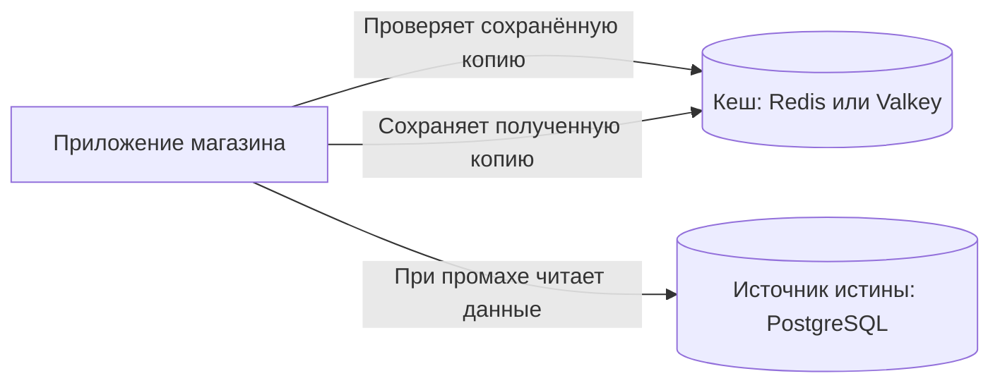
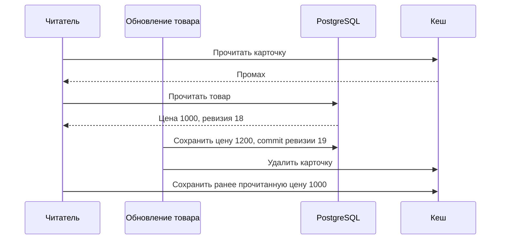

# 1. Место кеша в системе

## 1.1. Какие данные можно отдавать устаревшими

**Кеш — сохранённая копия данных или результата вычисления для ускорения повторных обращений.** Между изменением источника и обновлением копии кеш может возвращать прежнее значение.

**Допустимая устарелость — максимальное отставание данных, приемлемое для конкретного сценария.** Её определяют последствия ошибки, а не только частота обновлений.

| Данные и сценарий | Возможное требование |
|---|---|
| Описание товара в каталоге | Изменения могут появляться через несколько минут |
| Рейтинг товара | Допустимо обновление с задержкой |
| Предварительная цена на карточке | Возможна задержка, если оформление заказа предусматривает повторную проверку |
| Решение о резервировании последнего товара | Проверяется по авторитетному состоянию склада |
| Решение о повторном списании денег | Нельзя принимать только по потенциально устаревшей копии |

Это примеры продуктовых требований, а не универсальные сроки.

**TTL — Time To Live, срок жизни записи в кеше.** Например, TTL 60 секунд ограничивает время хранения записи после установки срока. Но он **не доказывает**, что данные отстают от источника максимум на 60 секунд: в кеш могли записать уже устаревший снимок. [Истечение срока в Redis](https://redis.io/docs/latest/commands/expire/)

Также не стоит автоматически продлевать жизнь старой копии при каждом чтении, если продукт ограничивает её возраст. Механизм хранения и требование к свежести нужно согласовать отдельно.

## 1.2. Кеш и источник истины

**Источник истины — система, чьи данные считаются авторитетными при расхождении копий.** Например, PostgreSQL хранит заказы, а Redis или Valkey — представление карточек товаров.

Распространённая схема — **cache-aside: приложение само читает кеш и заполняет его при отсутствии записи**.



Стрелки показывают обращения приложения; ответы и обновление исходных данных опущены.

**Cache hit — попадание:** пригодная запись найдена. **Cache miss — промах:** нужной записи нет. Сам cache-aside не гарантирует согласованность копии с источником. [Паттерн Cache-Aside](https://learn.microsoft.com/en-us/azure/architecture/patterns/cache-aside)

Проверка архитектуры: **если полностью потерять кеш, можно ли восстановить данные из других источников?** Для обычного кеша ответ должен быть положительным.

Если единственная копия корзины, платёжного результата или задания находится в Redis, он выполняет роль хранилища состояния, а не только кеша. Тогда нужны отдельные требования к сохранности и восстановлению.

Потеря кеша не должна уничтожать бизнес-данные, но может ухудшить доступность: источник истины не обязательно выдержит весь поток промахов.

## 1.3. Чтения, записи и рабочий набор

**Кеш полезен, когда сохранённый результат успевают повторно использовать и это дешевле повторного получения из источника.** Частые чтения редко меняющихся популярных товаров — хороший кандидат. Редкие запросы к постоянно меняющимся данным могут почти не выигрывать.

Оценивай:

- частоту чтений и изменений каждого типа данных;
- стоимость исходного запроса или вычисления;
- повторяемость ключей;
- ожидаемую долю попаданий;
- размер значений и число одновременно востребованных записей.

**Рабочий набор — данные, активно используемые за выбранный период.** Он может быть значительно меньше полного каталога.

Например, 100 000 популярных карточек по 2 КиБ — около 195 МиБ только содержимого. Дополнительно нужны память под ключи, служебные структуры и запас. Размер всего каталога для такой оценки недостаточен.

При ограничении памяти записи могут вытесняться раньше TTL. **Eviction — вытеснение записей**, определяемое выбранной политикой; некоторые настройки вместо вытеснения приводят к отказу новых записей. [Управление памятью Valkey](https://valkey.io/topics/lru-cache/)

Условно, при 1000 чтениях в секунду и 90% попаданий источник получает около 100 чтений. Это грубая оценка: обновления, повторные загрузки и конкурентные промахи добавляют работу. Проверяй также сценарий пустого кеша, когда доля попаданий близка к нулю.

## 1.4. Что продукт считает правильным ответом

**Корректность ответа определяется сценарием использования.** Одна и та же устаревшая цена может быть допустима в списке рекомендаций и неприемлема при подтверждении покупки.

Для каждого кешируемого представления зафиксируй:

| Вопрос | Пример решения |
|---|---|
| Что кешируем? | Предварительную цену товара в каталоге |
| Какое отставание допустимо? | До согласованного срока при штатной работе |
| Где нужна повторная проверка? | Перед подтверждением заказа |
| Что происходит при изменении цены? | Клиент видит новую сумму и подтверждает её |
| Что делать при недоступности кеша? | Читать источник в пределах допустимой нагрузки |
| Что делать, если свежий ответ получить нельзя? | Для оформления заказа вернуть понятную ошибку |

Например, карточка показывает 1000 рублей, а источник уже содержит 1200. Продукт должен заранее определить: действует показанная цена или требуется подтверждение новой. **Кеш не должен случайно выбирать бизнес-правило.**

Если допускается выдача старой копии при сбое источника, отдельно установи предельный возраст и способ обозначения устарелости. Для принятия критичных решений такая деградация может быть неприемлема.

**Запомнить:** сначала договорись о допустимой устарелости и правильном ответе, затем выбирай механизм кеширования; кеш должен ускорять восстановимые данные, а его потеря — иметь предусмотренные последствия.

# 2. Структуры данных

## 2.1. Выбор типа под задачу

**Тип данных определяет доступные операции и способ организации значения.** Выбирай его по тому, как приложение читает и изменяет данные.

| Тип | Что хранит | Пример для магазина | Ограничение |
|---|---|---|---|
| **String** | Последовательность байтов: текст, JSON, сериализованный объект | Готовая карточка товара | Для изменения поля JSON обычно нужно перезаписать значение |
| **Hash** | Набор пар «поле — значение» | Поля товара: название, цена, категория | Не является автоматически вложенным JSON-документом |
| **Set** | Неупорядоченные уникальные элементы | Идентификаторы товаров в подборке | Не хранит порядок и повторения |
| **Sorted set** | Уникальные элементы с числовым значением `score` | Рейтинг товаров, временное окно событий | Один элемент имеет один текущий `score` |
| **List** | Последовательность элементов с возможными повторениями | Последние просмотренные товары | Поиск произвольного элемента может требовать прохода по списку |
| **Stream** | Журнал записей с идентификаторами | Поток изменений для обработки | Требует управления сроком хранения и размером журнала |

Эти базовые структуры доступны в [Redis](https://redis.io/docs/latest/develop/data-types/) и [Valkey](https://valkey.io/topics/data-types/).

**Для готового ответа целиком string с JSON часто проще hash.** Hash полезнее, когда действительно нужны операции с отдельными полями.

Stream можно использовать для передачи изменений, но если в нём хранится единственная история событий, это уже обязанность хранилища, а не обычного восстановимого кеша.

## 2.2. Hash, set и sorted set на практике

**Hash представляет объект через отдельные поля.** Например:

```text
HSET catalog:product:42:v1 name "Кофе" price_cents 120000
HGET catalog:product:42:v1 price_cents
```

Значения полей возвращаются как байтовые строки: приложение должно знать, что `price_cents` интерпретируется как целое число. Hash сам не обеспечивает схему и бизнес-ограничения. [Hashes в Valkey](https://valkey.io/topics/hashes/)

**Set подходит для проверки членства:**

```text
SADD catalog:collection:summer:v1 42 57
SISMEMBER catalog:collection:summer:v1 42
```

Повторное добавление `42` не создаёт второй экземпляр. Такой набор удобен для ответа «входит ли товар в подборку», но порядок показа нужно определять отдельно.

**Sorted set поддерживает ранжирование по `score`.** Для рейтинга `member` может быть идентификатором товара, а `score` — числом продаж.

Для временного окна можно хранить:

```text
member = уникальный идентификатор события
score  = время события
```

Тогда доступны выборка и удаление элементов по диапазону времени. Это применяют, например, при ограничении числа запросов за последнюю минуту. [Sorted sets в Valkey](https://valkey.io/topics/sorted-sets/)

**Время в `score` не удаляет элемент автоматически.** Очистку старого диапазона нужно выполнять явно. TTL всего ключа не заменяет истечение отдельных элементов.

Если использовать один `member` для повторяющихся событий, новый `score` обновит прежний элемент вместо добавления события. А очистка, подсчёт и добавление при конкурентных запросах требуют согласованного выполнения: сам выбор структуры ещё не создаёт корректный ограничитель.

## 2.3. Схема имён ключей

**Схема ключей — договорённость, позволяющая определить владельца, содержимое и формат записи.**

Например:

```text
catalog:production:product:42:card:v2:locale:ru:currency:RUB
```

| Часть | Смысл |
|---|---|
| `catalog` | Сервис-владелец |
| `production` | Окружение |
| `product:42` | Сущность и идентификатор |
| `card` | Назначение представления |
| `v2` | Версия формата |
| `locale:ru`, `currency:RUB` | Параметры, влияющие на результат |

Двоеточие — соглашение приложения, а не автоматическая иерархия или изоляция доступа. [Имена ключей Redis](https://redis.io/docs/latest/develop/using-commands/keyspace/)

**Версия формата и версия данных различаются.** `v2` может означать новую структуру JSON, но не делает цену товара актуальной. Для изменений данных нужны отдельные правила обновления или инвалидации.

В Ruby сборку ключей удобно централизовать:

```ruby
key = [
  "catalog", Rails.env, "product", product.id,
  "card", "v2", "locale", I18n.locale,
  "currency", currency
].join(":")
```

Здесь `currency` — код валюты, подготовленный приложением. Произвольные значения нужно нормализовать и однозначно кодировать, чтобы разделители не создавали коллизии.

При смене версии старые ключи продолжают занимать память до удаления или истечения срока.

## 2.4. Размер значения и контекст доступа

**Ограничивай как размер сериализованного значения, так и число элементов коллекции.** Один небольшой элемент не мешает set или stream вырасти до огромного размера.

Например, команда может установить прикладной лимит 100 КиБ на карточку товара. Это условный бюджет: его выбирают по измеренным задержкам, расходу памяти и нагрузке. При превышении можно пропустить кеширование, сократить представление или разделить его на независимо читаемые части.

**Redis hash и Ruby Hash в `Rails.cache` — разные уровни.** Rails кеширует сериализуемое значение; передача Ruby Hash сама по себе не означает использование нативной структуры Redis hash. [Низкоуровневое кеширование Rails](https://guides.rubyonrails.org/caching_with_rails.html#low-level-caching-using-rails-cache)

Если ответ зависит от пользователя, ключ должен учитывать контекст, влияющий на его содержимое: организацию, пользователя, полномочия, локаль и другие параметры.

Однако **`user_id` в ключе не заменяет авторизацию**. Проверку доступа выполняют и при попадании в кеш. Нельзя помещать её только внутрь блока `Rails.cache.fetch`: при попадании блок не исполняется.

Изменение прав требует актуальной проверки и пересмотра зависимых записей. Часто проще кешировать общие данные, а доступ и персональное представление формировать отдельно.

**Запомнить:** выбирай структуру под операции, ключ — под все зависимости результата, а размер и доступ ограничивай явно; тип данных сам не обеспечивает корректность кеша.

# 3. Стратегии чтения и записи

## 3.1. Cache-aside: приложение управляет кешем

**Cache-aside — стратегия, при которой приложение сначала проверяет кеш, а при промахе самостоятельно читает источник истины и сохраняет полученную копию.**

Путь чтения:

1. Найти запись в кеше.
2. При попадании вернуть сохранённое значение.
3. При промахе прочитать PostgreSQL.
4. Сохранить результат в кеше с согласованным сроком жизни.
5. Вернуть данные клиенту.

Пример для публичной карточки товара в Rails:

```ruby
key = "catalog:#{Rails.env}:product:#{product_id}:card:v1"

Rails.cache.fetch(key, expires_in: 5.minutes) do
  product = Product.find(product_id)
  { id: product.id, name: product.name, price_cents: product.price_cents }
end
```

Предполагается, что `Rails.cache` настроен на нужное хранилище, а карточка одинакова для всех пользователей. Пять минут — условный срок, допустимый для этого представления. Блок `fetch` выполняется только при промахе. [Кеширование Rails](https://guides.rubyonrails.org/caching_with_rails.html#low-level-caching-using-rails-cache)

**При изменении данных сначала фиксируют запись в БД, затем инвалидируют — делают непригодной — соответствующую копию.** Следующее чтение заполнит кеш заново. [Cache-Aside](https://learn.microsoft.com/en-us/azure/architecture/patterns/cache-aside)

Ограничение: кеш и БД могут временно расходиться. Например, читатель получил старое значение из БД, запись обновилась и кеш удалили, после чего читатель снова положил старое значение. Порядок «БД → удаление кеша» полезен, но не устраняет все гонки.

## 3.2. Write-through и write-behind

Эти стратегии описывают **путь записи**, поэтому их сравнение начинается с вопроса: что уже произошло к моменту подтверждения клиенту?

| Стратегия | Момент успешного подтверждения | Преимущество | Цена |
|---|---|---|---|
| **Write-through — сквозная запись** | Запись синхронно выполнена в БД и кеше | Кеш обновляется сразу при записи | Ожидание обеих систем и обработка частичных сбоев |
| **Write-behind / write-back — отложенная запись** | Изменение принято кеширующим слоем, БД обновляется позднее | Можно сократить задержку ответа и объединять записи в пакеты | Отставание БД и ответственность за ещё не перенесённые изменения |

Такое различие описано в [обзоре архитектуры кеширования Redis](https://redis.io/blog/cache-layer-architecture-guide/).

**Write-through не создаёт общую транзакцию PostgreSQL и Redis.** Если БД обновилась, а обновление кеша завершилось ошибкой, изменение в БД не откатывается автоматически. Нужны правила восстановления, инвалидации и безопасного повтора. Конкурентные записи также могут поступить в кеш в неправильном порядке.

**Write-behind меняет требования к сохранности:** до переноса в БД подтверждённое изменение должно где-то надёжно храниться. Если оно существует только в памяти и теряется при сбое, клиент может потерять уже подтверждённую запись.

Нужны контроль отставания, повторы, порядок изменений и защита от вытеснения ещё не сохранённых данных. Для заказов и платежей это значительно сложнее обычного кеширования.

Это стратегии интеграционного слоя: обычная команда записи в Redis или Valkey сама по себе не обновляет PostgreSQL.

## 3.3. Cache-aside как базовый вариант для PostgreSQL

**Если PostgreSQL остаётся источником истины, cache-aside обычно является удобной отправной точкой:** бизнес-запись сохраняется привычной транзакцией, а кеш содержит восстановимые представления.

Он особенно полезен, когда:

- одни и те же данные читаются многократно;
- исходное чтение или вычисление достаточно дорого;
- допустима явно ограниченная устарелость;
- кешировать весь набор данных не требуется.

Например, карточку товара можно загружать по запросу. Непопулярные товары не занимают память, пока их не прочитали.

**Выбор стратегии зависит от требований.** Если данные постоянно меняются, почти не переиспользуются или требуют немедленной свежести, кеш может добавить обращения и сложность без заметного выигрыша.

Промах обычно дороже прямого чтения: приложение сначала обращается к кешу, затем к БД и заполняет кеш. При множестве одновременных промахов нагрузка на PostgreSQL возрастает.

При недоступности кеша можно предусмотреть чтение БД, но с ограничением нагрузки: возможность восстановить данные не означает, что источник выдержит весь поток запросов. Для подтверждения цены, резервирования или другого критичного действия проверяй авторитетное состояние, даже если экран использует кеш.

## 3.4. Один источник истины вместо независимой двойной записи

**Dual write — двойная запись в разные системы без общей гарантии завершения.** Проблема возникает, когда приложение независимо сохраняет одно бизнес-изменение в PostgreSQL и кеше.

Возможные последствия:

| Частичный результат | Что видит система |
|---|---|
| Кеш обновлён, транзакция БД откатилась | Читатель получает изменение, которого нет в источнике |
| БД обновлена, кеш остался старым | Читатель получает прежнее состояние |
| Более старая запись пришла в кеш позднее новой | Копия возвращается к предыдущей версии |

**Назначь PostgreSQL авторитетным владельцем данных, а обновление кеша — производным действием.** Успех бизнес-команды и успех обновления кеша должны различаться.

Когда простого удаления после commit недостаточно по надёжности доставки, можно применить **transactional outbox**: изменение и задание на инвалидацию сохраняются одной транзакцией PostgreSQL, затем обработчик выполняет задание с повторами. Это применение паттерна надёжной передачи изменений. [Transactional Outbox](https://docs.aws.amazon.com/prescriptive-guidance/latest/cloud-design-patterns/transactional-outbox.html)

Outbox закрывает потерю задания между commit и отправкой, но не делает кеш мгновенно согласованным и не устраняет гонки заполнения. Повторная инвалидация должна быть безопасной; для обновления значениями может понадобиться контроль версий.

**Запомнить:** для PostgreSQL начни с cache-aside; write-through требует обработки частичных сбоев, write-behind — сохранности неподтверждённых БД изменений, а кеш должен оставаться управляемой копией.

# 4. TTL и защита от лавины

## 4.1. TTL по допустимой устарелости

**TTL — Time To Live, срок жизни записи в кеше.** Его выбирают по требованиям к свежести конкретных данных и последствиям выдачи старого значения.

При выборе учитывай:

- сколько времени продукт допускает устаревший ответ;
- как быстро меняются исходные данные;
- сколько стоит загрузка или пересчёт;
- насколько часто результат используется повторно;
- есть ли инвалидация при изменении источника.

**Истечение TTL не обновляет данные автоматически.** При cache-aside следующий читатель обнаруживает промах и выполняет загрузку. В Redis срок задаётся для ключа; обычное чтение само по себе его не продлевает. [EXPIRE](https://redis.io/docs/latest/commands/expire/)

Например, описание товара может храниться несколько минут, а предварительный остаток — несколько секунд. При резервировании товара всё равно проверяют источник истины.

**TTL не равен гарантированному возрасту данных:** запись могла быть построена из уже отставшей реплики или долго выполнявшегося запроса. Для строгого ограничения свежести учитывай время исходного снимка, а не только момент записи в кеш.

Одинаковый TTL для всех ключей удобен технически, но скрывает разные требования к данным.

## 4.2. Случайный разброс TTL

**Jitter — случайный разброс срока жизни**, уменьшающий вероятность одновременного истечения большого количества ключей.

Допустим, после загрузки каталога приложение создало 100 000 записей с TTL ровно пять минут. Через пять минут многие из них могут одновременно потребовать обращения к PostgreSQL.

В Ruby можно выбирать срок при каждом заполнении:

```ruby
ttl_seconds = rand(240..300)
```

Получается диапазон от четырёх до пяти минут. Если пять минут — верхняя граница выбранного TTL, такой разброс её не превышает. Вариант `300 + rand(60)` уже увеличивал бы срок до шести минут.

**Разброс назначай при записи, а не пересчитывай и продлевай при каждом чтении.** Иначе популярная старая копия может сохраняться дольше предусмотренного.

Jitter распределяет обновления **разных ключей**, но не решает проблему одного очень популярного ключа. Тысяча читателей одной истёкшей карточки всё ещё может одновременно обратиться к БД.

Также разброс TTL не защищает от массового удаления кеша или запуска системы с полностью пустым кешем.

## 4.3. Cache stampede: один ключ, много пересчётов

**Cache stampede — лавина повторных загрузок одного значения:** запись исчезла, множество запросов одновременно получили промах и начали одинаковую дорогую работу.

Если карточка запрашивается 1000 раз в секунду, а пересчёт занимает 200 мс, до появления результата может начаться около 200 загрузок. Это условная оценка без защиты и очередей.

| Механизм | Идея | Ограничение |
|---|---|---|
| **Блокировка пересчёта** | Один участник получает право обновлять конкретный ключ | Нужно обработать истечение блокировки, ошибки и ожидание остальных |
| **Singleflight** | Одновременные обращения по одному ключу разделяют результат одного вычисления | Локальная реализация объединяет запросы только внутри процесса |
| **Вероятностное раннее обновление** | Некоторые обращения запускают обновление до истечения записи | Не гарантирует ровно один пересчёт |

При блокировке сначала получают право обновления, затем **повторно проверяют кеш**: другой участник мог уже заполнить его. Остальные ограниченно ждут, используют допустимую старую копию или получают предусмотренную ошибку — массовый обход блокировки снова создаст лавину.

У блокировки нужен срок действия и уникальный токен владельца. Освобождение выполняют атомарно с проверкой токена: простой `DEL` может удалить уже чужую блокировку. Если пересчёт пережил срок блокировки, вычисления снова могут идти параллельно; для защиты от записи старого результата может понадобиться контроль версии. [Блокировки Redis](https://redis.io/docs/latest/develop/clients/patterns/distributed-locks/)

**Singleflight объединяет выполняющиеся обращения, а не хранит результат навсегда.** В нескольких процессах Rails локальное объединение допускает по одному пересчёту в каждом процессе. Принцип показан в [официальной реализации Go singleflight](https://pkg.go.dev/golang.org/x/sync/singleflight).

При раннем обновлении вероятность запуска обычно увеличивают по мере приближения срока. Старое ещё допустимое значение продолжает обслуживать читателей. Возможны повторные пересчёты или отсутствие обновления до истечения — это вероятностная защита. [Разбор Cloudflare](https://blog.cloudflare.com/sometimes-i-cache/)

В Rails `race_condition_ttl` позволяет ненадолго переиспользовать недавно истёкшее значение во время обновления. Это дополнительная допустимая устарелость, а не универсальная блокировка и не защита первоначально пустого ключа. [Rails Cache Store](https://api.rubyonrails.org/classes/ActiveSupport/Cache/Store.html#method-i-fetch)

## 4.4. Короткие и длинные сроки

**Частота изменений — ориентир, но окончательное решение задаёт допустимая устарелость.**

| Данные | Возможный подход |
|---|---|
| Предварительный остаток товара | Короткий TTL, проверка источника при резервировании |
| Карточка товара | Умеренный TTL и инвалидация при изменениях |
| Справочник категорий | Более длинный TTL, если задержка обновления допустима |

Конкретные значения определяются продуктом и измерениями.

Слишком короткий TTL увеличивает промахи и нагрузку. Если значение почти не успевают повторно использовать, кеширование может быть невыгодным. Слишком длинный TTL увеличивает последствия пропущенной инвалидации.

**Срок блокировки пересчёта и TTL данных — разные параметры.** Первый связан с длительностью работы и восстановлением после сбоя, второй — со свежестью ответа.

Для дорогих популярных значений короткий TTL обычно требует защиты пересчёта. Для редко читаемого справочника сложное вероятностное обновление может быть избыточно.

**Запомнить:** TTL ограничивает жизнь копии, jitter распределяет истечения разных ключей, а блокировки, singleflight и раннее обновление уменьшают лавину пересчётов одного значения.

# 5. Инвалидация

## 5.1. Изменение источника и кеша в одном сценарии

**Инвалидация — действие, после которого устаревшая копия больше не должна использоваться:** удаление записи, замена значения или переключение на новую версию ключа.

Связывай её со всеми операциями, меняющими исходные данные. Например, изменение товара затрагивает карточку, списки каталога и поисковые подборки.

**«В той же операции» означает единый сценарий приложения, а не общую транзакцию PostgreSQL и Redis.** При cache-aside сначала фиксируют изменение БД, затем удаляют зависимый кеш. Если удалить его до commit, другой запрос может снова заполнить ключ прежними данными. [Cache-Aside](https://learn.microsoft.com/en-us/azure/architecture/patterns/cache-aside)

Простой пример Rails для одного ключа:

```ruby
class Product < ApplicationRecord
  after_commit :expire_card

  private

  def expire_card
    Rails.cache.delete("catalog:#{Rails.env}:product:#{id}:card:v1")
  end
end
```

`after_commit` выполняется после успешной фиксации транзакции. Пример предполагает единую схему ключей; остальные зависимые представления и обработка ошибок здесь опущены. Массовые операции вроде `update_all` обходят callbacks — для них инвалидацию нужно предусмотреть отдельно. [Транзакционные callbacks Rails](https://guides.rubyonrails.org/active_record_callbacks.html#transaction-callbacks)

**Сбой удаления не отменяет уже сохранённое изменение.** Если потеря задания недопустима, сохраняй его через outbox в одной транзакции с данными, затем выполняй с повторами. Это обеспечивает восстановление доставки задания, но не мгновенную свежесть кеша. [Transactional Outbox](https://docs.aws.amazon.com/prescriptive-guidance/latest/cloud-design-patterns/transactional-outbox.html)

## 5.2. Версионирование зависимых записей

**Версионирование ключа делает старые записи недостижимыми для новых чтений**, не требуя найти и удалить каждую копию.

Например:

```text
catalog:product:42:card:v2:r18
catalog:product:42:card:v2:r19
```

Здесь:

- `v2` — версия формата представления;
- `r18` и `r19` — ревизии исходных данных.

После изменения товара новые чтения используют `r19`. Записи `r18` остаются до удаления или истечения TTL.

В Rails `cache_key_with_version` включает идентификатор записи и её `updated_at`. Это удобно, если все значимые изменения действительно обновляют эту отметку. [Версионирование ключей Rails](https://guides.rubyonrails.org/caching_with_rails.html#low-level-caching-using-rails-cache)

**Версия должна учитывать все зависимости результата.** Изменение категории или скидки может поменять карточку без обновления самого товара. Тогда нужны дополнительные версии либо явная инвалидация.

Для множества списков иногда используют общую ревизию каталога. Это проще точечного удаления, но обесценивает сразу много записей и увеличивает число промахов.

Чтобы обеспечить свежесть, актуальную ревизию нужно получать надёжно. Если указатель на неё сам устарел в кеше, старые ключи продолжат использоваться. Данные и ревизия, которыми заполняют запись, должны соответствовать одному согласованному состоянию.

## 5.3. Гонка: старое значение возвращается после удаления

**Гонка заполнения возникает, когда читатель сохраняет ранее прочитанное значение уже после инвалидации.**



Границы примера: используется один постоянный ключ без проверки версии. После завершения сценария кеш снова содержит старую цену.

**Успешный `DELETE` не доказывает, что следующий ответ будет свежим.**

Возможные защиты:

| Подход | Что требуется |
|---|---|
| Ключи с ревизией | Старый читатель пишет в `r18`, новые чтения выбирают `r19` |
| Контроль версии при записи | Сохранение актуальной ревизии и атомарный отказ принять более старое значение |
| Согласованная блокировка | Единый протокол для изменения источника и заполнения кеша |

Блокировка только между читателями подавляет лавину пересчётов, но не обязательно координирует их с обновлением БД.

TTL ограничивает жизнь ошибочно сохранённой копии, **но не обеспечивает немедленную свежесть**. Для некритичной карточки временная устарелость может быть допустима; для другого API потребуется более строгий механизм.

## 5.4. Проверка поведения API после записи

**Проверяй пользовательскую гарантию, а не только вызов метода удаления.** Если обещано чтение собственной записи, запрос, начатый после подтверждения изменения, должен получить состояние не старее подтверждённой ревизии.

Для теста изменения цены с 1000 на 1200 нужны разные сценарии:

| Сценарий | Что проверить |
|---|---|
| До записи кеш содержит 1000 | Последующий GET возвращает 1200 |
| После записи кеш пуст | Промах загружает 1200 из источника |
| Первый GET уже заполнил кеш | Повторный GET при попадании возвращает 1200 |
| Транзакция откатилась | Несохранённое значение не появляется в ответе |
| Старый читатель завершился после инвалидации | Новое чтение не возвращается к прежней ревизии |

Гонку воспроизводи управляемой остановкой между чтением БД и заполнением кеша, а не случайными задержками.

**Проверка только ответа PATCH недостаточна:** он может использовать обновлённый объект, тогда как отдельный GET читает старый кеш.

Если инвалидация асинхронна, строгую гарантию обеспечивают отдельно: например, минимальной ожидаемой ревизией с обходом кеша. Учитывай и чтение отстающей реплики БД — промах сам по себе не гарантирует актуальности.

**Запомнить:** связывай инвалидацию с изменением источника, учитывай все зависимости и проверяй гонки; удаление ключа само по себе не гарантирует свежий ответ.

# 6. Недоступность кеша

## 6.1. Таймауты и ограничение ожидания

**Таймаут ограничивает время ожидания конкретного этапа обращения.** Для кеша важны отдельные ограничения соединения, отправки команды и получения ответа.

Пример настройки Rails:

```ruby
config.cache_store = :redis_cache_store, {
  url: ENV.fetch("REDIS_URL"),
  connect_timeout: 0.05,
  read_timeout: 0.05,
  write_timeout: 0.05,
  reconnect_attempts: 0,
  pool: { size: 5, timeout: 0.05 }
}
```

Значения таймаутов указаны в секундах. Это учебный пример для сети с небольшой задержкой; размер пула и сроки выбирают по измерениям и бюджету запроса. Настройки поддерживаются [RedisCacheStore](https://api.rubyonrails.org/classes/ActiveSupport/Cache/RedisCacheStore.html), повторы соединения описаны в [redis-rb](https://github.com/redis/redis-rb#reconnections).

**Таймаут команды не ограничивает ожидание свободного соединения в пуле:** для него нужен отдельный срок. Суммарную задержку также увеличивают несколько команд и автоматические повторы.

Пока поток Rails ждёт кеш, он занят и не обслуживает другой запрос. При массовом сбое даже короткие ожидания могут исчерпать рабочие потоки. Учитывай общий бюджет запроса и избегай удержания транзакции БД во время необязательных обращений к кешу.

Слишком маленький таймаут тоже вреден: исправный, но немного замедлившийся кеш будет ошибочно считаться недоступным.

## 6.2. Чтение источника при ошибке

**Fallback — запасной путь выполнения:** если кеш недоступен, приложение читает PostgreSQL и возвращает результат, если для этого достаточно ресурсов.

Различай обычный промах и сбой:

| Ситуация | Поведение |
|---|---|
| Ключ отсутствует, кеш исправен | Прочитать БД и заполнить кеш |
| Кеш недоступен | Прочитать БД в пределах установленного лимита |
| БД вернула ошибку | Вернуть предусмотренную ошибку, не выдавать её за данные |
| Кеш продолжает сбоить | Временно обходить обращения к нему |

**После сбоя чтения необязательно сразу пытаться записать результат обратно.** Такая попытка может добавить ещё один таймаут, переподключение и нагрузку. Данные, успешно прочитанные из БД, остаются пригодными для ответа клиенту — пропускается именно заполнение кеша.

Rails `RedisCacheStore` обрабатывает сетевые ошибки обычного чтения как промахи, а неуспешные записи отбрасывает. Но `fetch` после выполнения блока может всё равно **попытаться** записать результат. Чтобы избежать этой попытки, нужна отдельная политика обхода кеша. Ошибки следует учитывать через `error_handler`, поскольку они могут не доходить до внешнего `rescue`. [Поведение Rails при сбоях](https://guides.rubyonrails.org/caching_with_rails.html#activesupport-cache-rediscachestore)

**Circuit breaker — автоматический выключатель обращений:** после серии ошибок он временно пропускает кеш, затем разрешает ограниченные проверочные обращения. Это уменьшает повторные ожидания, но не защищает PostgreSQL от выросшего потока. [Circuit Breaker](https://learn.microsoft.com/en-us/azure/architecture/patterns/circuit-breaker)

## 6.3. Ограничение нагрузки на PostgreSQL

**Массовый обход кеша превращает попадания в дополнительные чтения БД.** Если обычно из 1000 запросов в секунду до PostgreSQL доходили 100, при полном отказе кеша поток может приблизиться к 1000.

Такой переход способен вызвать каскадный отказ: растёт время запросов, занятые соединения накапливаются, новые обращения ждут ещё дольше. [Риски зависимости от кеша](https://aws.amazon.com/builders-library/caching-challenges-and-strategies/)

Используй несколько ограничений:

- **Лимит параллелизма:** отдельное число одновременно выполняемых fallback-чтений.
- **Ограниченную очередь:** ожидание допускается только в пределах бюджета запроса.
- **Ограничение частоты:** защита от слишком большого числа коротких запросов.
- **Singleflight:** объединение одновременных загрузок одного ключа.
- **Приоритеты:** ресурсы для оформления заказа защищены от необязательных рекомендаций.

Это применение **bulkhead — изоляции ресурсов**, ограничивающей распространение отказа. [Bulkhead](https://learn.microsoft.com/en-us/azure/architecture/patterns/bulkhead)

**Локальный лимит умножается на количество экземпляров приложения.** Пять fallback-чтений в каждом из двадцати процессов допускают до ста одновременных обращений. Общий предел выбирают с учётом обычной нагрузки на БД.

Пул соединений ограничивает соединения, но без ограничения очереди приложение всё ещё может накопить множество ожидающих запросов. При исчерпании бюджета лучше быстро вернуть согласованную ошибку, чем создавать неограниченное ожидание.

## 6.4. Договорённость о деградации

**Деградация — заранее определённое сокращение функциональности или производительности при сбое.** Она должна сохранять корректность бизнес-операций.

| Операция | Возможное поведение |
|---|---|
| Карточка товара | Чтение БД с ограничением нагрузки |
| Персональные рекомендации | Пропуск блока или упрощённая подборка |
| Оформление заказа | Работа через авторитетные данные и обычные проверки |
| Операция, которой не хватило ресурсов | Понятная временная ошибка |
| Изменение данных при недоступной инвалидации | Фиксация в БД и предусмотренное восстановление инвалидации |

Последняя строка требует отдельного решения: если API обещает свежесть после записи, чтение должно обходить потенциально старый кеш или проверять ревизию. Возвращение кеша в строй само по себе не исправляет пропущенные инвалидации.

Зафиксируй измеримые пределы: допустимые чтения в секунду, параллелизм, задержку и долю отказов. Значения подтверждай нагрузочным испытанием с отключённым кешем.

Наблюдай ошибки кеша, fallback-чтения, ожидание соединений и задержки PostgreSQL. После восстановления возвращай заполнение постепенно, чтобы одновременный прогрев не создал новую лавину.

**Запомнить:** короткий таймаут ограничивает ожидание, fallback сохраняет часть функциональности, а лимиты и явная деградация защищают источник истины от массового обхода кеша.

# 7. Память и вытеснение

## 7.1. Maxmemory и выбор политики

**`maxmemory` — лимит памяти, используемый Redis или Valkey при принятии решений о вытеснении.** Когда лимит достигнут, поведение определяется настройкой `maxmemory-policy`.

Пример конфигурации отдельного экземпляра для восстановимого кеша:

```text
maxmemory 512mb
maxmemory-policy allkeys-lfu
```

Это условный размер, а не рекомендация для любого сервера. Политика `allkeys-lfu` старается сохранять часто используемые ключи. Для другой нагрузки может лучше подойти LRU — выбор по давности последнего обращения. [Настройки Redis](https://redis.io/docs/latest/develop/reference/eviction/)

**Политику выбирают по назначению данных и характеру обращений, а не по типу `string` или `hash`.** Для карточек товаров потеря копии допустима; для необработанных заданий такое вытеснение может означать потерю работы.

`maxmemory` не является жёстким пределом всей памяти процесса. Нужен запас под служебные расходы, фрагментацию, буферы и пики фоновых операций. Часть памяти буферов репликации и **AOF — журнала сохраняемых операций** — не учитывается при проверке лимита вытеснения. [Память и буферы Valkey](https://valkey.io/topics/lru-cache/)

Учитывай лимит контейнера или виртуальной машины: процесс может исчерпать доступную память, даже если выбранное значение `maxmemory` выглядит допустимым.

## 7.2. Истечение TTL и вытеснение ключей

**Expiration — удаление по истечении TTL. Eviction — вытеснение ради освобождения памяти.** Запись с TTL десять минут может быть вытеснена уже через минуту.

| Политика | Какие ключи рассматриваются | Принцип выбора |
|---|---|---|
| `allkeys-lru` | Любые | Давно не использовавшиеся |
| `allkeys-lfu` | Любые | Редко использовавшиеся |
| `volatile-lru` | Только имеющие TTL | Давно не использовавшиеся |
| `volatile-lfu` | Только имеющие TTL | Редко использовавшиеся |
| `volatile-ttl` | Только имеющие TTL | С ближайшим сроком истечения |
| `noeviction` | Вытеснение отключено | При нехватке памяти ограничиваются команды записи |

**`volatile-lru` не выбирает по оставшемуся TTL:** наличие TTL определяет кандидатов, а давность обращения — выбор среди них. Именно `volatile-ttl` учитывает близость истечения.

Если подходящих ключей с TTL нет, политики `volatile-*` ведут себя подобно `noeviction`: освобождать память таким способом не из чего. Чтения продолжают работать, но запись, требующая памяти, может завершиться ошибкой. [Политики Valkey](https://valkey.io/topics/lru-cache/)

`noeviction` не отключает обычное истечение TTL. А политики LRU/LFU используют приближённые алгоритмы и не гарантируют идеального выбора.

Вытеснение ключа удаляет его значение целиком: например, весь большой hash или list. Поэтому размер коллекций нужно ограничивать отдельно.

## 7.3. Вытеснения, фрагментация и попадания

**Наблюдаемость памяти должна показывать и расход ресурсов, и последствия для приложения.** Начальные сведения доступны командами:

```text
INFO memory
INFO stats
```

| Показатель | Что означает |
|---|---|
| `used_memory` | Память, выделенная внутренним аллокатором |
| `used_memory_rss` | Резидентная память процесса по данным ОС |
| `evicted_keys` | Число ключей, вытесненных из-за ограничения памяти |
| `expired_keys` | Число истечений ключей |
| `keyspace_hits`, `keyspace_misses` | Успешные и неуспешные поиски ключей |

Описание полей приведено в [INFO Valkey](https://valkey.io/commands/info/).

**Hit ratio — доля попаданий.** Для выбранного интервала её оценивают по приращениям счётчиков:

```text
hit ratio = Δhits / (Δhits + Δmisses)
```

Если обращений не было, показатель не вычисляется. Учитывай перезапуски и сбросы счётчиков. Дополнительно измеряй попадания на уровне приложения: локальный кеш Rails и правила пригодности записи могут давать другую картину, чем серверные поиски ключей.

**Фрагментация — неэффективное использование выделенных страниц памяти.** `mem_fragmentation_ratio` сравнивает RSS с `used_memory`, но включает также другие расходы процесса. Для уточнения смотри `allocator_frag_ratio` и абсолютные значения в байтах. Высокий коэффициент при нескольких лишних мегабайтах не обязательно означает проблему. [Показатели памяти Redis](https://redis.io/docs/latest/commands/info/)

Оценивай скорость роста вытеснений вместе с попаданиями, задержками и нагрузкой на PostgreSQL. Вытеснения ожидаемы в ограниченном кеше; проблема возникает, когда они вызывают постоянный пересчёт нужных данных и перегружают источник.

## 7.4. Кеш, очередь и постоянные данные

**Совместное размещение разных обязанностей требует отдельного архитектурного решения.** У кеша и очереди различаются допустимые последствия потери записи.

| Обязанность | Требование |
|---|---|
| Кеш карточек товаров | Значения можно вытеснить и восстановить |
| Очередь обработки заказов | Нельзя незаметно потерять необработанные задания |
| Постоянное состояние | Нужны определённые гарантии сохранности и восстановления |

При `allkeys-*` ключ очереди тоже может стать кандидатом на вытеснение. При `volatile-*` постоянные ключи защищены от такого выбора, но способны занять память и вызвать отказы записи кеша или новых заданий.

**Префиксы и разные логические БД одного экземпляра не создают независимых бюджетов памяти и политик вытеснения.** Сохранение на диск также не отменяет выбранную политику удаления ключей.

Практичный исходный вариант — отдельные экземпляры с собственными лимитами, настройками сохранности и мониторингом. Rails прямо рекомендует отделять Redis-кеш от экземпляра с постоянными данными, например очередью задач. [RedisCacheStore](https://api.rubyonrails.org/classes/ActiveSupport/Cache/RedisCacheStore.html)

Если совместное размещение необходимо, зафиксируй бюджет каждой нагрузки, поведение при переполнении, гарантии очереди и проверки восстановления. Одной договорённости об именах ключей недостаточно.

**Запомнить:** TTL управляет сроком жизни, политика вытеснения — нехваткой памяти; контролируй реальные расходы и попадания, а потеряемый кеш отделяй от данных, которые терять нельзя.

# 8. Наблюдаемость

## 8.1. Метрики кеша и приложения

**Наблюдаемость кеша — возможность понять, ускоряет ли он запросы, почему возникают промахи и как сбои влияют на сервис.** Нужны измерения сервера и клиентского пути приложения.

| Показатель | Что измерять |
|---|---|
| Доля попаданий — hit ratio | Попадания среди успешных проверок кеша |
| Задержка | p50, p95, p99 обращений приложения |
| Ошибки | Таймауты, ошибки соединения, отказы команд |
| Вытеснения | Скорость роста `evicted_keys` |
| Память | `used_memory`, RSS, запас до лимитов |
| Обход кеша | Число запросов, выполняемых без обращения к кешу |

**p95 — задержка, в которую укладываются 95% измерений.** Клиентское время включает ожидание соединения и сеть; серверное выполнение команды — только часть этого пути. Среднее время из серверной статистики не заменяет клиентские процентили.

Redis и Valkey предоставляют сведения через секции `INFO`, включая `memory`, `stats`, `commandstats` и `latencystats`. [INFO Redis](https://redis.io/docs/latest/commands/info/), [INFO Valkey](https://valkey.io/commands/info/)

Серверную долю попаданий рассчитывают по приращениям:

```text
hit ratio = Δkeyspace_hits /
            (Δkeyspace_hits + Δkeyspace_misses)
```

При отсутствии обращений значение не определено. Учитывай сбросы счётчиков; для нескольких узлов суммируй попадания и промахи, а не усредняй готовые проценты.

**В приложении различай `hit`, `miss`, `error` и `bypass` — намеренный обход.** Ошибка Redis, превращённая библиотекой в промах, не должна исчезать из статистики ошибок.

Разделяй метрики по назначению кеша, например `product_card` и `catalog_list`. Полный ключ или идентификатор пользователя создадут слишком много временных рядов. Попадание также не доказывает свежесть данных.

## 8.2. Причины промахов

**Отсутствующий ключ сам по себе не объясняет причину исчезновения.** Обычный ответ «не найдено» не сообщает, был ли ключ удалён, вытеснен или никогда не существовал.

| Наблюдение | Возможное объяснение |
|---|---|
| Растёт `expired_keys` | Истечение TTL |
| Растёт число инвалидаций приложения | Удаление или смена версии после изменений |
| Растёт `evicted_keys` | Давление на память |
| Новый формат ключей или запуск сервиса | Холодный кеш, ещё не выполненное заполнение |
| Ошибки сохранения | Значения не попадают в кеш после загрузки |

**Эти сигналы помогают объяснить общую картину, но не доказывают причину каждого промаха.** Несколько механизмов могут работать одновременно.

Регистрируй в приложении инвалидации, успешность заполнения и смену поколений ключей. Если точной причины нет, используй категорию «неизвестно», а не выдумывай классификацию.

Для диагностики Redis поддерживает **keyspace notifications — уведомления об изменениях ключей**, включая удаления, истечения и вытеснения. Они требуют включения и используют Pub/Sub: при разрыве соединения события теряются. Поэтому это дополнительный диагностический источник, а не надёжный журнал всех причин. [Уведомления Redis](https://redis.io/docs/latest/develop/pubsub/keyspace-notifications/)

Отдельно отслеживай логическое истечение записи в библиотеке: приложение может считать значение просроченным, хотя сервер ещё хранит его.

## 8.3. Алерты на проблемы

**Алерт — сигнал о ситуации, требующей действия.** Порог должен учитывать обычную нагрузку, продолжительность отклонения и последствия для пользователей.

| Сигнал | Что проверять |
|---|---|
| Кеш недоступен из приложения | Ошибки реальных обращений, проверочные запросы, состояние circuit breaker |
| Растёт доля ошибок | Тип ошибок, число попыток и устойчивость роста |
| Падает hit ratio | Достаточный объём чтений, прогрев, изменения ключей и TTL |
| Растут вытеснения | Одновременно ли растут промахи и обращения к БД |
| Заканчивается память | Запас процесса и контейнера, отказы записи, динамика расхода |

Например, снижение попаданий после выкладки может быть ожидаемым прогревом. Такое же снижение вместе с ростом задержки PostgreSQL требует другой реакции.

**Не назначай универсальный порог вроде «hit ratio ниже 90% — авария».** Для редко переиспользуемых данных обычное значение может быть ниже; для дорогого популярного представления даже небольшое падение существенно.

Учитывай отсутствие телеметрии: пропавшие метрики не означают нулевые ошибки. Когда circuit breaker отключил обращения, ошибки могут прекратиться, хотя кеш всё ещё недоступен. Поэтому наблюдай также обход кеша и состояние выключателя.

У каждого сигнала должны быть владелец и понятные первые действия: проверить доступность, память, последние изменения и нагрузку источника.

## 8.4. Связь с нагрузкой PostgreSQL

**Польза кеша проявляется в уменьшении работы источника истины.** Смотри показатели кеша и БД на общей временной шкале.

При 1000 чтениях карточек в секунду и 95% попаданий до БД условно доходят 50 запросов. При полном обходе поток может приблизиться к 1000 — двадцатикратный рост до применения ограничений нагрузки.

Сопоставляй:

- входящий поток API;
- попадания, промахи, ошибки и fallback-чтения;
- частоту соответствующих `SELECT`;
- задержку SQL, ожидание соединений, CPU и ввод-вывод БД;
- задержки и ошибки пользовательских запросов.

Для частоты конкретных SQL полезны приращения `calls` в заранее включённом `pg_stat_statements`. Там же доступны показатели времени и обращений к блокам. [pg_stat_statements](https://www.postgresql.org/docs/current/pgstatstatements.html)

**Рост SQL-чтений не обязательно вызывает такой же рост физических чтений диска:** данные могут находиться в буферах PostgreSQL.

Проверяй причинную связь: рост входящего трафика или изменение запросов тоже нагружают БД. Испытание с недоступным кешем помогает подтвердить ожидаемый fallback и работу ограничений. Риск перегрузки источника при потере кеша описан в [AWS Builders’ Library](https://aws.amazon.com/builders-library/caching-challenges-and-strategies/).

**Запомнить:** измеряй кеш со стороны сервера и приложения, различай ошибки и промахи, а влияние оценивай по нагрузке PostgreSQL и качеству ответов пользователю.

# 9. Redis и Valkey

## 9.1. Происхождение и границы совместимости

**Valkey — ответвление, или fork, Redis OSS 7.2.4, которое развивается как отдельный проект.** Он сохраняет совместимость с исходной веткой Redis OSS 7.2 для распространённых сценариев, включая типовое кеширование.

Оба сервера используют **RESP — Redis Serialization Protocol, протокол обмена командами и ответами**. Поэтому существующие Redis-клиенты часто позволяют подключиться к Valkey без изменения прикладного кода. Однако конкретную комбинацию клиента и сервера нужно проверять. [Совместимость Valkey](https://valkey.io/topics/migration/)

| Уровень | Что означает совместимость | Чего она не гарантирует |
|---|---|---|
| Протокол | Клиент умеет обмениваться запросами и ответами | Поддержку всех команд |
| Команды | Работают используемые операции и параметры | Наличие новых возможностей другой ветки |
| Конфигурация | Распознаются нужные настройки | Одинаковые значения по умолчанию и производительность |
| Данные на диске | Сервер читает определённый формат сохранения | Переносимость файлов между любыми версиями |

**Совместимый протокол не означает полную взаимозаменяемость.** Например, нельзя автоматически рассчитывать на перенос файлов сохранения из Redis 7.4 и более новых версий в Valkey: официальное руководство отмечает несовместимость этих форматов.

Для обычных `GET`, `SET`, удаления и TTL переход часто проще, чем для системы с модулями, скриптами и кластерными операциями. Но основанием решения должны быть проверки проекта, а не только название протокола.

## 9.2. Проверка используемых возможностей

**Контракт совместимости проекта — конкретный набор операций и настроек, на которые рассчитывает приложение.** Проверяй именно его на выбранной версии.

| Область | Что проверить |
|---|---|
| Команды | Операции, параметры, типы ответов и ошибки |
| TTL | Установку срока, истечение, поведение при перезаписи |
| Блокировки | Условное создание, срок действия, безопасное освобождение |
| Вытеснение | Наличие нужной политики и поведение при заполнении памяти |
| Персистентность | Сохранение на диск, запуск после перезапуска, восстановление |
| Клиент | Подключение, таймауты, повторы, сериализацию |

Например, приложение может использовать не просто `SET`, а сочетание параметров условной записи и срока жизни. Проверка одной базовой команды недостаточна.

Для просмотра фактических настроек доступны команды:

```text
CONFIG GET maxmemory
CONFIG GET maxmemory-policy
CONFIG GET save
CONFIG GET appendonly
CONFIG GET appendfsync
```

В управляемом сервисе часть настроек может задаваться через параметры платформы, а доступ к `CONFIG` — ограничиваться.

**Персистентность — сохранение состояния на долговременном носителе.** Основные варианты — **RDB**, периодические снимки, и **AOF**, журнал операций. Их настройки влияют на нагрузку, восстановление и возможную потерю последних изменений. Для полностью восстановимого кеша сохранение можно отключить, если предусмотрен запуск с пустым кешем. [Персистентность Valkey](https://valkey.io/topics/persistence/), [Redis](https://redis.io/docs/latest/operate/oss_and_stack/management/persistence/)

Проверяй переполнение экспериментом на изолированном стенде: `allkeys-*`, `volatile-*` и `noeviction` дают разные результаты. Наличие TTL само по себе не определяет политику. [Политики Valkey](https://valkey.io/topics/lru-cache/)

## 9.3. Фиксация проверенного сервера и версии

**Проверенная конфигурация — воспроизводимая комбинация сервера, клиента и настроек.** Запиши её в документации проекта и закрепи в окружении тестирования.

Минимальная запись должна содержать:

- название сервера и точную версию `major.minor.patch`;
- пакет или образ, при необходимости его digest — идентификатор содержимого;
- версию клиента и адаптера Rails;
- режим работы: отдельный сервер, Sentinel или Cluster;
- настройки памяти, вытеснения и сохранения;
- дату и результаты проверки основных сценариев.

Фактическую версию можно посмотреть через:

```text
INFO server
```

**У Valkey поле `redis_version` может содержать значение для обратной совместимости.** Для определения самого Valkey используй также `server_name` и `valkey_version`. [Определение версии Valkey](https://valkey.io/topics/migration/)

В CI запускай интеграционные проверки с закреплённой версией и существенными настройками рабочего окружения. Плавающий тег `latest` не описывает воспроизводимый стенд.

Проверки должны включать попадание и промах, истечение TTL, инвалидацию, недоступность и переполнение. Если используется сохранение, добавь перезапуск и восстановление. Быстрые тесты с подменённым кешем полезны, но не подтверждают совместимость сервера.

**Обновление версии — повод повторить проверки.** Если схема проверена только на Redis, не обозначай её как проверенную на Valkey без отдельного запуска, и наоборот.

**Запомнить:** Redis и Valkey совместимы во многих базовых сценариях, но гарантию для проекта даёт закреплённая версия и проверка реально используемых команд, настроек и отказов.
