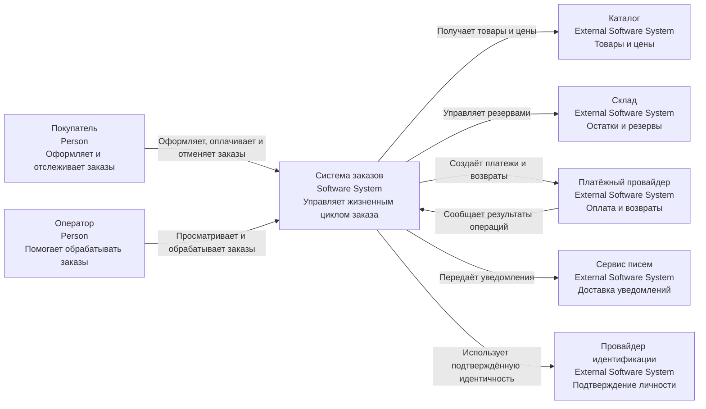
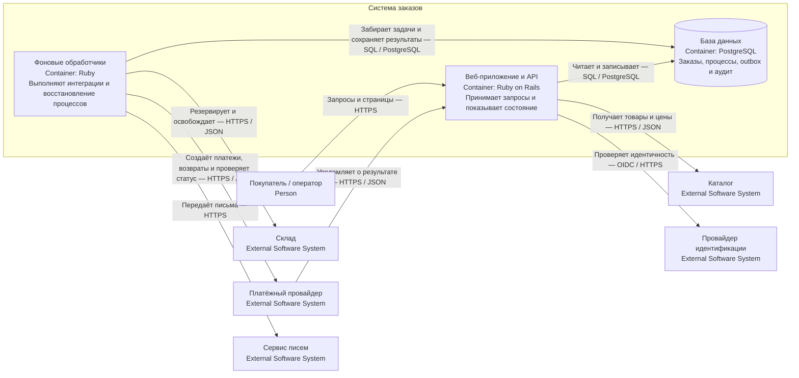
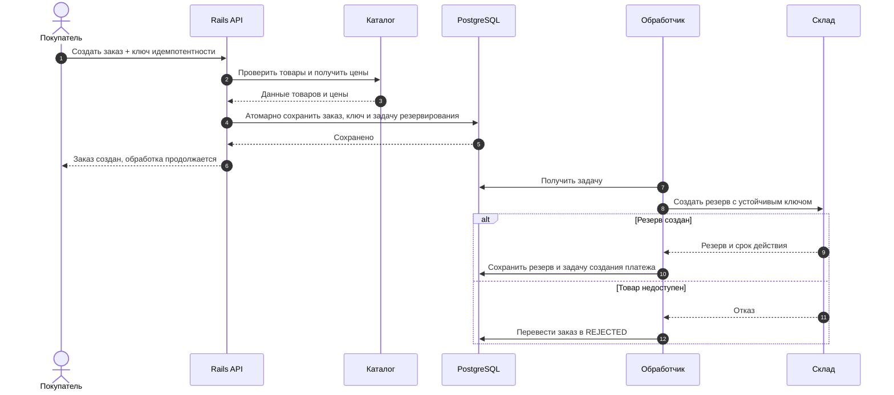
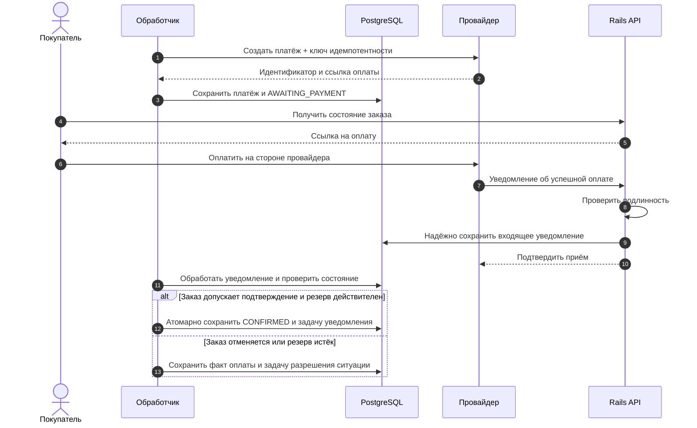
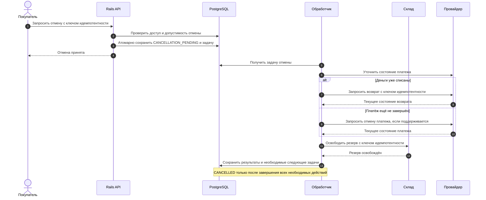

# HLD: система заказов

**Статус:** учебный проект, черновик для ревью.  
**Важно:** численные требования ниже — проектные допущения, которые необходимо подтвердить с бизнесом и испытаниями.

## 1. Контекст и цели бизнеса

Система позволяет покупателю оформить заказ, оплатить его, посмотреть состояние и запросить отмену.

Цели:

- сохранять заказы без потери подтверждённых данных;
- предотвращать повторные заказы и списания при повторе запросов;
- резервировать товар до оплаты;
- обрабатывать временные сбои внешних систем;
- давать покупателю и оператору понятный статус заказа.

**В границах решения:** заказы, координация резервирования и оплаты, отмена, уведомления и аудит.

**Внешние системы:** каталог, склад, платёжный провайдер, сервис писем и провайдер идентификации.

Доставка после передачи заказа в исполнение и возврат доставленного товара не входят в первую версию.

## 2. Функциональные требования

| ID | Требование |
|---|---|
| F1 | Создать заказ из выбранных товаров, зафиксировав цену и валюту |
| F2 | Запросить резерв товара на складе |
| F3 | Создать платёж после успешного резервирования |
| F4 | Обработать результат оплаты и показать состояние заказа |
| F5 | Отменить заказ, если он ещё не передан в исполнение |
| F6 | При отмене освободить резерв и при необходимости вернуть оплату |
| F7 | Отправлять уведомления без блокировки основных операций |
| F8 | Показывать покупателю только его заказы |
| F9 | Предоставить оператору разрешённые действия и аудит изменений |

Все изменяющие запросы предусматривают защиту от повторного выполнения.

### Ключевые состояния

Для ясности отдельно храним состояние заказа и платежа.

**Заказ:**

```text
CREATED → RESERVING → AWAITING_PAYMENT → CONFIRMED
                  ↘ REJECTED

Допустимые состояния → CANCELLATION_PENDING → CANCELLED
CONFIRMED → FULFILLMENT_STARTED
```

**Платёж:** `NOT_STARTED`, `PENDING`, `SUCCEEDED`, `FAILED`, `REFUND_PENDING`, `REFUNDED`.

`CANCELLED` означает, что необходимые действия отмены завершены. Если возврат или освобождение резерва ещё выполняется, заказ остаётся в `CANCELLATION_PENDING`.

Переходы уточняются с бизнесом. Ошибка отдельной попытки оплаты не обязательно завершает заказ: повторная попытка может быть разрешена до истечения резерва.

## 3. Нефункциональные требования

| ID | Требование | Как проверяем |
|---|---|---|
| N1 | Обычная нагрузка — 50 запросов/с; пик — 300 запросов/с в течение 15 минут | Нагрузочный тест |
| N2 | Профиль нагрузки: 80% чтение, 20% изменяющие запросы | Используем в тестах |
| N3 | p95 чтения ≤ 300 мс; принятия создания или отмены ≤ 500 мс | Измерение на входе API при N1 |
| N4 | Успешность допустимых основных API-запросов ≥ 99,9% за 30 дней | Метрики API |
| N5 | При доступных зависимостях 99% созданных заказов получают резерв и возможность оплаты за 10 секунд | Сквозные метрики процесса |
| N6 | RPO ≤ 5 минут; RTO ≤ 30 минут при аварийном восстановлении | Испытание восстановления |
| N7 | 1 млн заказов на старте, прирост 100 тыс. в месяц | Расчёт хранения и тесты |
| N8 | Повтор одного запроса или события не создаёт дополнительный заказ, резерв или платёж | Тесты повторов и конкурентной обработки |

Время принятия запроса не равно времени завершения оплаты или возврата. Доступность внешних операций учитывается отдельно.

**Допущение о хранении:** заказы — 3 года, аудит — 1 год. Окончательные сроки, основания удаления и архивирование требуют согласования.

## 4. Ограничения, допущения и вопросы

### Ограничения

- Команда — четыре разработчика.
- Основной стек — Ruby on Rails и PostgreSQL.
- В первой версии нет необходимости в независимых релизах бизнес-модулей.
- Система не принимает и не хранит карточные реквизиты: покупатель платит на стороне провайдера.

### Допущения

- Склад поддерживает идемпотентное резервирование, освобождение и проверку статуса.
- Провайдер платежей поддерживает ключи идемпотентности, уведомления, проверку статуса и возвраты.
- Резерв действует 20 минут.
- Подтверждённый заказ не изменяет состав и цену.
- Отмена разрешена до передачи в исполнение.

### Открытые вопросы

| Вопрос | Кто уточняет |
|---|---|
| Как фиксируется цена и как долго она действительна? | Бизнес и владелец каталога |
| Возможны ли частичные резервы и частичная оплата? | Бизнес |
| Что делать с оплатой, пришедшей после истечения резерва? | Бизнес, склад и платежи |
| Допустим ли автоматический возврат поздней оплаты? | Бизнес и платежи |
| Какой срок завершения отмены обещается покупателю? | Бизнес |
| Какие сроки хранения, размещение данных и аудит обязательны? | Безопасность и ответственные специалисты |
| Какой бюджет и режим дежурств доступны? | Владелец продукта и эксплуатация |

## 5. Архитектура решения

### C4 Context



**Scope:** система заказов и непосредственное окружение.  
**Легенда:** Person — роль человека; External Software System — система за выбранной границей. Стрелки обозначают подписанные взаимодействия.

### C4 Container



**Scope:** приложения и хранилище системы заказов.  
**Легенда:** рамка — граница системы; внутренние блоки — контейнеры; цилиндр — хранилище. OIDC — OpenID Connect.

Веб-приложение и обработчики используют общий код модульного монолита, но запускаются отдельно. Брокер в первой версии не вводится: задачи сохраняются в PostgreSQL.

### Компоненты и технологии

| Компонент | Ответственность |
|---|---|
| Модель заказа | Инварианты и допустимые переходы |
| Прикладные сценарии | Создание, просмотр и запрос отмены |
| Координатор процесса | Последовательность внешних шагов и компенсаций |
| Интеграционные адаптеры | Перевод контрактов каталога, склада и платежей |
| Outbox и обработчики | Надёжное сохранение задач и повторные попытки |
| Аудит | Значимые действия и их исполнители |

Rails выбран с учётом опыта команды. PostgreSQL обеспечивает локальные транзакции и ограничения целостности. Отдельные обработчики изолируют медленные интеграции от обработки пользовательских запросов.

## 6. Данные и контракты

Система владеет заказами, снимками цен, состоянием координации и записями обработки сообщений.

Склад — источник истины для резервов. Платёжный провайдер — для факта внешнего списания и возврата; система хранит подтверждённое локальное представление.

Основные API:

| Операция | Поведение |
|---|---|
| `POST /orders` | Принимает заказ с ключом идемпотентности; возвращает идентификатор и состояние |
| `GET /orders/{id}` | Возвращает заказ после проверки доступа |
| `POST /orders/{id}/cancellation` | Принимает запрос отмены; завершение может быть асинхронным |
| `POST /payment-notifications` | Проверяет подлинность и сохраняет уведомление для обработки |

Точный формат выносится в спецификацию API. Тот же ключ с другим содержимым отклоняется. Для уведомлений используют уникальные идентификаторы, а при их отсутствии — согласованный способ дедупликации.

## 7. Потоки оформления, оплаты и отмены

### Оформление



### Оплата



При отсутствии уведомления обработчик запрашивает статус у провайдера. Поздняя оплата не должна автоматически подтверждать отменённый заказ. Правило возврата или повторного резервирования требует согласования.

### Отмена



Проверка допустимости и запись состояния выполняются **в одной транзакции с защитой от конкурентных изменений**. На диаграмме они разделены для читаемости.

Все диаграммы показывают выбранные пути. Сетевые ошибки переводят процесс в ожидание повторной проверки, а не в ложный успешный результат.

## 8. Надёжность и восстановление

- Не менее двух экземпляров веб-приложения; ресурсы обработчиков ограничены отдельно.
- Резервная БД с подготовленным переключением.
- Резервные копии и журналирование для восстановления к моменту времени.
- Регулярные испытания восстановления по RPO/RTO.
- Таймауты, ограниченные повторы с backoff и jitter, circuit breaker для зависимостей.
- Периодическая проверка зависших заказов, платежей и отмен.

Заказ и задача следующего шага сохраняются одной транзакцией. Обработчик забирает задачу с ограниченной по времени блокировкой; после сбоя задача становится доступной повторно.

Внешний вызов не выполняют внутри долгой транзакции БД. Повтор использует прежний ключ идемпотентности.

Конкурентные переходы защищаются блокировкой или проверкой версии заказа. Отмена и оплата обрабатываются как согласованный процесс, а не независимые присваивания статуса.

## 9. Безопасность

- Пользователи идентифицируются через утверждённого провайдера.
- Доступ проверяется для каждой операции и конкретного заказа.
- Операторы получают минимально необходимые полномочия.
- Соединения защищены TLS; секреты хранятся отдельно от кода.
- Подлинность платёжных уведомлений проверяется по контракту провайдера.
- Сумму определяет сервер по согласованным правилам, а не клиент.
- Чувствительные данные исключаются из логов; копии и ключи защищены.
- Аудируются отмены, возвраты и административные действия.

Основные угрозы: чтение чужого заказа, подмена суммы, поддельное уведомление, повтор операции, злоупотребление полномочиями и перегрузка API. Для каждой назначаются проверки и владелец.

## 10. Развёртывание и наблюдаемость

Окружения: development, test, staging и production. В непроизводственных средах используются тестовые данные и sandbox внешних систем.

CI/CD включает доменные, интеграционные и контрактные проверки, сборку и постепенный выпуск. Миграции совместимы со старой и новой версией.

Веб-приложение и обработчики развёртываются отдельно, но совместимость их версий проверяется. Откат кода допускается только при совместимости схемы и сохранённых задач.

Мониторинг:

- успешность и p95/p99 API;
- время перехода от создания к готовности оплаты;
- возраст и количество фоновых задач;
- зависшие резервы, платежи и отмены;
- ошибки внешних систем;
- ресурсы приложения и БД.

Логи содержат `request_id`, `trace_id`, `order_id` и идентификаторы операций без секретов. Алерты имеют владельца и инструкцию действий.

Мощность выбирают по нагрузочному тесту с запасом на отказ экземпляра. Стоимость включает вычисления, БД, копии, сеть, наблюдаемость и работу команды.

## 11. Ключевые ADR

| ADR | Решение и альтернативы | Последствия |
|---|---|---|
| **001** | Модульный монолит вместо набора сервисов | Проще эксплуатация и локальные транзакции; общий цикл бизнес-релизов |
| **002** | PostgreSQL вместо документной БД | Удобны ограничения и транзакции; требуется контроль нагрузки |
| **003** | Фоновые задачи в PostgreSQL вместо отдельного брокера | Меньше инфраструктуры; обработка задач конкурирует за ресурсы БД |
| **004** | Асинхронная координация вместо ожидания всех внешних шагов в HTTP-запросе | Быстрое принятие операции; нужны промежуточные состояния и восстановление |
| **005** | Платёжная страница провайдера вместо обработки карточных данных системой | Меньше чувствительных данных; зависимость от провайдера и переход пользователя |
| **006** | Outbox и идемпотентность вместо независимой записи и отправки | Надёжнее фиксация действий; повторы всё равно возможны |

Пересмотр ADR 003 нужен, если очередь создаёт неприемлемую нагрузку на БД или требуется более сложная маршрутизация сообщений.

## 12. Реестр рисков

Оценки предварительные; владельцы назначаются конкретным людям при старте проекта.

| Риск | Вероятность | Влияние | Снижение | Владелец |
|---|---|---|---|---|
| Склад не поддерживает безопасные повторы | Неизвестна | Высокое | Проверить контракт до реализации; подготовить сверку | Владелец интеграции |
| Оплата приходит после отмены или истечения резерва | Средняя | Высокое | Явные состояния, сверка и согласованная компенсация | Команда заказов |
| Очередь перегружает БД | Средняя | Высокое | Индексы, ограничения обработки, нагрузочный тест | Команда разработки |
| Повтор уведомления вызывает повторный эффект | Средняя | Высокое | Дедупликация и атомарная обработка | Команда разработки |
| Восстановление не укладывается в RTO | Средняя | Высокое | Репетиции восстановления и измерения | Эксплуатация |
| Контактные данные попадают в логи | Средняя | Высокое | Фильтрация, ограничение доступа и проверки | Безопасность и разработка |
| Возможности команды не соответствуют режиму поддержки | Средняя | Высокое | Согласовать дежурства, поддержку и SLO | Владелец продукта |

## 13. Условия принятия HLD

Перед согласованием необходимо:

- подтвердить бизнес-правила оплаты, резервирования и отмены;
- проверить возможности и гарантии внешних API;
- согласовать численные требования, бюджет и хранение данных;
- испытать конкурирующие оплату и отмену, повторы и потерю ответов;
- выполнить нагрузочный тест и восстановление из копий;
- назначить владельцев эксплуатации и остаточных рисков.

**HLD задаёт проверяемое решение. Детальные схемы таблиц, форматы контрактов и алгоритмы переходов уточняются в LLD без потери описанных гарантий.**