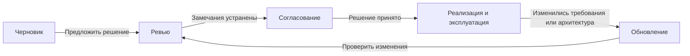
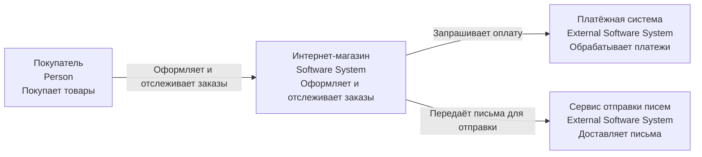
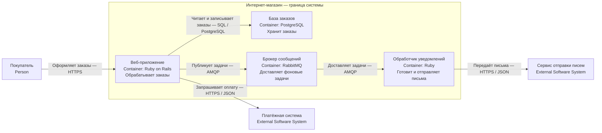
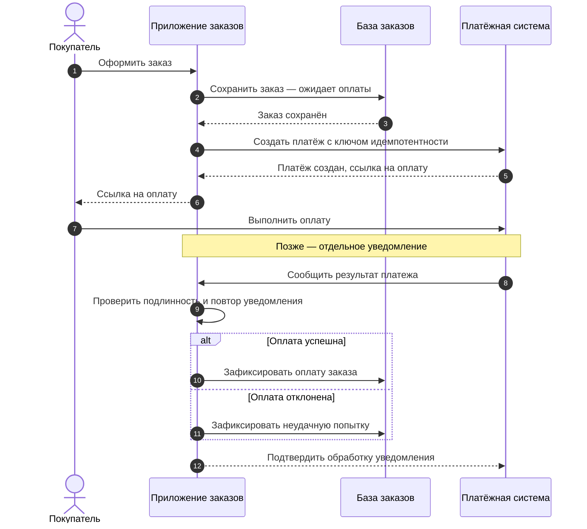
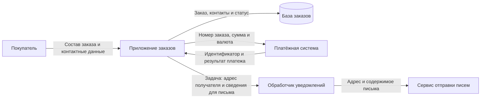
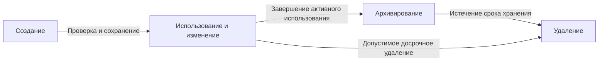
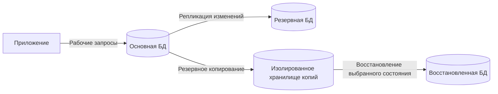
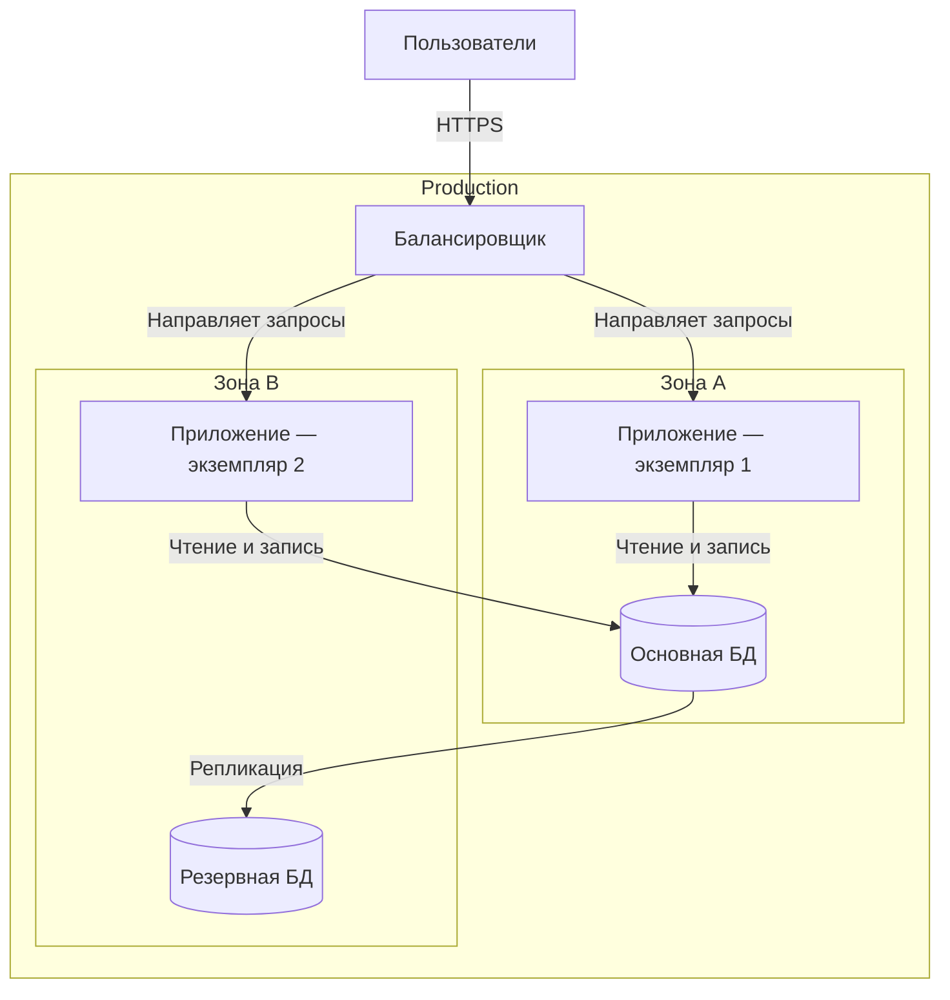
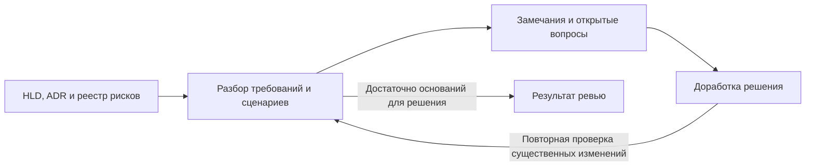

# Проектирование архитектуры решения + HLD

# 1. Основные понятия HLD

## 1.1. Роль архитектуры решения

**Solution Architecture — архитектура решения:** описание того, как программные системы, данные и инфраструктура вместе решают конкретную бизнес-задачу с учётом ограничений.

Она связывает:

- **бизнес-требования:** что нужно получить;
- **требования к качеству:** скорость, доступность, безопасность;
- **ограничения:** бюджет, сроки, существующие системы;
- **технические решения:** компоненты, интеграции, хранение и размещение данных.

Пример: для оформления заказов нужно определить, как магазин взаимодействует со складом и платежами, что происходит при сбоях и где хранятся данные.

**HLD — High-Level Design, высокоуровневое проектирование или документ с его результатами.** Он фиксирует общую структуру решения, ключевые решения и их обоснование.

Архитектура решения — деятельность и результат проектирования; HLD — один из способов этот результат описать.

## 1.2. HLD и LLD

| | HLD — High-Level Design | LLD — Low-Level Design |
|---|---|---|
| Главный вопрос | Как устроено решение в целом? | Как реализовать конкретную часть? |
| Детализация | Системы, приложения, данные, интеграции и инфраструктура | Классы, методы, алгоритмы, точные структуры данных |
| Решения | Границы сервисов, способ взаимодействия, отказоустойчивость | Поведение методов, обработка ошибок, детали реализации |
| Аудитория | Технические участники и заинтересованные представители бизнеса | Прежде всего разработчики и тестировщики |

Пример:

- **HLD:** заказы передают задачи уведомлений через брокер; обработка идемпотентная.
- **LLD:** формат сообщения, алгоритм проверки `event_id`, схема таблицы обработанных событий.


**Как читать:** это связь проектных артефактов, а не схема выполнения приложения. Обратная связь из реализации может потребовать пересмотра HLD.

Граница между HLD и LLD зависит от проекта. Существенные детали, влияющие на безопасность или согласованность, могут понадобиться уже в HLD.

**C4 помогает иллюстрировать HLD, но не заменяет его целиком:** одних диаграмм недостаточно для описания требований, рисков и причин выбора.

## 1.3. Кто использует HLD

| Участник | Что ищет в документе |
|---|---|
| **Бизнес** | Какие задачи решаются, что входит в scope, какие ограничения и компромиссы приняты |
| **Разработка** | Границы компонентов, ответственность, данные и взаимодействия |
| **Эксплуатация** | Размещение, масштабирование, мониторинг, восстановление и зависимости |
| **Информационная безопасность** | Потоки чувствительных данных, границы доверия, доступ и защита |
| **Тестирование** | Критические сценарии, требования к качеству и поведение при отказах |

**Один документ может иметь разную глубину для разных читателей.** Общее описание должно быть понятно всем, а технические разделы — давать нужные детали специалистам.

HLD помогает выявить противоречия до реализации. Например, бизнес ожидает непрерывной работы, но предложенная схема содержит единственную БД без подготовленного восстановления.

## 1.4. Жизненный цикл HLD



**Черновик:** фиксируют требования, предполагаемую архитектуру, альтернативы и открытые вопросы.

**Ревью:** участники проверяют реализуемость, безопасность, эксплуатацию и соответствие требованиям.

**Согласование:** ответственные принимают решение и существенные компромиссы. Формальность процесса зависит от организации и рисков проекта.

**Обновление:** документ приводят в соответствие с изменениями архитектуры. Назначают владельца, хранят историю версий и различают текущее и целевое состояние.

HLD не должен становиться неизменяемым обещанием: новые данные могут потребовать пересмотра решений. Причины значимых изменений удобно фиксировать в ADR.

**Запомнить:** HLD объясняет устройство решения и причины выбора; LLD уточняет реализацию. Документ проходит совместное обсуждение и развивается вместе с системой.


# 2. Сбор требований

## 2.1. Функциональные требования и сценарии

**Функциональные требования описывают, что система должна делать.** Например: создавать заказ, принимать оплату, оформлять возврат.

Для ключевого сценария фиксируют:

- **актора и цель:** кто выполняет действие и зачем;
- **предусловия:** что должно быть выполнено до начала;
- **основной путь:** последовательность действий;
- **альтернативы и ошибки:** отказ оплаты, отсутствие товара;
- **результат:** что изменится при успехе и неудаче.

Пример:

```text
Сценарий: оформление заказа
Актор: покупатель
Предусловие: корзина содержит товары

Основной путь:
Проверить товары → Создать заказ → Запустить оплату

При отказе оплаты:
Заказ не считается оплаченным;
покупателю доступна повторная попытка.
```

**Уточняй границы:** какие функции входят в решение, какие остаются во внешних системах и что пока не реализуется.

## 2.2. Измеримые нефункциональные требования

**Нефункциональные требования описывают качество работы системы и ограничения.** Формулировку «быстро и надёжно» нужно заменить проверяемыми показателями.

Примеры учебных требований:

| Область | Измеримая формулировка |
|---|---|
| **Нагрузка** | 100 запросов/с обычно, пик 500 запросов/с длительностью 10 минут при согласованном составе операций |
| **Время ответа** | Не менее 95% запросов создания заказа завершаются за 500 мс при указанной нагрузке |
| **Доступность** | Не менее 99,9% допустимых запросов создания заказа успешны за календарный месяц |
| **Объём данных** | 10 млн заказов на старте, прирост 1 млн в месяц |
| **Хранение** | Заказы хранятся 5 лет; порядок архивирования определён отдельно |
| **RPO** | При аварии допустима потеря не более 5 минут последних изменений |
| **RTO** | После аварии сервис должен быть восстановлен не позднее чем за 30 минут |

**RPO — Recovery Point Objective:** допустимая потеря данных, выраженная интервалом времени.

**RTO — Recovery Time Objective:** целевое время восстановления после нарушения работы.

```text
Последнее восстановимое состояние → Авария → Восстановление
           ← потеря данных →          ← время восстановления →
             ограничено RPO               ограничено RTO
```

Для каждого показателя указывают **условия, точку измерения и способ проверки**. Например, время ответа на сервере не равно времени ожидания пользователя.

Уточняй обычную и пиковую нагрузку, сезонность, размер запросов и прогноз роста. Сами числа без этих условий недостаточны.

## 2.3. Безопасность, регулирование и аудит

**Требования безопасности определяют, какие данные и действия нужно защищать и от каких угроз.**

На этапе сбора требований выясняют:

- какие данные чувствительные и где они проходят;
- кто имеет доступ и какие операции ему разрешены;
- нужна ли изоляция клиентов или организаций;
- требования к шифрованию, секретам и удалению данных;
- порядок обнаружения и обработки инцидентов.

**Регуляторные требования зависят от юрисдикции, отрасли и данных.** Применимость конкретных норм подтверждают с ответственными специалистами и фиксируют в требованиях.

**Аудит — возможность установить, кто, когда и что сделал.** Например, для возврата платежа сохраняют исполнителя, время, объект, результат и причину операции.

Для аудита определяют:

- перечень регистрируемых действий;
- срок хранения записей;
- доступ к ним и защиту от изменения;
- возможность поиска и восстановления последовательности событий.

**Аудит не равен обычным техническим логам.** Логи помогают диагностировать работу, а аудит подтверждает значимые действия. В оба источника нельзя бесконтрольно записывать секреты и чувствительные данные.

## 2.4. Допущения и открытые вопросы

**Допущение — временно принятое предположение. Открытый вопрос — то, что ещё требует ответа.** Их нельзя выдавать за подтверждённые требования.

| Тип | Пример | Что зафиксировать |
|---|---|---|
| **Допущение** | Платёжный провайдер поддерживает ключи идемпотентности | Основание, способ проверки и последствия ошибки |
| **Открытый вопрос** | Можно ли резервировать товар до оплаты? | Ответственного и срок решения |
| **Ограничение** | Нужно использовать существующую корпоративную систему входа | Источник ограничения и влияние на решение |

Практический порядок:


**Как читать:** это процесс уточнения требований. Если ответ меняет архитектурное решение, его пересматривают.

Для важных требований полезно хранить идентификатор, источник, приоритет и критерий приёмки. Это позволяет связать требование с решением и проверкой.

**Запомнить:** качественные требования объясняют, что нужно сделать, в каких условиях и как подтвердить результат. Неопределённости фиксируют явно.

# 3. Ограничения и атрибуты качества

## 3.1. Ограничения решения

**Ограничение сужает выбор допустимых решений.** Его важно отличать от предпочтения или привычки команды.

| Тип | Пример |
|---|---|
| **Техническое** | Необходимо интегрироваться с существующей системой через её API |
| **Организационное** | Решение поддерживает команда из четырёх человек без круглосуточного дежурства |
| **Бюджетное** | Расходы на инфраструктуру не должны превышать согласованный лимит |
| **По срокам** | Первая версия должна быть готова к запуску через три месяца |

Для ограничения записывают **источник, обязательность и последствия**.

Например, «разработчики знают PostgreSQL» — фактор выбора, но не обязательно запрет на другие БД. «Данные должны размещаться в утверждённой среде» может быть обязательным ограничением.

Нужно проверять совместимость ограничений с требованиями. Если бюджет не позволяет обеспечить заявленную доступность, противоречие обсуждают до реализации.

## 3.2. Атрибуты качества

**Атрибуты качества описывают, насколько хорошо система выполняет свои задачи и насколько удобно её развивать.**

| Атрибут | Главный вопрос | Возможные показатели |
|---|---|---|
| **Производительность** | Как быстро система работает при заданной нагрузке? | p95/p99 времени ответа, пропускная способность |
| **Масштабируемость** | Как система справляется с ростом нагрузки и данных? | Рост производительности и стоимости при добавлении ресурсов |
| **Надёжность** | Как система работает без отказов и справляется со сбоями? | Частота отказов, доступность, время восстановления, потеря данных |
| **Сопровождаемость** | Насколько легко понимать, изменять и проверять систему? | Время типового изменения, число затронутых компонентов |
| **Безопасность** | Как защищены данные и операции? | Проверяемые правила доступа, изоляции и регистрации действий |

**Производительность и масштабируемость — разные свойства.** Быстрая система на небольшой нагрузке может плохо масштабироваться.

**Доступность — не вся надёжность.** Система может отвечать на запросы, но терять данные или возвращать неправильный результат.

Названия атрибутов недостаточно: их уточняют измеримыми требованиями и сценариями.

## 3.3. Компромиссы между атрибутами

**Архитектурное решение может улучшать один атрибут и усложнять обеспечение другого.**

| Решение | Польза | Цена или риск |
|---|---|---|
| **Кэширование** | Снижает задержки и нагрузку на БД | Устаревшие данные и сложность обновления кэша |
| **Реплики для чтения** | Увеличивают возможности обработки чтения | Отставание реплик, расходы и эксплуатация |
| **Выделение сервисов** | Независимые релизы и масштабирование | Сетевые сбои, сложнее диагностика и согласование данных |
| **Синхронное согласование между узлами** | Более строгие гарантии данных | Дополнительная задержка и ограничения при сетевых сбоях |
| **Подробное логирование** | Упрощает диагностику | Стоимость хранения и риск раскрытия чувствительных данных |

Компромисс не означает, что требования безопасности можно произвольно ослабить. **Сначала обеспечивают обязательные требования, затем выбирают среди допустимых вариантов.**

Для решения фиксируют:

- какой атрибут улучшаем;
- чем жертвуем и в какой степени;
- почему это приемлемо;
- как проверим результат.

**Не оптимизируй всё одинаково:** приоритеты зависят от бизнес-сценария. Для оплаты важна корректность, для поиска может быть допустима небольшая задержка обновления индекса.

## 3.4. Сценарии атрибутов качества

**Сценарий качества описывает конкретную ситуацию и измеримую реакцию системы.** Он превращает общее требование в проверяемое.

Структура сценария:

| Часть | Что описывает |
|---|---|
| **Источник** | Кто или что создаёт воздействие |
| **Воздействие** | Запрос, сбой, изменение или попытка атаки |
| **Окружение** | Нормальная работа, пик нагрузки, аварийный режим |
| **Объект** | Какая часть системы затронута |
| **Реакция** | Что система должна сделать |
| **Мера реакции** | По какому показателю оцениваем результат |

Пример производительности:

> При нагрузке 500 запросов создания заказа в секунду в течение 10 минут API успешно обрабатывает не менее 99,9% допустимых запросов, а p95 времени ответа не превышает 500 мс.

Пример отказоустойчивости:

> При остановке одного экземпляра приложения во время обычной нагрузки оставшиеся экземпляры продолжают обслуживать запросы; доля ошибок за пятиминутное окно не превышает согласованный предел.

Пример сопровождаемости:

> Разработчик добавляет новый способ уведомления, не изменяя доменную модель заказа; реализация и проверки занимают не более двух рабочих дней.


**Как читать:** это процесс оценки решения. Производительность проверяют нагрузочными испытаниями, поведение при сбоях — испытаниями отказов, а сопровождаемость — разбором или выполнением типового изменения.

**Запомнить:** ограничения определяют допустимые варианты, атрибуты качества — желаемые свойства, сценарии — способ проверить, что выбранная архитектура их обеспечивает.

# 4. Компоненты решения

## 4.1. Декомпозиция и ответственность

**Декомпозиция — разделение решения на части с понятной ответственностью и границами взаимодействия.**

Для каждой части описывают:

- назначение и выполняемые функции;
- данные, которыми она владеет;
- предоставляемые интерфейсы;
- зависимости;
- поведение при отказах.

Пример интернет-магазина:

| Часть | Ответственность |
|---|---|
| **Веб-приложение** | Пользовательский интерфейс и обработка запросов |
| **Модуль заказов** | Состав заказа и допустимые переходы состояния |
| **База данных** | Хранение заказов |
| **Фоновый обработчик** | Выполнение отложенных задач |
| **Адаптер платежей** | Интеграция с платёжным провайдером |

**Часть решения не обязательно является отдельным сервисом.** Модуль заказов и адаптер платежей могут находиться внутри одного приложения.

В HLD слово «компонент» часто используется широко. При построении C4 различай **Container** — приложение или хранилище — и **Component** — внутреннюю часть контейнера.

## 4.2. Выбор технологий

**Технологию выбирают по требованиям и ограничениям, а решение обосновывают сравнением альтернатив.**

Учитывают:

- соответствие сценариям и атрибутам качества;
- опыт команды;
- совместимость с существующей инфраструктурой;
- эксплуатацию, стоимость и ограничения;
- сложность будущей замены.

Пример:

| Задача | Выбор | Обоснование | Альтернатива |
|---|---|---|---|
| Хранение заказов | Реляционная БД | Транзакции, ограничения целостности, связанные данные | Документная БД |
| Фоновые задачи | Очередь и обработчики | Отложенное выполнение и сглаживание пиков | Синхронная обработка |
| Первое приложение | Модульный монолит | Небольшая команда и отсутствие потребности в независимых релизах | Набор сервисов |

Для конкретного продукта проверяют, действительно ли он обеспечивает нужные свойства.

**Обоснование должно объяснять связь с задачей**, а не ограничиваться фразой «популярная технология». Существенные решения и причины отказа от альтернатив фиксируют в ADR.

## 4.3. Внешние интеграции и контракты

**Для интеграции недостаточно указать адрес внешнего API.** Нужно описать смысл взаимодействия и гарантии сторон.

Минимальное описание:

| Что фиксировать | Пример для платежей |
|---|---|
| **Назначение** | Проведение оплаты и возвратов |
| **Способ взаимодействия** | Синхронный запрос и отдельное уведомление о результате |
| **Контракт** | Поля, типы, статусы, ошибки и их смысл |
| **Безопасность** | Проверка доступа и подлинности уведомлений |
| **Надёжность** | Таймауты, безопасные повторы и ключ идемпотентности |
| **Совместимость** | Версии API и порядок изменения контракта |
| **Ответственность** | Владелец интеграции и порядок эскалации |

В HLD описывают ключевые операции и правила, а полные схемы API и сообщений можно вынести в отдельную спецификацию.

Особенно важны неоднозначные результаты: **таймаут не означает отказ платежа**. Решение должно предусматривать уточнение статуса и защиту от повторного списания.

## 4.4. Context и Container в HLD

**Context показывает границы решения и окружение. Container раскрывает приложения и хранилища внутри этих границ.**

### Context — интернет-магазин



**Scope:** интернет-магазин и непосредственное окружение.  
**Легенда:** Person — роль человека; Software System — система; External — за выбранной границей. Стрелки показывают инициатора подписанного взаимодействия.

### Container — устройство интернет-магазина



**Scope:** приложения и хранилища магазина.  
**Легенда:** рамка — граница системы; внутренние блоки — контейнеры. Стрелки обозначают вызовы или доставку сообщений согласно подписям. AMQP — протокол обмена сообщениями.

Это учебная схема: детали callback платежей и надёжной публикации задач здесь не показаны. Их описывают в контрактах и сценариях.

**Диаграммы дополняют текст HLD:** они показывают структуру, но не заменяют обоснование технологий, требования и обработку отказов.

**Запомнить:** у каждой части должна быть ответственность, у технологии — причина выбора, у интеграции — контракт, а у диаграммы — ясная область рассмотрения.

# 5. Потоки данных

## 5.1. Ключевые сценарии и sequence-диаграммы

**Sequence-диаграмма показывает участников сценария и порядок их взаимодействий.** Время идёт сверху вниз.

Для ключевого сценария отражают запросы, ответы, асинхронные уведомления и существенные ошибки.

Пример оплаты заказа:



**Scope:** оформление и получение результата оплаты.  
**Легенда:** сплошные стрелки — запросы и действия; пунктирные — ответы; `alt` — альтернативные ветки.

Это упрощённый сценарий. Повторные уведомления, таймауты и уточнение статуса при отсутствии ответа можно раскрыть отдельными диаграммами.

**Не пытайся поместить все варианты на одну схему:** она должна помогать разбирать сценарий, а не заменять всю спецификацию.

## 5.2. Потоки между компонентами и внешними системами

**Поток данных описывает, какие сведения перемещаются, откуда, куда и зачем.** Sequence показывает порядок, а схема потоков — маршруты передачи и места обработки.



**Scope:** основные потоки оформления заказа.  
**Легенда:** стрелки — направление передачи данных; цилиндр — хранилище. Очередь между приложением и обработчиком здесь опущена.

Для каждого потока фиксируют:

- состав и назначение данных;
- источник и получателя;
- способ передачи и защиту;
- пересечение границ доверия;
- возможность повторной доставки и задержки.

**Передавай только необходимые данные.** Например, платёжному провайдеру не нужно отправлять полный профиль покупателя, если операция этого не требует.

## 5.3. Чувствительность и места хранения

**Классификация определяет, как данные можно передавать, хранить и использовать.** Названия категорий зависят от политики организации.

| Категория | Пример | Что учитывать |
|---|---|---|
| **Публичные** | Описание товара | Защиту от несанкционированного изменения |
| **Внутренние** | Рабочие отчёты | Ограничение доступа |
| **Конфиденциальные** | Контакты покупателя, история заказов | Доступ по необходимости, защиту передачи и хранения |
| **Особо чувствительные** | Секреты доступа, платёжные реквизиты | Специальные правила хранения и строгие ограничения |

Для набора данных составляют краткую карточку:

```text
Данные: контактный адрес покупателя
Владелец: команда заказов
Источник истины: база заказов для контакта конкретного заказа
Копии: задача уведомления, система отправки писем
Доступ: только необходимые роли и сервисы
Хранение и удаление: по утверждённой политике
```

**Учитывай все копии:** БД, кэши, очереди, выгрузки, логи, трассировки и резервные копии. Защиты основной таблицы недостаточно, если сведения попадают в открытые логи.

Требования к конкретным категориям и срокам подтверждают с ответственными за безопасность и применимые нормы.

## 5.4. Жизненный цикл данных

**Жизненный цикл описывает данные от появления до окончательного удаления.**



**Как читать:** это пример политики жизненного цикла. Архивирование требуется не для всех данных.

На каждом этапе определяют:

- **Создание:** источник, проверки и владелец.
- **Изменение:** разрешённые операции, история и обновление копий.
- **Архивирование:** условия переноса, место хранения и доступ.
- **Удаление:** основание, сроки и очистка связанных копий.

**Архив — не резервная копия.** Архив хранит данные для дальнейшего использования, резервная копия нужна для восстановления после сбоя.

Удаление должно учитывать реплики, индексы, кэши и внешних получателей. Для резервных копий задают отдельную политику: когда данные исчезнут и как предотвратить их возвращение после восстановления.

**Запомнить:** потоки данных показывают движение информации, классификация — необходимую защиту, жизненный цикл — правила хранения и удаления.

# 6. Надёжность и безопасность

## 6.1. Точки отказа

**Единая точка отказа — компонент, отказ которого нарушает работу системы и для которого нет работающей альтернативы.**

Проверяют всю цепочку: приложение, БД, брокер, балансировщик, сеть и внешние зависимости.

| Возможный отказ | Способ уменьшить влияние |
|---|---|
| Экземпляр приложения остановился | Несколько экземпляров, проверки здоровья и балансировка |
| Основной узел БД недоступен | Резервный узел и подготовленное переключение |
| Платёжный провайдер не отвечает | Таймауты, уточнение статуса позже, сохранение промежуточного состояния |
| Уведомления обрабатываются медленно | Очередь, отдельные ресурсы и ограничение нагрузки |
| Недоступна зона размещения | Размещение в нескольких зонах, если этого требуют цели доступности |

**Несколько экземпляров не устраняют общие причины отказа:** ошибочный релиз, общая БД или единая сеть могут затронуть их одновременно.

В HLD описывают не только защиту, но и **поведение при сбое**: что продолжает работать, что недоступно и как система восстанавливается.

## 6.2. Резервирование, копирование и восстановление

Эти механизмы решают разные задачи:

| Механизм | Назначение |
|---|---|
| **Резервирование** | Продолжить работу или быстро переключиться при отказе |
| **Резервное копирование** | Сохранить восстановимую версию данных |
| **Восстановление** | Вернуть данные и работоспособность после сбоя |



**Как читать:** резервная БД помогает при отказе узла, копии — при потере или повреждении данных. Это концептуальная схема, без деталей переключения.

**Реплика не заменяет резервную копию:** ошибочное удаление может распространиться на реплики.

В HLD фиксируют:

- целевые **RPO** — допустимую потерю данных — и **RTO** — время восстановления;
- периодичность, сроки хранения и защиту копий;
- порядок переключения и предотвращение одновременной записи в два основных узла;
- ответственных и инструкции восстановления;
- регулярные проверки восстановления.

**Наличие копии не доказывает, что восстановление работает.** Нужно проверить целостность данных и фактическое время возвращения сервиса.

## 6.3. Доступ, шифрование и секреты

| Механизм | На какой вопрос отвечает |
|---|---|
| **Аутентификация** | Кто обращается: пользователь или сервис? |
| **Авторизация** | Какие данные и действия ему разрешены? |
| **Шифрование** | Как защитить данные при передаче и хранении? |
| **Управление секретами** | Как выдавать, хранить, менять и отзывать ключи доступа? |

Пример: пользователь вошёл в систему, но это не означает, что ему разрешено читать любой заказ. Сервер проверяет доступ **к конкретному объекту и операции**.

Основные принципы:

- минимально необходимые права для пользователей и сервисов;
- проверка доступа на стороне сервера, а не только в интерфейсе;
- защита сетевых соединений, включая необходимые внутренние связи;
- шифрование чувствительных данных и копий с отдельным управлением ключами;
- хранение секретов вне кода и логов;
- ротация, отзыв и аудит использования секретов.

**Шифрование не заменяет авторизацию.** Приложение может расшифровать данные и ошибочно отдать их чужому пользователю.

В HLD показывают **границы доверия**: например, между интернетом и приложением, приложением и внешним провайдером. Внутренняя сеть сама по себе не подтверждает личность участника.

## 6.4. Базовое моделирование угроз: STRIDE

**Моделирование угроз — разбор того, что может пойти не так, какие последствия возникнут и какие меры нужны.**

STRIDE помогает систематически искать шесть категорий угроз. [Описание Microsoft](https://learn.microsoft.com/en-us/biztalk/core/identifying-potential-threats).

| Категория | Пример для заказов | Возможная защита |
|---|---|---|
| **S — Spoofing: подмена личности** | Поддельное уведомление от платёжного провайдера | Проверка подписи и защита от повторного воспроизведения |
| **T — Tampering: изменение данных** | Клиент подменяет сумму заказа | Серверный расчёт суммы и проверка входных данных |
| **R — Repudiation: отрицание действий** | Невозможно установить, кто оформил возврат | Защищённый аудит действий |
| **I — Information Disclosure: раскрытие данных** | Покупатель читает чужой заказ | Проверка доступа к объекту, минимизация данных |
| **D — Denial of Service: отказ в обслуживании** | Запросы исчерпывают ресурсы | Лимиты запросов, параллелизма и размеров входных данных |
| **E — Elevation of Privilege: повышение привилегий** | Пользователь выполняет административную операцию | Серверная проверка ролей и разрешений |

Порядок работы:

1. Нарисовать компоненты, хранилища, потоки данных и границы доверия.
2. Проверить применимые категории STRIDE для элементов и связей.
3. Записать конкретные угрозы и последствия.
4. Назначить меры, владельцев и способы проверки.
5. Зафиксировать оставшиеся риски и порядок их принятия.

**STRIDE классифицирует угрозы, но не определяет их приоритет.** Важность оценивают отдельно по вероятности, последствиям и контексту.

**Запомнить:** надёжность требует работающего восстановления, безопасность — проверяемых правил защиты. В HLD нужно объяснить, как они обеспечиваются и кто за них отвечает.

# 7. Развёртывание и эксплуатация

## 7.1. Окружения и схема развёртывания

**Окружение — набор ресурсов и настроек для определённой цели.**

| Окружение | Назначение |
|---|---|
| **Development** | Разработка и локальная проверка |
| **Test** | Автоматические и интеграционные проверки |
| **Staging** | Проверка выпуска в условиях, близких к production |
| **Production** | Работа с реальными пользователями и данными |

Staging не обязательно повторяет production по мощности, но должен воспроизводить существенные особенности: технологии, конфигурацию и способы интеграции.

Для каждого окружения описывают:

- приложения, хранилища и число экземпляров;
- размещение и сетевые границы;
- конфигурацию, секреты и права доступа;
- резервирование и внешние зависимости;
- порядок создания и изменения инфраструктуры.



**Scope:** упрощённое размещение веб-приложения и БД. Рамки показывают окружение и зоны размещения.

Схема должна сопровождаться описанием переключения БД и доступности балансировщика. Само наличие резервного узла не гарантирует восстановление.

## 7.2. Мониторинг, логирование и алертинг

**Наблюдаемость помогает определить состояние системы и понять причины проблем.**

| Инструмент | Что показывает |
|---|---|
| **Метрики** | Нагрузку, ошибки, задержки и использование ресурсов |
| **Логи** | Подробности отдельных событий |
| **Трассировка** | Путь запроса и время выполнения его частей |
| **Алерты** | Проблемы, требующие реакции |

Основные показатели:

- успешность операций и p95/p99 времени ответа;
- CPU, память, диски и пулы соединений;
- нагрузка БД, блокировки и отставание реплик;
- размер очередей и возраст ожидающих задач;
- бизнес-результаты: созданные заказы, успешные платежи.

Для логов определяют формат, корреляционные идентификаторы, срок хранения и доступ. Секреты и чувствительные данные исключают или маскируют.

**Алерт должен иметь владельца и понятное действие.** Для него указывают условие, важность, канал доставки и ссылку на инструкцию диагностики.

Оповещение о нарушении пользовательского сценария обычно полезнее, чем тревога на каждый кратковременный скачок CPU. Пороговые значения согласуют с SLO и допустимым бюджетом ошибок.

## 7.3. Релизы и откат

| Стратегия | Как работает | Ограничение |
|---|---|---|
| **Rolling update** | Экземпляры обновляются постепенно | Старая и новая версии работают одновременно |
| **Blue-green** | Подготавливают второе окружение и переключают трафик | Нужны дополнительные ресурсы; данные могут оставаться общими |
| **Canary** | Новую версию сначала получает небольшая часть трафика | Нужны маршрутизация и сравнение показателей |


До выпуска определяют критерии успеха, условия остановки, ответственных и способ восстановления.

**Откат приложения не откатывает данные и внешние действия.** Миграции должны сохранять совместимость версий; необратимые изменения требуют отдельного плана. Иногда безопаснее выпустить исправление.

Для функций можно использовать флаги, позволяющие отключить новое поведение без повторного развёртывания.

## 7.4. Ресурсы и стоимость

**Оценку строят по ожидаемой нагрузке, проверяют измерениями и уточняют после запуска.**

Учитывают:

- обычную и пиковую нагрузку;
- потребление ресурсов одним экземпляром;
- рост данных, индексов и журналов;
- реплики, резервные копии и сроки хранения;
- сетевой трафик, фоновые задачи и наблюдаемость.

Пример: если экземпляр устойчиво обрабатывает 200 запросов/с с целевым временем ответа, для пика 500 запросов/с нужно минимум три экземпляра **без учёта запаса**. Если при отказе одного нагрузка должна обслуживаться полностью, по этим допущениям потребуется минимум четыре.

Расчёт проверяют нагрузочным тестом: общая БД или внешняя зависимость могут ограничить производительность.

```text
Стоимость инфраструктуры =
вычисления + хранение + сеть
+ резервирование и копии
+ управляемые сервисы
+ логи, метрики и трассировки
```

Отдельно учитывают труд команды и дежурства.

**Автомасштабирование требует времени:** задают минимальные и максимальные ресурсы, сигналы масштабирования и запас для резких пиков.

**Запомнить:** HLD должен объяснять, где система работает, как её состояние контролируется, как выпускаются изменения и сколько ресурсов потребуется.

# 8. Архитектурные решения и ревью

## 8.1. ADR: решения, альтернативы и последствия

**ADR — Architecture Decision Record:** короткая запись о значимом архитектурном решении, его причинах и последствиях.

Минимальная структура:

- **Контекст:** проблема, требования и ограничения.
- **Варианты:** что рассматривали.
- **Решение:** что выбрали и почему.
- **Последствия:** преимущества, затраты и риски.
- **Статус:** предложено, принято или заменено.

Пример:

> **Решение:** отправлять уведомления через очередь.  
> **Альтернативы:** синхронная отправка; периодический поиск неотправленных уведомлений.  
> **Причина:** задержки сервиса писем не должны блокировать оформление заказа.  
> **Последствия:** нужен брокер, контроль очереди и идемпотентная обработка; письмо может прийти не сразу.

**HLD описывает решение в целом, ADR сохраняет причины конкретного выбора.** Их связывают ссылками.

При пересмотре принятого решения создают новый ADR, который заменяет предыдущий. Старую запись сохраняют как историю.

## 8.2. Реестр рисков

**Архитектурный риск — неопределённость или возможное событие, способное помешать выполнению требований.**

| Риск | Вероятность | Влияние | Меры снижения |
|---|---|---|---|
| БД не выдержит пиковую нагрузку | Средняя | Высокое | Нагрузочный тест, оптимизация запросов, запас ресурсов |
| Провайдер платежей недоступен | Средняя | Высокое | Промежуточные статусы, таймауты, уточнение результата позже |
| Очередь уведомлений растёт быстрее обработки | Средняя | Среднее | Контроль возраста задач, масштабирование обработчиков |

Для каждого риска также указывают:

- владельца;
- срок проверки или выполнения мер;
- статус;
- остаточный риск после снижения.

**Вероятность и влияние оценивают по согласованной шкале**, опираясь на доступные данные. Не стоит превращать субъективные оценки в видимость точного расчёта.

Различай риск и уже существующую проблему: «БД может не выдержать пик» — риск; «на тесте БД не выдержала пик» — подтверждённая проблема.

## 8.3. Архитектурное ревью HLD

**Ревью проверяет, соответствует ли решение требованиям и можно ли его реализовать и обслуживать.**

Участвуют представители бизнеса, разработки, эксплуатации, безопасности и тестирования — в зависимости от влияния решения.

Проверяют:

- полноту ключевых сценариев и границ решения;
- измеримость требований к качеству;
- ответственность компонентов и владение данными;
- интеграции, совместимость и обработку ошибок;
- отказоустойчивость, восстановление и безопасность;
- стоимость и возможности команды;
- допущения, альтернативы и риски.



**Как читать:** это процесс оценки архитектуры. Результат — принятое решение, условия его принятия или необходимость доработки.

Замечания должны быть конкретными: **какое требование не обеспечено, почему и что нужно проверить**. После ревью фиксируют ответственных и сроки.

## 8.4. ATAM и облегчённая оценка

**ATAM — Architecture Tradeoff Analysis Method:** метод оценки архитектуры через атрибуты качества, сценарии и компромиссы.

Он помогает выявлять:

- **риски:** решения, которые могут не обеспечить требования;
- **точки чувствительности:** параметры, сильно влияющие на качество;
- **точки компромисса:** решения, затрагивающие несколько атрибутов.

Пример: увеличение числа реплик может улучшить возможности чтения, но повысить стоимость. При асинхронном обновлении также нужно учитывать отставание данных.

**Облегчённая оценка по мотивам ATAM:**

1. Выбрать наиболее важные сценарии качества.
2. Для каждого разобрать, как архитектура обеспечивает требуемую реакцию.
3. Рассмотреть сбои, пики нагрузки и изменения.
4. Выявить компромиссы и неподтверждённые предположения.
5. Назначить проверки: прототип, нагрузочный тест, испытание восстановления.
6. Записать выводы в ADR и реестр рисков.

Это полезный формат командного обсуждения, но не полноценная процедура ATAM.

**Оценка архитектуры не доказывает её работоспособность.** Существенные предположения подтверждают испытаниями и измерениями.

**Запомнить:** ADR объясняет выбор, реестр рисков сохраняет неопределённости, ревью проверяет решение, а сценарии качества делают оценку предметной.