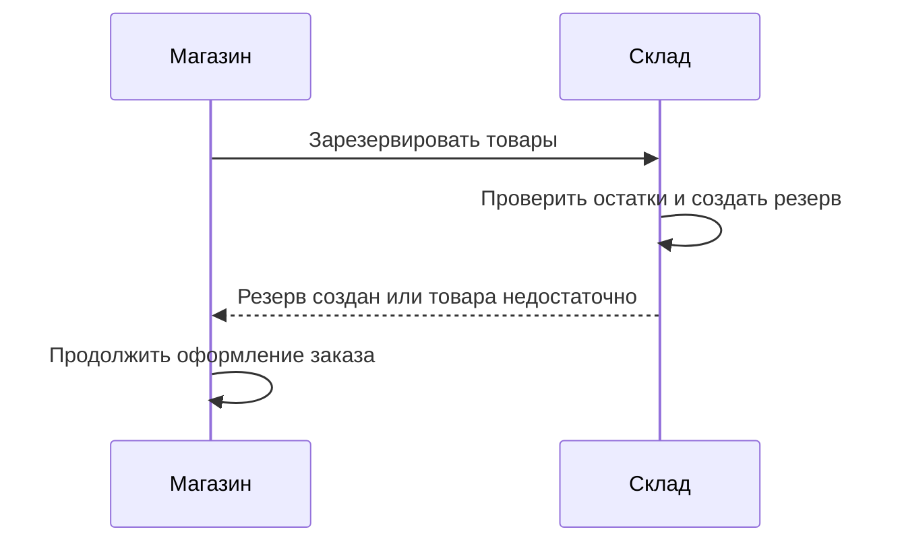
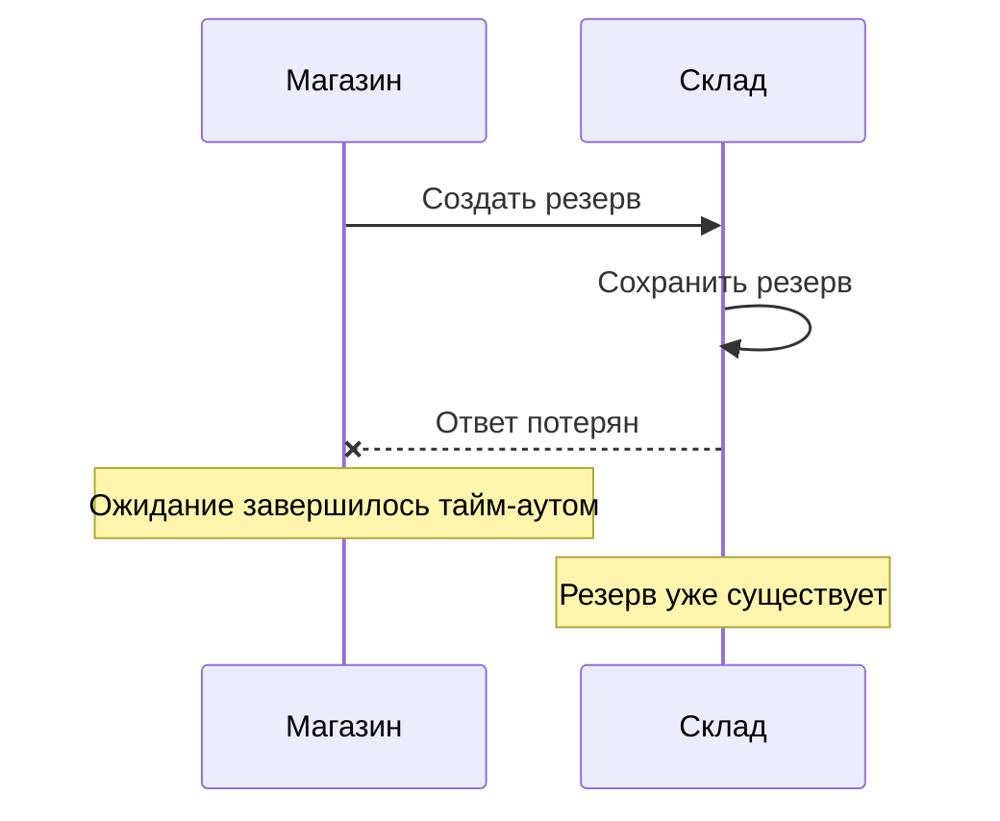
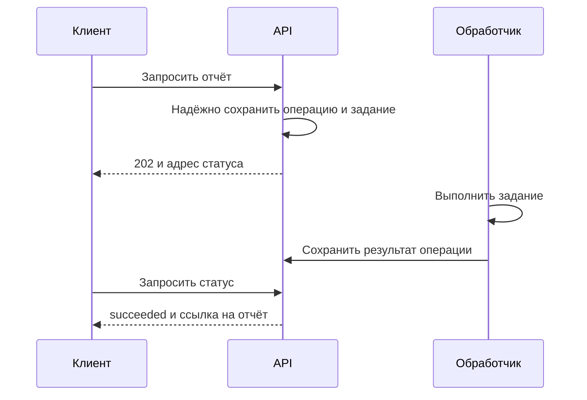
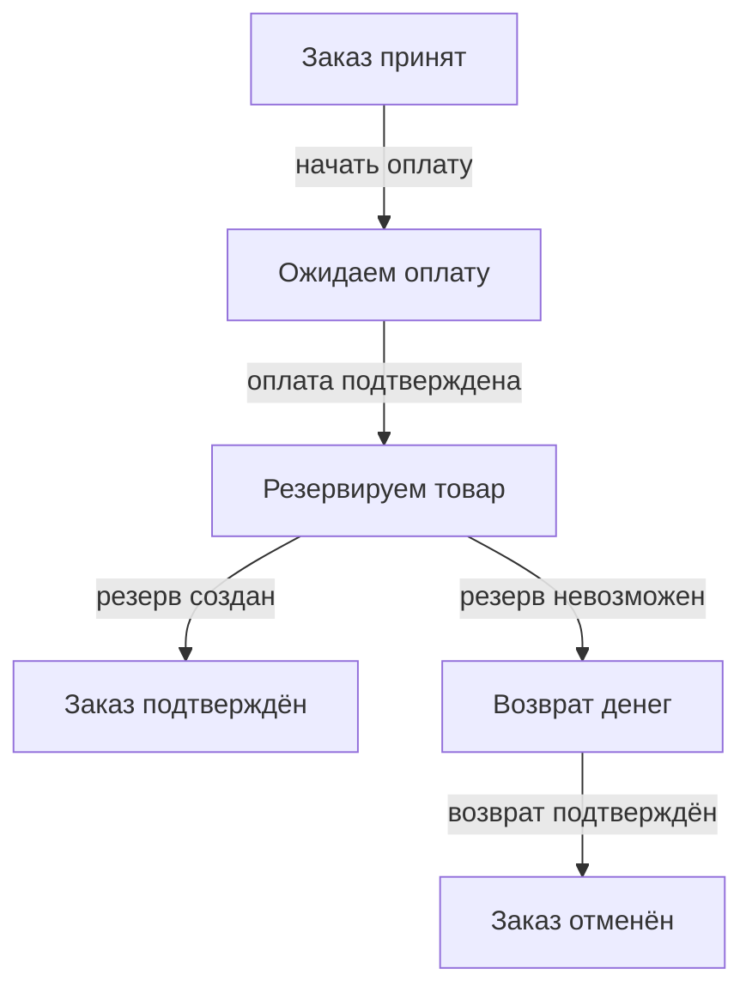
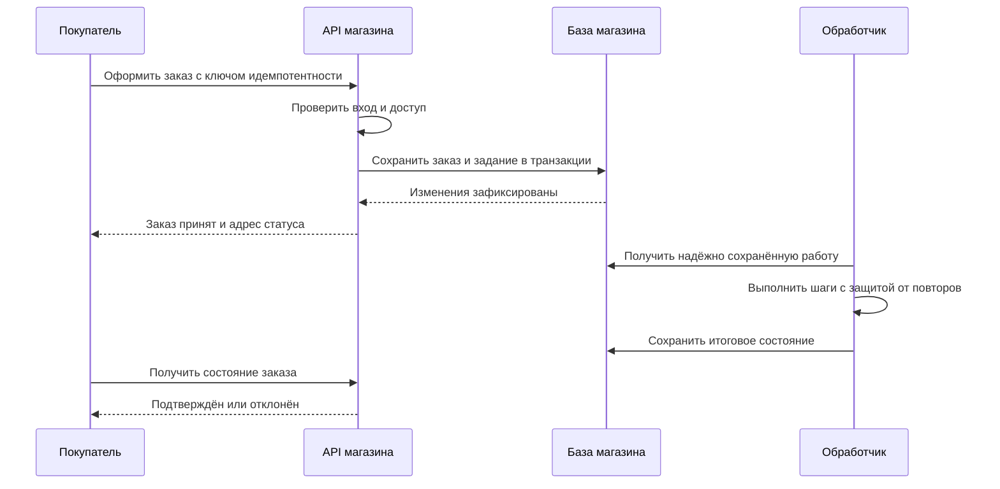

# Синхронное и асинхронное взаимодействие

Разобраться, когда выбирать каждый подход и как обеспечить надёжность:

- Синхронные вызовы и асинхронная обработка.
- Тайм-ауты, повторы и идемпотентность.
- Согласованность и компенсации.
- Контракты, наблюдаемость и выбор способа взаимодействия.

# 1. Основные понятия

## 1.1. Синхронное взаимодействие

**Синхронное взаимодействие — способ общения, при котором вызывающая сторона получает ответ в рамках того же вызова.** Пока ответ не получен или ожидание не завершилось ошибкой, операция для неё не закончена.

Например, магазин обращается в сервис склада и ждёт результат резервирования:



Такой способ удобен, когда следующий шаг требует немедленного результата: например, нужно узнать стоимость доставки перед подтверждением заказа.

**Синхронность не гарантирует успешного ответа.** Нужен **timeout — ограничение времени ожидания**. Если склад не ответил вовремя, магазин должен явно решить, что делать дальше.

Особенно важно: **тайм-аут не доказывает, что операция не выполнена**. Склад мог создать резерв, но ответ потерялся. Повторный вызов без защиты от повторов способен создать второй резерв.

Здесь синхронность описывает взаимодействие сторон, а не обязательную блокировку потока операционной системы. Способ выполнения сетевого вызова — отдельный вопрос.

## 1.2. Асинхронное взаимодействие

**Асинхронное взаимодействие — способ общения, при котором получение результата отделено от первоначального запроса.** Сначала инициируется работа, затем её результат становится доступен другим путём.

Например, магазин принимает заказ на обработку и возвращает идентификатор операции. Результат проверки оплаты появляется позже.

| Как получить результат | Как это работает |
|---|---|
| Сообщение | Получатель публикует результат в очередь или поток событий |
| Callback — обратный вызов | Получатель вызывает заранее согласованный обработчик; между системами это часто webhook |
| Polling — опрос статуса | Инициатор периодически запрашивает состояние операции |

**Асинхронность не обязательно предполагает брокер сообщений.** Можно запустить фоновую задачу и предоставить API проверки статуса.

Состояние операции стоит сделать явным:

```text
pending → processing → succeeded
                     → failed
```

Это пример: конкретные состояния зависят от процесса.

**«Запрос принят» не означает «операция выполнена».** Кроме того, договорённость должна уточнять, что именно подтверждено: получение запроса, надёжное сохранение задания или фактическое начало работы.

Асинхронность полезна для долгих операций и работы, которую можно завершить позже: формирования отчёта, доставки уведомления, обработки заказа. Она требует дополнительных решений: где хранить статус, как сопоставить результат с запросом, обнаружить зависшую обработку и обработать повтор.

При этом доставка уведомления часто не требует отдельного результата для инициатора: достаточно отслеживания ошибок и состояния самой задачи.

## 1.3. Асинхронность между системами и внутри процесса

**Асинхронность внутри процесса относится к выполнению кода, а между системами — к контракту обмена и жизненному циклу операции.** Эти свойства могут сочетаться независимо.

Например, приложение может одновременно отправить запросы в сервисы склада и доставки с помощью неблокирующего ввода-вывода. Поток не простаивает в ожидании сети, но HTTP-ответ пользователю всё равно зависит от результатов обоих вызовов. Межсервисное взаимодействие остаётся синхронным по смыслу.

Обратный пример: обработчик очереди получает сообщение об оплаченном заказе, затем последовательно выполняет обычный блокирующий код. Между системами обмен асинхронный, хотя сам обработчик работает последовательно.

| Понятие | Что описывает |
|---|---|
| Асинхронное выполнение | Возможность продолжить выполнение, пока результат ещё не готов |
| Неблокирующий ввод-вывод | Ожидание сети или диска без удержания потока в блокировке |
| Конкурентность | Продвижение нескольких задач за перекрывающиеся промежутки времени |
| Параллелизм | Одновременное выполнение задач |

**Асинхронность не равна параллелизму и не делает работу надёжной автоматически.** Задача, запущенная в памяти процесса, может исчезнуть при его завершении. Для гарантированного продолжения после перезапуска нужны отдельные механизмы хранения и восстановления.

## 1.4. Время ответа, связность и доступность

**Выбор способа зависит от того, когда нужен результат и какие зависимости допустимы в этот момент.**

| Критерий | Синхронное взаимодействие | Асинхронное взаимодействие |
|---|---|---|
| Ответ инициатору | Обычно содержит результат операции | Часто подтверждает только приём |
| Задержка | Включает ожидание зависимостей | Быстрый приём возможен, завершение происходит позже |
| Доступность сторон | Получатель обычно должен быть доступен во время вызова | Буфер позволяет обработать работу после восстановления получателя |
| Обработка сбоев | Тайм-ауты, ограниченные повторы, запасной сценарий | Повторы доставки, статусы, обработка зависших и ошибочных заданий |
| Сложность | Проще проследить короткий сценарий | Нужно отслеживать работу через несколько этапов |

**Временная связность — необходимость доступности компонентов в один и тот же момент.** Надёжная очередь может её уменьшить: магазин принимает заказ, пока обработчик временно недоступен. Но для приёма может понадобиться доступный брокер или другое надёжное хранилище.

Асинхронность также не устраняет зависимость от формата и смысла сообщений. А если обработчик надолго отстал, система может принимать запросы, но не обеспечивать приемлемое время завершения.

Практический выбор часто смешанный: стоимость доставки получить синхронно, а уведомление о заказе отправить асинхронно. **Быстрое подтверждение приёма и быстрое завершение операции — разные характеристики**, измерять нужно обе.

**Запомнить:** синхронный вызов связывает продолжение с ответом, асинхронный отделяет результат от запроса; в обоих случаях ожидание, состояние и последствия отказа должны быть явными.

# 2. Синхронные вызовы

## 2.1. Модель запрос–ответ: HTTP и RPC

**Запрос–ответ (request–response) — модель, в которой инициатор отправляет запрос и ожидает связанный с ним ответ.** При синхронном взаимодействии продолжение операции зависит от результата этого вызова.

В HTTP запрос содержит метод, адрес, заголовки и при необходимости тело. Ответ — статус, заголовки и тело. Например:

```text
POST /stock-reservations
{"order_id":42,"product_id":7,"quantity":2}

201 Created
{"reservation_id":815}
```

**RPC — Remote Procedure Call, удалённый вызов процедуры:** клиент обращается к операции удалённого сервиса как к методу, например `ReserveStock`. RPC может работать поверх HTTP, поэтому HTTP и RPC не являются взаимоисключающими вариантами.

Сходство с обычным методом не должно скрывать сетевую природу вызова: запрос или ответ могут потеряться, сервер — замедлиться, соединение — оборваться.

**Получение ответа ещё не означает бизнес-успех.** Ответ может сообщать, что товара недостаточно. А подтверждение приёма задания ещё не является результатом его выполнения.



Главное следствие: отсутствие ответа оставляет результат изменяющей операции неопределённым.

## 2.2. Тайм-ауты, повторы, идемпотентность и бюджет задержки

**Timeout — максимальная длительность ожидания; deadline — момент, после которого результат уже не нужен вызывающей стороне.** Они ограничивают расход времени и ресурсов, но сами по себе не откатывают выполненную операцию. В gRPC дедлайны и их передачу по цепочке вызовов нужно учитывать явно. [Дедлайны gRPC](https://grpc.io/docs/guides/deadlines/)

Полезно различать ограничения на установление соединения, чтение ответа и общую длительность операции. **Тайм-аут чтения не всегда ограничивает весь вызов:** точная семантика зависит от клиента.

**Бюджет задержки — общее время, выделенное на выполнение пользовательского сценария.** Например, из условных 1 000 мс:

| Работа | Бюджет |
|---|---:|
| Проверка запроса и локальные вычисления | 150 мс |
| Обращение к складу, включая повторы и паузы | 600 мс |
| Формирование ответа и запас | 250 мс |

Повтор не должен каждый раз получать новый полный бюджет. Следующему вызову передают оставшееся время.

**Идемпотентность означает, что повтор одной операции не создаёт дополнительного эффекта относительно её однократного выполнения.** Ответы при этом могут различаться. По семантике HTTP `PUT` и `DELETE` идемпотентны, а `POST` автоматически таким свойством не обладает. [RFC 9110](https://www.rfc-editor.org/rfc/rfc9110.html#section-9.2.2)

Для создания резерва можно договориться об **idempotency key — ключе одной логической операции**:

```ruby
# Условный клиент приложения
stock.reserve(
  order_id: order.id,
  quantity: 2,
  idempotency_key: "order:#{order.id}:reservation:1"
)
```

Повтор отправляется с тем же ключом. Сервер должен надёжно и атомарно предотвращать дубли, связывать ключ с параметрами и определять срок хранения результата. Одна передача ключа ничего не гарантирует.

Повторы задают явно: какие сбои повторять, сколько попыток разрешено и сколько ждать между ними. **Backoff** увеличивает задержку между попытками, **jitter** добавляет случайный разброс, уменьшая одновременные повторы клиентов. [Политика повторов gRPC](https://grpc.io/docs/guides/retry/)

Не стоит повторять ошибки входных данных и бизнес-отказы. Повторы сразу на нескольких уровнях также опасны: они перемножают нагрузку.

## 2.3. Недоступность зависимости: ошибка, деградация или кеш

**Политика отказа определяет, какой результат система может честно предоставить без зависимости.**

| Вариант | Когда полезен | Ограничение |
|---|---|---|
| Вернуть ошибку | Без зависимости нельзя подтвердить результат | Пользователь не завершит действие сейчас |
| Деградировать | Можно временно сократить функциональность | Нужно явно обозначить ограничения |
| Ответить из кеша | Допустимы ранее полученные данные | Данные могут устареть |

**Деградация — сохранение части полезного поведения при снижении возможностей.** Например, карточку товара можно показать без рекомендаций.

**Кеш — сохранённый результат предыдущего обращения.** Стоимость доставки можно показать как предварительную, если допустим её возраст. Но старый остаток не подтверждает успешное резервирование, а кешированный статус платежа не заменяет подтверждение новой оплаты.

Для кеша определяют максимальный возраст данных и условия использования при сбое. **Запасной ответ должен сохранять смысл контракта:** нельзя возвращать «резерв создан», если склад недоступен.

При длительных сбоях полезен **circuit breaker — механизм временного прекращения заведомо неуспешных вызовов**. Он помогает снизить нагрузку и быстрее перейти к выбранному запасному сценарию, но не устраняет причину отказа.

## 2.4. Когда синхронный вызов оправдан

**Синхронный вызов оправдан, когда результат нужен для текущего решения пользователя и его можно получить за приемлемое время.**

Примеры: рассчитать доставку перед подтверждением покупки, проверить промокод, получить результат быстрого резервирования.

Нужно оценивать всю цепочку: задержки последовательных обращений складываются, а медленная зависимость задерживает ответ целиком. Даже быстрый отдельный сервис не гарантирует быстрый пользовательский сценарий.

Длительную операцию разумнее оформить как отдельный процесс со статусом: принять запрос, вернуть идентификатор и предоставить результат позже. При этом интерфейс должен различать «принято», «выполняется» и «завершено».

**Запомнить:** синхронный вызов требует ограниченного ожидания, безопасных повторов и честного сценария отказа; тайм-аут не означает, что удалённая операция не выполнена.

# 3. Асинхронное взаимодействие

## 3.1. Очередь, событие, отложенная обработка и опрос статуса

**Асинхронное взаимодействие отделяет инициирование работы от получения её результата.** Оно может использовать несколько механизмов, которые решают разные задачи.

| Понятие | Что означает | Пример |
|---|---|---|
| Очередь | Буфер заданий, из которого обработчики забирают работу | Задания на создание накладных |
| Событие | Сообщение о произошедшем факте | `OrderPaid` — заказ оплачен |
| Отложенная обработка | Выполнение работы позже, вне исходного вызова | Формирование отчёта в фоне |
| Polling — опрос статуса | Периодические запросы о состоянии операции | Проверка готовности отчёта |

**Очередь описывает передачу и распределение работы, событие — смысл сообщения.** События можно доставлять через очереди, но задание «создать накладную» является командой, а не фактом.

В очереди задач одну работу обычно получает один из конкурирующих обработчиков. Если событие должны независимо обработать склад и сервис уведомлений, каждому подписчику нужен собственный механизм получения и отслеживания обработки.

«Выполнить позже» тоже имеет два смысла: выполнить в фоне при первой возможности или запланировать на определённое время. Во втором случае нужно отдельно договориться о допустимой задержке.

**Асинхронность не гарантирует порядок обработки.** Даже если задания поступили последовательно, несколько обработчиков могут завершить их в другом порядке.

## 3.2. Ответ «принято в обработку» и получение результата

**Подтверждение приёма означает, что система приняла обязательство обработать запрос по определённым правилам, а не уже выполнила работу.**

Для долгой операции HTTP API может вернуть:

```http
HTTP/1.1 202 Accepted
Location: /operations/op-42
Content-Type: application/json

{
  "operation_id": "op-42",
  "status": "pending",
  "status_url": "/operations/op-42"
}
```

`202 Accepted` означает, что запрос принят, но обработка не завершена и в итоге может оказаться неуспешной. Сам HTTP не отправит позднее второй ответ на исходный запрос: механизм получения результата нужно спроектировать отдельно. [RFC 9110](https://www.rfc-editor.org/rfc/rfc9110.html#section-15.3.3)

Удобно предоставить ресурс операции:

```json
{
  "operation_id": "op-42",
  "status": "succeeded",
  "result": {
    "report_url": "/reports/815"
  }
}
```

Минимальная модель состояний: `pending → processing → succeeded | failed`. При необходимости добавляют отмену и срок действия результата.



Диаграмма условная: статус и задание могут храниться в разных компонентах. Их согласованность нужно обеспечить, например через **Transactional Outbox — сохранение задания вместе с операцией в одной транзакции с последующей публикацией**.

Также определяют частоту опроса, срок хранения статуса, права доступа и формат ошибки. Вместо polling можно использовать webhook или сообщение о завершении.

**Повтор исходного запроса не должен случайно создавать вторую операцию:** для этого полезен согласованный ключ идемпотентности.

## 3.3. Гарантии доставки и effectively-once

**Гарантия доставки описывает возможные потери и повторы в конкретных условиях отказа.** Всегда нужно уточнять её область: до брокера, до обработчика или до бизнес-эффекта.

| Гарантия | Смысл | Последствие |
|---|---|---|
| **At-most-once** | Не более одной доставки | Сообщение может потеряться |
| **At-least-once** | Доставка повторяется до подтверждения в рамках принятых гарантий | Возможны дубли |
| **Effectively-once** | Повторные доставки дают один наблюдаемый бизнес-эффект | Нужна защита на уровне обработки |

При at-least-once обработчик может сохранить результат и завершиться до отправки **ack — подтверждения обработки**. Брокер доставит сообщение снова. Подтверждение публикации брокером и подтверждение обработки потребителем — разные этапы. [Надёжность RabbitMQ](https://www.rabbitmq.com/docs/reliability)

**Effectively-once — характеристика результата обработки, а не отдельный способ доставки.** Обычно её достигают сочетанием повторов и идемпотентности.

Например, обработчик события `OrderPaid` сохраняет `event_id` и создаёт доставку в одной транзакции. Уникальное ограничение на идентификатор защищает от конкурентных дублей. Отдельная предварительная проверка «уже обработано?» недостаточна.

Если эффект происходит во внешнем сервисе, локальная транзакция его не охватывает: нужны поддерживаемый внешней стороной ключ идемпотентности или сверка результата.

Термин **exactly-once** также требует указания границ. Например, транзакционная обработка внутри Kafka не даёт автоматически однократного списания денег во внешней системе. [Гарантии обработки Kafka](https://kafka.apache.org/41/design/design/)

## 3.4. Когда асинхронность оправдана

**Асинхронность полезна, когда работу допустимо завершить позже, а ожидание внутри исходного вызова неудобно или ненадёжно.**

Основные случаи:

- **Долгая работа:** отчёты, обработка файлов, подготовка документов.
- **Пики нагрузки:** очередь временно накапливает задания, обработчики выполняют их доступным темпом.
- **Независимый темп систем:** сервис уведомлений может восстановиться и обработать накопленную работу позже.

**Очередь сглаживает пик, но не создаёт вычислительную мощность.** Если поступление постоянно превышает скорость обработки, очередь растёт, а результат приходит всё позже. Нужны ограничения приёма, масштабирование или сокращение объёма работы.

Измерять стоит не только скорость ответа «принято», но и возраст старейшего задания, время до результата, количество повторов и окончательных отказов.

Для быстрого обязательного результата асинхронный процесс может быть избыточен. Он добавляет состояния, хранение, наблюдение и сценарии восстановления. Выбор оправдан, если эти затраты компенсируются управляемым ожиданием и независимостью компонентов.

**Запомнить:** асинхронность отделяет приём от завершения; надёжность требует явных статусов, гарантий доставки, защиты от повторов и контроля накопленной работы.

# 4. Надёжность вызова

## 4.1. Безопасные повторы и идемпотентность

**Идемпотентная операция при повторении сохраняет тот же целевой эффект, что и при однократном выполнении.** Например, «установить количество товара равным 3» может быть идемпотентным, а «увеличить количество на 3» без дополнительной защиты — нет.

**Автоматический повтор допустим, когда повторное выполнение безопасно.** Это может обеспечиваться смыслом операции, ключом идемпотентности или достоверным знанием, что предыдущая попытка не начала выполнение.

Тайм-аут такого знания не даёт: платёж мог пройти, хотя ответ не дошёл. Поэтому повтор списания без защиты способен снять деньги второй раз.

Даже безопасную операцию не нужно повторять при любой ошибке:

| Ситуация | Решение |
|---|---|
| Кратковременный сетевой сбой | Возможен ограниченный повтор |
| Перегрузка зависимости | Пауза и повтор только в пределах бюджета |
| Неверные параметры | Исправить запрос |
| Отказ по бизнес-правилу | Обработать результат без автоматического повтора |
| Неопределённый результат списания | Использовать прежний ключ или запросить статус |

**Backoff — увеличение пауз между попытками, jitter — случайный разброс этих пауз.** Они уменьшают синхронные волны повторов. Но повторы всё равно увеличивают нагрузку, поэтому нужны предел попыток и общий срок выполнения. [Рекомендации AWS](https://aws.amazon.com/builders-library/timeouts-retries-and-backoff-with-jitter/)

Повторы лучше согласовать между уровнями: три попытки в каждом из трёх вложенных компонентов способны породить до 27 обращений к последней зависимости.

## 4.2. Дедупликация по идентификатору

**Дедупликация — распознавание повторной обработки одной логической операции.** Для сообщений используют стабильный `message_id`, для запросов — **idempotency key**, ключ идемпотентности.

```ruby
# Условный клиент платёжного сервиса
payments.charge(
  order_id: order.id,
  amount_cents: 150_000,
  idempotency_key: "payment-attempt:#{attempt.id}"
)
```

Все сетевые повторы этой попытки используют один ключ. Новая самостоятельная попытка оплаты получает другой: одного `order_id` может быть недостаточно, если заказ допускает несколько операций.

На стороне обработчика нужно согласованно:

- зарегистрировать ключ и параметры;
- выполнить изменение;
- сохранить результат или состояние операции;
- определить ответ на повтор и срок хранения ключа.

**Проверка «ключа ещё нет» перед отдельным выполнением недостаточна:** два запроса могут пройти её одновременно. Нужны атомарная регистрация, уникальное ограничение и подходящая транзакция.

Для локальных изменений запись об обработанном сообщении и бизнес-эффект можно сохранить в одной транзакции. Если эффект происходит во внешнем сервисе, локальная транзакция его не охватывает.

Повтор с тем же ключом, но другими параметрами должен выявляться как конфликт. После удаления записи о ключе прежняя защита может перестать действовать. Конкретные правила зависят от API; например, Stripe документирует проверку параметров и сроки хранения ключей. [Идемпотентные запросы Stripe](https://docs.stripe.com/api/idempotent_requests)

## 4.3. Общий тайм-аут и вложенные ожидания

**Бюджет задержки — время на весь сценарий, включая вложенные вызовы, повторы, паузы и локальную работу.** Настраивать каждый тайм-аут независимо опасно.

Допустим, вызывающая сторона готова ждать 1 000 мс:

```text
Локальная работа                  100 мс
Склад: попытки и паузы             450 мс
Доставка: попытки и паузы           250 мс
Формирование ответа и запас        200 мс
```

Это условное распределение, которое нужно проверять измерениями.

**Для последовательных вызовов складываются длительности, для параллельных — учитывается критический путь**, то есть самая долгая зависимая цепочка. При этом параллельные запросы продолжают расходовать ресурсы.

Следующий вызов должен получать оставшийся бюджет:

```ruby
# Условный код: timeout ограничивает всю попытку
remaining = deadline - monotonic_now
raise DeadlineExceeded if remaining <= 0

stock.reserve(timeout: [remaining, 0.45].min)
```

`monotonic_now` здесь обозначает монотонные часы: они подходят для измерения интервалов и не зависят от коррекции календарного времени.

Дедлайн передают дальше поддерживаемым протоколом, учитывая уже потраченное время. Механизмы автоматической передачи зависят от языка и клиента. [Дедлайны gRPC](https://grpc.io/docs/guides/deadlines/)

**Истечение ожидания не откатывает удалённую операцию.** Отмена может остановить ненужную работу, но завершённый бизнес-эффект требует отдельной обработки.

## 4.4. Ограничение параллелизма, circuit breaker и backpressure

**Эти механизмы защищают разные стороны системы.**

| Механизм | Что ограничивает | Пример |
|---|---|---|
| Ограничение параллелизма | Число одновременно выполняемых операций | Не более 20 обращений к складу |
| Circuit breaker | Вызовы зависимости, которая устойчиво отказывает | Временно прекращать запросы после серии сбоев |
| Backpressure | Поступление работы сверх возможностей обработки | Замедлять получение заданий или отклонять новые |

**Ограничение параллелизма** защищает соединения, потоки и саму зависимость. Ожидание свободного места тоже должно иметь предел. Лимит одного процесса нужно соотносить с количеством экземпляров приложения.

**Circuit breaker — автоматический выключатель вызовов.** В состоянии `closed` запросы проходят, в `open` быстро отклоняются, в `half-open` ограниченное число проб проверяет восстановление. Бизнес-отказы вроде «недостаточно товара» обычно не должны считаться признаком поломки склада. [Описание паттерна](https://learn.microsoft.com/en-us/azure/architecture/patterns/circuit-breaker)

**Backpressure — обратное давление:** перегруженный получатель заставляет источник снизить темп. Практически это ограниченная очередь, уменьшение числа получаемых сообщений или явный отказ в приёме.

Бесконечная очередь лишь откладывает перегрузку и увеличивает задержку. Circuit breaker также не заменяет ограничение параллелизма: исправный, но медленный сервис тоже может исчерпать ресурсы вызывающего.

**Запомнить:** безопасные повторы требуют стабильного ключа и общего дедлайна, а устойчивость под нагрузкой — ограниченного параллелизма, управляемого приёма работы и явной реакции на отказ зависимости.

# 5. Согласованность

## 5.1. Локальная транзакция и согласованность между системами

**Локальная транзакция объединяет изменения внутри одного транзакционного ресурса**, обычно одной базы данных: они фиксируются вместе либо откатываются.

Например, заказ и запись о будущем событии можно сохранить атомарно:

```ruby
Order.transaction do
  order.update!(status: "payment_pending")
  OutboxEvent.create!(
    event_type: "PaymentRequested",
    payload: { order_id: order.id }
  )
end
```

Предполагается, что обе модели используют одну базу и одну транзакцию. Отдельный обработчик позднее публикует событие.

**Транзакция базы не распространяется автоматически на HTTP-вызов, брокер или чужую базу.** Если внутри `Order.transaction` вызвать платёжный сервис, последующий откат заказа не отменит списание.

**Согласованность между системами означает выполнение согласованных правил для их совокупного состояния.** Например: у отменённого заказа не должно оставаться активного резерва, а возврат денег должен соответствовать реально полученной оплате.

Transactional Outbox решает конкретную проблему: изменение данных и намерение отправить событие сохраняются вместе. Он не делает весь процесс атомарным и не исключает повторную публикацию. [Паттерн Transactional Outbox](https://docs.aws.amazon.com/prescriptive-guidance/latest/cloud-design-patterns/transactional-outbox.html)

## 5.2. Почему распределённая транзакция подходит не всегда

**Распределённая транзакция координирует фиксацию изменений нескольких участников.** Один из механизмов — **Two-Phase Commit, 2PC, двухфазная фиксация**:

1. Координатор просит участников подготовиться к фиксации.
2. После успешной подготовки принимает общее решение: зафиксировать изменения или отменить их.

Это даёт атомарность в поддерживаемых условиях, но требует совместимого протокола и участия всех ресурсов. Обычный HTTP API оплаты обычно не предоставляет такой возможности.

| Ограничение | Последствие |
|---|---|
| Координация по сети | Дополнительные задержки и зависимость от доступности участников |
| Подготовленные транзакции удерживают ресурсы | Возможны блокировки и снижение пропускной способности |
| Сбой после подготовки | Участник может ждать восстановления решения |
| Долгий бизнес-процесс | Непрактично держать транзакцию до завершения всех шагов |

Поэтому для независимо работающих сервисов часто используют **Saga — последовательность локальных транзакций с явно предусмотренным восстановлением после ошибок**. [Паттерн Saga](https://learn.microsoft.com/en-us/azure/architecture/patterns/saga)

**Распределённая транзакция не является безусловно плохим решением.** Она может подходить для коротких операций в контролируемой инфраструктуре с поддерживаемыми участниками. Но внедрять её ради интеграции произвольных сервисов обычно сложно.

Если строгий инвариант требуется постоянно, полезно сначала проверить границы компонентов: возможно, связанные данные и операцию стоит оставить в одной системе.

## 5.3. Итоговое согласование и состояние для клиента

**Eventual consistency — итоговая согласованность: связанные представления данных могут временно различаться, но должны согласоваться после распространения изменений**, при выполнении необходимых условий доставки и восстановления.

Например, платёж уже подтверждён, но сервис заказов ещё не обработал событие. Интерфейс пока показывает «Проверяем оплату».

Это не обещание «всё само исправится». Нужны надёжная передача, повторы, обработка дублей, обнаружение зависших операций и при необходимости **reconciliation — сверка состояний систем**.

Отдельно нужно описать промежуточные состояния самого процесса:



Схема условная: порядок оплаты и резервирования выбирают по бизнес-требованиям.

**Промежуточный статус должен честно отражать незавершённость операции.** «Запрос принят», «заказ подтверждён» и «деньги возвращены» — разные факты.

Для каждого состояния определяют допустимые действия клиента, срок ожидания и реакцию на превышение срока. Например, кнопку повторной оплаты нельзя предлагать только потому, что подтверждение задержалось: сначала нужно выяснить результат прежней попытки.

## 5.4. Компенсация при неудаче следующего шага

**Компенсация — новая бизнес-операция, которая устраняет или уравновешивает последствия уже выполненного шага.** Это отличается от отката незавершённой транзакции.

| Выполненный шаг | Возможная компенсация |
|---|---|
| Зарезервировать товар | Освободить конкретный резерв |
| Авторизовать платёж | Отменить авторизацию, если провайдер позволяет |
| Списать деньги | Оформить возврат |
| Создать отправление | Отменить его, пока это допустимо |

Компенсация не обязана возвращать мир в точное исходное состояние: возврат может занять время, комиссия — сохраниться, отправленное письмо — остаться у клиента. Она должна учитывать конкурентные изменения, а не восстанавливать старый снимок данных целиком. [Компенсирующая транзакция](https://learn.microsoft.com/en-us/azure/architecture/patterns/compensating-transaction)

**Неопределённый результат шага сначала нужно разрешить.** Тайм-аут создания доставки не означает, что доставка не создана. Перед компенсацией следует запросить статус или безопасно повторить операцию с тем же ключом.

Для компенсаций сохраняют идентификаторы исходных операций и прогресс выполнения. Их делают идемпотентными, предусматривают повторы и ручное вмешательство при окончательном сбое. Порядок компенсаций определяется зависимостями и не всегда строго обратен исходному.

После необратимого шага, например фактической передачи посылки перевозчику, может потребоваться отдельный процесс возврата, а не попытка «откатить заказ».

**Запомнить:** локальная транзакция защищает изменения одного ресурса; между системами нужны явные состояния, надёжное продвижение процесса и компенсации, которые сами могут завершиться ошибкой.

# 6. Контракты взаимодействия

## 6.1. Контракт синхронного вызова

**Контракт взаимодействия — соглашение о данных, смысле операции и поведении сторон при успехе, ожидании и отказе.** Одной JSON Schema недостаточно: она описывает данные, но не весь порядок взаимодействия.

Для синхронного вызова фиксируют:

| Часть контракта | Что определить |
|---|---|
| Операция | Адрес и HTTP-метод либо RPC-метод, смысл действия |
| Запрос | Поля, типы, обязательность, единицы измерения |
| Ответ | Структура и точное значение успешного результата |
| Ошибки | Статусы, машинные коды, возможность повтора |
| Ожидание | Тайм-ауты и общий бюджет вызова |
| Повтор | Поддержка ключа идемпотентности и срок его действия |

Например, для резервирования товара:

```text
POST /stock-reservations

Запрос: order_id, product_id, quantity
Успех: 201, reservation_id, expires_at
Бизнес-отказ: 409, code = insufficient_stock
Бюджет клиента: 800 мс, включая повторы
Повтор: тот же ключ для одной попытки резервирования
```

Это условное соглашение, а не обязательные значения для любого API.

**Тайм-аут клиента и целевое время ответа сервера — разные вещи.** Клиент ограничивает своё ожидание; серверу нужно знать переданный дедлайн, если он должен прекращать ненужную работу.

Для HTTP API запросы, ответы и ошибки можно описать через **OpenAPI — машиночитаемую спецификацию интерфейса**. Эксплуатационные договорённости, включая бюджет ожидания, при необходимости дополняют текстовым описанием. [Спецификация OpenAPI](https://spec.openapis.org/oas/v3.1.1.html)

## 6.2. Контракт асинхронного взаимодействия

**Асинхронный контракт описывает сообщение и правила его доставки и обработки.** Получателю должно быть понятно не только содержимое, но и допустимые повторы, порядок и задержка.

| Часть контракта | Пример договорённости |
|---|---|
| Схема сообщения | Конверт, payload, тип события, версия |
| Идентификатор | `message_id` сохраняется при повторной доставке |
| Ключ маршрутизации | `order_id` используется для распределения сообщений |
| Порядок | Требуется в пределах одного заказа |
| Доставка | Возможны повторы, обработчик идемпотентен |
| Срок жизни | После `expires_at` команду выполнять нельзя |
| Ошибки | Ограниченные повторы, затем карантин |

**«Ключ» нужно уточнять:** ключ маршрутизации, идентификатор сообщения и ключ идемпотентности выполняют разные задачи. Совпадение `order_id` не делает два разных события дублями.

Порядок тоже требует точной формулировки: порядок публикации, доставки и завершения обработки может различаться. Один ключ сам по себе не обеспечивает последовательность — нужны соответствующие настройки транспорта и обработчиков.

**Срок хранения сообщения отличается от срока его бизнес-актуальности.** Брокер может хранить команду дольше, чем разрешено её выполнять. Поэтому получатель должен учитывать срок действия, если просроченная обработка опасна.

Для документирования message-driven API подходит **AsyncAPI**: он описывает каналы, операции, сообщения, заголовки и payload. Транспортные особенности задаются через соответствующие привязки (*bindings*) и дополнительные договорённости. [Спецификация AsyncAPI](https://www.asyncapi.com/docs/reference/specification/v3.0.0)

## 6.3. Correlation ID через вызовы и сообщения

**Correlation ID — идентификатор, связывающий действия одного сценария**, например оформление заказа, запрос оплаты и последующие события.

На входе его принимают по согласованным правилам или создают. Затем передают во вложенные вызовы, сообщения и диагностические записи:

```json
{
  "message_id": "msg-815",
  "correlation_id": "checkout-42",
  "causation_id": "msg-814",
  "type": "order.paid",
  "data": { "order_id": 42 }
}
```

Здесь:

- `message_id` обозначает конкретное сообщение;
- `correlation_id` объединяет сценарий;
- `causation_id` указывает сообщение, ставшее непосредственной причиной нового.

Последнее поле полезно для восстановления причинной цепочки, но требуется не в каждом простом процессе.

**Correlation ID не заменяет ключ идемпотентности:** в одном сценарии могут выполняться несколько самостоятельных платежей или отправляться разные сообщения.

Для распределённой трассировки существует стандарт **W3C Trace Context** с HTTP-заголовками `traceparent` и `tracestate`. Он передаёт контекст технической трассы. Бизнес-корреляция может жить дольше одной трассы, поэтому идентификаторы не обязаны совпадать. При переходе между сервисами контекст обновляется по правилам трассировки, а не копируется целиком без изменений. [W3C Trace Context](https://www.w3.org/TR/trace-context/)

Внешний идентификатор следует проверять по длине и формату. Он не подтверждает личность пользователя и не даёт прав доступа.

## 6.4. Обратная совместимость контрактов

**Обратная совместимость позволяет обновлять участников без одновременного изменения всех клиентов и потребителей.** Всегда нужно назвать направление проверки.

| Изменение | Возможная проблема |
|---|---|
| Обязательное поле запроса | Старый клиент его не отправляет |
| Удаление поля ответа | Старый клиент продолжает его читать |
| Новое значение `enum` в ответе или событии | Старый получатель не знает, как его обработать |
| Новое необязательное поле сообщения | Строгая старая схема запрещает неизвестные поля |
| Изменение единиц суммы | Тип прежний, но смысл данных нарушен |

**Совместимость включает поведение.** Уменьшение срока действия сообщения, ослабление порядка доставки или изменение правил повторов может сломать интеграцию без изменения JSON.

Практический порядок миграции: сначала подготовить получателей к новому формату, затем изменить отправителей. Старое поведение удаляют после подтверждения, что оно больше не требуется.

Контракты и примеры хранят версионированно, проверяют в CI с поддерживаемыми клиентами. Для событий учитывают сообщения в очередях и архиве: прекращение публикации старого формата не означает, что он больше не поступит.

**Запомнить:** контракт определяет данные и поведение; корреляция связывает сценарий, а совместимость проверяют по направлениям обмена, включая ошибки, сроки, повторы и порядок.

# 7. Наблюдаемость

## 7.1. Связь логов, метрик и трасс

**Наблюдаемость — возможность понять состояние системы и причины её поведения по доступным данным.** Для взаимодействия компонентов важно видеть весь сценарий: от исходного запроса до результата обработки.

| Источник | Что показывает | Пример |
|---|---|---|
| Логи | Отдельные события с контекстом | Не удалось зарезервировать товар для заказа |
| Метрики | Числовые показатели во времени | Доля неуспешных резервирований |
| Трассы | Связанные этапы выполнения | API заказа → склад → база |

**Trace — трасса одного выполнения, span — отдельная операция внутри трассы.** В логах полезно сохранять `trace_id` и `span_id`, чтобы переходить от записи к соответствующему участку выполнения. OpenTelemetry поддерживает эти виды телеметрии и их связь через контекст. [Сигналы OpenTelemetry](https://opentelemetry.io/docs/concepts/signals/)

Для долгого бизнес-процесса дополнительно используют `correlation_id`, для конкретного сообщения — `message_id`. На обеих сторонах записывают имя операции, результат, длительность и номер попытки.

В асинхронной обработке контекст передают в метаданных сообщения. Связь с обработчиком может выражаться родительством spans или **span links — ссылками между участками трасс**, особенно при пакетах и нескольких причинах обработки. Необязательно держать одну трассу открытой весь многодневный процесс. [Трассировка сообщений OpenTelemetry](https://opentelemetry.io/docs/specs/semconv/messaging/messaging-spans/)

**Идентификаторы заказов и сообщений не стоит добавлять как обычные метки метрик:** это создаёт высокую кардинальность — слишком много уникальных комбинаций. Их удобнее хранить в логах и трассах. Метрики агрегируют по ограниченному набору признаков: операция, сервис, класс результата.

## 7.2. Время ответа, очередь, возраст и ошибки

**Метрика полезна, только если понятно, что именно измеряется и на каком участке.**

| Показатель | Что измерять |
|---|---|
| Время ответа | Полный вызов со стороны клиента и обработку на сервере |
| Глубина очереди | Ожидающие и уже выданные, но не подтверждённые сообщения |
| Возраст | Время ожидания в очереди и время от принятия операции до результата |
| Доля ошибок | Неуспешные операции относительно всех подходящих операций |
| Скорость обработки | Поступление, завершение и повторы за единицу времени |

Клиентская задержка может включать соединение, сеть и повторы; серверная — только один этап. Поэтому эти значения не обязаны совпадать.

**Среднее скрывает медленные случаи.** Полезно смотреть p95/p99 — значения, в которые укладываются 95/99% измерений, — и долю операций, превысивших установленный срок.

Большая очередь не обязательно означает инцидент: быстрые обработчики могут скоро её разобрать. Маленькая очередь тоже не гарантирует здоровье: одно старое сообщение способно зависнуть надолго. Поэтому глубину рассматривают вместе с возрастом и темпом обработки.

Для возраста фиксируют начальную точку: создание события, постановку в очередь или первый приём системой. Повторная постановка не должна скрывать общий возраст операции. Измерения между машинами зависят от согласованности часов.

**Ошибки попыток и окончательные ошибки операций считают отдельно.** Один заказ может пережить три сбоя, а затем успешно завершиться. Ожидаемый отказ «товара нет» также стоит отличать от недоступности склада.

## 7.3. Обнаружение потери и зависания сообщения

**Потерю нельзя надёжно обнаружить только по отсутствию записи в логе.** Сам лог мог не сохраниться, а трасса — не попасть в выборку.

Нужен наблюдаемый жизненный цикл операции:

```text
Принята → ожидает обработки → выполняется → завершена
                                      → окончательно отклонена
```

Для важных операций сохраняют идентификатор, время создания, последнее продвижение, число попыток и конечный результат.

Практические проверки:

- операция принята, но задание долго не опубликовано — проверить outbox;
- сообщение опубликовано, но результат не появился в срок — запустить сверку;
- обработка началась, но давно не обновлялась — проверить зависший обработчик;
- сообщение оказалось в очереди ошибок — выяснить причину и владельца восстановления.

**Heartbeat — периодический признак активности**, а **lease — ограниченное по времени право обработки**. Они помогают обнаружить остановившийся обработчик, но активный heartbeat ещё не доказывает полезный прогресс.

Пустая очередь не означает, что все заказы завершены. Подтверждение брокера также не доказывает бизнес-успех. Для критичных процессов нужна **reconciliation — сверка** принятых операций с итоговыми состояниями, например платежей с заказами.

Просрочка означает «результат неизвестен или задержан», а не автоматически «сообщение потеряно». Перед повтором операции с побочным эффектом нужно выяснить её состояние.

## 7.4. Сигналы по пользовательскому симптому

**Alert — сигнал, требующий реакции; его полезно связывать с нарушением пользовательского результата.** Технические показатели помогают объяснить причину.

| Технический факт | Пользовательский симптом |
|---|---|
| Выросли тайм-ауты склада | Покупатели не могут подтвердить заказы |
| Растёт очередь уведомлений | Подтверждения оплаты приходят слишком поздно |
| Воркеры работают без исключений | Часть принятых заказов всё равно не завершается |

Можно задать **SLI — измеряемый показатель качества**: долю принятых заказов, подтверждённых либо явно отклонённых за две минуты. **SLO — целевое значение этого показателя**, например 99,5%. Числа условные и выбираются по потребностям продукта.

В расчёт должны попадать и зависшие операции, срок которых уже истёк. Если учитывать только завершённые, самые проблемные случаи исчезнут из статистики.

Google SRE рекомендует различать симптомы и причины, а сигналы для срочного вмешательства делать понятными и практически полезными. [Мониторинг распределённых систем](https://sre.google/sre-book/monitoring-distributed-systems/)

Для критичных сценариев полезна синтетическая проверка — контролируемое прохождение пользовательского пути. У сигнала должны быть владелец и понятный порядок действий.

**Запомнить:** связывай технические этапы с конечным результатом пользователя; успешная публикация, пустая очередь и отсутствие исключений ещё не означают успешную операцию.

# 8. Выбор способа

## 8.1. Вопросы для выбора

**Способ взаимодействия выбирают по требованиям к результату, ожиданию и отказам.** Предпочтение HTTP или очередей само по себе не определяет подходящую архитектуру.

| Вопрос | Что учитывать |
|---|---|
| Нужен ли результат прямо сейчас? | Если без него нельзя продолжить действие, синхронный вызов часто проще |
| Какая задержка допустима? | Для фоновой работы задают срок завершения, а не только скорость приёма |
| Что произойдёт при недоступности зависимости? | Ошибка пользователю, ограниченный режим или накопление работы |
| Нужен ли порядок? | Уточняют область: один заказ, один покупатель или весь поток |
| Какой ожидается объём? | Средняя нагрузка, пики, размер данных и скорость обработки |

**Немедленный ответ и немедленный результат — разные требования.** Пользователю может быть достаточно быстро узнать, что заказ принят, а подтверждение комплектации получить позже.

Порядок тоже не выбирает способ автоматически. Два одновременных HTTP-запроса могут выполниться в неожиданной последовательности, а несколько обработчиков очереди — завершить сообщения не по порядку. Если для заказа важно сначала подтвердить оплату, а затем начать отгрузку, нужны явные состояния и проверка допустимости переходов.

Высокий объём не означает обязательную асинхронность. Короткие запросы могут эффективно обслуживаться синхронно. Очередь полезна для сглаживания пиков, но при постоянном превышении входного потока над производительностью она лишь накапливает задержку.

**Асинхронность уменьшает необходимость одновременной доступности сторон, если работа надёжно сохраняется.** Цена — хранение заданий, повторы, статусы и восстановление.

## 8.2. Антипаттерны взаимодействия

**Антипаттерн — решение, которое выглядит удобным, но в определённых условиях систематически создаёт проблемы.**

Первый пример — длинная синхронная цепочка:

```text
Оформление заказа → оплата → склад → доставка → уведомление
```

Если каждый компонент ждёт следующий, задержки складываются, а отказ последнего может задержать весь ответ. Повторы на нескольких уровнях дополнительно увеличивают нагрузку. При этом часть действий, например уведомление, обычно не нужна для немедленного ответа.

**Само число вызовов ещё не делает цепочку ошибкой.** Короткая цепочка с измеренным бюджетом, безопасными повторами и понятными отказами может быть оправданна. Проблема возникает, когда необязательные шаги становятся обязательными зависимостями пользовательского действия.

Второй пример — «запустили в фоне и забыли», хотя пользователь ждёт результата. Интерфейс показывает бесконечный индикатор, не различает ошибку и задержку, а повторное нажатие создаёт новую операцию.

Для такого сценария нужны:

- идентификатор операции;
- состояния ожидания, выполнения и завершения;
- способ получить результат;
- срок ожидания и действие при его превышении.

**Статус нужен там, где есть ожидание результата.** Для необязательной фоновой аналитики отдельный пользовательский экран может быть избыточен, хотя техническое наблюдение за обработкой всё равно полезно.

## 8.3. Смешанный сценарий

**Смешанный сценарий синхронно подтверждает приём команды, а её выполнение продолжает асинхронно.** Это позволяет быстро ответить пользователю, сохранив явный процесс обработки.

Пример оформления заказа:



Диаграмма условная: задание может передаваться через брокер после публикации из outbox.

В синхронной части проверяют то, что необходимо для корректного приёма: форму данных, права, допустимость создания операции. Но предварительная проверка остатка не гарантирует наличие товара к моменту резервирования.

**Подтверждение приёма должно опираться на надёжное сохранение работы.** Запуск потока в памяти процесса перед ответом не обеспечивает восстановление после перезапуска.

Асинхронные шаги могут содержать синхронные обращения к оплате и складу. Асинхронным остаётся весь сценарий относительно исходного запроса покупателя.

Контракт должен объяснять возможный последующий отказ, изменение цены, компенсацию и повторное получение статуса. Если магазин обещает окончательную цену при приёме, это обещание нужно обеспечить отдельно.

## 8.4. Фиксация решения и последствий

**ADR — Architecture Decision Record, короткая запись архитектурного решения:** контекст, выбор, альтернатива и последствия. Она помогает понять, почему решение подходит текущим требованиям и когда его стоит пересмотреть.

Пример содержания ADR:

| Часть | Решение для оформления заказа |
|---|---|
| Контекст | Обработка зависит от внешних систем и может занимать десятки секунд |
| Выбор | Быстро сохранять заказ, выполнять шаги в фоне, предоставлять статус |
| Альтернатива | Ждать завершения всех шагов в исходном HTTP-запросе |
| Причина выбора | Длительное ожидание и сбои зависимостей не должны удерживать исходный запрос |
| Последствия | Нужны outbox, идемпотентность, компенсации и интерфейс промежуточных состояний |
| Критерии пересмотра | Изменение требований к срокам, порядку или окончательности ответа |

Полезно указывать измеримые ориентиры: бюджет приёма, допустимое время завершения и максимальный возраст задания. Значения выбирают по требованиям продукта и проверяют под нагрузкой.

**Решение относится к конкретному взаимодействию, а не обязательно ко всей системе.** Получение карточки товара, резервирование и отправка уведомления могут использовать разные способы.

**Запомнить:** выбирай способ по требуемому результату и допустимому ожиданию; фиксируй не только преимущества, но и обязательства по статусам, отказам, нагрузке и восстановлению.

